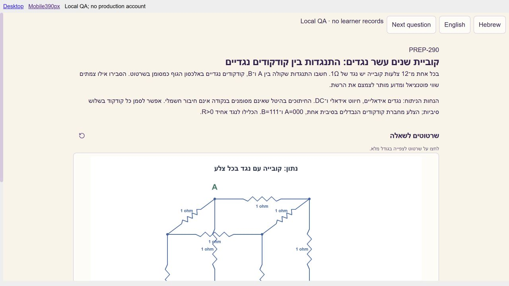

# קליטת שאלות — 7.11.2026, מקבץ לילה של 30 צילומים

## תוצאה וגבולות

נשמרו כל **30 צילומי המקור**. נוספו **14 שאלות** (289–302), הורחבו **חמש שאלות קיימות** ונוספו מקורות ל־**עשר זהויות קיימות**. צילומים 1 ו־ 28 עוסקים בתמורות ומקושרים לאותה זהות 162: בסך הכול **29 זהויות מושפעות**. שמרנו מזהים, גרסאות קודמות, רמזים, ביקורות והיסטוריית לומדים. כל התוכן החדש כולל עברית ואנגלית, שלושה רמזים ופתרון מוצע; ההשלמות מסומנות כהנחות שנבחרו לתרגיל.

הקטלוג כולל כעת **301 רשומות PREP, ‏331 רשומות קטלוג ו־ 326 משפחות**. **500 שאלות היסודות ו־ 2,500 הגרסאות האמריקאיות הפעילות נשמרו ללא שינוי**: הבקשה הנוכחית היא לקלוט שאלות ראיון. מרשם 93 האישורים האנושיים ההיסטוריים נשמר; בדיקות AI, קומפילציה ופרסום אינן אישור מומחה. פתרונות חדשים/מורחבים ממתינים לביקורת ואינם מקנים ראיות שליטה או קושי מכויל.

נוצרו **44 שרטוטי PNG נקיים בשתי השפות**. שלושת המעגלים הנתונים 290/294/297 מקבלים גם שרטוטי שאלה ללא תוצאה; שרטוטי פתרון נשארים מאחורי החשיפה. בשאלות החוזרות משתמשים בשרטוטים העצמאיים הקיימים; צילום המקור נשמר בפרטיות ואינו מוצג ללומד. המניפסט מכיל 1,762 אובייקטים, מהם **94 חדשים שאומתו בהורדה ו־SHA256**. אין פרסום של צילומי המקור כמדיה ציבורית.

העדכון במסד הושלם בטרנזקציה ממוקדת אחרי גיבוי והרצת rollback. אימות גרסת השירותים החיה מתועד בפסקת הפרסום בהמשך; הבדיקות המקומיות אינן בדיקה בחשבון ייצור.

## מיפוי כל המקורות

| צילום | זהות יציבה | נושא | פעולה |
| --- | --- | --- | --- |
| 1 | PREP-162 | הדפסת כל התמורות השונות של מחרוזת | מקור נוסף — ללא שינוי תוכן |
| 2 | PREP-289 | הרצף הארוך ביותר של אחדות במערך: התחלה וסיום | חדשה |
| 3 | PREP-290 | קוביית שנים עשר נגדים: התנגדות בין קודקודים נגדיים | חדשה |
| 4 | PREP-122 | מחבר לשני מספרים בני ארבעה ביטים באמצעות HA בלבד | וריאציה — זהות קיימת |
| 5 | PREP-291 | נתב בעל 16 כניסות: תעבורה אקראית עם תקציב מדויק | חדשה |
| 6 | PREP-036 | מכונת מצבים לבדיקת התחלקות ב־ 3 של מספר בינארי טורי | וריאציה — זהות קיימת |
| 7 | PREP-292 | מונה מחזורי 0, 1, 2, 1 — ארבעה מצבים לשלושה ערכים | חדשה |
| 8 | PREP-092 | מימוש XOR באמצעות שערי NAND | מקור נוסף — ללא שינוי תוכן |
| 9 | PREP-293 | כפל מספר בן עשר סיביות ב־ 49 באמצעות הזזות וחיבור | חדשה |
| 10 | PREP-010 | מחלק תדר ב־ 3 עם Duty Cycle של 50% | מקור נוסף — ללא שינוי תוכן |
| 11 | PREP-107 | בידוד הביט הדלוק הנמוך ביותר באמצעות שערים | מקור נוסף — ללא שינוי תוכן |
| 12 | PREP-294 | גשר ויטסטון: מתי לא זורם זרם בנגד האמצעי? | חדשה |
| 13 | PREP-007 | מכונת מצבים לזיהוי כיוון סיבוב בעזרת שני גלאים | מקור נוסף — ללא שינוי תוכן |
| 14 | PREP-295 | פענוח מחרוזת למספר שלם ב־ C++: חוזה בסגנון atoi | חדשה |
| 15 | PREP-296 | מלבנים חוסמים לצורות שחורות בתמונה בינארית | חדשה |
| 16 | PREP-001 | ספירת אחדות בכניסה בת 8 סיביות באמצעות מחברים | וריאציה — זהות קיימת |
| 17 | PREP-194 | היפוך שרשרת באמצעות Head, Tail ושרשור | וריאציה — זהות קיימת |
| 18 | PREP-168 | תשעה מטבעות ומטבע קל אחד — שתי שקילות | מקור נוסף — ללא שינוי תוכן |
| 19 | PREP-225 | המילה השכיחה ברשימה ושבירת שוויון לפי הופעה ראשונה | וריאציה — זהות קיימת |
| 20 | PREP-044 | מימוש סדרת פיבונצ׳י באמצעות חומרה | מקור נוסף — ללא שינוי תוכן |
| 21 | PREP-297 | מגבר שאינו הופך עם שלושה נגדים שווים: מציאת ההגבר | חדשה |
| 22 | PREP-298 | תשלום יומי במטיל זהב לשבעה ימים — מינימום חיתוכים | חדשה |
| 23 | PREP-299 | סינוס 100kHz בדגימה של 1MHz: זיכרון מלא, חצי ורבע | חדשה |
| 24 | PREP-058 | ממוצע שני מספרים בהפרש שתיים באמצעות שערים בלבד | מקור נוסף — ללא שינוי תוכן |
| 25 | PREP-002 | שלוש קערות גולות עם תוויות שגויות | מקור נוסף — ללא שינוי תוכן |
| 26 | PREP-300 | ספירת מסלולים ברשת ריבועית באמצעות תכנון דינמי | חדשה |
| 27 | PREP-301 | נורת חדר: הראשון מדליק והאחרון מכבה בארבעה מצבים | חדשה |
| 28 | PREP-162 | הדפסת כל התמורות השונות של מחרוזת | מקור נוסף — ללא שינוי תוכן |
| 29 | PREP-302 | מימוש שער NAND בשני קלטים ברמת CMOS | חדשה |
| 30 | PREP-151 | ספירת אחדות בבית: סריקה, קבוצות וטבלת חיפוש | מקור נוסף — ללא שינוי תוכן |

[מניפסט המקורות ופרטי הייחוס](../interview_preparation/intakes/2026-11-07-night30-sources.json). חברות ותגיות מקור הן דיווחים מהצילומים, ללא טענה לאימות החברה או לשיתוף פעולה עמה.

## בחירות טכניות מפורשות

- **289:** אינדקסים כוללים ומתחילים באפס; בשוויון בוחרים את הרצף המוקדם; ריק/ללא אחדות מחזיר זוג סנטינל.
- **290/294/297:** נגדים ומגבר אידאליים בניתוחDC; הוגדרו הדקים, מסילות, חיבורים והבדל בין הצטלבות לצומת. ב־ 294 מקור המתח הראשי אינו אפס וכל הנגדים חיוביים וסופיים. ב־ 297 מונחת עבודה ליניארית במשוב שלילי; אין הנחה שכל נגד כניסה מאזן זרמי הטיה בכל מגבר אמיתי.
- **291:** תקציב הבתים כולל לכל הבדיקה; כל פורט שנבחר פעיל מקבל לפחות חבילה. גודל חבילה הוא 2..65536 בתים. הוגדרו בדיקת היתכנות, תקרה ניתנת להגדרה עד 1,000,000 בתים, seed ושארית שאינה יוצרת חבילה בת בית אחד. האקראיות אינה מוצגת כאחידות על כל הפירוקים; הבדיקה משתמשת ב־spy ולא בנתב פיזי.
- **292/036:** נשמר הבדל בין פאזות עם אותו פלט; ב־ 036 הוגדרו הגעת ביט חדש משמאל, קידומת לא ריקה והשהיית הפלט ביחס לדגימה. המקור והווריאציות הקודמים נשמרו.
- **293/001/122:** רוחבי ביניים ופלט מפורשים; חיווט/אפס מותר נספרים בהתאם לספרייה שנבחרה. טענת מניין 7FA ב־ 001 מוגבלת למבנה דחיסה משוקלל שהוגדר, ואינה טענת מינימום על כל רשת אפשרית.
- **295:** מחרוזת בתים, ששת רווחיASCII, סימן יחיד, קידומת עשרונית ורוויה ל־int32. זו הגדרה בטוחה שנבחרה ולא העתקת התנהגות גלישה לא מוגדרת של `std::atoi`. ההרצה באתר קוראת את כלstdin; NUL נבדק ב־native אך נדחה בידי מדיניות ה־stdin הקיימת של הברוקר, ולכן אינו מקרה ריצה באתר.
- **296:** רכיבי פיקסלים שחורים בקישוריות 4, מסגרות כוללות, סדר תוצאות מוגדר וללא שינוי תמונת הקלט. אלכסונים/חורים/צורות נוגעות נבדקים לפי אותו חוזה.
- **298:** תשלום מצטבר בכל סוף יום ושימוש בעודף; ההרשאה להחליף חלקי זהב מפורשת וכל חיתוך נספר בעלות.
- **299:** נבחרו עשר פאזות לדגימה, ייצוגQ15 ואיפוס/enable ברורים. אין תאROM חלקי: רבע מעשר דגימות אינו מספר שלם; חלופת הקבועים והאפס המחווט מציגה בנפרד תקציבROM ועלות לוגיקת הבקרה. אין הבטחת איכות ספקטרלית או שחזור אנלוגי.
- **300:** תנועה רק ימינה/למטה בגרידחיובי; פתרוןDP ולא שימוש ישיר בנוסחה קומבינטורית. האורקל רשאי להשתמש בנוסחה באופן עצמאי. סיבוכיות מילים מובחנת מעלות מספרים גדולים.
- **301:** נבחרה תפוסה מרבית 3 כדי לעמוד בדרישה לפחות מחמישה מצביMoore; מוסבר מדוע תפוסה לא חסומה אינה מאפשרת זיהוי ריקות מדויק במכונה סופית כזו. אירועים לא חוקיים/בו־זמניים מוגדרים.
- **194/225:** נוספו וריאציית מחרוזת רקורסיבית דרך ארבע פעולותADT ווריאציית טקסטPython. החוזים הקודמים לרשימה נשמרו. עלות העתקת מחרוזות אינה מוצגת כזמן ליניארי.
- **302:** NAND סטטי משלים, עם גוף/מסילות ומודל מתג לוגי מפורשים. אין הסקת זמני השהיה/זרמים מסימולציה דיגיטלית.

## בדיקות שבוצעו

- **4351 בדיקות backend ייחודיות עברו:**4100 בריצה המלאה ו־ 251 בדיקות קטלוג הרצה נפרדות. ריצת runtime משולבת 366 כוללת 115 בדיקות שכבר נספרו בריצה המלאה, ולכן לא נספרת פעמיים.13 בדיקות דולגו ושתי בדיקותSQL חיות הוחרגו במכוון; שני warnings קיימים תועדו. Ruff עבר ל־ 34 קובצי הבדיקות/המודלים שהשתנו.
- **449 בדיקות web, בדיקת TypeScript ובניית production עברו** כנגד קבצים יציבים. אין שינוי ב־TSX של המוצר; נוספו מפות כותרות וגרסאות ומניין צילומים/שאלות עדכני.
- **21810 בדיקות SystemVerilog עברו בהידור וסימולציה אמיתיים** ב־Icarus12; **25 מקרי גבולC++17** ובדיקתCLI נוספת עברו ב־g++15.2. קובצי המקור קשורים לראיה באמצעותSHA256. ה־VM היה זמני, ללא שימור ועם רשת חסומה בזמן ההרצה, ונעצר בסיום. אין כאןSPICE, סינתזה,STA או אימות שלDUT נתב אמיתי.
- נוספו ארבעה חוזי הרצה:289/295/296/300. **49 חוזים,88 דוגמאות חיוביות ו־ 29 smoke fixtures**; כל 45 החוזים הישנים ותחיליות 84/25 נשמרו. **ארבע עבודות חתומות בברוקר החי עברו 56/56 מקרים**, כולל 20C++. ניסיון read-only קודם המתין 60 שניות ללא תגובה; ניסיוןC++ ראשון נדחה לפני הקימפול בגללNUL. מדיניות הברוקר לא הוחלשה; נבחר מקרה גבול תואם והרצה חוזרת שלC++ בלבד הצליחה.
- מודלי התוכנה עברו והושוו גם ב־**17801 מקרים עצמאיים בסקירת עמית**. מודלי החשיבה עברו 253823 בדיקות; סקירת עמית נפרדת בדקה רצפים, תפוסה, תקציבי חבילות ותשלומים. בדיקה עצמאית נוספת לחומרה השתמשה באנרגיית רשת, שקוליThevenin ו־KCL. [TI למגבר הלא־מהפך](https://www.ti.com/tool/CIRCUIT060022), [MIT Computation Structures למבנהCMOS](https://computationstructures.org/notes/cmos/notes.html).
- **116 תצוגות דפדפן מקומיות**:29 זהויות ×2 שפות ×2 רוחבים. נפתחו שלושת הרמזים והפתרון; לא נצפתה גלישה אופקית, תמונה שבורה בחלק הגלוי או חשיפת מקור. רוחבי תוכן 1272/382 פיקסלים הםiframe מדומה ולא טלפון אמיתי. תמונותlazy שמחוץ למסך אינן נספרות כהורדות מוצלחות. נבדקו דוגמאות של פירוט חומר נוסף; זו אינה בדיקה מחוברת של זרימת לומד בייצור.

בדיקת מוטציה ראשונה ניסתה לשנות את הנכס הראשון, שהתברר כשרטוט חדש הממוין לפני הנכסים הישנים. הבדיקה תוקנה לפגיעה בנכס היסטורי כדי לבדוק את המטרה הנכונה; לאחר מכן כל הבדיקות עברו. אף hash היסטורי לא הוחלף כדי להכשיר שינוי.

## מסד, מדיה והיסטוריה

פרויקטSupabase המאומת: `djpwvqpsqbkvprlncjjg`. הגיבויים לפני/אחרי שמורים מחוץGit ב־`C:/Projects/Job_Run/backups/intake-20261107-night30-{before,after}.json`. אין בהם שינוי סכימה או כתיבה לנתוני לומדים.

קריאה חוזרת מאמתת 331 שאלות/662 תרגומים/351 קישורי מיומנות. נשמרו 317 זהויות קיימות,302 טביעות שאלות לא קשורות,624 תרגומים שלא שונו ו־ 337 קישורי מיומנות קיימים. עשרת התרגומים שהורחבו שומרים prefix ורמזים ישנים;29 רשומות מושפעות ו־ 58 תרגומים נקראו חזרה במלואם. כל 94 אובייקטי המדיה החדשים אומתו בדלי פרטי.

## פרסום ובדיקה ידנית

מצב פריסות: ממתין לקריאה חוזרת של גרסתGit המדויקת; יעודכן אחרי הדחיפה.

לבדיקה באתר לאחר כניסה: פתחו **מאגר שאלות** וחפשו **קוביית שנים עשר נגדים** או **פענוח מחרוזת**. פתחו שאלה, החליפו לעברית/אנגלית, פתחו את שלושת הרמזים ואז **הצעה לפתרון**. במעגל הקובייה השרטוט הנתון צריך להופיע לפני החשיפה ושרטוט הצמצום אחריה. בשאלות 289/295/296/300 אפשר לבחור את שפת חוזה ההרצה ולשלוח קוד; מקרי הבדיקה המוגדרים אמורים לרוץ בברוקר. אין להסיק שהמסלול הזה נבדק בחשבון לומד מחובר מהבדיקות המקומיות או מהעבודות הישירות.

## ראיות וקבצים

- [native ושיוךSHA](../interview_preparation/checks/night1107n30-native-verification.json)
- [בדיקות backend והפרדת ספירה](../interview_preparation/checks/night1107n30-backend-verification.json)
- [בדיקות web](../interview_preparation/checks/night1107n30-web-verification.json)
- [שילוב חוזי הרצה](../interview_preparation/checks/night1107n30-runtime-integration-verification.json)
- [הרצות חיות](../interview_preparation/checks/night1107n30-live-execution-verification.json)
- [מסד חי ושימור היסטוריה](../interview_preparation/checks/night1107n30-live-content-verification.json)
- [דפדפן מקומי](../interview_preparation/checks/night1107n30-browser-verification.json)

העבודה בוצעה לפי [הפרוטוקול הקיים](question-publication-protocol.md); לא נוספו דרישות אישור או שלבי חובה חדשים. שלושת קובציSupabase המקומיים הלא קשורים נשארו ללא שינוי וללאstaging.
