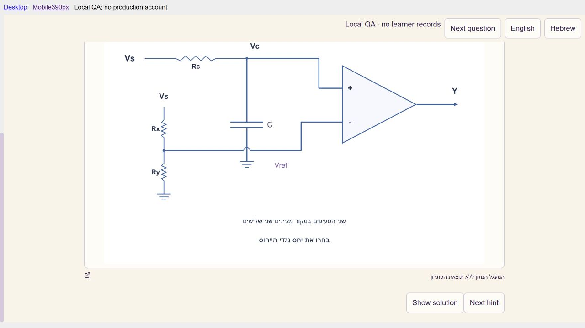
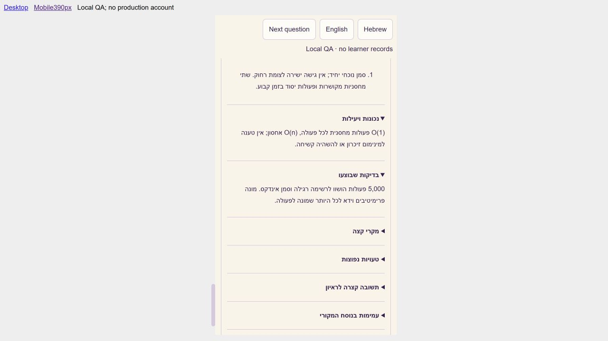
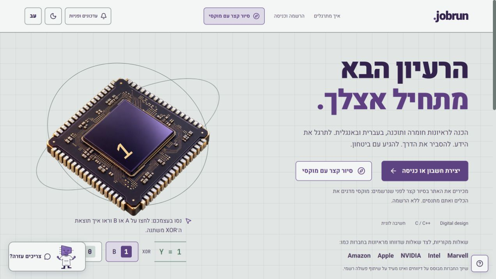

# קליטת עשרים שאלות — 8 בנובמבר 2026

כל 20 צילומי המקור נשמרו עם SHA-256 ונקשרו ל־20 זהויות: **9 שאלות חדשות, 6 הרחבות, 5 חזרות**. הקטלוג מכיל **310 רשומות PREP, 340 רשומות כוללות ו־335 משפחות**. מאגרי 500 השאלות הקצרות ו־2,500 הגרסאות האמריקאיות הפעילות נשמרו ללא שינוי.

**פורסם ואומת באתר ובשרת החי.** גרסת התוכן [`0a78195`](https://github.com/BIGshak4/new_project/commit/0a78195f6562ba46f9024ceaf3210a54a94ba690) אומתה בשני שירותי הפריסה ב־8 בנובמבר 2026 בשעה 10:25 UTC; בדיקת המסד החזירה 2.36 ms. הקטלוג החי החזיר 340 שאלות, 500 שאלות קצרות ו־2,500 גרסאות אמריקאיות. [ראיית הפריסה](../interview_preparation/checks/batch1108b20-deployment-verification.json). צילום הפתיחה בעברית ובקרות הכניסה נבדקו בדפדפן ללא התחברות; זו בדיקה נפרדת מ־80 תצוגות התוכן המקומיות. לא הופעלו חשבון לומד או משוב AI. ה־commit הבא מתעד את האימות בלבד ואינו משנה תוכן או קוד ריצה.

## שינוי הפרוטוקול ודירוגי הקושי

[פרוטוקול הפרסום](question-publication-protocol.md) עודכן בהנחיות המפורשות: ליצור שרטוט מקורי כשהמקור כולל שרטוט או כשהשאלה זקוקה להמחשה; לקבוע לכל קליטה/וריאציה ציון קושי פנימי שלם 1–10 עם נימוק. הסולם מתועד, וזו הערכת עריכה ללא כיול על לומדים.

נעשה שימוש בתשתית הדירוג שכבר הייתה קיימת. [הרישום הסמכותי](../backend/seeds/question_difficulty.json) מכיל 340 דירוגים הקשורים לטביעת השאלה והפתרון. בנייה רגילה דוחה דירוג חסר או מיושן. בשרת נשמרים `question.difficulty` ו־`assets.difficulty_status=rated`; בקריאה חוזרת מהמסד אומתו כל 20 הרשומות. הציונים והדקות נשארו מוסתרים בממשק ובתשובות API ללומד. דירוג אינו אישור מקצועי לפתרון או כשירות להערכה.

כל תשע החדשות ושש ההרחבות דורגו מחדש על ההיקף המלא. PREP-022 עלתה מ־5 ל־6 ו־PREP-035 מ־6 ל־7; בארבע ההרחבות האחרות הציון אושר מחדש. בחמש החזרות הציון והנימוק נשמרו. טביעותיהן נקשרו מחדש כי התשתית הקיימת כוללת גם מדיית מקור פרטית בתפקיד prompt. שדות דירוג המקור הישנים בארכיון נשמרו; הדירוג הפנימי מגיע מרישום השרת. [ראיית דירוג מלאה](../interview_preparation/checks/batch1108b20-difficulty-verification.json).

## מיפוי המקורות

| צילום | מזהה | נושא | פעולה | קושי פנימי |
| --- | --- | --- | --- | --- |
| 1 | PREP-036 | מכונת מצבים לבדיקת התחלקות ב־3 של מספר בינארי טורי | מקור נוסף בלבד | 5 |
| 2 | PREP-303 | הסרת כל הרווחים ממחרוזת, תוך שמירת סדר התווים | חדשה | 2 |
| 3 | PREP-304 | רשימה סביב איבר נוכחי באמצעות שתי מחסניות | חדשה | 6 |
| 4 | PREP-305 | תור FIFO באמצעות שתי מחסניות וניתוח אמורטי | חדשה | 5 |
| 5 | PREP-085 | חמש אבנים על שעון מאוזן | מקור נוסף בלבד | 4 |
| 6 | PREP-132 | מהפכים עם צימוד קיבולי — משרטוט המעגל לגלי המתחים | הרחבה בזהות קיימת | 7 |
| 7 | PREP-037 | בדיקת תקינות סוגריים במחרוזת עם טקסט | מקור נוסף בלבד | 3 |
| 8 | PREP-306 | פינות PVT: תהליך, מתח, טמפרטורה וסיכוני setup/hold | חדשה | 6 |
| 9 | PREP-307 | קומפרטור למתח קבל בסף שני שלישים מהמקור | חדשה | 4 |
| 10 | PREP-058 | ממוצע שני מספרים בהפרש שתיים באמצעות שערים בלבד | מקור נוסף בלבד | 6 |
| 11 | PREP-022 | פרמוטציה אקראית ללא חזרות | הרחבה בזהות קיימת | 6 |
| 12 | PREP-308 | ארגז צ׳יפים ממפעל לא ידוע — הסתברות לאחר בדיקה תקינה | חדשה | 5 |
| 13 | PREP-309 | מחסנית Java בקיבולת קבועה: בנאי, push, pop וחיפוש | חדשה | 3 |
| 14 | PREP-053 | ספירת כניסות ויציאות באמצעות שני גלאים | הרחבה בזהות קיימת | 7 |
| 15 | PREP-018 | מעגל המחזיר את הגדול מבין שני מספרים | הרחבה בזהות קיימת | 3 |
| 16 | PREP-035 | כפל באמצעות ארבעה רגיסטרים ופקודות הגדלה והקטנה בלבד | הרחבה בזהות קיימת | 7 |
| 17 | PREP-310 | ארבעה אותות עד 100kHz באמצעות ADC משותף | חדשה | 6 |
| 18 | PREP-299 | סינוס 100kHz בדגימה של 1MHz: זיכרון מלא, חצי ורבע | הרחבה בזהות קיימת | 5 |
| 19 | PREP-311 | חלוקה שלמה מדויקת באמצעות INC, DEC ו־ JNZ בלבד | חדשה | 8 |
| 20 | PREP-096 | כובעים בטור — תיאום מראש ותשובות סדרתיות | מקור נוסף בלבד + שרטוטי פתרון | 6 |

שיוכי החברות והתגיות הם דיווחי המקור, ללא אימות עצמאי. [מניפסט הקליטה](../interview_preparation/intakes/2026-11-08-batch20-sources.json) שומר את הנוסחים, ההחלטות והגיבובים.

## תוכן, השלמות והמחשות

לכל חדשה ולהרחבות הוכנו נוסחים מקבילים בעברית ובאנגלית, שלושה רמזים, פתרון מוצע, הנחות, מקרי קצה, טעויות נפוצות, הסבר נכונות ועלויות, תשובה לראיון והמשך תרגול. הרחבות אינן מחליפות כותרות, רמזים או תוכן קודם: ששת המזהים הקיימים עלו גרסה אחת ונשמרו הקידומות. בחזרות נשמרו הגרסה והנוסחים; PREP-096 קיבלה רק זוג המחשות פתרון בנוסף למקור.

נוספו **40 PNG מקוריים — 20 זוגות עברית/אנגלית**. שישה מהם מציגים את הנתונים לפני הפתרון ב־053/132/307, ו־34 הם המחשות פתרון הנחשפות במנגנון הקיים. בכל 20 הזהויות נבדקה התאמת ההמחשות, כולל שימוש בהמחשות קודמות בחזרות. בשרטוט ADC תוקנו מסלולי ארבע הכניסות כך שאינם מתחברים זה לזה; ב־RC סומן גשר מפורש בהצטלבות ללא חיבור. צילום המקור נשאר פנימי. הועלו ואומתו בגיבוב חוזר **75 אובייקטים פרטיים חדשים**: 20 מקורות, 40 תמונות ו־15 קובצי מימוש. מלאי המדיה עלה מ־1,762 ל־1,837.

השלמות משמעותיות שסומנו בשתי השפות:

- רשימת שתי מחסניות היא מבנה סביב סמן נוכחי, עם חוזה מפורש להוספה/תנועה/מחיקה ולמקרי קצה. תור משתי מחסניות מבחין בין עלות מצטברת למקרה הגרוע של העברה.
- במקור הקומפרטור שני התנאים מציינים `2Vs/3`. נשמר סף יחיד עם הגדרת שוויון, ולא הוחלפה השאלה בהיסטרזיס. מעגל הצימוד החדש כולל נגד לאדמה ומהפך אחד; המקור עם הטיה ל־VDD נשמר בנפרד.
- טבלת PVT משתמשת במודל הוראה קונבנציונלי ומצהירה שתוצאות אמת תלויות בספרייה, בפינות, במתח, בטמפרטורה וב־skew. אין כאן אפיון PDK או signoff.
- בבול עץ קצר יש מרווח שבו שני החיישנים כבויים. החוזה הראשי הוא מעבר בודד מונוטוני עם אפשרות עצירה; נידון מדוע היפוך תנועה במרווח העיוור אינו ניתן לזיהוי מלא.
- נוסחת הסינוס המקורית עם `T=32` נשמרה ונידונה מילולית; נוסחת 32 דגימות למחזור מוצגת כפרשנות שנבחרה. חלוקת האסמבלי מגדירה תחום של חלוקה מדויקת ומפרידה בין קפיצה על דגל התוצאה הקודמת לבין קפיצה על רגיסטר נקוב.
- שאלת ה־rand מגדירה 100 פלטים ללא חזרה במחזור, עם דחיית ערכים למניעת הטיית מודולו בהנחת דגימות מקור אחידות. אין טענה שה־PRNG הפיזי הוכח כאחיד.

הרחבות ההמשך נשמרו בחומרי השאלה; לא נבנה בתהליך זה תור אינטראקטיבי חדש להמשך שאלות. כל החדשות והפתרונות המורחבים נשארו מוצעים וממתינים לביקורת אנושית; רישום האישורים ההיסטורי לא נכתב מחדש.

## בדיקות ותוקף הראיות

- **4,160 בדיקות backend** עברו במחיצה לא מקוונת, ועוד **260 בדיקות קטלוג הרצה נפרדות**: **4,420 בדיקות ייחודיות**. 159 בדיקות הפרופילים כבר כלולות במחיצה הראשונה ואינן נספרות שוב. 13 בדיקות דולגו, 2 בדיקות אבטחה חיות הוצאו, וכן שלושה קובצי live DB/service/interview; כתובות המסד ו־fixtures הביטחוניים רוקנו במפורש. ריצה ראשונה חשפה שש הנחות היסטוריות בבדיקות; תוקנו יעדי הגרסאות/המדיה וההשלכה לציוני הדוגמאות הישנים, ואז כל המחיצה עברה. [ראיית backend](../interview_preparation/checks/batch1108b20-backend-verification.json).
- **454 בדיקות web**, TypeScript ובניית production עם 16 דפים סטטיים עברו. [ראיית web](../interview_preparation/checks/batch1108b20-web-verification.json). מעטפת ההדפסה נתקלה פעם בקידוד מסוף Windows אחרי סיום תהליכי npm בהצלחה; קובצי UTF-8 וקודי היציאה נשמרו, ותיקון ההדפסה אינו שינוי מוצר.
- GCC קימפל C11 וביצע **6,665 בדיקות**; Java קומפל ליעד Java17 וביצע **12,003 בדיקות**; Icarus קימפל SystemVerilog וביצע **66,134 השוואות** (65,536 זוגות min/max, 404 דגימות חיישנים, 194 בדיקות סינוס). שמונה קובצי המקור נקשרו בגיבוב לפני ובתוך VM. [ראיית native](../interview_preparation/checks/batch1108b20-native-verification.json). ריצה ראשונה פעלה עם רשימת שרתי חבילות מותרים; לאחר גילוי שהגדרת sandbox אינה משנה session פעיל, הבדיקה חזרה על אותם גיבובים ב־VM חדש עם מדיניות session מאומתת `deny-all`, וכל הבדיקות עברו שוב. שני ה־VM נעצרו.
- מודלי חומרה/גאומטריה/הסתברות וקוד נבדקו מול אורקלים נפרדים. ביקורת תוכנה בלתי תלויה ביצעה **17,256 מקרים**; ביקורת הסתברות מנתה **384 מקרים מדויקים**. היקפי המודלים מפורטים ב[בדיקות החומרה](../interview_preparation/checks/batch1108b20-hardware-model-verification.json), [ביקורת התוכנה](../interview_preparation/checks/batch1108b20-software-peer-review.json) וב[ביקורת ההסתברות](../interview_preparation/checks/batch1108b20-reasoning-peer-review.json). אלו בדיקות AI ומודלים; הן אינן אישור מקצועי אנושי או בדיקת חומרה פיזית.
- **80 תצוגות מקומיות** כיסו 20 זהויות × שתי שפות × מחשב/טלפון, לפני ואחרי חשיפה; לא נמצא גלילה אופקית של הדף או צילום מקור גלוי. שלושה סעיפי חומר הורחבו במובייל ונבדקה תצוגת קוד LTR. תמונות מחוץ למסך נטענות בעצלתיים, ולכן בדיקת נוכחות אינה טענה שכל thumbnail נטען בדפדפן. כל 75 הקבצים עצמם אומתו בנפרד מה־Storage. [ראיית דפדפן](../interview_preparation/checks/batch1108b20-browser-verification.json).

## הרצת קוד

נוספו שלושה פרופילי Python ל־303/304/305, כל אחד עם 12 קלטים ואורקל נפרד. מלאי הריצה הוא **52 פרופילים, 91 מקורות חיוביים ו־32 smoke fixtures**; כל 49 הפרופילים ו־88/29 הרשומות הקודמות נשמרו בדיוק. **שלוש עבודות חתומות לשירות החי עברו 36/36 מקרים**, ללא כתיבת התקדמות לומד. [אימות הריצה החיה](../interview_preparation/checks/batch1108b20-live-execution-verification.json) ו[בדיקות השילוב](../interview_preparation/checks/batch1108b20-runtime-integration-verification.json).

המסלול שנבדק הוא מפעיל חתום → broker פרוס → VM מבודד → תוצאה. לא הופעל כפתור Run מתוך חשבון לומד מחובר. Java נבדקה בקומפיילר נפרד; לא נוסף מנוע Java לאתר. תוכניות האסמבלי נבדקו במפרש חינוכי עם משמעות פקודות מפורשת, ולא במעבד ISA אמיתי. אין בדיקות SPICE, STA, ADC פיזי, חיישן אמיתי או טענת אופטימליות כללית של חומרה.

## פרסום ושמירה

בוצעו בדיקת טרנזקציה עם ROLLBACK, פרסום ממוקד עם COMMIT וקריאה חוזרת מהמסד. אחרי הפרסום: **340 שאלות, 680 תרגומים, 360 קישורי מיומנות**. נשמרו כל **331 המזהים הקיימים, 320 גיבובי שאלות שאינן יעד, 650 תרגומים ללא שינוי ו־351 קישורי מיומנות קודמים**. ב־12 התרגומים שהורחבו נשמרו הקידומות והרמזים; כל 20 ציוני הקושי הפנימיים אומתו. [ראיית מסד](../interview_preparation/checks/batch1108b20-database-verification.json). לא שונו נתוני משתמשים, ניסיונות, ציונים אישיים, רמזים שנחשפו או הרשאות.

בזמן העבודה התקבלו שלושה commits נוספים ב־origin/master, עד `49a8703`, הכוללים עדכוני אבטחה והגדרות. הם שולבו ב־fast-forward ללא דריסה. לאחר השילוב עברו **436 בדיקות רגרסיה ב־18 מודולים**, כולל 12 בדיקות אבטחה חדשות; בדיקה אחת דולגה. זו קבוצה שחופפת לריצה הקודמת, ואינה מתווספת במלואה למניין 4,420. סביבת הבדיקה עודכנה ל־`certifi2026.10.23` מה־wheel הרשמי עם SHA מדויק ו־`--require-hashes`, לפי ה־lock שהתקבל, בלי שינוי נעילה או מקור. [ראיית השילוב והסביבה](../interview_preparation/checks/batch1108b20-postmerge-verification.json). קובצי Supabase המקומיים שאינם חלק מהמשימה נשמרו מחוץ ל־commit.

## הפניות טכניות

תכנון דגימה מרובת ערוצים וזמני התייצבות נבדק מול [TI multiplexed data acquisition design](https://www.ti.com/lit/ug/tiduad9/tiduad9.pdf) ו־[Analog Devices DAQ optimization](https://www.analog.com/en/resources/analog-dialogue/articles/performance-optimization-of-multichannel-data-acquisition-daq-systems.html). הגדרת פינות PVT נבדקה מול [SkyWater PDK](https://skywater-pdk.readthedocs.io/en/main/python-api/skywater_pdk.html) ו־[LibreLane timing corners](https://librelane.readthedocs.io/en/latest/usage/timing_corners.html); מספרי ההוראה כאן אינם נתוני אפיון של הספריות האלה.

## תצוגות שנבדקו

