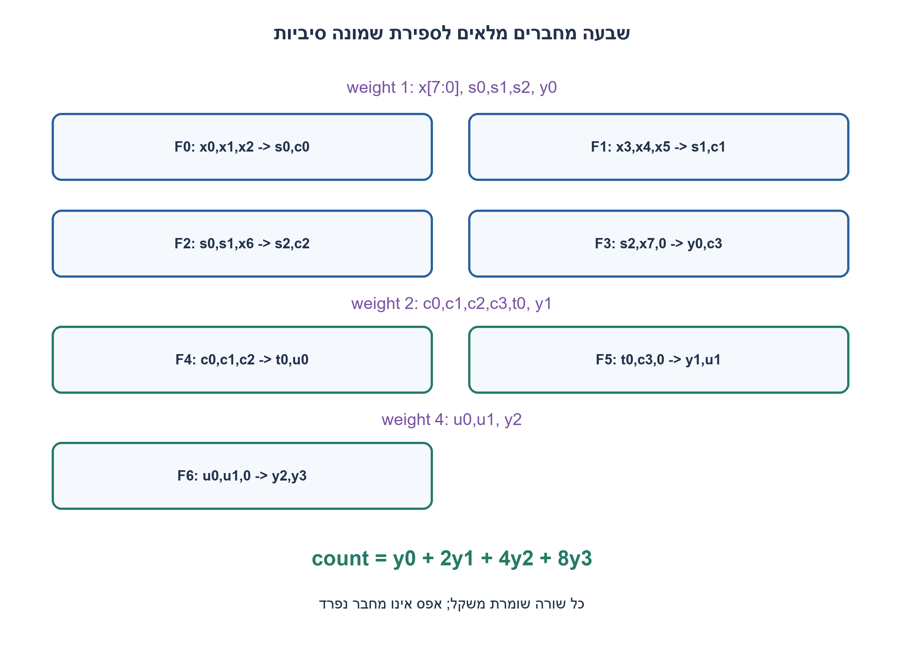
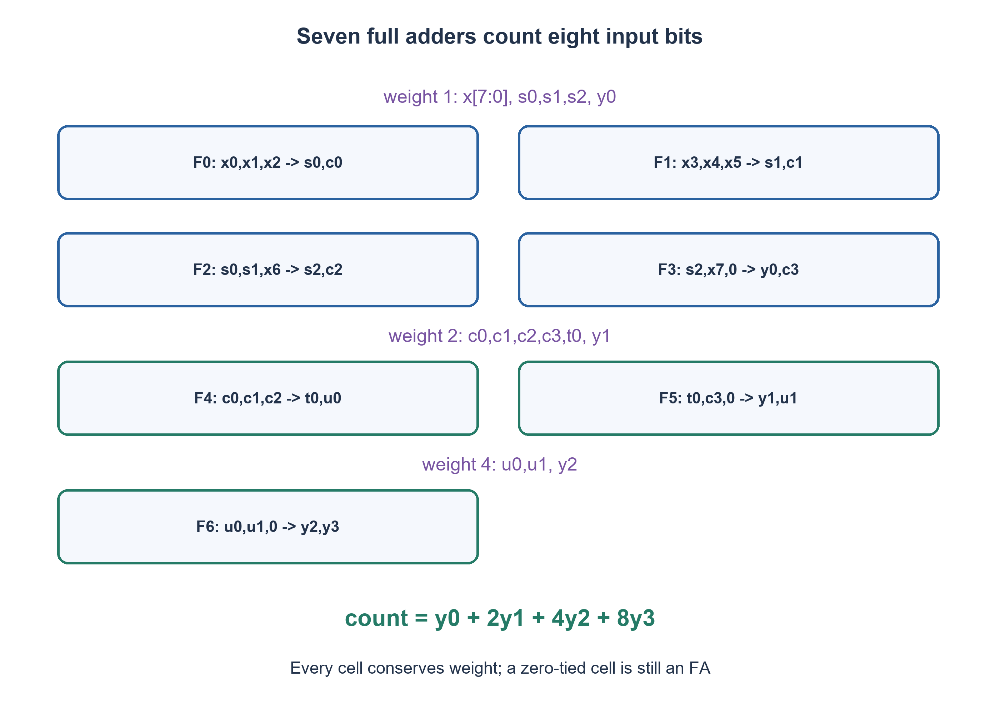

# PREP-001 — ספירת אחדות בכניסה בת 8 סיביות באמצעות מחברים

פתרון מוצע בסיוע AI; ביקורת מקצועית אנושית ממתינה. הקושי אינו מכויל.

[צילום מקור פרטי](../sources/2026-11-07-night30-16.png)

לתכנן מערכת המקבלת מספר המורכב משמונה ביטים. יש לבדוק כמה ביטים דלוקים במספר באמצעות Full adder בלבד, במספר FA מינימלי. לדוגמה עבור 01001010 התשובה 3.

חברות לפי הדיווח בצילום בלבד: Sandisk.

## עברית

### וריאציה: שמונה סיביות באמצעות Full Adder בלבד
קבלו x[7:0] במקביל והחזירו בסיביות את מספר האחדות, 0..8. מותר להשתמש רק בתאי FA, בחיווט, בפיצול אות ובקבוע 0; אין תאי HA נפרדים, שערים חיצוניים או אוגרים. תא FA המחובר לאפס עדיין נספר כ־FA. הציגו חיבור לכל תא, משקלי סיביות ואת העלות. הבהרה שנבחרה: מימוש צירופי; אין תוספת של טענת מינימום כללית ללא מודל ספרייה והוכחה. הדרישה שונה מהחלק הישן המתיר גם HA.

1. מחבר מלא מקיים a+b+c=s+2c_out. איך אפשר לשמור את הסכום תוך צמצום מספר הסיביות באותו משקל?
2. רכזו את שמונה הביטים לסיבית יחידות אחת וארבע סיביות שמשקלן שתיים; אין לאבד נשא.
3. ארבעה FA מטפלים במשקל 1, שניים במשקל 2 ואחד במשקל 4. בפלט דרושות ארבע סיביות כדי לייצג גם 8.

### שומרים סכום, לא רק זוגיות
FA מפיק Sum באותו משקל כמו שלושת קלטיו ו־Carry במשקל כפול. נשתמש בשבעה תאים:

```text
F0(x0,x1,x2) -> (s0,c0)
F1(x3,x4,x5) -> (s1,c1)
F2(s0,s1,x6) -> (s2,c2)
F3(s2,x7,0) -> (y0,c3)
F4(c0,c1,c2) -> (t0,u0)
F5(t0,c3,0) -> (y1,u1)
F6(u0,u1,0) -> (y2,y3)
```

ארבעת התאים הראשונים מקבלים משקל 1; c0..c3 במשקל 2. F4 ו־F5 מחברים במשקל 2 ומפיקים u0,u1 במשקל 4. F6 מחבר אותם ומפיק y2 במשקל 4 ו־y3 במשקל 8. סכימת הזהות של כל תא נותנת `sum(x)=y0+2y1+4y2+8y3`. זה מוכיח את הרשת לכל קלט בלי להסתמך על דוגמאות.

למשל 01001010 מכיל שלוש אחדות ולכן הפלט 0011; כל שמונת הביטים הדלוקים נותנים 1000. עץ XOR בלבד היה מחזיר זוגיות, לא את הסכום. בהשוואה למימוש בן שבעה קלטים, הקלט השמיני מחייב טיפול נוסף ואין להעתיק את מספר ארבעת המחברים שלו.

### עלות ומידת טענת המינימום
הבנייה משתמשת בשבעה FA, כולל שלושה תאים עם כניסת אפס המממשים פעולת HA אך נספרים FA. במודל מוגבל של דחיסת עמודות ללא שכפול סיביות, ושימוש ב־Sum באותו משקל וב־Carry במשקל כפול, דרושות ארבע פעולות בעמודת משקל 1 כדי להפוך שמונה סיביות לאחת; הן יוצרות ארבע סיביות משקל 2. בעמודה זו דרושות עוד שתי פעולות, היוצרות שתי סיביות משקל 4; עוד פעולה מחברת אותן. לכן שבע הוא מזערי במודל עמודות זה. אין מכאן הוכחה לכל מעגל FA עם פיצול ושימושים לא־רגילים בפלטים: זו טענת מינימום מצומצמת, והפתרון המקובל אינו תלוי בטענה כללית.

בדיקת המודל משווה את כל 256 הקלטים לספירת אחדות בלתי תלויה. קוד RTL שומר את שבעת המופעים במפורש, ובדיקת native נפרדת מאמתת את אותו תחום; לא בוצע מיפוי שטח או STA.

### קוד SystemVerilog; תוצאות סימולציה בדוח נפרד

```systemverilog
// Each instance is counted as a full adder, including pins tied to zero.
module prep001_fa(input wire a,b,c, output wire s,k);
  assign s = a ^ b ^ c;
  assign k = (a&b) | (a&c) | (b&c);
endmodule
module prep001_eight_fa_only(input wire [7:0] x, output wire [3:0] y);
  wire s0,s1,s2,c0,c1,c2,c3,t0,u0,u1;
  prep001_fa f0(x[0],x[1],x[2],s0,c0);
  prep001_fa f1(x[3],x[4],x[5],s1,c1);
  prep001_fa f2(s0,s1,x[6],s2,c2);
  prep001_fa f3(s2,x[7],1'b0,y[0],c3);
  prep001_fa f4(c0,c1,c2,t0,u0);
  prep001_fa f5(t0,c3,1'b0,y[1],u1);
  prep001_fa f6(u0,u1,1'b0,y[2],y[3]);
endmodule
```




### assumptions

שמונה ביטים במקביל, FA בלבד עם קבוע אפס; פלט ארבע סיביות.

### optimality

שבעה FA; מינימום מנומק רק במודל דחיסת עמודות ללא שכפול, לא ברשת בלתי מוגבלת.

### verification

מודלים עצמאיים עברו: קובייה בחמישה ערכי התנגדות, 3,072 גשרי DC במתח שאינו אפס, דוגמת מתח אפס, 64 זוגות נגדי משוב ו־256 בדיקות הגבר סופי, עשר פאזות סינוס, 1,024 קלטי מכפיל, 256 קלטי ספירת אחדות, 256 זוגות חיבור וארבע שורות NAND. ראיה: checks/night1107n30-hardware-model-verification.json. בדיקות אלה הן Python וחישוב רציונלי; קומפילציית SystemVerilog מתועדת בנפרד בדוח native של האצווה. לא בוצעו SPICE, סינתזה, ניתוח תזמון או מדידת חומרה.

בדיקת Icarus Verilog 12 בפועל עברה: 1,664 השוואות RTL באצוות החומרה, כולל כל קלטי המכפיל, ספירת אחדות וחיבור, כל שורות NAND ו־124 בדיקות לוח פאזה עם איפוס והשהיה. ראיה: checks/night1107n30-native-verification.json. ריצת הקוד הייתה בסביבה זמנית מבודדת ללא רשת; אין להסיק מכך SPICE או סינתזה.

### edge_cases

```json
[
  "0→0000",
  "255→1000",
  "01001010→0011"
]
```

### common_mistakes

```json
[
  "קבלת פלט בן שלוש סיביות.",
  "חיבור נשאים במשקל שגוי.",
  "ספירת FA עם אפס כרכיב חינם."
]
```

### interview_answer

דוחס בכל משקל עם FA, שומר את כל הנשאים ומקבל ארבע סיביות באמצעות שבעה תאים.

### source_ambiguities

מניין רכיבים מוגדר ב־FA כולל תאי אפס; הוכחת מינימום מוגבלת הוצהרה.

### solution_extensions

```json
[
  {
    "question": "מה משתנה אם יש רק שבע כניסות?",
    "direction": "אין צורך לחבר את הקלט השמיני; אפשר לצמצם את העמודות לארבעה FA.",
    "tests": "בדקו 0 ו־7 אחדות וכל 128 הקלטים."
  }
]
```

## English

### Variant: eight bits using full adders only
Accept simultaneous x[7:0] and output their population count, zero through eight. Only FA cells, wiring, fanout and constant zero are allowed; no separate HAs, external gates or registers. An FA with a zero pin still counts as an FA. Show every cell connection, bit weights and cost. Chosen clarification: combinational operation; no unsupported global minimum claim is added. This differs from the earlier part that also allows HAs.

1. A full adder preserves a+b+c=s+2c_out. How can you reduce the number of same-weight bits without changing total value?
2. Reduce the eight inputs to one units bit and four weight-two bits; retain every carry.
3. Use four FAs at weight one, two at weight two and one at weight four. Four output bits are needed to represent eight.

### Preserve value, not just parity
An FA produces Sum at its input weight and Carry at twice that weight. Use seven cells:

```text
F0(x0,x1,x2) -> (s0,c0)
F1(x3,x4,x5) -> (s1,c1)
F2(s0,s1,x6) -> (s2,c2)
F3(s2,x7,0) -> (y0,c3)
F4(c0,c1,c2) -> (t0,u0)
F5(t0,c3,0) -> (y1,u1)
F6(u0,u1,0) -> (y2,y3)
```

The first four cells take weight-one inputs; c0..c3 have weight two. F4 and F5 operate at weight two and produce weight-four u0,u1. F6 combines those into y2 at weight four and y3 at weight eight. Summing cell conservation equations gives `sum(x)=y0+2y1+4y2+8y3`, proving the entire network for every input.

For example, 01001010 contains three ones and yields 0011; eight asserted inputs yield 1000. An XOR tree alone would return parity rather than the count. The eighth input needs additional handling, so the four-FA cost of the separate seven-input exercise cannot be copied here.

### Cost and the scope of minimality
This construction has seven FAs, including three zero-tied cells that perform HA functions but still count as FAs. In the restricted nonduplicating weighted-column compression model, Sum stays at its input weight and Carry moves to twice that weight. Reducing eight weight-one bits to one requires four column operations, creating four weight-two carries. Reducing that column takes two more operations and creates two weight-four carries; one final operation combines those. Thus seven is minimal in this column-compression model. This is not a proof for every possible FA circuit with fanout or unconventional output reuse; the minimum claim is deliberately scoped, and accepting the construction does not require a global claim.

The Python model checks all 256 inputs against an independent popcount. RTL explicitly retains the seven cell instances, and a separate native run verifies the same input domain. No mapped-area or static-timing result is claimed.

### SystemVerilog; simulation results are in a separate report

```systemverilog
// Each instance is counted as a full adder, including pins tied to zero.
module prep001_fa(input wire a,b,c, output wire s,k);
  assign s = a ^ b ^ c;
  assign k = (a&b) | (a&c) | (b&c);
endmodule
module prep001_eight_fa_only(input wire [7:0] x, output wire [3:0] y);
  wire s0,s1,s2,c0,c1,c2,c3,t0,u0,u1;
  prep001_fa f0(x[0],x[1],x[2],s0,c0);
  prep001_fa f1(x[3],x[4],x[5],s1,c1);
  prep001_fa f2(s0,s1,x[6],s2,c2);
  prep001_fa f3(s2,x[7],1'b0,y[0],c3);
  prep001_fa f4(c0,c1,c2,t0,u0);
  prep001_fa f5(t0,c3,1'b0,y[1],u1);
  prep001_fa f6(u0,u1,1'b0,y[2],y[3]);
endmodule
```




### assumptions

Eight simultaneous bits; FAs plus zero; four-bit output.

### optimality

Seven FAs; minimality is justified only for nonduplicating weighted-column compression, not unrestricted networks.

### verification

Independent models passed: five cube resistance scales, 3,072 nonzero-source DC bridges plus a zero-source example, 64 feedback-resistor pairs and 256 finite-gain checks, ten sine phases, 1,024 multiplier inputs, 256 popcount inputs, 256 addition pairs and four NAND truth rows. Evidence: checks/night1107n30-hardware-model-verification.json. These are Python/exact-rational checks; SystemVerilog compilation is documented separately in the batch native report. No SPICE, synthesis, timing analysis or hardware measurement was performed.

Actual Icarus Verilog12 execution passed 1,664 hardware RTL comparisons, including all multiplier, popcount and adder inputs, all NAND rows and 124 phase-schedule checks with reset and hold. Evidence: checks/night1107n30-native-verification.json. Execution used a temporary isolated environment with networking denied; this is not SPICE or synthesis.

### edge_cases

```json
[
  "0→0000",
  "255→1000",
  "01001010→0011"
]
```

### common_mistakes

```json
[
  "Using only three output bits.",
  "Combining carries at the wrong weight.",
  "Treating a zero-tied FA as free."
]
```

### interview_answer

Compress each weight using FAs, retain every carry, and obtain four output bits with seven cells.

### source_ambiguities

Cell cost counts every FA including zero-tied ones; minimum-proof scope is explicit.

### solution_extensions

```json
[
  {
    "question": "What changes with only seven inputs?",
    "direction": "Without the eighth input, columns can be compressed using four FAs.",
    "tests": "Check zero, seven ones and all 128 input patterns."
  }
]
```
