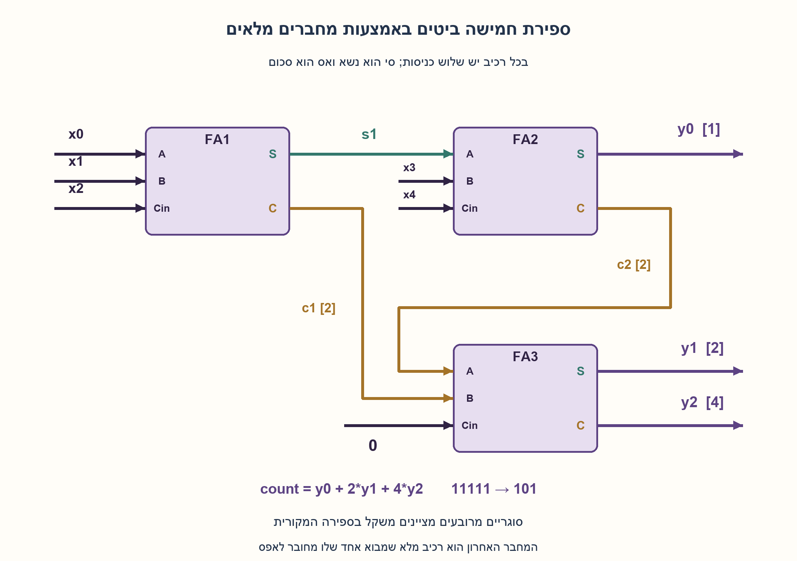
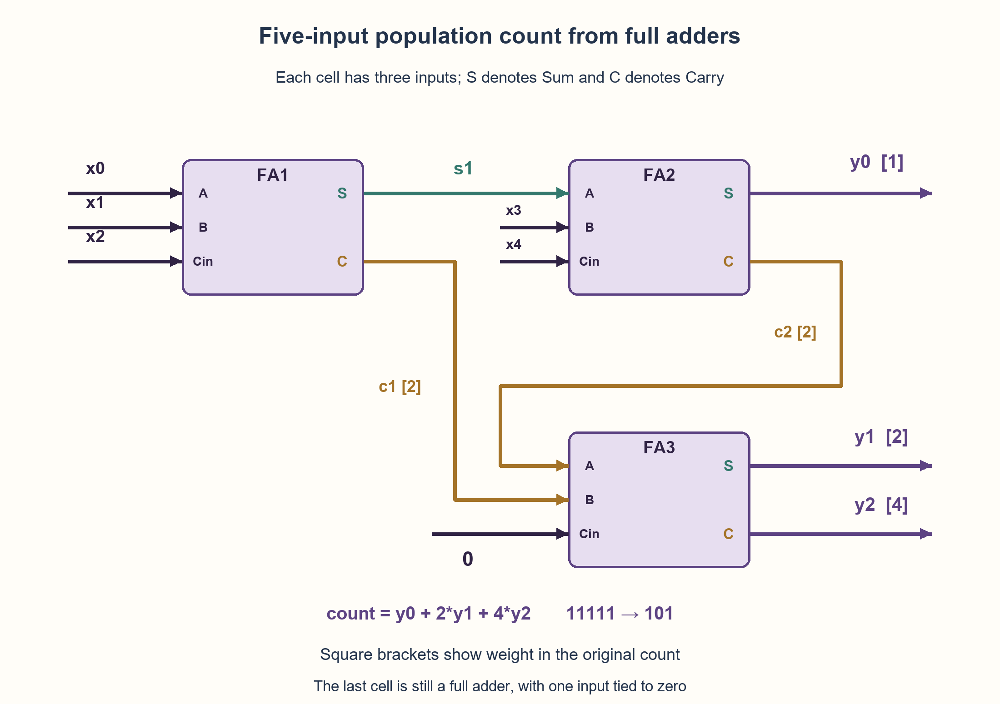

# PREP-001 — חמישה ביטים באמצעות FA בלבד / Five-input FA-only variant

פתרון מוצע בסיוע AI; ביקורת מקצועית אנושית ותרגום ממתינות. / AI-assisted proposed solution; professional and parity review pending.

[צילום מקור / Source](../sources/2026-10-25-batch11-02.png)

ממש באמצעות רכיבי Full-Adder מכונה הסופרת את כמות ה'1' בכניסה בעלת 5 סיביות.

Intel / NVIDIA — שיוכי מקור שלא אומתו עצמאית / source-reported affiliations, not independently verified.

## עברית

### מקור נוסף: ספירת אחדות בחמישה ביטים באמצעות FA בלבד
ממשו בעזרת רכיבי Full-Adder בלבד מערכת המקבלת חמישה ביטים ומחזירה את מספר האחדות בהם בבינארי.

הבהרות עריכה: חמש הכניסות ניתנות יחד כווקטור x[4:0]; נבחר מעגל צירופי, לא ספירה של ביטים המגיעים לאורך זמן. התוצאה y[2:0] היא ללא סימן בטווח 0..5. כל FA מקבל שלושה ביטים ומוציא Sum,Carry לפי a+b+c=Sum+2·Carry. מותר חיווט, פיצול וקבוע 0. אין HA, שערים חיצוניים, קלטים מהופכים בחינם, קבוע 1 או רכיבי זיכרון; מותר לקבע מבוא FA לאפס, והוא עדיין נספר כ־FA. הציגו חיבורים, משקלים, הוכחה ועלות. מינימום רכיבים אינו דרישה במקור; אם טוענים לו, יש לתחום את מודל הרכיבים ולהצדיק את החסם. הגרסאות הקודמות נשמרות בנפרד.

### שלושה רמזים משלימים

1. כל כניסה תורמת יחידה אחת לספירה, בלי קשר למיקומה בווקטור. כמה ביטים דרושים כדי לייצג מספר בין אפס לחמש?
2. FA מחלק עד שלוש אחדות לשארית במשקל אחד ולזוג במשקל שתיים. חברו שלוש כניסות, ואז את השארית ושתי הכניסות שנותרו.
3. לאחר שני ה־FA יש ביט יחידות סופי ושני נשאים במשקל שתיים. חברו את הנשאים ב־FA שלישי עם כניסה שלישית אפס; Sum ו־Carry שלו יהפכו לביטי המשקל שתיים וארבע.

### סופרים זוגות ושאריות
FA אינו חייב לקבל נשא ממחבר קודם: שלוש כניסותיו שוות במשקלן. הוא מחלק את מספר האחדות שבשלושתן לשארית Sum ולזוג Carry. לדוגמה, 1+1+1=3 נותן Sum=1,Carry=1, כלומר יחידה ועוד זוג.

### שלושה מחברים מלאים, ללא HA
בכל זוג מוצאים מופיעים Sum ואז Carry:

```text
(s1, c1) = FA(x0, x1, x2)
(y0, c2) = FA(s1, x3, x4)
(y1, y2) = FA(c1, c2, 0)
```

שני המחברים הראשונים עובדים במשקל יחידה. השני קובע את y0 הסופי ומשאיר יחד עם הראשון שני זוגות אפשריים c1,c2, כל אחד במשקל שתיים. ה־FA השלישי מקבל את שני הנשאים באותו משקל ואפס: Sum שלו הוא y1 במשקל שתיים ו־Carry שלו הוא y2 במשקל ארבע. אין רכיב HA מוסתר; זהו FA רגיל שמבוא אחד שלו מחובר לאפס. קוראים את הפלט y2y1y0.

### הוכחת שימור הערך
שלוש משוואות הרכיבים נותנות:

```text
x0+x1+x2 = s1+2c1
s1+x3+x4 = y0+2c2
c1+c2    = y1+2y2
```

לכן סכום חמש הכניסות הוא y0+2(c1+c2)=y0+2y1+4y2. כך מקבלים את מספר האחדות, ולא את ערך הקלט הבינארי או רק זוגיות. למשל 11111 נותן s1=1,c1=1; אחר כך y0=1,c2=1; ולבסוף y1=0,y2=1. הפלט 101 הוא חמש. קלט 10000 נותן 001, וקלט אפס נותן 000. שלושה ביטים דרושים כי הפלט יכול להיות חמש.

### עלות וחסם תחתון מוגדר
המימוש משתמש בשלושה FA ובשלוש שכבות תלות; אין טענה למדידת תזמון פיזי. אפשר גם להוכיח ששלושה הם מינימום רכיבי FA בספרייה שהוגדרה, באמצעות מנייה מלאה קטנה של כל רשת עם עד שני רכיבים. כל רשת חסרת מעגלים ניתנת לסדר טופולוגי. לרכיב הראשון זמינים חמישה קלטים ואפס: יש 56 שלשות פינים בלתי־מסודרות עם חזרות. אחריו זמינים גם שני מוצאיו, ולכן לרכיב השני יש 120 שלשות אפשריות. נבדקו כל 56 רשתות הרכיב היחיד וכל 56·120=6,720 רשתות שני הרכיבים, עם חזרות בפינים, פיצול ושימוש בכל חוט זמין כמוצא. אף רשת לא מכילה בו־זמנית את שלוש פונקציות ביטי הספירה בכל 32 הקלטים. בלי רכיבים גם הן אינן קלטים גולמיים. זו מנייה ממצה של המודל הסופי המוגדר, ולא ראיה ממדגם או מינימום שטח/שערים בספרייה אחרת.

המימוש נבדק בכל 32 הווקטורים וב־96 משוואות רכיבים משוקללות מול ספירת אחדות עצמאית. זהו Python בלבד, ללא HDL, סינתזה או מדידה. שלושת רמזי הווריאנט שמורים בחומר המשלים ובתוספת המסמך; שלושת הרמזים המקוריים נשארו בתור הקיים, שאינו בוחר רמזים אוטומטית לפי וריאנט. התוכן החדש מוצע בסיוע AI וממתין לביקורת אנושית.

```python
"""Five simultaneous input bits to a three-bit population count, using three FAs.

Only FA primitives, free zero, wiring and fanout are hardware resources.
Python shifts/arithmetic encode or inspect wires; they are not extra circuit cells.
"""


def full_adder(a, b, c):
    if any(type(x) is not int or x not in (0, 1) for x in (a, b, c)):
        raise ValueError("FA inputs must be binary integers")
    return a ^ b ^ c, (a & b) | (a & c) | (b & c)


def network(value):
    if type(value) is not int or not 0 <= value < 32:
        raise ValueError("five-bit unsigned input required")
    x = [(value >> bit) & 1 for bit in range(5)]
    s1, c1 = full_adder(x[0], x[1], x[2])
    y0, c2 = full_adder(s1, x[3], x[4])
    y1, y2 = full_adder(c1, c2, 0)
    return {"x": x, "s1": s1, "c1": c1, "c2": c2, "y0": y0, "y1": y1, "y2": y2}


def popcount5(value):
    wires = network(value)
    return wires["y0"] + 2 * wires["y1"] + 4 * wires["y2"]
```



## English

### Additional source: five-input population count using FAs only
Using only full-adder components, accept five bits and return their number of ones in binary.

Editorial clarifications: all five inputs arrive together as vector x[4:0]; choose a combinational circuit, not a count of serially arriving bits. Unsigned y[2:0] ranges from zero to five. Each FA has three bit inputs and Sum/Carry outputs with a+b+c=Sum+2·Carry. Wiring, fanout and constant zero are allowed. No HAs, external gates, free complemented inputs, constant one or memory. An FA with one pin tied to zero is permitted and still counted as an FA. Show connections, weights, correctness and cost. Minimum components is not requested by the source; any minimum claim needs an explicit library and lower bound. Earlier variants remain separate.

### Three supplementary hints

1. Each input contributes one counting unit, regardless of its vector position. How many output bits encode zero through five?
2. An FA splits up to three ones into a weight-one leftover and a weight-two pair. Add three inputs, then that leftover and the remaining two inputs.
3. After two FAs, keep the final unit bit and two weight-two carries. Add those carries using a third FA with its remaining input tied to zero; its Sum/Carry become weights two/four.

### Count pairs and leftovers
An FA does not require a carry from an earlier adder: its three inputs have equal weight. It splits their number of ones into a Sum leftover and a Carry pair. For example, 1+1+1=3 gives Sum=1,Carry=1: one unit plus one pair.

### Three full adders, no HA
Every output pair is ordered Sum, then Carry:

```text
(s1, c1) = FA(x0, x1, x2)
(y0, c2) = FA(s1, x3, x4)
(y1, y2) = FA(c1, c2, 0)
```

The first two cells operate at unit weight. The second fixes final y0, leaving two possible pairs c1,c2, each of weight two. The third FA adds those equal-weight carries and zero: its Sum is y1 at weight two and Carry is y2 at weight four. No HA is hidden; this is an ordinary FA with one input tied to zero. Read output y2y1y0.

### Value-preservation proof
The three component equations give:

```text
x0+x1+x2 = s1+2c1
s1+x3+x4 = y0+2c2
c1+c2    = y1+2y2
```

Thus the five input bits sum to y0+2(c1+c2)=y0+2y1+4y2. This is population count, not the input’s binary value or just parity. For 11111, the first FA gives s1=1,c1=1; the second gives y0=1,c2=1; the last gives y1=0,y2=1. Output 101 means five. Input 10000 gives 001; zero gives 000. Three bits are necessary because the output may be five.

### Cost and a scoped lower bound
The construction has three FAs and three dependency layers, without a physical timing claim. Three is also a minimum FA-cell count in the declared library, proved by complete small-network enumeration. Every acyclic network has a topological order. The first cell can use five raw bits and zero: 56 unordered pin triples with repetition. Its two outputs expand the second cell’s pool to eight wires, giving 120 triples. All 56 one-cell and 56·120=6,720 two-cell networks were checked, allowing repeated pins, fanout and any available output tap. None simultaneously supplies all three population-count bit functions on all 32 inputs. Those functions are not raw wires in the zero-cell case either. This is complete finite-model enumeration, not sampled evidence or a physical area/gate minimum under another library.

The construction passed all 32 input vectors and 96 weighted component equations against an independent count. Python only; no HDL, synthesis or measurements. Three variant hints are stored in supporting material and the addendum. The original three remain in the existing hint queue, which does not automatically choose hints by variant. New content is AI-assisted proposed material awaiting human review.

```python
"""Five simultaneous input bits to a three-bit population count, using three FAs.

Only FA primitives, free zero, wiring and fanout are hardware resources.
Python shifts/arithmetic encode or inspect wires; they are not extra circuit cells.
"""


def full_adder(a, b, c):
    if any(type(x) is not int or x not in (0, 1) for x in (a, b, c)):
        raise ValueError("FA inputs must be binary integers")
    return a ^ b ^ c, (a & b) | (a & c) | (b & c)


def network(value):
    if type(value) is not int or not 0 <= value < 32:
        raise ValueError("five-bit unsigned input required")
    x = [(value >> bit) & 1 for bit in range(5)]
    s1, c1 = full_adder(x[0], x[1], x[2])
    y0, c2 = full_adder(s1, x[3], x[4])
    y1, y2 = full_adder(c1, c2, 0)
    return {"x": x, "s1": s1, "c1": c1, "c2": c2, "y0": y0, "y1": y1, "y2": y2}


def popcount5(value):
    wires = network(value)
    return wires["y0"] + 2 * wires["y1"] + 4 * wires["y2"]
```



## חומר משלים / Supporting material

```json
{
  "assumptions": {
    "he": "וריאנט חמישה ביטים: כל הכניסות מקבילות במשקל יחידה; FA בלבד, אפס וחיווט חופשיים, פלט ספירה מדויק בן שלושה ביטים, ללא זיכרון או שערים חיצוניים.",
    "en": "Five-input variant: parallel unit-weight bits, FAs only, free zero/wiring and exact three-bit count, without memory or external gates."
  },
  "optimality": {
    "he": "שלושה FA הם מינימום בספריית FA תלת־כניסתי, קלטים גולמיים ואפס בלבד, חיווט חסר מעגלים ופיצול חופשי. מנייה מלאה שוללת אפס/רכיב אחד/שניים: 1,56,6720 אפשרויות. אין טענת מינימום פיזי או השהיה.",
    "en": "Three FAs are minimal with three-input FAs, only raw bits/zero, acyclic wiring and free fanout. Complete enumeration excludes 0/1/2 cells: 1,56,6720 possibilities. No physical size/delay optimum is claimed."
  },
  "verification": {
    "he": "הווריאנט עבר 32 וקטורים, 96 משוואות עמודה, שמונה שורות FA וארבע דחיות קלט. מניית חסם תחתון מלאה בדקה 56 רשתות FA יחיד ו־6,720 רשתות שני FA, ללא פתרון. Python בלבד; לא HDL או חומרה.",
    "en": "Variant passed 32 vectors, 96 column equations, eight FA rows and four rejected inputs. Complete lower-bound enumeration found no solution among 56 one-FA/6,720 two-FA networks. Python only, not HDL or hardware."
  },
  "edge_cases": {
    "he": {
      "variant": "five_input_fa_only",
      "examples": [
        "00000→000",
        "10000→001",
        "11111→101"
      ],
      "note": "כל מיקום קלט נספר כיחידה אחת; השלישי מחבר c1,c2 במשקל שתיים, לא יחד עם x במשקל יחידה."
    },
    "en": {
      "variant": "five_input_fa_only",
      "examples": [
        "00000→000",
        "10000→001",
        "11111→101"
      ],
      "note": "Every input position counts as one; the third FA adds c1,c2 at weight two, not mixed with a raw weight-one x."
    }
  },
  "common_mistakes": {
    "he": [
      "בלבול בין ספירת חמישה ביטים מקבילים לבין מונה סדרתי.",
      "ערבוב משקלי יחידה ושתיים באותו FA.",
      "החלפת ה־FA השלישי ב־HA למרות איסור הספרייה.",
      "פלט זוגיות של ביט אחד או קיצוץ הספירה לשני ביטים."
    ],
    "en": [
      "Confusing five parallel input bits with a serial counter.",
      "Mixing weight-one and weight-two inputs in one FA.",
      "Replacing the third FA with an HA despite the library restriction.",
      "Returning one parity bit or truncating the count to two bits."
    ]
  },
  "interview_answer": {
    "he": "לחמישה ביטים: FA(x0,x1,x2) נותן s1,c1; FA(s1,x3,x4) נותן y0,c2; FA(c1,c2,0) נותן y1,y2. c1,c2 במשקל שתיים ולכן Sum האחרון הוא ביט השתיים ו־Carry ביט הארבע. שלושה FA; הפלט בטווח 0..5.",
    "en": "For five bits: FA(x0,x1,x2) gives s1,c1; FA(s1,x3,x4) gives y0,c2; FA(c1,c2,0) gives y1,y2. c1,c2 have weight two, making final Sum weight two and Carry weight four. Three FAs, output zero through five."
  },
  "source_ambiguities": {
    "he": "״מכונה״ אינה מגדירה שעון או סדרה; הוגדר וקטור בן חמישה ביטים ומעגל צירופי. זמינות אפס ומדד מינימום הוגדרו בעריכה. Intel ו־NVIDIA מדווחות בצילום ולא אומתו עצמאית.",
    "en": "“Machine” specifies no clock or serial protocol; an explicit five-bit vector/combinational model is selected. Free zero and minimum-count model are editorial choices. Intel/NVIDIA are source-reported, not independently verified."
  },
  "relationship_note": {
    "he": "מקור נוסף ל־PREP-001 עם רוחב וחוק ספרייה אחרים; גרסאות שמונה ושבעה ביטים נשמרו, ואין כפילות חדשה במאגר.",
    "en": "Additional PREP-001 source with another width/library contract. Eight/seven-bit variants remain, without a new duplicate catalog entry."
  },
  "solution_extensions": {
    "he": {
      "question": "האם אפשר לממש בלי שום קבוע זמין?",
      "answer_direction": "לא במודל FA בלבד עם חוטים ופיצול: בקלט 11111 כל מבוא של כל FA הוא 1 ושני מוצאיו 1 באינדוקציה. הפלט הדרוש הוא 101, ולכן ביטו האמצעי חייב להיות 0 שאינו יכול להיווצר.",
      "principle": "אינווריאנט על קלט מיוחד יכול להוכיח מגבלת ספרייה."
    },
    "en": {
      "question": "Can this be built with no available constant?",
      "answer_direction": "Not with FAs/wiring/fanout only: on input 11111 every FA input is one and both outputs stay one inductively. Required output 101 has a zero middle bit, which cannot be produced.",
      "principle": "An invariant on a special input can prove a library limitation."
    }
  }
}
```
