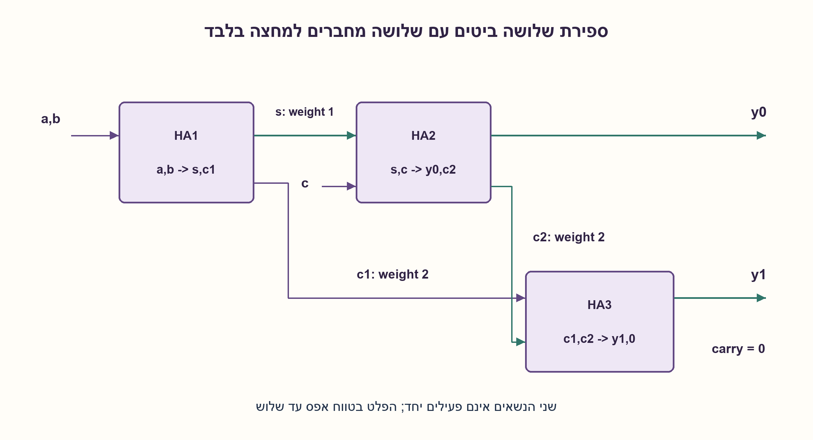

# PREP-001 — ספירת אחדות בכניסה בת 8 סיביות באמצעות מחברים

פתרון מוצע בסיוע AI; ביקורת מקצועית אנושית ממתינה. הקושי אינו מכויל.

[צילום מקור פרטי](../sources/2026-11-03-batch20-17.png)

ממש סכום אחדות של 3 ביטים רק על ידי HA.

חברות לפי הדיווח בצילום בלבד: NVIDIA.

## עברית

### הרחבה: סכום האחדות בשלושה ביטים באמצעות HA בלבד
קבלו שלושה ביטים יחד והחזירו מספר בינארי בן שתי סיביות המייצג כמה מהם1. מותר להשתמש ב־Half Adders בלבד, חיווט ופיצול אותות; ללא FA, שער נוסף או זיכרון. הבהרות: כל קלט תורם0 או1 לספירה, ולא את משקלו במספר המקורי. הפלט בטווח0..3. אין צורך להוכיח מינימום רכיבים.

1. מהו הערך המרבי של הספירה וכמה ביטים דרושים לה?
2. HA מפצל סכום של שני ביטים לשארית במשקל1 ולנשא במשקל2. הוסיפו את הביט השלישי לשארית.
3. נשארו שני נשאים במשקל2. האם הם יכולים להיות1 יחד? חברו אותם ב־HA נוסף וקבעו מה קורה לנשא שלו.

### משקלי הנשאים חשובים יותר ממיקום הביט בקלט
נסמן HA(a,b)→(s,c1), ואז HA(s,c)→(y0,c2). משוואות הערך הן `a+b=s+2c1` ו־`s+c=y0+2c2`; לכן `a+b+c=y0+2(c1+c2)`.

כאשר c1=1, בהכרח a=b=1 ולכן s=0 ו־c2=s AND c=0. לכן c1 ו־c2 לעולם אינם1 יחד. HA שלישי מקבל אותם: Sum שלו הוא y1=c1 XOR c2, והנשא שלו c1 AND c2=0 תמיד. אין צורך בשער OR שאינו מותר; עבור שני אותות זרים XOR שווה ל־OR. הפלט הוא y1y0.

ב־111: הראשון נותן s=0,c1=1; השני y0=1,c2=0; השלישי y1=1 ונשא0, ולכן11=3. ב־101 הפלט10=2, וב־000 הפלט00. כל שמונת הקלטים נבדקו, כולל הנשיאה שאינה מחוברת לפלט.

המימוש כולל שלושה HA, ללא FA או שער חיצוני. יש לכל היותר שלוש רמות תלות. זו עלות המבנה הנתון ולא טענת מינימום שערים/שטח/זמן. הגרסאות הקודמות עם8/7/5 ביטים והספריות שלהן נשמרות בנפרד.

### קוד SystemVerilog; תוצאות סימולציה בדוח נפרד

```systemverilog
`timescale 1ns/1ps
module prep001_ha(input wire a,b, output wire s,c);
  assign s=a^b;
  assign c=a&b;
endmodule
module prep001_ha3(input wire [2:0] x, output wire [1:0] y,
                   output wire unused_carry);
  wire s,c1,c2;
  prep001_ha first(x[0],x[1],s,c1);
  prep001_ha second(s,x[2],y[0],c2);
  prep001_ha carries(c1,c2,y[1],unused_carry);
endmodule
```




### assumptions

```json
[
  "שלושה ביטים במקביל, HA בלבד וחיווט.",
  "פלט בינארי לא מסומן בן שתי סיביות."
]
```

### optimality

שלושה HA במבנה הנתון; אין טענת מינימום.

### verification

שמונה קלטים נבדקו מול ספירה עצמאית, ונבדק שהנשא האחרון תמיד0. HDL וסימולציה מתועדים בנפרד.

ששת מימושי החומרה של האצווה קומפלו ב־Icarus Verilog עם ‎-g2012 -Wall והורצו ב־vvp בסביבה מבודדת ללא רשת:333,512 בדיקות עברו. נכללו גם נועלי ה־NAND של גלאי הפולס. נותרה אזהרה טכנית אחת על ירושת timescale של מודול הבדיקה tb, ללא כשל פונקציונלי. ראיה: checks/batch1103-native-verification.json. לא בוצעו סינתזה, STA או מדידה פיזית.

### edge_cases

```json
[
  "000,111 ושלוש אפשרויות one-hot.",
  "נשאי HA במשקל2 והנשא הלא בשימוש במשקל4."
]
```

### common_mistakes

חיבור נשאים כאילו הם סיביות במשקל1; שימוש ב־OR חיצוני; התעלמות מהסיבה שהנשא האחרון0.

### interview_answer

שני HA מטפלים בשלוש היחידות. שני הנשאים שלהם זרים ולכן HA שלישי מחבר אותם בלי נשא נוסף.

### source_ambiguities

המקור מבקש HA בלבד; רוחב הפלט והקלט המקביל הובהרו כאן.

### solution_extensions

```json
{
  "question": "מה נדרש אם נוסף ביט קלט רביעי?",
  "direction": "התוצאה יכולה להגיע4 ולכן דרושים שלושה ביטי פלט; יש לטפל גם בנשיאה למשקל4.",
  "tests": "רוחב פלט ומשקלי נשיאה."
}
```

## English

### Extension: population count of three bits using HAs only
Accept three simultaneous bits and return their population count as a two-bit binary number. Use only half adders, wiring and fanout; no FA, external gates or storage. Each input contributes0 or1, not its original binary place value. Output ranges0..3. A minimum-component proof is not required.

1. What is the maximum count, and how many output bits does it need?
2. A half adder splits two unit-weight bits into a unit sum and a weight-two carry. Add the third input to the sum.
3. Two weight-two carries remain. Can both be1? Combine them in another HA and analyze its carry.

### Carry weight matters more than input position
Let HA(a,b)→(s,c1), then HA(s,c)→(y0,c2). Value equations are `a+b=s+2c1` and `s+c=y0+2c2`, hence `a+b+c=y0+2(c1+c2)`.

If c1=1 then a=b=1, so s=0 and c2=s AND c=0. The carries are mutually exclusive. A third HA combines them: its sum y1=c1 XOR c2 is their sum, while its carry c1 AND c2 is always0. No forbidden external OR is needed: XOR equals OR for mutually exclusive signals. Return y1y0.

For111: HA1 gives s=0,c1=1; HA2 gives y0=1,c2=0; HA3 gives y1=1,carry=0, yielding11=3. Input101 yields10=2 and000 yields00. All eight inputs and the disconnected carry were checked.

The construction uses three HAs, no FA or external gate, and at most three dependency levels. This is its cost, not a minimum-gate/area/delay claim. Earlier8/7/5-bit variants and their allowed libraries remain separate.

### SystemVerilog; simulation results are in a separate report

```systemverilog
`timescale 1ns/1ps
module prep001_ha(input wire a,b, output wire s,c);
  assign s=a^b;
  assign c=a&b;
endmodule
module prep001_ha3(input wire [2:0] x, output wire [1:0] y,
                   output wire unused_carry);
  wire s,c1,c2;
  prep001_ha first(x[0],x[1],s,c1);
  prep001_ha second(s,x[2],y[0],c2);
  prep001_ha carries(c1,c2,y[1],unused_carry);
endmodule
```


### assumptions

```json
[
  "Three parallel input bits, HAs and wiring only.",
  "Two-bit unsigned output."
]
```

### optimality

Three HAs in this construction; no minimum claim.

### verification

All eight inputs were compared with an independent count, including zero final carry. HDL/simulation evidence is recorded separately.

All six hardware implementations were compiled with Icarus Verilog -g2012 -Wall and run with vvp in an isolated network-denied environment:333,512 checks passed, including the pulse detector NAND latches. One technical warning remained about tb inheriting a timescale, without a functional failure. Evidence: checks/batch1103-native-verification.json. No synthesis, STA or physical measurement was performed.

### edge_cases

```json
[
  "000,111 and the three one-hot inputs.",
  "Weight-two intermediate carries and the unused weight-four carry."
]
```

### common_mistakes

Treating carries as unit-weight bits; adding an external OR; discarding carry without proving it is0.

### interview_answer

Two HAs process the three units. Their carries cannot coincide, so a third HA combines them without another carry.

### source_ambiguities

The source permits HAs only; output width and parallel input timing are clarified here.

### solution_extensions

```json
{
  "question": "What changes with a fourth input bit?",
  "direction": "The count can reach4, so three outputs and a weight-four carry are needed.",
  "tests": "Output sizing and carry weights."
}
```
