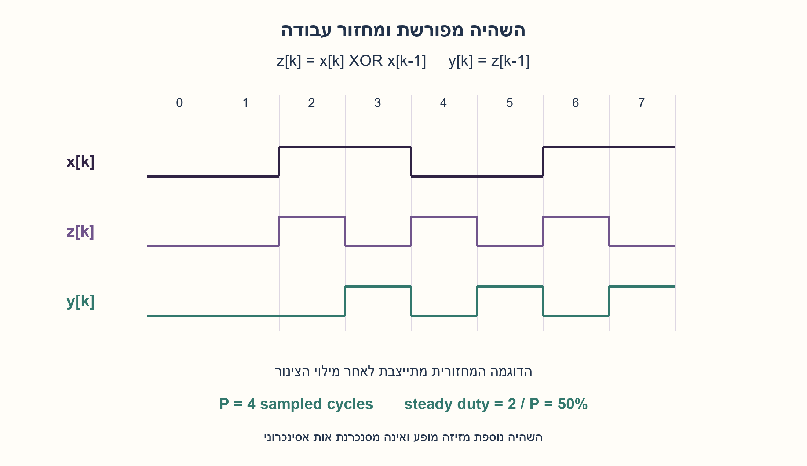
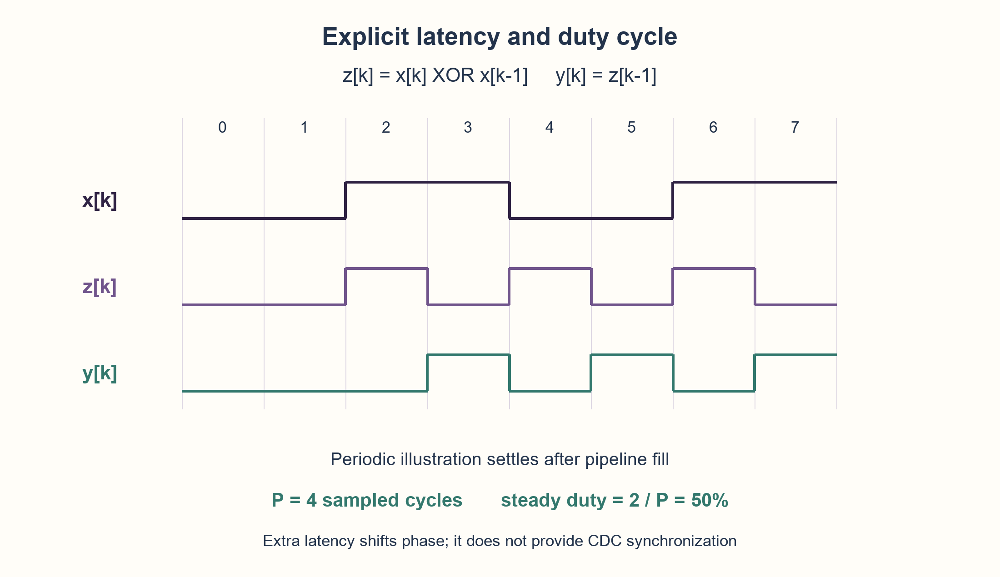

# PREP-004 — הרחבה מתאריך 30.10.2026

פתרון מוצע בסיוע AI; ביקורת אנושית ממתינה. הקושי לא כויל.

[צילום מקור פרטי](../sources/2026-10-30-batch20-04.png)

נתונה מערכת סינכרונית שמשמשת גוזר: מוציאה 1 כאשר הכניסה משתנה מ־1 ל־0 או להפך. הפלט הינו מחזור שעון אחד לאחר הכניסה; כלומר עבור 011 נקבל 001. ממש את המערכת ומצא את ה־DC שלה עבור כניסות עם DC של 50% בעלות אורך מחזור משתנה.

## עברית

### וריאציה: גלאי שני כיווני שינוי עם השהיה ומחזור עבודה
בצילום החדש מבקשים גלאי סינכרוני לשינוי מ־0 ל־1 או להפך, עם מוצא מאוחר במחזור אחד, ודוגמה 011→001. זו הרחבת תזמון נפרדת מהטבלה המקורית לעיל. הגדירו תחילה את סדר הדגימות ואת זמן קריאת המוצא. כאן המחרוזות כתובות לפי סדר ההגעה, הדגימה הראשונה היא k=0, והעבר לפני תחילת הקלט הוא אפס. נבחר y[k]=x[k−1] XOR x[k−2], שנקרא אחרי חזית k; זו השהיה נוספת של מחזור לעומת z[k]=x[k] XOR x[k−1] שבשאלה המקורית. ממשו והסבירו את מחזור העבודה עבור גל כניסה של 50% כאשר משנים את מחזורו. ציינו מתי יחס פשוט של מחזורי השעון מספיק ומתי הדגימה מאבדת שינויים.

1. כתבו את מספר הדגימה ליד כל ביט בדוגמה. האם מותר לשנות את הטבלה המקורית כדי להתאים למקור החדש?
2. הבחינו בין חישוב ההפרש של שתי הדגימות האחרונות לבין רישום ההפרש למחזור הבא. השהיית צינור מזיזה פולסים אך אינה משנה את צפיפותם במצב מתמיד.
3. אם לגל הנדגם יש P דגימות במחזור ושתי החלפות, כל אחת מוסיפה מחזור מוצא גבוה. בדקו גם P=2 ואת האפשרות ששתי החלפות אנלוגיות מתרחשות בין דגימות.

### מגדירים את הזמן לפני שבוחרים דלגלגים
הניסוח של מחזור אחד אחרי הכניסה אינו מספיק ללא ייחוס לחזית. לפי ההגדרה החדשה, 011 מתאר x[0]=0,x[1]=1,x[2]=1, ולכן y[0..2]=001. לעומת זאת, המעגל המקורי נותן z[0..2]=010. שניהם תקפים לחוזים שונים; אין לשנות את הנוסח הקודם או לומר ששתי הטבלאות זהות.

מימוש רשום משתמש בשלושה ביטי מצב, עם איפוס סינכרוני לאפס. בכל חזית, כל צד ימין נקרא מהמצב הישן:

```text
out <= q1 XOR q2
q2  <= q1
q1  <= In
```

אחרי החזית q1=x[k],q2=x[k−1],out=x[k−1] XOR x[k−2]. האינווריאנט מתקבל ישירות מהעדכון הסימולטני. המוצא הרשום יציב בין חזיתות במודל הסינכרוני. אין כאן טענה למסנכרן CDC, לעמידות מטא־יציבות או למינימום שטח פיזי.

### מחזור עבודה סופרים מתוך הגל שנדגם
נניח גל מחזורי שבדגימותיו יש P/2 אפסים ואחריהם P/2 אחדים, כאשר P זוגי ולפחות 2. יש שתי החלפות במחזור, ולכן בדיוק שתי דגימות מוצא גבוהות: DCout=2/P=2Tclk/Tin במצב מתמיד. ל־P=8 מתקבלים 25%; ל־P=4 מתקבלים 50%; ל־P=2 מתקבלים 100% והמוצא נשאר גבוה. אין חובה לרווח נמוך בין שני אירועי זיהוי סמוכים. ההשהיה הנוספת מזיזה את המופע בלבד.

אין להציב בנוסחה מחזור אנלוגי כלשהו ולקבל הבטחה כללית: הקלט חייב לעמוד בחלון הדגימה, ויש לדעת אילו רמות נתפסות בכל חזית. למשל גל אנלוגי עם 50% duty בתדר שווה לתדר הדגימה עשוי להידגם תמיד באותה רמה ולהפיק אפס שינויים. שינויים כפולים בין דגימות אובדים. עבור P אי־זוגי אי אפשר לייצג בדיוק 50% בעזרת דגימות שלמות. במצב פתיחה או בחלון סופי צריך לספור את הפולסים בפועל; 2/P הוא יחס של מצב מתמיד תחת ההנחות המוצהרות.

```python
"""Sampled both-edge detector with explicit extra-cycle pipeline latency."""


def delayed_edges(samples, initial=0):
    if initial not in (0, 1) or any(x not in (0, 1) for x in samples):
        raise ValueError("binary samples required")
    q1 = q2 = initial
    result = []
    for sample in samples:
        result.append(q1 ^ q2)
        q2, q1 = q1, sample
    return result


def steady_duty(period):
    """50% square wave, even integer sampled period >=2; omit startup."""
    if type(period) is not int or period < 2 or period % 2:
        raise ValueError("even sampled period required")
    word = [0] * (period // 2) + [1] * (period // 2)
    trace = delayed_edges(word * 4)
    tail = trace[2 * period:3 * period]
    return sum(tail), period
```




## English

### Variant: both-edge change detection, latency and duty cycle
The new source asks for a synchronous rising/falling change detector delayed by one cycle, and gives 011→001. This is a separate timing extension to the original table above. First define arrival order and output observation time. Here strings are chronological, the first sample is k=0 and prehistory is zero. Choose y[k]=x[k−1] XOR x[k−2], observed after edge k; this adds one cycle relative to the original z[k]=x[k] XOR x[k−1]. Implement it and analyze output duty for a 50%-duty input with varying period. State when a simple clock-period ratio applies and when sampling misses changes.

1. Index every bit in the example. Does the new latency require a different contract from the original timing table?
2. Separate comparison of consecutive samples from registering that comparison one cycle later. Pipeline delay shifts pulses but preserves steady-state density.
3. If the sampled period contains P samples and two transitions, each transition contributes one high output cycle. Also test P=2 and two analog transitions occurring between samples.

### Define time before choosing flip-flops
One cycle after input is ambiguous without edge indexing. Under this variant, 011 means x[0]=0,x[1]=1,x[2]=1, hence y[0..2]=001. The original circuit instead gives z[0..2]=010. They implement different timing contracts; the earlier text and table remain intact.

Use three state bits with synchronous zero reset. At each edge every right-hand side reads the old state:

```text
out <= q1 XOR q2
q2  <= q1
q1  <= In
```

After the edge q1=x[k],q2=x[k−1],out=x[k−1] XOR x[k−2]. This invariant follows from simultaneous updates. Registered output is stable between edges in the synchronous model. This is not a CDC synchronizer or a physical metastability/area guarantee.

### Count transitions in the sampled waveform
Assume a sampled periodic input with P/2 zeros then P/2 ones, even P≥2. Two transitions contribute exactly two high output samples per period: DCout=2/P=2Tclk/Tin in steady state. P=8 gives25%, P=4 gives50%, P=2 gives100% with continuous high output. Adjacent detection events need no low gap. The extra pipeline delay changes phase only.

Do not apply that expression to an arbitrary analog period without a sampling contract. Input must meet sampling timing, and captured levels matter. A50%-duty analog input at the sampling frequency can always be sampled at the same level and produce zero detected changes. Two transitions between samples can disappear. Odd P cannot represent exactly50% with whole samples. Startup and finite windows require counting actual pulses;2/P is a qualified steady-state result.

```python
"""Sampled both-edge detector with explicit extra-cycle pipeline latency."""


def delayed_edges(samples, initial=0):
    if initial not in (0, 1) or any(x not in (0, 1) for x in samples):
        raise ValueError("binary samples required")
    q1 = q2 = initial
    result = []
    for sample in samples:
        result.append(q1 ^ q2)
        q2, q1 = q1, sample
    return result


def steady_duty(period):
    """50% square wave, even integer sampled period >=2; omit startup."""
    if type(period) is not int or period < 2 or period % 2:
        raise ValueError("even sampled period required")
    word = [0] * (period // 2) + [1] * (period // 2)
    trace = delayed_edges(word * 4)
    tail = trace[2 * period:3 * period]
    return sum(tail), period
```




```json
{
  "assumptions": {
    "he": [
      "סדר דגימות כרונולוגי; עבר אפס; השהיה נוספת לפי הנוסחה; איפוס סינכרוני גובר על קליטה.",
      "הנוסחה למחזור עבודה מחייבת מחזור נדגם זוגי עם שתי החלפות; קלט סינכרוני ולא אות CDC חופשי."
    ],
    "en": [
      "Chronological samples, zero prehistory, extra latency as indexed, synchronous reset priority.",
      "Duty formula requires an even sampled period with two transitions; synchronous input, not an arbitrary CDC signal."
    ]
  },
  "optimality": {
    "he": "שלושה ביטי מצב ושער XOR במימוש הרשום המוצע, זמן קבוע לדגימה. אין טענת מינימום חדש או תדר פיזי. המינימום של שני ביטים בחוזה המקורי אינו אישור לאותה השהיה בהרחבה.",
    "en": "Proposed registered construction: three state bits and one XOR, constant work per sample. No new minimum or physical frequency claim. The original two-bit lower bound applies to its original latency contract."
  },
  "verification": {
    "he": "עברו 16,382 צירופי זרם/אתחול, 100 מחזורים זוגיים ודוגמת נגד לדגימת גל 50% באותה רמה; Python ושברים מדויקים בלבד.",
    "en": "Passed16,382stream/initialization pairs,100even periods and a same-phase50%-wave alias counterexample; Python and exact fractions only."
  },
  "edge_cases": {
    "he": [
      "011 נותן 001 בחוזה ההרחבה.",
      "P=2 נותן 100% אחרי התייצבות.",
      "שינויים בין חזיתות יכולים להיעלם; איפוס יכול לבטל אירוע שהיה בצינור."
    ],
    "en": [
      "011 gives001 under the extension contract.",
      "P=2 gives100% after startup.",
      "Between-edge changes may disappear; reset may cancel an in-flight event."
    ]
  },
  "common_mistakes": {
    "he": [
      "ערבוב טבלת המקור עם השהיה נוספת.",
      "הנחה שכל פולס מחייב מחזור נמוך אחריו.",
      "הסקת duty אנלוגי בלי לבחון את הדגימות."
    ],
    "en": [
      "Mixing the original table with extra latency.",
      "Assuming every pulse requires a low gap.",
      "Inferring analog duty without inspecting samples."
    ]
  },
  "interview_answer": {
    "he": "אגדיר y[k]=x[k−1] XOR x[k−2], ואשמור שתי דגימות ומוצא רשום. בגל נדגם של P מחזורים עם שתי החלפות מתקבל duty של 2/P במצב מתמיד, כולל 100% עבור P=2; אות אנלוגי מהיר יכול להתקפל ולהחמיץ שינויים.",
    "en": "Define y[k]=x[k−1] XOR x[k−2], retain two samples and a registered output. A P-cycle sampled square wave with two transitions gives steady duty2/P, including100% atP=2; fast analog changes may alias or be missed."
  },
  "source_ambiguities": {
    "he": [
      "המקור אינו מגדיר סדר כתיבה, חלון קריאת מוצא, יחס תדרים או איפוס; הוספנו חוזה שמתאים לדוגמה ושמרנו את החוזה המקורי בנפרד."
    ],
    "en": [
      "Source omits string orientation, output observation, frequency relationship and reset; the explicit example-compatible contract is separate from the preserved original."
    ]
  },
  "solution_extensions": {
    "he": [
      {
        "question": "מה יקרה אם הכניסה תשתנה בכל חזית?",
        "answer_direction": "אחרי מילוי הצינור מוצא גבוה רצוף; האירועים סמוכים ללא דרישת מחזור נמוך.",
        "principle": "פעימה לוגית יכולה להיות סמוכה לפעימה אחרת."
      }
    ],
    "en": [
      {
        "question": "What if input changes every edge?",
        "answer_direction": "After pipeline fill, output is continuously high; adjacent events need no low gap.",
        "principle": "Logical event cycles may be adjacent."
      }
    ]
  }
}
```
