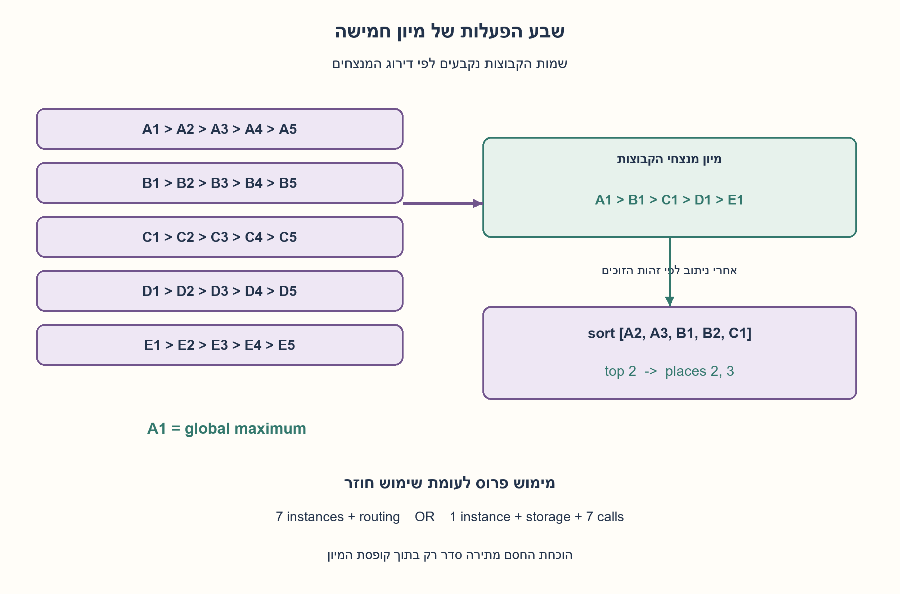
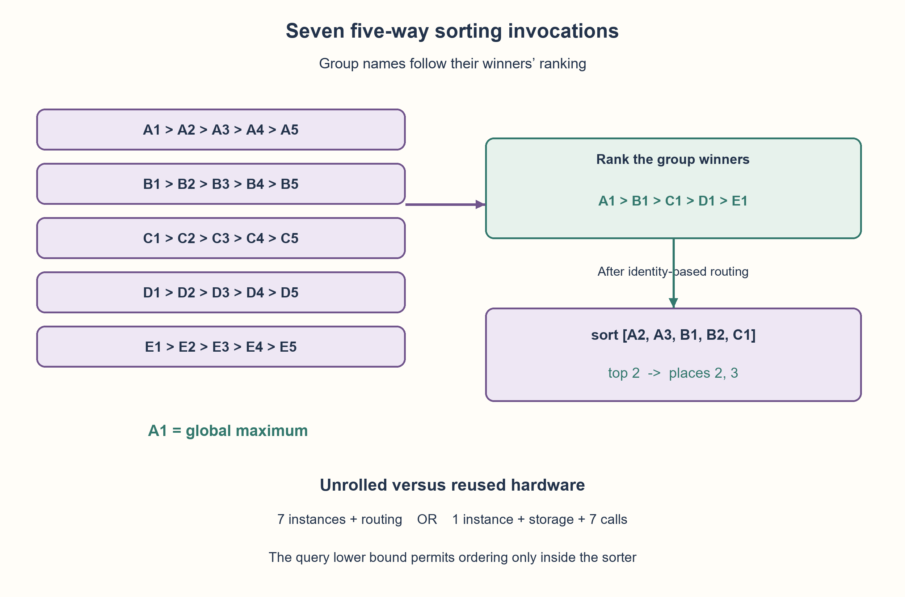

# PREP-009 — הרחבה מתאריך 30.10.2026

פתרון מוצע בסיוע AI; ביקורת אנושית ממתינה. הקושי לא כויל.

[צילום מקור פרטי](../sources/2026-10-30-batch40-15.png)

נתון רכיב A בעל חמש כניסות וחמש יציאות שממיין מספרים מהגדול לקטן. תכנן מערכת שמקבלת 25 מספרים שונים ומחזירה את שלושת הגדולים, באמצעות מינימום רכיבי A ורק באמצעותם. ניתן להשתמש בהתניות על מוצאי הרכיבים.

## עברית

### וריאציה חומרתית: 25 מספרים ורכיב שממיין חמישה
רכיבA מקבל חמישה מספרים שונים ומחזיר אותם בסדר יורד. תכננו מערכת שמחזירה את שלושת הגדולים מתוך25, עם מעט שימושים ברכיב. המקור מבקש מינימום רכיביA ומאפשר התניות על מוצאיהם.

הבחינו בין מספר הפעלות לבין מספר רכיבים פיזיים. במודל הראשי נבחר רשת צירופית ללא מחזורי שימוש חוזר, שבה כל סדר יחסי נלמד רק מרכיביA. מותר לנתב ערכים לפי זהות הזוכה של רכיבA, אך אסור לבצע השוואות סדר חופשיות מחוץ להם. זהות ניתנת למעקב בחיווט מותנה או בבדיקת שוויון של ערכים שונים. בנוסף דונו במודל סדרתי שמאפשר לשמור תוצאות ולהשתמש שוב באותה קופסה. המקור אינו מכריע בין המודלים.

1. החלוקה לחמש קבוצות מהשאלה המקורית עדיין מועילה. אילו מספרים אפשר לפסול אחרי שממיינים גם את חמשת המנצחים?
2. מספר שכבר ידועים שלושה גדולים ממנו אינו מועמד לשלישייה. עקבו גם אחרי המיקום בתוך קבוצה וגם אחרי דירוג מנצחי הקבוצות.
3. סמנו את הקבוצות אחרי דירוג המנצחיםA,B,C,D,E. המועמדים למקומות2,3 הםA2,A3,B1,B2,C1. הפרידו בין שבע הפעלות לבין כמה קופסאות פיזיות מחזיקים.

### אותה תובנת דירוג, אך תקציב חומרה מפורש
ממיינים את חמש הקבוצות ב־5רכיביA. רכיב שישי ממיין את חמשת מנצחי הקבוצות. שמותA,B,C,D,E להלן הם שמות הקבוצות אחרי דירוג זה, ולא קבוצה קבועה במיקום הכניסה. בתוך כל קבוצהA1>A2>...>A5, ודירוג המנצחים הואA1>B1>C1>D1>E1. A1 הוא הגדול מכל25.

למקומות2ו־3 נותרים רקA2,A3,B1,B2,C1. ל־A4 יש כברA1,A2,A3 מעליו; ל־B3 ישA1,B1,B2; ל־C2 ישA1,B1,C1; ל־D1ולכל קבוצה מאוחרת ישA1,B1,C1. כל ערך עוד יותר נמוך באותן קבוצות פסול גם הוא. רכיב שביעי ממיין את חמשת המועמדים. מחזיריםA1 ושתי היציאות הגדולות שלו. זה גם מסדר את השלישייה, לא רק מאתר אותה.

### מה פירוש שבעה
ברשת צירופית ללא שימוש חוזר, אפשר לפרוס7מופעים שלA: חמשה בשכבה הראשונה, אחד לדירוג מנצחים ואחד לסיום. בין שני האחרונים דרוש ניתוב מותנה שמעביר את מועמדי הקבוצות לפי זהות הזוכים. רכיב הממיין רק מספרים אינו מעביר תוויות קסומות; משתמשים במעקב זהות מותר או בשוויון, בהתאם לחוזה. אין לאפשר כאן השוואות גדול/קטן חופשיות, כי הן עצמן יכולות למיין ולהפוך את דרישת המינימום לחסרת משמעות.

למה שש הפעלות אינן מספיקות במקרה הגרוע במודל הזה? נגדיר יריב: בכל קריאה הוא מדרג את המשתתפים שטרם הפסידו מעל המשתתפים שכבר הפסידו. זה עקבי עם כל ההשוואות הקודמות: אילו כבר היה ידוע שמשתתף שהפסיד גדול ממועמד שטרם הפסיד, גם המועמד היה נשלל כמקסימום. לכן אפשר להמשיך את הסדר החלקי לסדר מלא חוקי המקיים את כלל היריב.

כדי לזהות מקסימום צריך לשלול 24 מועמדים. אם קריאה כוללת k מועמדים שטרם הפסידו, היריב משאיר אחד מהם כמנצח ושולל רק k−1; משתתפים שכבר הפסידו אינם מוסיפים שלילה חדשה. לכל היותר ארבעה נשללים בכל קריאה. לפיכך שש קריאות מחייבות חמישה מועמדים שטרם הפסידו בכל קריאה תחת כלל היריב הזה; אחרת לא יישללו כל ה־24. מתקבל עץ של רכיבים נפרדים, שהאלופים שלהם מתחרים.

לפחות אחד המשתתפים בקריאה האחרונה כבר ניצח קודם; היריב יכול לבחור בו כמנצח האחרון. הסגן שלו מהקריאה הקודמת והסגן מהקריאה האחרונה נמצאים בענפים נפרדים, ולא נלמד סדר ביניהם. שני סדרים מלאים חוקיים, שבהם כל אחד מהם שני, עדיין מתאימים לאותן תוצאות. לכן אפילו המקום השני לא מובטח אחרי שש קריאות. שבע קריאות נחוצות במקרה הגרוע והבנייה משיגה זאת. זהו חסם במודל חמש־דרך שהוגדר, לא לכל חומרה עם השוואות חופשיות; במקרה ממוזל ייתכן שיודעים יותר אחרי שש.

אם מותר שימוש סדרתי חוזר, די ברכיבA פיזי אחד שמופעל7פעמים, יחד עם אחסון, ניתוב ובקרה. אין סתירה: מחיר הזמן והאחסון השתנה. לכן אין תשובה יחידה למינימום רכיבים פיזיים בלי לקבוע אם זמן, אוגרים ובקרה מותרים. לא נטען ששטח כולל או מסלול קריטי מינימליים.

מודל התוכנה משתמש בסדר רק בתוך פונקציית הקופסה; מיפוי קבוצות משתמש בזהות ושוויון. נבדקו כל13,800המיקומים האפשריים של שלושת הגדולים ועוד1,000תמורות אקראיות, מול מיון מלא עצמאי; כל מקרה השתמש בדיוק7קריאות. הבדיקות תומכות בבנייה, והוכחת החסם נפרדת. אין סינתזה או מדידת השהיה.

```python
"""Seven five-way ordering queries; all ordering is inside the supplied block.

Inputs are 25 distinct hashable values from a total order. Equality/hash lookup
only routes groups. A reusable block needs storage/control; an unrolled network
uses seven block instances plus identity-based conditional routing.
"""


def top_three(values, sorter):
    if len(values) != 25 or len(set(values)) != 25:
        raise ValueError('Expected 25 distinct values')
    groups = [sorter(values[start:start + 5]) for start in range(0, 25, 5)]
    by_winner = {group[0]: group for group in groups}
    winners = sorter([group[0] for group in groups])
    a, b, c = (by_winner[winner] for winner in winners[:3])
    finalists = sorter([a[1], a[2], b[0], b[1], c[0]])
    return [a[0], finalists[0], finalists[1]]
```




## English

### Hardware variant:25numbers and a five-way sorter
BlockA takes five distinct numbers and returns them in descending order. Return the top three among25using few block uses. The source asks for the minimum number ofAcomponents and allows conditions on their outputs.

Distinguish invocations from physical instances. The main model is an acyclic combinational network without time reuse: onlyAblocks reveal relative order. Values may be routed according to winner identity, but no free external order comparisons are allowed. Identity can be tracked by conditional routing or equality on distinct values. Also discuss sequential reuse with stored intermediate results. The source does not choose between these models.

1. The original five groups remain useful. Which numbers can be discarded after sorting the five group winners?
2. A value with three known larger values cannot be in the top three. Track both within-group rank and winner-group rank.
3. After ranking group winners asA,B,C,D,E, places2and3 come fromA2,A3,B1,B2,C1. Separate seven invocations from physical block count.

### The same ranking insight with an explicit hardware budget
Sort five groups with5Ablocks, then sort their five winners with a sixth. NamesA,B,C,D,E below are assigned AFTER winner ranking, not fixed input groups. Within each groupA1>A2>...>A5, and winners satisfyA1>B1>C1>D1>E1. A1 is globally largest.

OnlyA2,A3,B1,B2,C1 can occupy places2and3. A4 already hasA1,A2,A3 above it;B3 hasA1,B1,B2;C2 hasA1,B1,C1;D1and all later groups haveA1,B1,C1. Every still-lower value in those groups is excluded too. A seventh block sorts the five finalists. ReturnA1and its top two outputs, so the answer is ordered.

### What seven counts
An acyclic non-reused network can instantiate7Ablocks: five in the first layer, one ranking winners, and one finishing. Conditional routing must select finalists based on winner identity. A numerical sorter does not magically carry labels; track identity through permitted wiring/equality. Free external greater/less comparisons are not allowed: they could do the sorting themselves and make the minimum-A question meaningless.

Why are six calls insufficient in the worst case? Use an explicit adversary: in each query rank every participating undefeated candidate above every participant that has already lost. This is consistent with prior comparisons: a known ordering path from an already defeated value to an undefeated candidate would already have eliminated that candidate from maximum contention. Thus the partial order admits a legal total-order extension respecting the adversary response.

Identifying the maximum requires eliminating 24 candidates. A query containing k undefeated candidates leaves one as winner and eliminates only k−1 under this adversary; previously defeated participants contribute no new elimination. At most four are eliminated per query. Therefore six queries force five undefeated candidates in every query under this rule, or fewer than 24 can be eliminated. The queries merge disjoint components through their champions into a tree.

At least one final-query participant has won earlier, and the adversary may choose it as the final winner. Its previous runner-up and the final runner-up lie in separate branches with no established relative order. Two legal total orders, making either one second, still fit the same observations. Thus even second place cannot be guaranteed after six queries. Seven worst-case queries are necessary and the construction attains the bound. This is a lower bound for the stated five-way model, not unrestricted hardware with free comparisons; a lucky six-query outcome may reveal more.

With sequential reuse, one physicalAblock can instead execute7queries, provided storage, routing and control are allowed. The time/storage budget changed. Therefore physical component minimum is not uniquely specified until reuse and auxiliary resources are defined. No minimum total area or critical-path claim is made.

The software model learns order only inside the supplied sorter; group routing uses identity/equality. All13,800possible top-three position placements plus1,000seeded permutations matched an independent full-sort oracle, with exactly7calls each. Tests support the construction; the lower-bound proof is separate. No synthesis or physical timing measurement was performed.

```python
"""Seven five-way ordering queries; all ordering is inside the supplied block.

Inputs are 25 distinct hashable values from a total order. Equality/hash lookup
only routes groups. A reusable block needs storage/control; an unrolled network
uses seven block instances plus identity-based conditional routing.
"""


def top_three(values, sorter):
    if len(values) != 25 or len(set(values)) != 25:
        raise ValueError('Expected 25 distinct values')
    groups = [sorter(values[start:start + 5]) for start in range(0, 25, 5)]
    by_winner = {group[0]: group for group in groups}
    winners = sorter([group[0] for group in groups])
    a, b, c = (by_winner[winner] for winner in winners[:3])
    finalists = sorter([a[1], a[2], b[0], b[1], c[0]])
    return [a[0], finalists[0], finalists[1]]
```




```json
{
  "assumptions": {
    "he": [
      "25 מספרים שונים בסדר מלא; הקופסה ממיינת בדיוק5 בסדר יורד.",
      "רק הקופסה חושפת סדר; התניות חופשיות משמשות ניתוב לפי זהות בלבד.",
      "מפרידים רשת צירופית משימוש סדרתי חוזר עם אחסון ובקרה."
    ],
    "en": [
      "25distinct total-order values; each block sorts exactly5descending.",
      "Only the block reveals ordering; free conditions perform identity-based routing only.",
      "Separate combinational instances from sequential reuse with storage/control."
    ]
  },
  "optimality": {
    "he": "7 קריאות במקרה הגרוע במודל חמש־דרך. מימוש פרוס משתמש7רכיבים; מימוש סדרתי יכול להשתמש ברכיב אחד וב־7קריאות. לא מינימום שטח כולל.",
    "en": "7worst-case queries in the five-way ordering model. Unrolling uses7instances; sequential reuse can use1instance for7queries. Not a total-area optimum."
  },
  "verification": {
    "he": "13,800 הצבות של השלישייה ועוד1,000תמורות, כולן מול מיון מלא ובדיקת7קריאות.",
    "en": "13,800top-three placements plus1,000permutations versus full sorting, each checked for7calls."
  },
  "edge_cases": {
    "he": [
      "כל שלושת הגדולים באותה קבוצה; או בשלוש קבוצות.",
      "סדר הקבוצות בכניסה שונה מסדר המנצחים; ערכים שליליים.",
      "כפילויות מחוץ לחוזה; שימוש חוזר משנה את ספירת הרכיבים."
    ],
    "en": [
      "Top three in one group or three separate groups.",
      "Input group order differs from winner order; negative values.",
      "Duplicates are outside the contract; reuse changes instance counts."
    ]
  },
  "common_mistakes": {
    "he": [
      "להציג שבע הפעלות כהוכחה לשבעה רכיבים בכל מודל.",
      "לנתב מהקבוצות המקוריות בלי לעדכן את שמותיהן לפי דירוג המנצחים.",
      "להשתמש בהשוואות סדר מחוץ לקופסה ולהמשיך לטעון לחסם שלה."
    ],
    "en": [
      "Treating seven invocations as seven necessary physical instances in every model.",
      "Routing fixed original groups instead of ranked winner groups.",
      "Using external ordering comparisons while claiming the oracle lower bound."
    ]
  },
  "interview_answer": {
    "he": "ממיינים חמש קבוצות ואז את המנצחים; הגדול ידוע, וחמישה מועמדים בלבד נשארים למקומות2,3. הפעלה שביעית מכריעה. מספר הרכיבים הפיזיים תלוי אם שימוש חוזר מותר.",
    "en": "Sort five groups and their winners. The maximum is known and five candidates remain for places2and3. A seventh query resolves them; physical instance count depends on reuse."
  },
  "source_ambiguities": {
    "he": [
      "מינימום רכיבים מול מינימום הפעלות, אחסון, ניתוב ושימוש בהתניות לא פורטו במקור; החוזים נפרדו."
    ],
    "en": [
      "Instances versus invocations, storage, routing and allowed conditions are unspecified; contracts are separated."
    ]
  },
  "solution_extensions": {
    "he": [
      {
        "question": "מה משתנה כאשר מרשים להשוות ערכים מחוץ לקופסה ללא עלות?",
        "answer_direction": "אפשר למצוא שלישייה בליA; החסם על קריאותA כבר אינו מודל משמעותי.",
        "principle": "חסם אופטימליות תלוי בגבול המשאבים."
      }
    ],
    "en": [
      {
        "question": "What changes if free external value comparisons are allowed?",
        "answer_direction": "Top three can be found withoutA; theA-query lower bound no longer models the task.",
        "principle": "Optimality bounds depend on resource boundaries."
      }
    ]
  }
}
```
