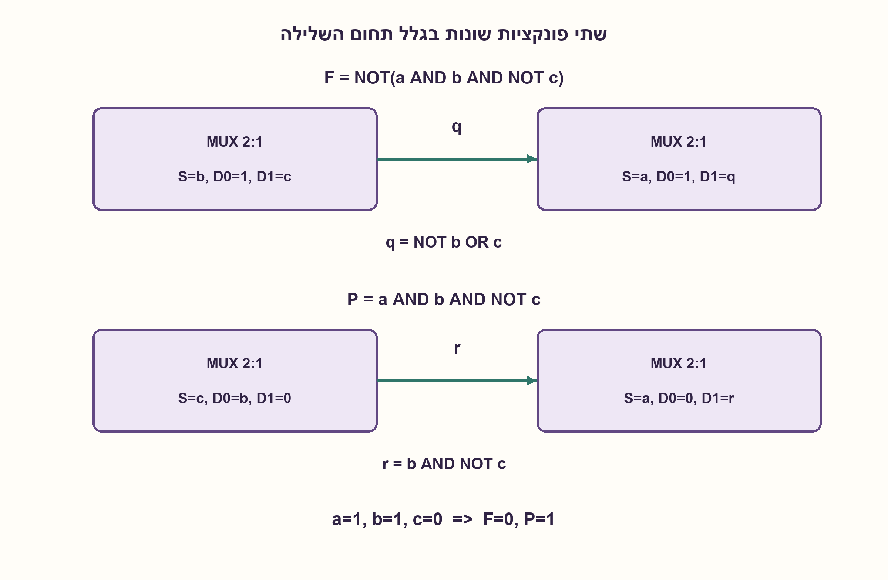
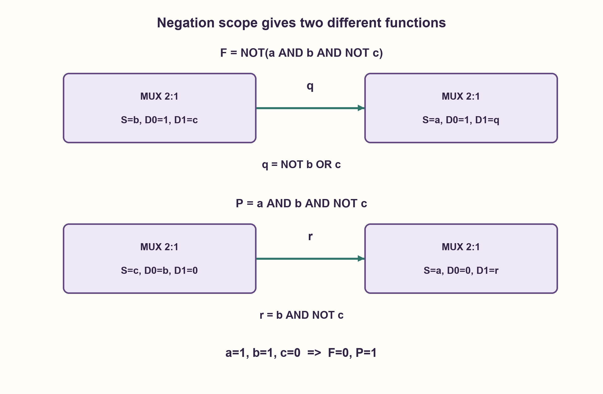

# PREP-011 — מימוש פונקציה בוליאנית באמצעות שני MUX

פתרון מוצע בסיוע AI; ביקורת מקצועית אנושית ממתינה. הקושי אינו מכויל.

[צילום מקור פרטי](../sources/2026-10-31-batch21-11.png)

נתון מספר בלתי מוגבל של רכיבי mux 2-1, צריך לממש את הפונק 'f=(a*b*c')

חברות לפי הדיווח בצילום בלבד: NVIDIA.

## עברית

### מקור נוסף: סימוני גרש עמומים
בצילום מופיע טקסט דו־כיווני דמוי ‎`'f=(a*b*c')`. אין להתייחס למיקום הגרש לבדו כהוכחה לתחום השלילה. החוזה הקנוני שכבר נשמר הוא F=NOT(a AND b AND NOT c). נציג לצד זה גם את קריאת המכפלה P=a AND b AND NOT c, כדי לא למחוק אפשרות פרשנות מהמקור.

לכל פירוש השתמשו ב־MUX 2:1 רגיל הבוחר D0 כש־S=0, עם כניסות a, b, c וקבועים 0,1. אין שלילות נתונות בחינם או שערים חיצוניים. הבהירו תחילה איזה פלט נדרש; שני הפלטים משלימים ואינם אותה פונקציה.

1. בדקו האם נדרשת המכפלה או השלילה שלה; השוו קלט אחד שבו המכפלה היא אחת.
2. אפשר לפרק לפי a: אם a=0, המכפלה אפס והשלילה אחת.
3. לשלילה חשבו q=MUX(b,1, c), ואז F=MUX(a,1, q). למכפלה חשבו r=MUX(c, b,0), ואז P=MUX(a,0, r).

### שני חיבורים שונים, שתי פונקציות משלימות
ל־F הקנונית נגדיר q=MUX(b,1, c). אם b=0 אז q=1, ואם b=1 אז q=c, לכן q=NOT b OR c. נבחר F=MUX(a,1, q): a=0 מחזיר אחת, ו־a=1 מחזיר NOT b OR c. זהו בדיוק NOT(a AND b AND NOT c), עם שני MUXes.

לקריאה P נגדיר r=MUX(c, b,0), שהוא b AND NOT c. אחר כך P=MUX(a,0, r), ולכן הוא a AND b AND NOT c. גם כאן שני MUXes, אך החיבורים שונים. בקלט a=b=1, c=0 מתקבלים P=1, F=0; ביתר שבע שורות הטבלה המכפלה אפס ושלילתה אחת.

במודל האציקלי שבו ל־MUX יחיד מותר לבחור כל אחד מ־a, b, c,0,1 בכל פין, אף בחירה של שלושת הפינים אינה נותנת אף פונקציה. אפשר לראות זאת גם בפירוק לפי כל משתנה: אחת מפונקציות ההמשך הלא־קבועות תלויה בשני המשתנים האחרים, ואינה חוט קלט יחיד. לכן שניים הם מינימום MUXes תחת הרשימה המוגדרת, לא תחת כניסות משלימות או פונקציות מוכנות מראש. ההוכחה והבדיקה של כל 125 חיבורי MUX יחיד נפרדות מהכרעה בנוסח העמום; המקור עצמו אינו נעשה חד־משמעי בעקבות הבדיקה.

### מודל לוגי בפייתון שהורץ

```python
"""Two explicitly distinct readings of the source's ambiguous prime marks."""


def mux(select, d0, d1):
    return d1 if select else d0


def complemented_product(a, b, c):
    inner = mux(b, 1, c)
    return mux(a, 1, inner)  # NOT(a AND b AND NOT(c))


def plain_product(a, b, c):
    inner = mux(c, b, 0)
    return mux(a, 0, inner)  # a AND b AND NOT(c)
```




### assumptions

```json
[
  "שני פירושים נפרדים; הקנוני נשאר F המשלים.",
  "רק קבועים 0,1 וכניסות גולמיות זמינים בכל פין."
]
```

### optimality

שני MUXes לכל פונקציה, ומינימום של שניים תחת ספריית הפינים המוגדרת. אין הוכחת מינימום כאשר פונקציות עזר מסופקות חינם.

### verification

נבדקו 16 שורות אמת לשתי הפונקציות, וכל 125 בחירות הפינים ל־MUX יחיד. אין הידור חומרה.

### edge_cases

```json
[
  "110 מבדיל בין הפונקציות.",
  "שלילה חיצונית שנשכחה הופכת את כל שמונה התוצאות."
]
```

### common_mistakes

```json
[
  "להסיק את הגרש ב־RTL בלי להציג חלופה.",
  "להוסיף inverter חיצוני בלי לספור אותו או לשנות את הספרייה."
]
```

### interview_answer

אכתוב תחילה את תחום השלילה בסוגריים. עבור הפונקציה הקנונית נשתמש בשני MUXes לפי b ואז a; אם הכוונה למכפלה, ניתן זוג חיבורים אחר.

### source_ambiguities

הצילום הדו־כיווני נשמר והעמימות מתועדת. אין שינוי של הפונקציה הקנונית או רמזיה הישנים.

### solution_extensions

```json
[
  {
    "question": "מה משתנה אם קבוע אחד אינו זמין?",
    "answer_direction": "צריך לבדוק מחדש אילו פונקציות ניתן לבנות מאוסף הכניסות המותר; אין להעתיק את הספירה של ספרייה עם 0 וגם 1.",
    "principle": "הוכחת מינימום קשורה לספריית המקורות."
  }
]
```

## English

### Additional source: ambiguous prime scope
The bidirectional screenshot contains a formula resembling `'f=(a*b*c')`. Prime placement alone does not establish negation scope. The preserved canonical contract is F=NOT(a AND b AND NOT c). Also show the alternative product reading P=a AND b AND NOT c rather than silently discard a possible interpretation.

For either reading use ordinary 2:1 MUXes selecting D0 for S=0, raw a, b, c and constants zero/one. No free complements or external gates are supplied. Clarify the desired output first: the two functions are complements, not interchangeable.

1. First distinguish the product from its complement using an input where the product is one.
2. Expand on a: when a=0 the product is zero and its complement one.
3. For the complement use q=MUX(b,1, c), F=MUX(a,1, q). For the product use r=MUX(c, b,0), P=MUX(a,0, r).

### Two connections, two complementary functions
For canonical F define q=MUX(b,1, c). It is one at b=0 and c at b=1, so q=NOT b OR c. Then F=MUX(a,1, q) gives one at a=0 and NOT b OR c at a=1: exactly NOT(a AND b AND NOT c), using two MUXes.

For product P define r=MUX(c, b,0)=b AND NOT c, then P=MUX(a,0, r)=a AND b AND NOT c. This also uses two MUXes but different connections. At a=b=1, c=0, P=1 and F=0; the other seven rows have P=0, F=1.

One acyclic MUX whose pins may each receive a, b, c,0,1 cannot implement either function. Expanding on any variable leaves a nonconstant branch depending on both remaining variables, not a single raw wire. Thus two MUXes are minimal under this declared pin library, not under arbitrary precomputed complements/functions. The proof and exhaustive check of 125 single-MUX pin assignments do not resolve the source's textual ambiguity.

### Executed Python logical model

```python
"""Two explicitly distinct readings of the source's ambiguous prime marks."""


def mux(select, d0, d1):
    return d1 if select else d0


def complemented_product(a, b, c):
    inner = mux(b, 1, c)
    return mux(a, 1, inner)  # NOT(a AND b AND NOT(c))


def plain_product(a, b, c):
    inner = mux(c, b, 0)
    return mux(a, 0, inner)  # a AND b AND NOT(c)
```




### assumptions

```json
[
  "Two distinct interpretations; canonical output remains complemented F.",
  "Only constants zero/one and raw inputs are available at pins."
]
```

### optimality

Two MUXes per function, minimal under the declared pin library. This lower bound excludes free helper functions.

### verification

Sixteen truth-table outputs and all 125 single-MUX pin assignments checked. No hardware compilation.

### edge_cases

```json
[
  "110 distinguishes the functions.",
  "An omitted outer negation reverses all eight outputs."
]
```

### common_mistakes

```json
[
  "Reading RTL prime scope as certain without preserving alternatives.",
  "Adding an uncounted external inverter or changing the library."
]
```

### interview_answer

Write explicit negation parentheses first. Canonical F uses two MUXes expanding on b then a; the product uses a different two-MUX wiring.

### source_ambiguities

The bidirectional screenshot is archived and ambiguity retained. Canonical function and old hints are unchanged.

### solution_extensions

```json
[
  {
    "question": "What if one constant is unavailable?",
    "answer_direction": "Recheck realizability from the allowed sources; do not carry over counts proved with both zero and one.",
    "principle": "A minimum proof is tied to its input library."
  }
]
```
