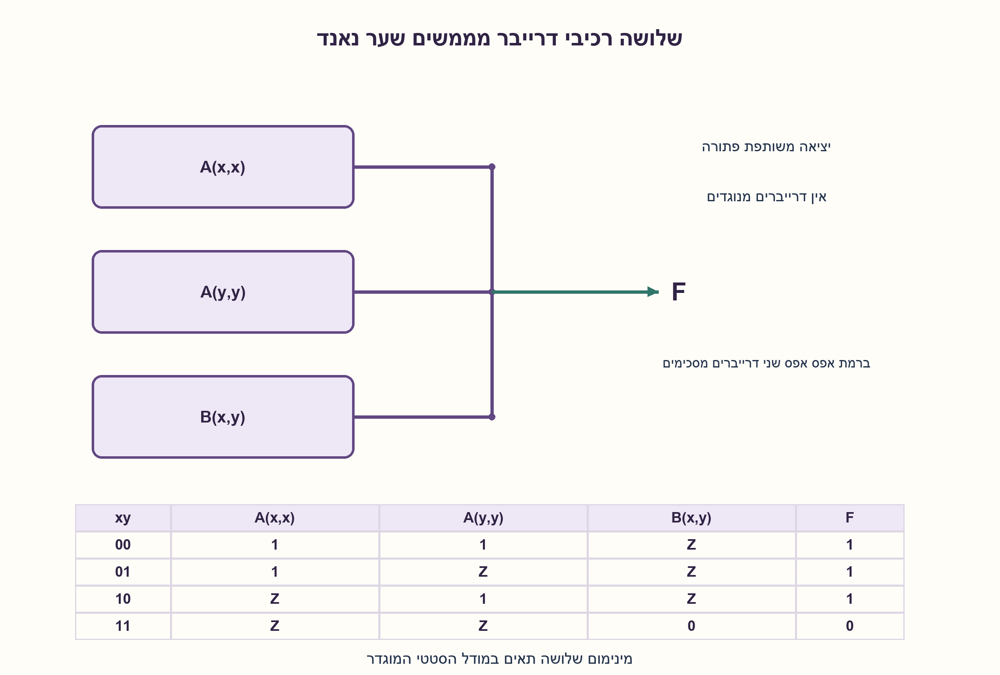
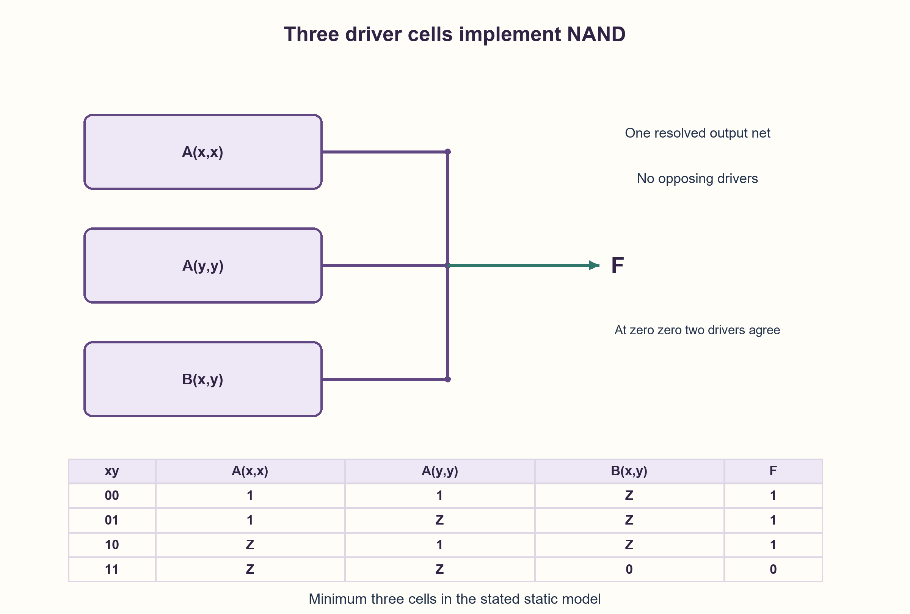

# PREP-015 — מימוש XOR באמצעות רכיבי A/B עם יציאות High-impedance

פתרון מוצע בסיוע AI; ביקורת מקצועית אנושית ממתינה. הקושי אינו מכויל.

[צילום מקור פרטי](../sources/2026-10-31-batch22-09.png)

ממש שער NAND עם הרכיבים a,b. [טבלה a: x,y=00→1,01→Z,10→Z,11→Z. טבלה b: 11→0,01→Z,10→Z,00→Z. Z: נתק.]

חברות לפי הדיווח בצילום בלבד: Intel, Apple.

## עברית

### וריאציה: NAND מאותם רכיבי A ו־B
ממשו NAND של שני ביטים x, y באמצעות רכיבי A, B הבאים והוכיחו מינימום: A(p, q) מוציא 1 רק ב־00, ו־Z בכל מקרה אחר; B(p, q) מוציא 0 רק ב־11, ו־Z בכל מקרה אחר.

במודל הסטטי מותר לחבר את יציאות הרכיבים לאותו חוט אם לכל צירוף קלט יש לפחות דרייבר פעיל אחד וכל הפעילים מסכימים. Z אינו ערך לוגי ואינו מוזן לבדו לכניסה. מותר לקשור את שתי כניסות הרכיב לאותו אות, להשתמש ב־fanout ובחיווט. המעגל חסר משוב; אין שערים חיצוניים, נגדי משיכה או כניסות משלימות בחינם. דונו גם בשאלה אם קבועי 0,1 חופשיים משנים את המינימום. היעד כאן NAND; יעד XOR המקורי נשאר סעיף נפרד.

1. ב־NAND רק המקרה 11 צריך לקבל 0. איזה רכיב מסוגל כבר להניע 0 בדיוק שם?
2. כדי לכסות 01 ו־10 עם רמת 1, בדקו בנפרד A(x, x) ו־A(y, y).
3. חברו A(x, x), A(y, y), B(x, y) לאותה יציאה. להוכחת מינימום, בדקו למה דרייבר 1 יחיד אינו יכול לכסות גם 01 וגם 10 בלי להתנגש ב־11.

### שלושה דרייברים, חוט פתור אחד
מחברים את יציאות A(x, x), A(y, y), B(x, y) לאותו חוט F. כל הרכיבים מקבלים רק x, y, שהם ביטים חוקיים; אף יציאת Z מבודדת אינה מזינה רכיב אחר.

| x | y | A(x, x) | A(y, y) | B(x, y) | F |
|---|---|---|---|---|---|
|0|0|1|1|Z|1|
|0|1|1|Z|Z|1|
|1|0|Z|1|Z|1|
|1|1|Z|Z|0|0|

ב־00 שני רכיבי A מניעים את אותה רמה 1; זו אינה התנגשות במודל המוגדר. בכל מקרה אחר יש דרייבר פעיל יחיד. לכן F=NOT(x AND y), וכל שורה מוגדרת. החיבור המשותף אינו שער OR, והחלפת Z באפס בטבלה הייתה משנה את משמעות המעגל.

### למה אי אפשר בפחות משלושה במודל הזה?
רמת 0 ב־11 מחייבת לפחות רכיב B אחד, כי A לעולם אינו מניע אפס. רמות 1 ב־01 וב־10 מחייבות רכיבי A. רכיב A יחיד שמקבל רק x, y, או גם קבועים חופשיים, אינו יכול להניע 1 בשני המקרים האלה בלי להניע 1 גם ב־11: אילו שתי כניסותיו אפס הן ב־01 והן ב־10, אף אחת אינה יכולה להיות x או y, ולכן שתיהן חייבות להיות אפס קבוע. אז הוא מניע 1 בכל המקרים ומתנגש עם האפס הנדרש ב־11. לכן נדרשים לפחות שני רכיבי A ולפחות B אחד.

הטיעון אינו מדלג על אפשרות של חיבור בטור: בתקציב של שני רכיבים, הרכיב הראשון לבדו אינו יכול ליצור אות ביניים בוליאני חדש שמוגדר בכל ארבע השורות. A בודד מניע רק 1 או Z, ו־B בודד רק 0 או Z. אם הוא מוגדר תמיד, הוא לכל היותר קבוע שכבר הותר בניתוח המחמיר. יציאה צפה אסורה כקלט. לכן רכיב ביניים אינו עוקף את החסם. המימוש בן שלושת הרכיבים משיג אותו, כך שהמינימום הוא בדיוק 3, גם עם קבועים חופשיים וגם בלעדיהם, תחת ההנחות המפורשות.

אימות ממוחשב מנה את כיסויי הדרייברים במחירים 1,2,3 בשתי ספריות המקורות ובדק את ארבע שורות המימוש ללא ציפה או רמות מתנגשות. זו הוכחה קומבינטורית למודל סטטי של תאים וכניסות בוליאניות תקפות, לא מינימום טרנזיסטורים או הבטחה להתנהגות אנלוגית במעברים. מינימום שבעת התאים של XOR אינו מועתק לכאן; פונקציית היעד השתנתה.

### מודל Python שנבדק

```python
"""Three-cell NAND, with an exact small-library lower-bound enumeration."""
from itertools import combinations_with_replacement, product


def a_cell(x, y):
    return 1 if x == y == 0 else 'Z'


def b_cell(x, y):
    return 0 if x == y == 1 else 'Z'


def drivers(x, y):
    return [a_cell(x, x), a_cell(y, y), b_cell(x, y)]


def nand(x, y):
    active = {value for value in drivers(x, y) if value != 'Z'}
    assert len(active) == 1
    return active.pop()


def minimum_direct_cover(free_constants=False):
    # Truth rows are 00,01,10,11. Driver choice is kind + two Boolean input nets.
    inputs = [(0,0,1,1), (0,1,0,1)]
    if free_constants:
        inputs += [(0,0,0,0), (1,1,1,1)]
    cells = []
    for function, x, y in product((a_cell, b_cell), inputs, inputs):
        values = tuple(function(a, b) for a, b in zip(x, y, strict=True))
        if values not in cells:
            cells.append(values)
    for size in range(1, 4):
        for chosen in combinations_with_replacement(cells, size):
            out = []
            for row in range(4):
                active = {cell[row] for cell in chosen if cell[row] != 'Z'}
                if len(active) != 1:
                    break
                out.append(active.pop())
            if out == [1,1,1,0]:
                return size
    raise AssertionError('No NAND cover within three cells')
```




### assumptions

```json
[
  "A מניע רק 1 ב־00 ו־B רק 0 ב־11; בשאר המקרים Z.",
  "מותרות כניסות קשורות ויציאות משותפות באותה רמה, ללא משוב או שערים נוספים.",
  "כניסה לרכיב חייבת להיות ביט מוגדר בכל צירוף קלט."
]
```

### optimality

מינימום 3 תאים: שני A ואחד B. החסם חל על מודל תאים א־מחזורי עם קלטים מוגדרים, ולא על ספריות טרנזיסטורים או כניסות משלימות חופשיות.

### verification

נבדקו ארבע שורות האמת, מספר הדרייברים הפעילים והסכמה ביניהם. נמנו כל כיסויי הדרייברים במחירים עד 3 עם ובלי קבועים. אין בדיקת מעבר אנלוגי.

### edge_cases

```json
[
  "ב־00 מותרים שני דרייברים שמסכימים על 1.",
  "ב־11 שני A מנותקים ורק B מניע 0."
]
```

### common_mistakes

```json
[
  "לבלבל Z עם 0.",
  "לאסור בלי הצדקה שתי יציאות שמניעות אותה רמה.",
  "להשתמש בכניסות NOT x ו־NOT y בלי לשלם על יצירתן.",
  "להעתיק את מינימום XOR אל יעד NAND."
]
```

### interview_answer

אחבר A(x, x), A(y, y), B(x, y). כל השורות מכוסות בלי התנגשויות. צריך B בשביל האפס ב־11 ושני A כדי לכסות את 01 ו־10, ולכן 3 הוא מינימום במודל הנתון.

### source_ambiguities

כללי החיבור והקלטים המותרים צריכים חוזה. כאן הם מפורשים ותואמים למודל הדרייברים של התרגיל, בלי להסיק מהם בטיחות חשמלית כללית.

### solution_extensions

```json
[
  {
    "question": "מה אם אוסרים ששני דרייברים פעילים אפילו מסכימים?",
    "answer_direction": "הפתרון ב־00 אינו עומד בחוזה החדש, וצריך לתכנן ולבדוק מינימום מחדש.",
    "principle": "מינימום רכיבים תלוי גם בכללי חיבור היציאות."
  }
]
```

## English

### Variant: NAND from the same A and B cells
Implement two-input NAND of x, y using these cells and prove a minimum: A(p, q) drives 1 only at 00 and Z otherwise; B(p, q) drives 0 only at 11 and Z otherwise.

In the static model outputs may share a net if every input case has at least one active driver and all active drivers agree. Z is not a Boolean input value. Tied cell inputs, fanout and wiring are allowed. The circuit is acyclic, without other gates, pull resistors or free complemented inputs. Also discuss whether free constants 0,1 change the minimum. This target is NAND; the original XOR target remains a separate part.

1. Only input 11 requires NAND output 0. Which cell already drives 0 exactly there?
2. To provide 1 at 01 and 10, examine A(x, x) and A(y, y) separately.
3. Join A(x, x), A(y, y), B(x, y) at the output. For minimality, show why one high driver cannot cover both 01 and 10 without conflicting at 11.

### Three drivers, one resolved net
Join outputs A(x, x), A(y, y), B(x, y) to one F net. Every cell receives only valid Boolean inputs x, y; no isolated Z output feeds another cell.

| x | y | A(x, x) | A(y, y) | B(x, y) | F |
|---|---|---|---|---|---|
|0|0|1|1|Z|1|
|0|1|1|Z|Z|1|
|1|0|Z|1|Z|1|
|1|1|Z|Z|0|0|

At 00 both A cells drive the same 1 level, which is not contention under the stated model. Every other case has exactly one active driver. F=NOT(x AND y) is therefore fully defined. Joining outputs is not an OR gate; replacing Z by Boolean zero would change the problem.

### Why fewer than three cannot suffice
The required 0 at 11 needs at least one B cell because A never drives zero. Required 1 values at 01 and 10 need A cells. One A cell using x, y, even with free constants, cannot drive 1 at both cases without also driving 1 at 11. If both its inputs are zero at both 01 and 10, neither input can be x or y; each must be constant zero. It would then drive 1 everywhere and conflict with the required zero at 11. At least two A cells and one B cell are needed.

This argument also addresses cascading: with a total budget of two cells, the first cell alone cannot produce a new Boolean intermediate net defined on all four rows. A single A drives only 1 or Z and a single B only 0 or Z. If always defined, it is at most a constant already allowed by the stronger argument. Feeding a floating intermediate value into a cell is forbidden. An intermediate cell therefore cannot evade the lower bound. The three-cell construction attains it, proving an exact minimum of 3 with or without free constants under these assumptions.

Computation enumerated driver covers at costs 1,2,3 for both source libraries and checked all four construction rows for floating or opposing drivers. This is a combinatorial static-cell result with valid Boolean cell inputs, not a transistor minimum or an analog switching guarantee. The XOR seven-cell minimum is not reused: the target function has changed.

### Verified Python teaching model

```python
"""Three-cell NAND, with an exact small-library lower-bound enumeration."""
from itertools import combinations_with_replacement, product


def a_cell(x, y):
    return 1 if x == y == 0 else 'Z'


def b_cell(x, y):
    return 0 if x == y == 1 else 'Z'


def drivers(x, y):
    return [a_cell(x, x), a_cell(y, y), b_cell(x, y)]


def nand(x, y):
    active = {value for value in drivers(x, y) if value != 'Z'}
    assert len(active) == 1
    return active.pop()


def minimum_direct_cover(free_constants=False):
    # Truth rows are 00,01,10,11. Driver choice is kind + two Boolean input nets.
    inputs = [(0,0,1,1), (0,1,0,1)]
    if free_constants:
        inputs += [(0,0,0,0), (1,1,1,1)]
    cells = []
    for function, x, y in product((a_cell, b_cell), inputs, inputs):
        values = tuple(function(a, b) for a, b in zip(x, y, strict=True))
        if values not in cells:
            cells.append(values)
    for size in range(1, 4):
        for chosen in combinations_with_replacement(cells, size):
            out = []
            for row in range(4):
                active = {cell[row] for cell in chosen if cell[row] != 'Z'}
                if len(active) != 1:
                    break
                out.append(active.pop())
            if out == [1,1,1,0]:
                return size
    raise AssertionError('No NAND cover within three cells')
```




### assumptions

```json
[
  "A drives 1 only at 00 and B drives 0 only at 11; otherwise Z.",
  "Tied inputs and agreeing shared drivers are allowed, without feedback or extra gates.",
  "Each cell input must be a defined bit on every input case."
]
```

### optimality

Exactly 3 cells: two A and one B. The bound is for acyclic defined-input cell networks, not transistor libraries or free complemented inputs.

### verification

Checked all four truth rows, active-driver counts and agreement; enumerated covers through cost 3 with and without constants. No analog transient check.

### edge_cases

```json
[
  "At 00 two drivers agree on 1.",
  "At 11 both A cells disconnect and only B drives 0."
]
```

### common_mistakes

```json
[
  "Confusing Z with 0.",
  "Unjustifiably banning two outputs driving the same value.",
  "Using NOT x and NOT y as uncounted free inputs.",
  "Transferring XOR minimality to NAND."
]
```

### interview_answer

Join A(x, x), A(y, y), B(x, y). Every row is driven consistently. One B is needed for zero at 11 and two A cells for 01 and 10, so 3 is minimal in this model.

### source_ambiguities

Joining and allowed inputs need a contract. They are explicit here and match the stated driver model without implying general electrical safety.

### solution_extensions

```json
[
  {
    "question": "What if even agreeing simultaneous drivers are forbidden?",
    "answer_direction": "The 00 case violates that changed contract, requiring a new construction and minimum analysis.",
    "principle": "Cell minimality depends on output-joining rules too."
  }
]
```
