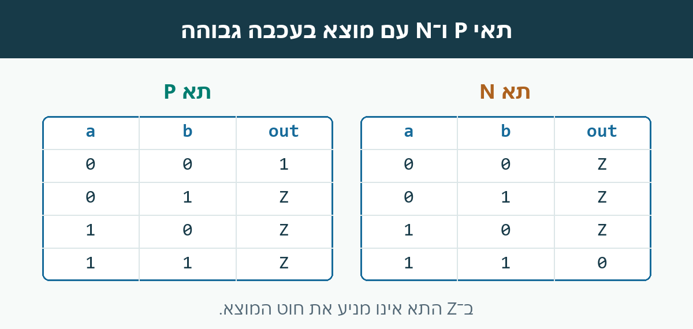
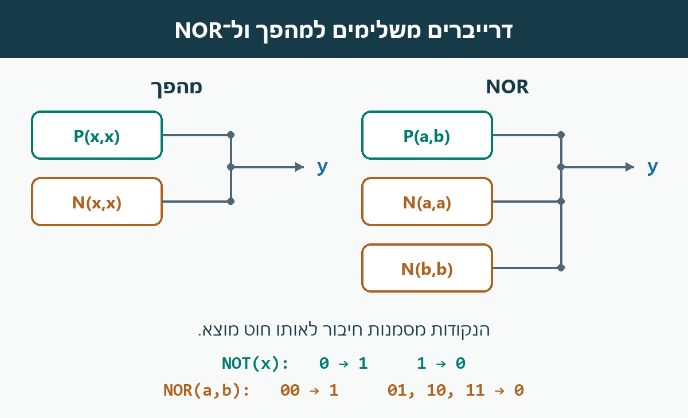
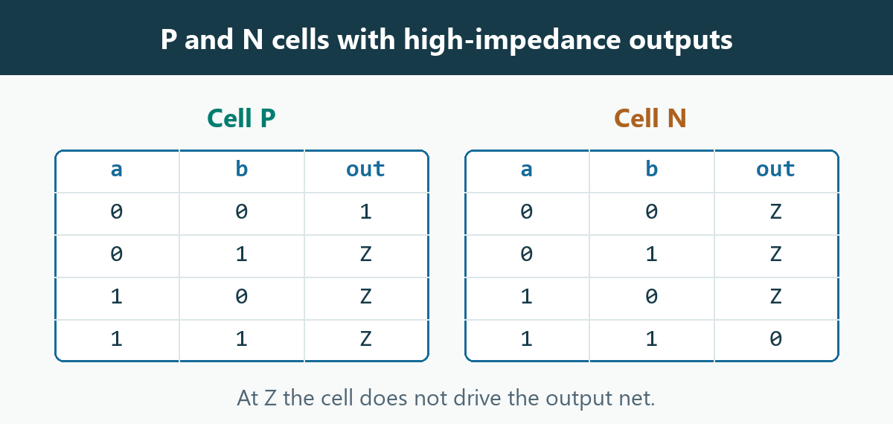
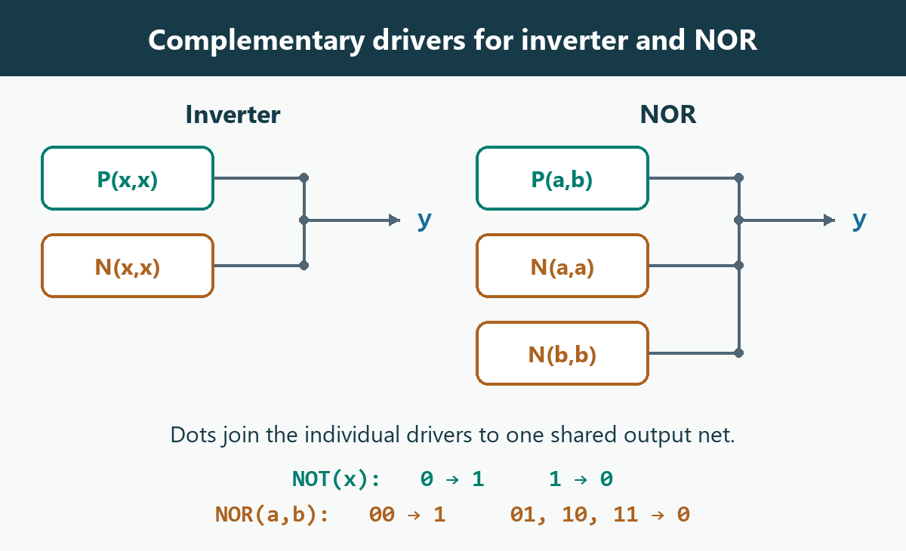

# PREP-015 — מימוש XOR באמצעות רכיבי A/B עם יציאות High-impedance

הצעה לפתרון. ביקורת מקצועית אנושית ממתינה.

## עברית

### הרחבה: מהפך ושער NOR
השתמשו בתאים `P` ו־`N` לפי הטבלה המצורפת. `P` מניע 1 עבור `00` בלבד, ו־`N` מניע 0 עבור `11` בלבד. בשאר השורות כל תא מציג עכבה גבוהה `Z`. ממשו מהפך ושער `NOR` דו־כניסתי באמצעות התאים האלה והציגו את ערכי הדרייברים בכל שורה. מותר לקשור כניסות זו לזו ולשתף חוט מוצא במודל יציב שבו בכל צירוף יש לפחות דרייבר פעיל אחד וכל הפעילים מסכימים.

1. במהפך נדרש דרייבר שונה עבור כל אחד משני ערכי הקלט.
2. קשרו את שתי הכניסות של P ל־x וגם את שתי הכניסות של N ל־x.
3. ב־NOR צריך 1 רק ב־00. הוסיפו דרייבר 0 נפרד לכל קלט שערכו 1.

### בניית דרייברים משלימים

#### כיווני חשיבה להרחבה
1. במהפך נדרש דרייבר שונה עבור כל אחד משני ערכי הקלט.
2. קשרו את שתי הכניסות של P ל־x וגם את שתי הכניסות של N ל־x.
3. ב־NOR צריך 1 רק ב־00. הוסיפו דרייבר 0 נפרד לכל קלט שערכו 1.

במהפך מחברים את יציאות `P(x,x)` ו־`N(x,x)` לאותו חוט `y`. ב־`x=0` רק P מניע 1, וב־`x=1` רק N מניע 0. כך `y=¬x` בשני המצבים.

ב־NOR מחברים חוט מוצא משותף לשלושת הדרייברים `P(a,b)`, `N(a,a)`, `N(b,b)`. התא הראשון מספק את ה־1 עבור `00`, וכל N מניע 0 אם הקלט שהוא מחובר אליו הוא 1.

| a | b | P(a,b) | N(a,a) | N(b,b) | y |
| --- | --- | --- | --- | --- | --- |
| 0 | 0 | 1 | Z | Z | 1 |
| 0 | 1 | Z | Z | 0 | 0 |
| 1 | 0 | Z | 0 | Z | 0 |
| 1 | 1 | Z | 0 | 0 | 0 |

בכל שורה המוצא מוגדר, וב־11 שני הדרייברים הפעילים מניעים 0. שני תאים מספיקים למהפך ושלושה ל־NOR. הטבלה מראה נכונות יציבה. `Z` מציין שהדרייבר אינו מניע, ואינו הערך 0. בדיקת פיזור השהיות, זרם זמני במעבר ומימוש בטכנולוגיה מסוימת מצריכה מידע מעבר למודל הדרייברים. סימולציית RTL בדקה את הטבלה על חוט רב־דרייברים עם רזולוציית `Z`.

## English

### Follow-up: An inverter and a NOR gate
Use cells `P` and `N` as specified in the figure. `P` drives 1 only for `00`, and `N` drives 0 only for `11`. In the remaining rows each cell presents high impedance `Z`. Build an inverter and a two-input `NOR` from these cells and show the driver values in every row. You may tie inputs together and share an output net in the steady-state model when at least one driver is active for each input and all active drivers agree.

1. An inverter needs a different active driver for each of its two inputs.
2. Tie both inputs of P to x and both inputs of N to x.
3. NOR needs 1 only at 00. Use a separate zero driver for each asserted input.

### Build complementary drivers

#### Hints for the follow-up
1. An inverter needs a different active driver for each of its two inputs.
2. Tie both inputs of P to x and both inputs of N to x.
3. NOR needs 1 only at 00. Use a separate zero driver for each asserted input.

For the inverter connect `P(x,x)` and `N(x,x)` to output net `y`. At `x=0` only P drives, producing 1. At `x=1` only N drives, producing 0. Either way `y=¬x`.

For NOR share one output net among `P(a,b)`, `N(a,a)`, `N(b,b)`. The first cell supplies the one for `00`, and each N supplies a zero when its particular input is one.

| a | b | P(a,b) | N(a,a) | N(b,b) | y |
| --- | --- | --- | --- | --- | --- |
| 0 | 0 | 1 | Z | Z | 1 |
| 0 | 1 | Z | Z | 0 | 0 |
| 1 | 0 | Z | 0 | Z | 0 |
| 1 | 1 | Z | 0 | 0 | 0 |

Every output is defined. At 11 both active drivers agree on zero. Two cells suffice for inversion and three for NOR. The table proves steady-state correctness. `Z` indicates the absence of a drive, which must be resolved on the net before it can be assigned a Boolean value. Transition current, delay spread and technology mapping require information outside the driver model. RTL simulation checked the table on multiply driven nets with `Z` resolution.

[צילום מקור פנימי 8](../sources/2026-11-18-batch31-08.png)
[קובץ המימוש](../solutions/digital1118.sv)
[קובץ המימוש](../solutions/digital1118_models.py)
[תוצאות בדיקות](../checks/digital1118-verification.json)
