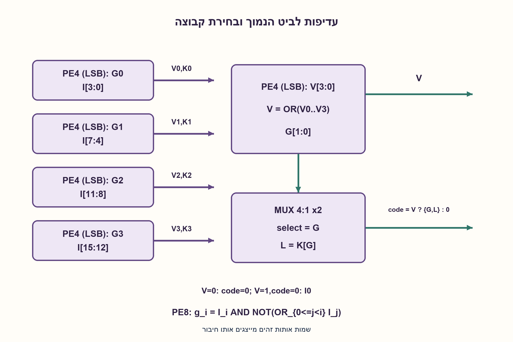
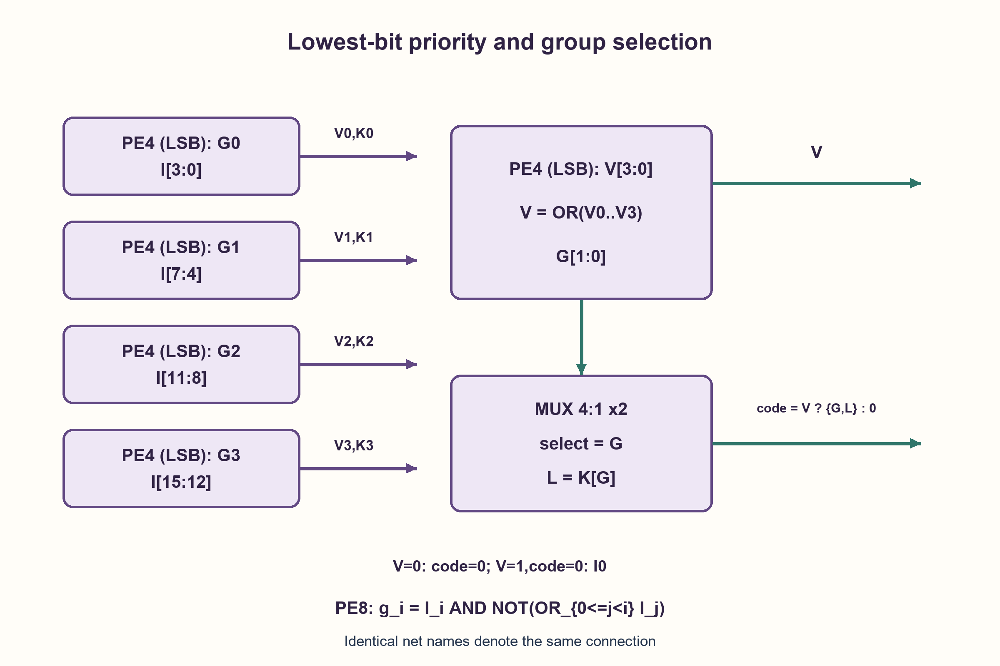

# PREP-016 — בניית בקר פסיקות של 16 כניסות מבקרים של 4 כניסות

פתרון מוצע בסיוע AI; ביקורת מקצועית אנושית ממתינה. הקושי אינו מכויל.

[צילום מקור פרטי](../sources/2026-10-30-batch90-05.png)

יש לך רכיב שמקבל 4 ביטים ומוציא את המקום של הביט 1 הכי ימני ועוד יציאה בגודל סיב אחד שהיא מחזירה 1 אם קיים 1 בכניסה ו־0 אם לא קיים. לתכנן רכיב בגודל 16 ביט שעושה את אותה פעולה.

חברות לפי הדיווח בצילום בלבד: Intel, NVIDIA, Amazon.

[צילום מקור פרטי](../sources/2026-10-30-batch90-16.png)

ממש Priority Encoder בעל 8 סיביות בעזרת שערים לוגיים בסיסיים בלבד.

חברות לפי הדיווח בצילום בלבד: Apple.

## עברית

### וריאציות מקור נוספות: קדימות לימין ומימוש בשערים
צילום 5 נותן מקודד לארבע כניסות שמחזיר את מיקום ה־1 הימני ביותר ואת valid. בנו בעזרתו מקודד לשש־עשרה כניסות. צילום 16 מבקש מקודד עדיפות לשמונה כניסות בשערים בסיסיים.

בחלק זה דווקא הביט בעל האינדקס הנמוך הוא בעל העדיפות הגבוהה, בניגוד לחוזה המקורי לעיל. נבחר מספור I0=LSB, פלט מיקום בינארי ו־valid. כאשר אין 1 נגדיר מיקום 0, שרק valid=0 מבדיל אותו מקלט חוקי I0. במימוש שמונה הכניסות נבחר AND/OR/NOT עם fanout וחיווט מותרים; אין אופטימום ספריית תאים מוסכם.

1. קדימות בתוך קבוצה אינה מספיקה; צריך לבחור גם את הקבוצה הראשונה שיש בה 1.
2. חלקו את 16 הכניסות לארבע קבוצות, וצרו valid לכל קבוצה. קוד הקבוצה הוא שני הביטים העליונים.
3. בחרו בעזרת MUX את הקוד המקומי של הקבוצה הזוכה. למימוש שערים, חסמו כל כניסה אם כבר הופיעה כניסה נמוכה יותר.

### שומרים בנפרד מידע על קיום ועל מיקום
לכל קבוצה g=0..3 מפעילים PE4 על I[4 g+3:4 g] ומקבלים Vg, Kg. בוחרים את הקבוצה g הקטנה ביותר ש־Vg=1, ויוצרים code={g, Kg}. לא עושים OR של הקודים המקומיים: קוד של קבוצה פעילה בעדיפות נמוכה יותר, ואפילו ערך לא מוגדר של קבוצה ריקה, עלול לשבש את התוצאה. לכן low=MUX(K0, K1, K2, K3, select=g), ו־valid=V0∨V1∨V2∨V3.

לבחירת הקבוצה אפשר להשתמש ב־PE4 חמישי מאותו סוג או בשערים: G1=(¬V0)∧(¬V1)∧(V2∨V3), G0=(¬V0)∧(V1∨((¬V2)∧V3)). שני הביטים העליונים הם G1, G0; שני התחתונים נבחרים ב־MUX. זו בנייה בארבעה מקודדים מקומיים ועוד לוגיקה, או בחמישה אם גם בחירת הקבוצה נעשית בקופסה. אין טענת מינימום בלתי מסויג: אם כל פונקציה מותרת בחינם בשערים, אפשר לבנות את הכול ללא קופסאות.

לשמונה כניסות מגדירים grant יחיד לכל מועמד: g_i=I_i∧¬(I0∨…∨I_(i−1)), ועבור i=0 פשוט g_0=I0. רק ה־1 בעל האינדקס הקטן ביותר שורד. אחר כך Y0=g1∨g3∨g5∨g7, Y1=g2∨g3∨g6∨g7, Y2=g4∨g5∨g6∨g7. valid הוא OR של כל הכניסות. אפשר לחשב את ה־prefix OR בשרשרת או בעץ, בהתאם לפשרת שטח־השהיה.

בחירת עדיפות ל־MSB דורשת היפוך סדר הכניסות ומיפוי המיקום בחזרה; אין להציג את השרטוט הישן של MSB כאילו הוא מממש LSB ללא התאמה. ההוכחה: Vg מסמן בדיוק קבוצה לא ריקה; בחירת הקבוצה הראשונה ואז האיבר הראשון בה נותנת את המיקום הראשון בכל המילה. נבדקו כל 65,536 הקלטים בארבעה דפוסי קוד לא פעיל שונים, וכל 256 קלטי המקודד בן 8 הכניסות. אין הידור HDL או מדידת השהיה.

### מודל לוגי בפייתון שהורץ

```python
"""Lowest-index hierarchy and an eight-input AND/OR/NOT encoder model."""


def pe4_low(word, invalid_code=0):
    if type(word) is not int or not 0 <= word < 16 or not 0 <= invalid_code < 4:
        raise ValueError("four-bit input and two-bit invalid code required")
    for index in range(4):
        if word & (1 << index):
            return 1, index
    return 0, invalid_code


def pe16_low(word, invalid_codes=(0, 0, 0, 0), upper_invalid=0):
    if type(word) is not int or not 0 <= word < (1 << 16):
        raise ValueError("sixteen input bits required")
    if len(invalid_codes) != 4:
        raise ValueError("four inactive local codes required")
    local = [pe4_low((word >> (4 * group)) & 15, invalid_codes[group])
             for group in range(4)]
    valid, group = pe4_low(sum(v << i for i, (v, _) in enumerate(local)), upper_invalid)
    code = (group << 2) | local[group][1]
    return valid, code if valid else 0


def pe8_gates_low(word):
    if type(word) is not int or not 0 <= word < 256:
        raise ValueError("eight input bits required")
    grants, prefix = [], 0
    for index in range(8):
        bit = (word >> index) & 1
        grants.append(bit & (1 ^ prefix))
        prefix |= bit
    y0 = grants[1] | grants[3] | grants[5] | grants[7]
    y1 = grants[2] | grants[3] | grants[6] | grants[7]
    y2 = grants[4] | grants[5] | grants[6] | grants[7]
    return prefix, (y2 << 2) | (y1 << 1) | y0
```




### assumptions

```json
[
  "קדימות הווריאציה ל־LSB; החוזה המקורי ל־MSB נשאר ללא שינוי.",
  "valid נפרד מהקוד; קודים בקבוצות ריקות אינם מהימנים."
]
```

### optimality

ארבעה מקודדים מקומיים ולוגיקת קבוצה/MUX, או קופסה חמישית לקבוצה. אין הוכחת מינימום כששערים חופשיים; מקודד 8 הוא רשת prefix/grant.

### verification

262,144 מקרי היררכיה ו־256 מקרי שערים, כולל כמה 1 וקודים שרירותיים בקבוצות ריקות.

### edge_cases

```json
[
  "כל הכניסות 0: valid=0.",
  "I0 בלבד: valid=1, code=0.",
  "כמה קבוצות פעילות; יש לבחור את בעלת האינדקס הקטן."
]
```

### common_mistakes

```json
[
  "איחוד הקודים ב־OR.",
  "החלפה שקטה בין קדימות MSB ל־LSB.",
  "התעלמות מ־valid כאשר code=0."
]
```

### interview_answer

אחשב valid וקוד בכל רביעייה, אקודד את הקבוצה הראשונה שאינה ריקה ואבחר את הקוד המקומי שלה ב־MUX. בשערים אחסום כל כניסה אם יש 1 נמוך ממנה.

### source_ambiguities

```json
[
  "צילום 16 אינו מציין כיוון קדימות; כאן נבחר LSB בגלוי.",
  "המספר המינימלי תלוי בעלות ובפעולות שמותר לבצע ללא קופסה."
]
```

### solution_extensions

```json
[
  {
    "question": "האם קוד 0 לבדו מוכיח שלא היה קלט?",
    "answer_direction": "לא. מיקום 0 הוא קלט חוקי; valid חיוני כדי להבחין.",
    "principle": "אפס נתונים אינו בהכרח חוסר נתונים."
  }
]
```

## English

### Additional source variants: rightmost priority and basic gates
Source 5 supplies a four-input encoder returning the rightmost1 position and valid; build a 16-input encoder from it. Source 16 requests an eight-input priority encoder from basic gates.

This variant assigns highest priority to the LOWEST input index, unlike the original contract above. Choose I0=LSB, a binary position and valid. Normalize inactive code to 0; valid=0 distinguishes it from the genuine active I0 case. For eight inputs choose AND/OR/NOT gates with wiring and fanout; no cell-library optimum is specified.

1. Local priority is insufficient: select the first nonempty group as well.
2. Split16 inputs into four groups; group-valid priority gives the upper two index bits.
3. Mux the winning local code. For gate-only logic, inhibit each input when any lower input is asserted.

### Keep existence and position separate
For each group g=0..3, apply PE4 to I[4 g+3:4 g], yielding Vg, Kg. Select the smallest g with Vg=1 and form code={g, Kg}. Do not OR local codes: lower-priority active groups, and even arbitrary inactive-group codes, can corrupt the answer. Use low=MUX(K0, K1, K2, K3, select=g) and valid=V0∨V1∨V2∨V3.

Select the group with a fifth PE4 or gate logic: G1=(¬V0)∧(¬V1)∧(V2∨V3), G0=(¬V0)∧(V1∨((¬V2)∧V3)). These are the upper two bits; a mux selects the lower two. This is a construction using four local encoders plus logic, or five boxes when group selection also uses a box. An unrestricted minimum is unjustified: if arbitrary gate logic is free, the entire function can use zero encoder boxes.

For eight inputs define one grant per candidate: g_i=I_i∧¬(I0∨…∨I_(i−1)); g_0=I0. Only the lowest asserted input survives. Then Y0=g1∨g3∨g5∨g7, Y1=g2∨g3∨g6∨g7, Y2=g4∨g5∨g6∨g7. valid is the OR of all inputs. A prefix-OR chain or tree trades area and delay.

MSB priority needs reversed input order and an index remapping; the old MSB diagram does not become LSB logic without those changes. Correctness follows because Vg identifies precisely a nonempty group, and selecting the first group then its first active input selects the first bit of the entire word. Checks cover all 65,536 inputs under four arbitrary inactive-code patterns and all 256 eight-input words. No HDL compilation or delay measurement was performed.

### Executed Python logical model

```python
"""Lowest-index hierarchy and an eight-input AND/OR/NOT encoder model."""


def pe4_low(word, invalid_code=0):
    if type(word) is not int or not 0 <= word < 16 or not 0 <= invalid_code < 4:
        raise ValueError("four-bit input and two-bit invalid code required")
    for index in range(4):
        if word & (1 << index):
            return 1, index
    return 0, invalid_code


def pe16_low(word, invalid_codes=(0, 0, 0, 0), upper_invalid=0):
    if type(word) is not int or not 0 <= word < (1 << 16):
        raise ValueError("sixteen input bits required")
    if len(invalid_codes) != 4:
        raise ValueError("four inactive local codes required")
    local = [pe4_low((word >> (4 * group)) & 15, invalid_codes[group])
             for group in range(4)]
    valid, group = pe4_low(sum(v << i for i, (v, _) in enumerate(local)), upper_invalid)
    code = (group << 2) | local[group][1]
    return valid, code if valid else 0


def pe8_gates_low(word):
    if type(word) is not int or not 0 <= word < 256:
        raise ValueError("eight input bits required")
    grants, prefix = [], 0
    for index in range(8):
        bit = (word >> index) & 1
        grants.append(bit & (1 ^ prefix))
        prefix |= bit
    y0 = grants[1] | grants[3] | grants[5] | grants[7]
    y1 = grants[2] | grants[3] | grants[6] | grants[7]
    y2 = grants[4] | grants[5] | grants[6] | grants[7]
    return prefix, (y2 << 2) | (y1 << 1) | y0
```




### assumptions

```json
[
  "The variant uses LSB priority; the original MSB contract is unchanged.",
  "Valid is separate from index; inactive local codes cannot be trusted."
]
```

### optimality

Four local encoders plus group/mux logic, or a fifth box for groups. No minimum under unrestricted free gates; PE8 uses a prefix/grant network.

### verification

262,144 hierarchy cases and 256 gate cases, including multiple asserted inputs and arbitrary inactive codes.

### edge_cases

```json
[
  "All-zero input: valid=0.",
  "I0 only: valid=1, code=0.",
  "Several groups active: select the lowest group index."
]
```

### common_mistakes

```json
[
  "OR-combining codes.",
  "Silently switching MSB and LSB priority.",
  "Ignoring valid when code=0."
]
```

### interview_answer

Compute local valid/index, encode the first nonempty group and mux its local code. Gate logic suppresses each input if a lower bit is active.

### source_ambiguities

```json
[
  "Source 16 does not specify priority direction; this variant explicitly selects LSB.",
  "A minimum depends on the cost and logic allowed outside boxes."
]
```

### solution_extensions

```json
[
  {
    "question": "Does index0 prove no input was active?",
    "answer_direction": "No. Input0 is a genuine winner; valid distinguishes it.",
    "principle": "A zero value is not absence."
  }
]
```
