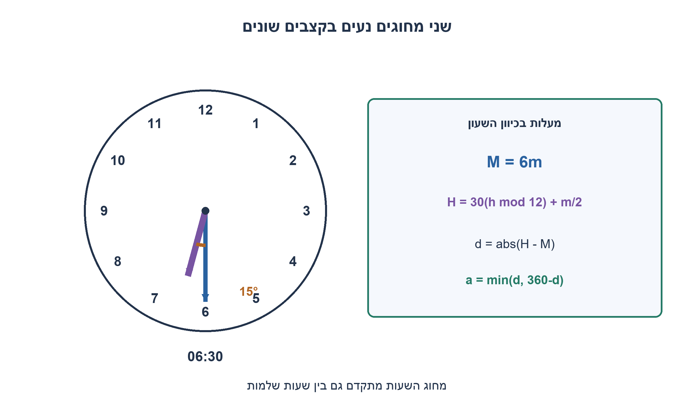
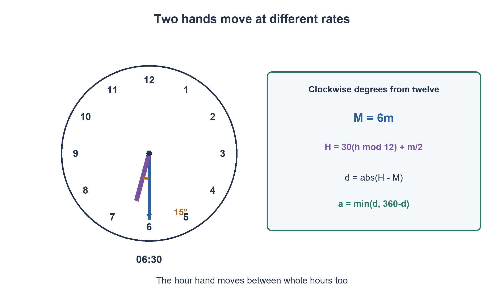

# PREP-017 — הזווית בין מחוגי השעון בזמן נתון

פתרון מוצע בסיוע AI; ביקורת מקצועית אנושית ממתינה. הקושי אינו מכויל.

[צילום מקור פרטי](../sources/2026-10-31-batch22-10.png)

בהינתן שעה (שעות, דקות), מה הזווית בין מחוגי השעון?

## עברית

### שעה ודקות כלליות
נתונים שעה שלמה h בתחום 0..23 ודקות שלמות m בתחום 0..59. חשבו את הזווית הקטנה בין מחוג השעות למחוג הדקות בשעון מחוגים רגיל בן 12 שעות. מחוג השעות נע ברציפות גם בתוך השעה; אין צורך במחוג שניות. החזירו מעלות בדיוק, כולל אפשרות של חצי מעלה, והסבירו את הנוסחה ואת מקרי הגבול.

1. מצאו בנפרד כמה מעלות עובר כל מחוג במשך דקה. מחוג השעות אינו נע רק בשעה עגולה.
2. מדדו את שני המיקומים בכיוון השעון מהספרה 12. בדקו מדוע צריך לצמצם את השעה מודולו 12.
3. חשבו M=6m ו־H=30(h mod 12)+m/2. אם ההפרש הוא d, השוו אותו ל־360−d כדי לקבל את הזווית הקטנה.

### מחשבים שני מיקומים ואז בוחרים את הקשת הקצרה
מחוג הדקות עובר סיבוב של 360 מעלות ב־60 דקות, ולכן מיקומו הוא M=6m. מחוג השעות עובר 30 מעלות בשעה, ולכן 0.5 מעלה בדקה. מיקומו הוא H=30(h mod 12)+m/2. האיבר m/2 הוא בדיוק התיקון שמונע את הטעות של קיבוע המחוג על מספר השעה.

מחשבים d=|H−M| ומחזירים min(d,360−d). שני מיקומי המחוגים באותו סיבוב, ולכן זו אחת משתי הקשתות שמחברות אותם. למשל 6:30 נותן M=180 ו־H=195, ולכן 15 מעלות, בדיוק כתוצאת השאלה הקונקרטית. 10:10 נותן M=60 ו־H=305, הפרש 245, ולכן דווקא הקשת האחרת, 115 מעלות, היא הקטנה. 6:00 נותן 180; ב־0:00 וב־12:00 מתקבל 0.

### דיוק ותחומי קלט
הקלט h=23 מצטמצם ל־11, ולכן 23:15 ו־11:15 נותנים אותה תוצאה. m=60 אינו דקות תקינות בחוזה הזה; אפשר לנרמל זמן בפונקציה אחרת, אבל אין לבצע שינוי כזה בשקט. שומרים את m/2 כשבר מדויק או עובדים ביחידות חצי־מעלה: מיקומי המחוגים ביחידות אלה הם 60(h mod 12)+m ו־12m, והסיבוב הוא 720 יחידות. כך מתקבלת תוצאה מדויקת בלי עיגול. גם הפרש אפס וגם 180 מותרים.

החישוב משתמש במספר קבוע של פעולות אריתמטיות וב־O(1) מקום תחת תחומי הקלט הנתונים. אין צורך לדמות כל שנייה או לסרוק זמנים כדי לחשב זווית אחת. אם מוסיפים שניות, יש להוסיף את התקדמותן לשני המחוגים; מחוג השעות עדיין אינו קבוע.

האימות מיצה את כל 720 זוגות השעה/דקה במחזור של 12 שעות. אורקל עצמאי חישב את הפאזה מתוך הפרש המהירויות, 5.5 מעלות לדקה, לפי מספר הדקות הכולל שחלף. לכל מקרה נבדקה גם מחזוריות של 12 שעות, ובסך הכול 720 השוואות מחזוריות נוספות. התוצאות הן חישוב של זמן נתון ולא מדידה של תצלום שעון.

```python
"""Minor angle of a conventional continuously moving twelve-hour clock."""
from fractions import Fraction


def hand_positions(hour: int, minute: int) -> tuple[Fraction, Fraction]:
    if type(hour) is not int or type(minute) is not int:
        raise TypeError("hour and minute must be integers")
    if not 0 <= hour <= 23 or not 0 <= minute <= 59:
        raise ValueError("hour 0..23 and minute 0..59 required")
    return Fraction(30 * (hour % 12)) + Fraction(minute, 2), Fraction(6 * minute)


def minor_angle(hour: int, minute: int) -> Fraction:
    hour_position, minute_position = hand_positions(hour, minute)
    clockwise_delta = (hour_position - minute_position) % 360
    return min(clockwise_delta, 360 - clockwise_delta)
```




## English

### General hour and minute inputs
Given integer hour h in 0..23 and integer minute m in 0..59, compute the smaller angle between hour and minute hands on an ordinary twelve-hour analog clock. The hour hand moves continuously within each hour; ignore seconds. Return exact degrees, including half degrees, and explain the formula and boundary cases.

1. Find each hand's degrees per minute. The hour hand moves between whole hours too.
2. Measure both positions clockwise from twelve and reduce the hour modulo twelve.
3. Compute M=6m and H=30(h mod 12)+m/2. If their difference is d, compare d with 360−d to choose the minor angle.

### Compute both positions, then choose the shorter arc
The minute hand turns 360 degrees in sixty minutes, so M=6m. The hour hand moves thirty degrees per hour, or half a degree per minute, so H=30(h mod 12)+m/2. The m/2 term prevents incorrectly fixing it at the hour numeral.

Compute d=|H−M| and return min(d,360−d). Both hand positions lie within one turn, and these are the two connecting arcs. At 6:30, M=180 and H=195, giving fifteen degrees as in the earlier concrete question. At 10:10, M=60 and H=305: the difference is 245, so the other arc, 115 degrees, is smaller. At 6:00 the answer is 180; at 0:00 and 12:00 it is zero.

### Exactness and input boundaries
Hour 23 reduces to eleven, so 23:15 and 11:15 agree. Minute sixty is invalid under this contract; normalization could be a separate interface, but must not be introduced silently. Keep m/2 as an exact fraction, or calculate in half-degree units: hand positions are 60(h mod 12)+m and 12m, and a full turn has 720 units. This avoids rounding. Both zero and 180 are valid answers.

The stated bounded input uses a fixed number of arithmetic operations and O(1) space. Simulating every second or searching over times is unnecessary for one angle query. Adding seconds requires advancing both hands, including the hour hand.

Verification exhausted all 720 hour/minute pairs in a twelve-hour cycle. An independent oracle used relative speed, five-and-a-half degrees per minute, and total elapsed minutes. Every case also matched its twelve-hours-later input, adding 720 periodicity comparisons. This computes supplied times rather than measuring a clock photograph.

```python
"""Minor angle of a conventional continuously moving twelve-hour clock."""
from fractions import Fraction


def hand_positions(hour: int, minute: int) -> tuple[Fraction, Fraction]:
    if type(hour) is not int or type(minute) is not int:
        raise TypeError("hour and minute must be integers")
    if not 0 <= hour <= 23 or not 0 <= minute <= 59:
        raise ValueError("hour 0..23 and minute 0..59 required")
    return Fraction(30 * (hour % 12)) + Fraction(minute, 2), Fraction(6 * minute)


def minor_angle(hour: int, minute: int) -> Fraction:
    hour_position, minute_position = hand_positions(hour, minute)
    clockwise_delta = (hour_position - minute_position) % 360
    return min(clockwise_delta, 360 - clockwise_delta)
```




## חומר משלים / Supporting material

```json
{
  "assumptions": {
    "he": [
      "שעון רגיל בן 12 שעות עם מחוג שעות רציף.",
      "h שלם בתחום 0..23 ו־m שלם בתחום 0..59; שניות אינן חלק מהקלט.",
      "מבקשים את הזווית הקטנה במעלות ולא את הקשת הרפלקסיבית."
    ],
    "en": [
      "Ordinary twelve-hour clock with a continuously moving hour hand.",
      "Integer h in 0..23 and m in 0..59; seconds are outside the input.",
      "Return the minor angle in degrees rather than the reflex arc."
    ]
  },
  "optimality": {
    "he": "נוסחה ישירה במספר קבוע של פעולות ו־O(1) מקום עבור תחום הקלט הנתון; אין חיפוש בזמן ואין סימולציה שנייה אחר שנייה.",
    "en": "Direct formula with a fixed number of operations and O(1) space for the bounded input domain; no time search or per-second simulation."
  },
  "verification": {
    "he": "כל 720 זמני הדקה במחזור התאימו לאורקל מהירות יחסית, וכל אחד התאים גם אחרי הוספת 12 שעות. נבדקו במפורש 0, 15, 115 ו־180 מעלות.",
    "en": "All 720 minute-times matched a relative-speed oracle and each also matched twelve hours later. Explicit results include zero, fifteen, 115 and 180 degrees."
  },
  "edge_cases": {
    "he": [
      "חצות וצהריים; 6:00; 6:30; 10:10; שעות מעל 12; דקה 59; דקה 60 מחוץ לחוזה."
    ],
    "en": [
      "Midnight and noon; 6:00; 6:30; 10:10; hours above twelve; minute fifty-nine; minute sixty outside the contract."
    ]
  },
  "common_mistakes": {
    "he": [
      "להשמיט m/2 ממיקום מחוג השעות.",
      "להחזיר תמיד את ההפרש המוחלט גם אם הוא גדול מ־180.",
      "לעשות חילוק שלם ולאבד חצי מעלה.",
      "להסיק שעת קלט מציור במקום להשתמש ב־h,m שנמסרו."
    ],
    "en": [
      "Omitting m/2 from the hour hand.",
      "Always returning the absolute difference even above 180.",
      "Truncating division and losing a half degree.",
      "Inferring inputs from an illustration instead of using the supplied h,m."
    ]
  },
  "interview_answer": {
    "he": "מחוג הדקות נמצא ב־6m מעלות ומחוג השעות ב־30(h mod 12)+m/2. אקח את ההפרש ואת המשלים ל־360 ואחזיר את הקטן. אחשב בשברים או בחצאי מעלות כדי לא לעגל.",
    "en": "Use M=6m and H=30(h mod 12)+m/2. Return the smaller of their difference and its complement to 360. Fractions or half-degree units keep the result exact."
  },
  "source_ambiguities": {
    "he": [
      "הזווית מוגדרת כקטנה; תנועת מחוג השעות רציפה. שעון עם מחוג שקופץ רק פעם בשעה היה מודל אחר."
    ],
    "en": [
      "The requested angle is minor and hour-hand motion is continuous. A hand jumping only once per hour is a different model."
    ]
  },
  "solution_extensions": {
    "he": [
      {
        "question": "איך מוסיפים קלט של שניות?",
        "answer_direction": "מחליפים m בזמן הדקות המדויק m+s/60 עבור שני המחוגים, ומיישמים שוב בחירת קשת קטנה.",
        "principle": "שינוי רזולוציית הקלט דורש לעדכן את כל הרכיבים שנעים בזמן."
      }
    ],
    "en": [
      {
        "question": "How would seconds be included?",
        "answer_direction": "Replace m by exact elapsed minutes m+s/60 in both hand positions, then choose the minor arc again.",
        "principle": "Finer time resolution affects every hand that moves continuously."
      }
    ]
  }
}
```
