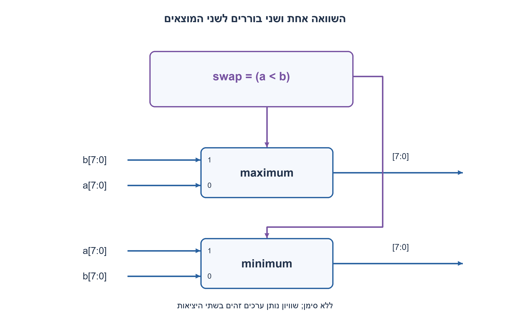
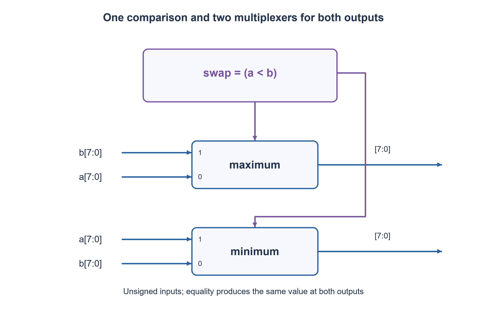

# PREP-018 — מעגל המחזיר את הגדול מבין שני מספרים

פתרון מוצע בסיוע AI; ביקורת מקצועית אנושית ממתינה. דירוג הקושי פנימי ואינו מוצג ללומדים.

[צילום מקור פרטי](../sources/2026-11-08-batch20-15.png)

תכנן מערכת המקבלת a,b כל אחד8 סיביות ומוציאה את הגבוה ואת הנמוך ביניהם.

חברות לפי הדיווח בצילום בלבד: Samsung.

## עברית

### וריאציה: מינימום ומקסימום של שני קלטים בני שמונה סיביות
קבלו a,b במקביל והפיקו בשתי יציאות את הגבוה והנמוך. השלמה: שני הקלטים unsigned בתחום0..255; מימוש צירופי עם קומפרטור ושערים/בוררים מותרים. אין שעון או קלט טורי. בשוויון שתי היציאות מחזירות אותו ערך. הציגו שיתוף תוצאת השוואה ובדקו את כל הזוגות; זו הרחבה נפרדת מהספרייה המוגבלת של שני הביטים בחלק הקודם.

1. שני המוצאים הם אותם שני מספרים בסדר אחר. צריך רק לדעת אם להחליף.
2. אות swap=(a<b) מספיק לשלוט בשני בוררים בעלי סדר נתונים הפוך.
3. maximum=swap?b:a, minimum=swap?a:b. השוויון אינו דורש טיפול מיוחד.

### אותה החלטה לשתי היציאות
מחשבים `swap=(a<b)` פעם אחת. אם הוא1, המקסימום b והמינימום a; אחרת המקסימום a והמינימום b. מממשים שני בוררים ברוחב8 עם אותו select וסדר כניסות הפוך. אין צורך לבצע השוואה שנייה עבור המינימום.

נכונות נובעת משני מקרי הסדר המלא: a<b או a≥b. בכל מקרה maximum≥minimum, ושתי היציאות מכילות בדיוק את שני הקלטים, כולל כפילויות. בשוויון גם החלפה אינה משנה ערכים. דוגמאות:0,255 נותן255,0; ‏128,127 נותן128,127; ‏42,42 נותן42,42.

אפשר לממש את הקומפרטור בסריקה מן ה־MSB: הביט השונה הראשון קובע מי גדול; ביטים נמוכים רלוונטיים רק כל עוד כל הגבוהים שווים. זה משווה ללא סימן. בטיפוס מסומן הסיבית העליונה משנה משמעות, ולכן אותו חוזה אינו מתאים אוטומטית.

עלות הבנייה היא קומפרטור8 סיביות ושני MUX ברוחב8, עם select משותף. אין מכאן הוכחת מינימום שערים או השהיה פיזית. כל65,536 הזוגות נבדקו מול min/max בלתי תלויים, וב־RTL נבדק גם שלא אובד נשא מדומה: כאן אין כלל חיבור אריתמטי אלא בחירת קלטים.

### קוד SystemVerilog; תוצאות סימולציה בדוח נפרד

```systemverilog
module prep018_minmax8(input wire [7:0] a,b,
                      output wire [7:0] maximum,minimum);
  wire swap = a < b;
  assign maximum = swap ? b : a;
  assign minimum = swap ? a : b;
endmodule
```




### assumptions

שני קלטי unsigned8 במקביל, קומפרטור ובוררים מותרים, ללא אוגרים.

### optimality

קומפרטור אחד ושני בוררים בני8 סיביות, ללא טענת מינימום.

### verification

בדיקות מודלים עצמאיות עברו: 81 חישובי פינות תזמון מול זמני הגעה מוחלטים, 27 דוגמאות RC בסף יחיד ו־27 בקבל מצומד לאדמה, 100 חלונות ADC ו־32 דוגמאות aliasing, ‏23,254 תצפיות גאומטריות בחיישני עץ, זוג מסלולים המדגים חוסר נצפות בעץ קצר, 32 פאזות סינוס וכל 65,536 זוגות min/max. ראיה: checks/batch1108b20-hardware-model-verification.json. בדיקות Python וחישוב מספרי אינן SPICE, נתוני תהליך, STA או מדידת ADC. קוד SystemVerilog נבדק בנפרד, ותנאי הסביבה והיקף ההרצה מתועדים בדוח native של האצווה. סימולציית Icarus 12.0 עברה 66,134 השוואות: 65,536 זוגות min/max, ‏404 דגימות חיישני עץ ו־194 צעדי סינוס. הבתים של הקוד אומתו מול SHA-256, וההרצה החוזרת בוצעה ללא גישת רשת. ראיה: checks/batch1108b20-native-verification.json. זהו כיסוי סופי מוגבל לחוזים המתוארים, ולא הוכחת חומרה פיזית.

### edge_cases

```json
[
  "0 מול255",
  "128 מול127",
  "a=b"
]
```

### common_mistakes

```json
[
  "שימוש בהשוואה מסומנת.",
  "חיבור אותם סדרי נתונים לשני הבוררים."
]
```

### interview_answer

משווה פעם אחת ומעביר את הזוג לשני בוררים הפוכים; תמיד נשמרים שני הערכים.

### source_ambiguities

המקור אינו קובע סימן או ספריית רכיבים; הוגדר unsigned וסעיף צירופי כללי.

### solution_extensions

```json
[
  {
    "question": "איך משווים שני מספרים מסומנים?",
    "direction": "בודקים סימנים תחילה או משתמשים בקומפרטור signed תחת חוזה two’s complement.",
    "tests": "‎−128 מול127, ‏‎−1 מול0 ושוויון."
  }
]
```

## English

### Variant: minimum and maximum of two eight-bit inputs
Accept simultaneous a,b and produce their maximum and minimum on separate outputs. Completion: unsigned inputs0..255; combinational operation allowing a comparator, gates and multiplexers. There is no clock or serial input. Equal values produce that value at both outputs. Share the comparison and verify all pairs; this is separate from the earlier restricted two-bit primitive library.

1. The outputs are the same two values, perhaps swapped.
2. One swap=(a<b) signal drives two multiplexers with opposite data ordering.
3. maximum=swap?b:a and minimum=swap?a:b. Equality needs no special branch.

### One decision controls both outputs
Compute `swap=(a<b)` once. If true, maximum is b and minimum a; otherwise maximum is a and minimum b. Use two eight-bit multiplexers sharing select but reversing their data-input order. There is no need for a second comparison for minimum.

Correctness follows from the total-order cases a<b or a≥b. In each, maximum≥minimum and outputs contain exactly the original values, including duplicates. Equal inputs need no special branch. Examples:0,255 produces255,0;128,127 produces128,127;42,42 produces42,42.

A comparator can inspect bits from the MSB downward: the first differing bit determines order; lower bits matter only while all higher bits match. This is unsigned comparison. Signed values assign another meaning to the top bit, so the contract does not automatically carry over.

Cost is one eight-bit comparator and two eight-bit MUXes with shared select, not a minimum-gate or physical-delay proof. All65,536 pairs were compared with independent min/max results. The RTL selects input values rather than adding them, so no arithmetic carry or wider output is needed.

### SystemVerilog; simulation results are in a separate report

```systemverilog
module prep018_minmax8(input wire [7:0] a,b,
                      output wire [7:0] maximum,minimum);
  wire swap = a < b;
  assign maximum = swap ? b : a;
  assign minimum = swap ? a : b;
endmodule
```




### assumptions

Two simultaneous unsigned-eight-bit inputs; comparator/MUXes allowed; no registers.

### optimality

One comparator and two eight-bit MUXes; no minimum claim.

### verification

Independent models passed:81 corner budgets compared with absolute arrival times,27 single-threshold RC and27 ground-coupling cases,100 ADC slots and32 alias examples,23,254 geometric wood observations, one indistinguishable short-wood trajectory pair,32 sine phases and all65,536 min/max pairs. Evidence: checks/batch1108b20-hardware-model-verification.json. Python/numerical checks are not SPICE, process characterization, STA or physical ADC measurements. SystemVerilog is verified separately; execution conditions and coverage are recorded in the batch native report. Icarus12.0 simulation passed66,134 comparisons:65,536 min/max pairs,404 wood-sensor samples and194 sine steps. Source bytes were checked against SHA-256, and the confirmation run had network access denied. Evidence: checks/batch1108b20-native-verification.json. This is finite coverage of the stated contracts, not physical hardware signoff.

### edge_cases

```json
[
  "0 versus255",
  "128 versus127",
  "a=b"
]
```

### common_mistakes

```json
[
  "Using signed comparison.",
  "Wiring both MUXes in the same data order."
]
```

### interview_answer

Compare once and drive oppositely wired MUXes, preserving both values.

### source_ambiguities

The source omits signedness/library; unsigned general combinational operation is chosen.

### solution_extensions

```json
[
  {
    "question": "How would signed inputs change comparison?",
    "direction": "Check signs first or use a signed comparator under a two’s-complement contract.",
    "tests": "Test−128 versus127,−1 versus0, and equality."
  }
]
```

