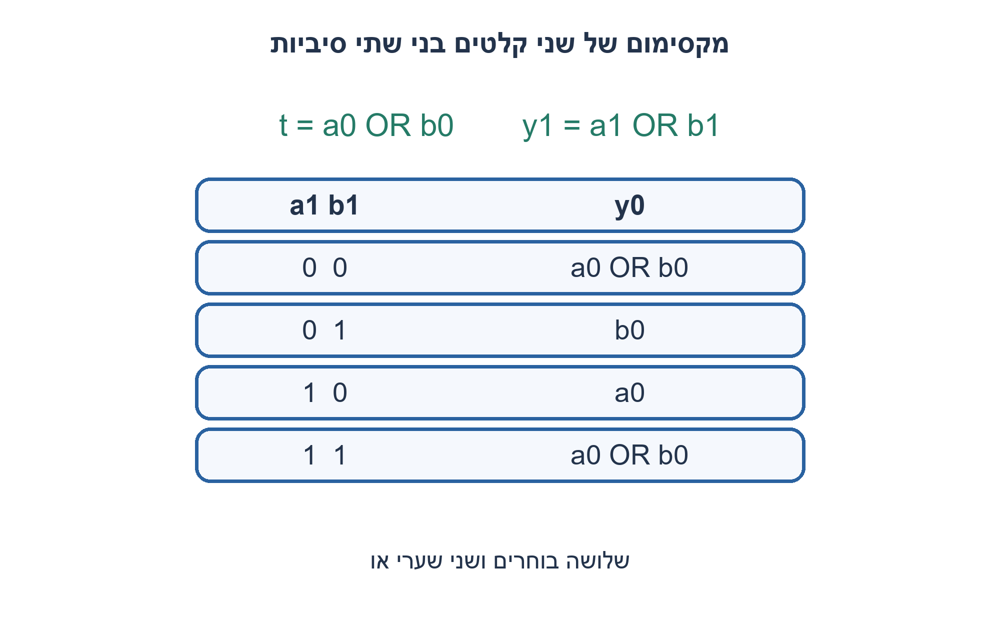
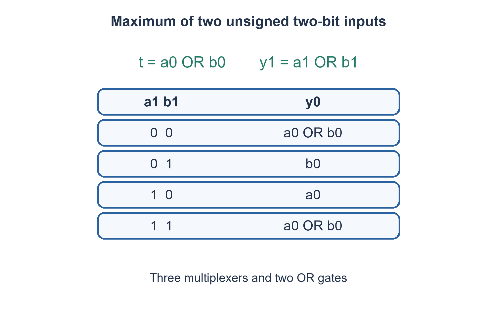

# PREP-018 — מעגל המחזיר את הגדול מבין שני מספרים

פתרון מוצע בסיוע AI; ביקורת מקצועית אנושית ממתינה. הקושי אינו מכויל.

[צילום מקור פרטי](../sources/2026-11-07-batch10-03.png)

קופסה בעלת שתי כניסות, כל כניסה מורכבת משני ביטים. יש להוציא את הכניסה המייצגת מספר גדול יותר על ידי שימוש בשערי OR, NOT, MUX.

חברות לפי הדיווח בצילום בלבד: Apple.

## עברית

### וריאציה מוגבלת לשערי OR, NOT ובוחרים
תכננו רכיב צירופי המקבל שני מספרים unsigned בני שתי סיביות A,B ומוציא את הגדול מהם. מותרים רק שערי OR, שערי NOT ובוחרי MUX2:1; קבועים וחיווט מותרים. אין להשתמש במשווה, מחבר או מחסר כרכיב חופשי. שוויון מחזיר את אותו ערך. אין דרישה להוכחת מינימום שערים.

1. הפרידו את ההחלטה לפי שתי הסיביות הגבוהות.
2. אם הסיביות הגבוהות שונות, הסיבית הגבוהה קובעת; אם הן זהות, מהו המקסימום של שני ביטים?
3. הסיבית הגבוהה ביציאה היא OR. הסיבית הנמוכה נבחרת בין a0,b0 ו־a0 OR b0 לפי ארבעת מצבי a1,b1.

### פותרים לפי קבוצות של שני ערכים
הסיבית הגבוהה של המקסימום היא `y1=a1 OR b1`: אם מישהו לפחות2, גם המקסימום לפחות2. נגדיר `t=a0 OR b0`. כאשר a1=b1, הבסיס המשותף הוא0 או2 והמקסימום נקבע לפי OR של הסיביות הנמוכות. כאשר a1=0,b1=1 בוחרים b0; וכאשר a1=1,b1=0 בוחרים a0.

|a1 b1|y0|
|---|---|
|00|t|
|01|b0|
|10|a0|
|11|t|

נגדיר `MUX(S,D0,D1)` כמחזיר D0 עבור S=0. מימוש מפורש:

```text
t = OR(a0,b0)
l0 = MUX(b1,t,b0)
l1 = MUX(b1,a0,t)
y0 = MUX(a1,l0,l1)
y1 = OR(a1,b1)
```

זהו מימוש חוקי בשני OR ושלושה MUX בלבד; אין חובה להשתמש ב־NOT רק משום שהותר. טבלת ארבעת המקרים מוכיחה נכונות לכל16 זוגות הקלט. עומק הנתיב y0 הוא לכל היותר OR ושתי רמות MUX. אין טענת מינימום: היא תלויה במחיר הרכיבים ובאפשרות לשתף אותות. הקוד משתמש ב־`?:` רק כבוחר וב־`|` רק כ־OR; אין אופרטור `>` במימוש.

### קוד SystemVerilog; תוצאות סימולציה בדוח נפרד

```systemverilog
`timescale 1ns/1ps
module prep018_two_bit_max_batch1107b10(
 input wire [1:0] a,b, output wire [1:0] y);
 wire t=a[0]|b[0];
 wire lo_when_a_high_zero=b[1]?b[0]:t;
 wire lo_when_a_high_one=b[1]?t:a[0];
 assign y[1]=a[1]|b[1];
 assign y[0]=a[1]?lo_when_a_high_one:lo_when_a_high_zero;
endmodule
```




### assumptions

שני קלטי unsigned בתחום0..3, יציאת שתי סיביות, לוגיקה צירופית.

### optimality

שני OR ושלושה MUX; עד שלוש רמות רכיבים ל־y0, ללא FF. אין הוכחת מינימום גלובלי.

### verification

אימות RTL אמיתי: Icarus Verilog 12 קימפל את חמש הווריאציות והרתמה עברה 138,967 בדיקות בסביבה מבודדת ללא רשת: 2,046 מילים טוריות, 5,000 מחזורי FIFO, 1,300 מחזורי חלון וכל 16 זוגות המקסימום. בדיקת Python עצמאית מרחיבה את הכיסוי ל־4,094 מילים ו־10,000 מחזורי FIFO. ראיות: checks/batch1107b10-native-verification.json ו־checks/batch1107b10-hardware-model-verification.json. זו סימולציה דיגיטלית מוגבלת; לא בוצעו סינתזה או ניתוח תזמון.

### edge_cases

```json
[
  "כל16 זוגות, לרבות0/3,1/2 ושוויון."
]
```

### common_mistakes

התייחסות לקלט כמסומן; מימוש OR לכל הווקטור בלבד; שימוש במחסר שאינו מותר.

### interview_answer

אבדיל בין ארבעת מצבי הסיביות הגבוהות. הגבוהה ביציאה היא OR; הנמוכה היא OR כשיש שוויון גבוה, וביתר המקרים הביט של הקלט הזוכה.

### source_ambiguities

תחום unsigned ועלות הבוחרים הם הבהרות שהוספנו. המקור אינו מגדיר בעיית מינימום רכיבים.

### solution_extensions

```json
{
  "question": "כיצד משתנה ההשוואה למספרים מסומנים?",
  "direction": "סיביות סימן שונות הופכות את עדיפות ה־MSB; אותו סימן מאפשר השוואת שאר הסיביות.",
  "tests": [
    "10 לעומת01",
    "11 לעומת10"
  ]
}
```

## English

### Variant restricted to OR, NOT and multiplexers
Design a combinational maximum of two unsigned two-bit inputs A,B. Only OR, NOT and MUX2:1 primitives are allowed; constants and wiring are permitted. Do not introduce a free comparator, adder or subtractor. Equal inputs return that value. A globally minimum gate count is not required.

1. Split the decision by the two high bits.
2. Different high bits decide the winner; equal high bits reduce to the maximum of two single bits.
3. The output high bit is OR. Select the low bit from a0, b0 and a0 OR b0 according to the four high-bit cases.

### Compare the two-value groups
The high bit is `y1=a1 OR b1`: if either input is at least two, their maximum is too. Set `t=a0 OR b0`. When the high bits agree, both numbers have the same base0 or2, so the maximum low bit is their OR. For a1=0,b1=1 choose b0; for a1=1,b1=0 choose a0.

|a1 b1|y0|
|---|---|
|00|t|
|01|b0|
|10|a0|
|11|t|

Using `MUX(S,D0,D1)` to return D0 for S=0:

```text
t = OR(a0,b0)
l0 = MUX(b1,t,b0)
l1 = MUX(b1,a0,t)
y0 = MUX(a1,l0,l1)
y1 = OR(a1,b1)
```

This legally uses two OR gates and three multiplexers. A permitted NOT gate need not be used. The four cases prove all16 input pairs; y0 has at most an OR plus two MUX levels. No minimum is claimed, since primitive costs and sharing affect optimality. The RTL uses `?:` only as MUX and `|` only as OR; the implementation contains no `>` operator.

### SystemVerilog; simulation results are in a separate report

```systemverilog
`timescale 1ns/1ps
module prep018_two_bit_max_batch1107b10(
 input wire [1:0] a,b, output wire [1:0] y);
 wire t=a[0]|b[0];
 wire lo_when_a_high_zero=b[1]?b[0]:t;
 wire lo_when_a_high_one=b[1]?t:a[0];
 assign y[1]=a[1]|b[1];
 assign y[0]=a[1]?lo_when_a_high_one:lo_when_a_high_zero;
endmodule
```




### assumptions

Unsigned inputs0..3, two-bit output, combinational logic.

### optimality

Two OR and three MUX primitives; up to three primitive levels for y0, no flip-flops; no global minimum proof.

### verification

Executed RTL verification: Icarus Verilog 12 compiled the five variants and the harness passed 138,967 checks in an isolated network-denied environment: 2,046 serial words, 5,000 FIFO cycles, 1,300 window cycles and all 16 maximum-input pairs. Independent Python checks extend coverage to 4,094 words and 10,000 FIFO cycles. Evidence: checks/batch1107b10-native-verification.json and checks/batch1107b10-hardware-model-verification.json. This is bounded digital simulation, not synthesis or timing analysis.

### edge_cases

```json
[
  "All16 pairs including0/3,1/2 and ties."
]
```

### common_mistakes

Treating inputs as signed; ORing the whole vectors; using a forbidden subtractor.

### interview_answer

Split the four high-bit cases. Output high is OR; output low is OR on high-bit equality, otherwise the winning input low bit.

### source_ambiguities

Unsigned interpretation and MUX convention are added clarifications; the source does not define a minimum-component optimization.

### solution_extensions

```json
{
  "question": "What changes for signed numbers?",
  "direction": "Different signs reverse the high-bit priority; same-sign inputs compare their remaining bits.",
  "tests": [
    "10 versus01",
    "11 versus10"
  ]
}
```
