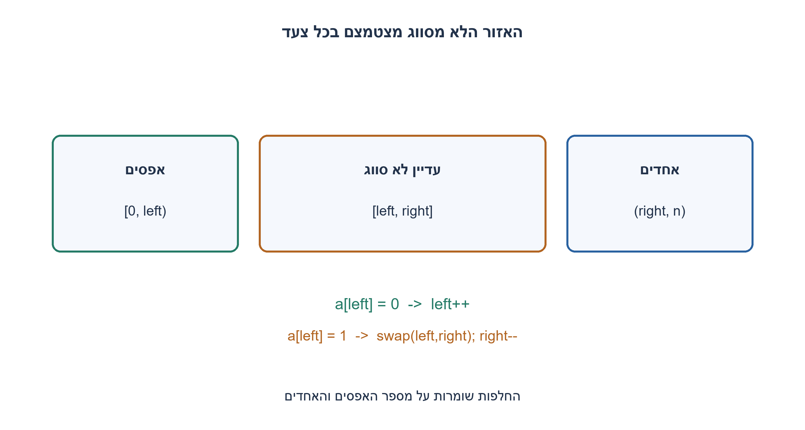
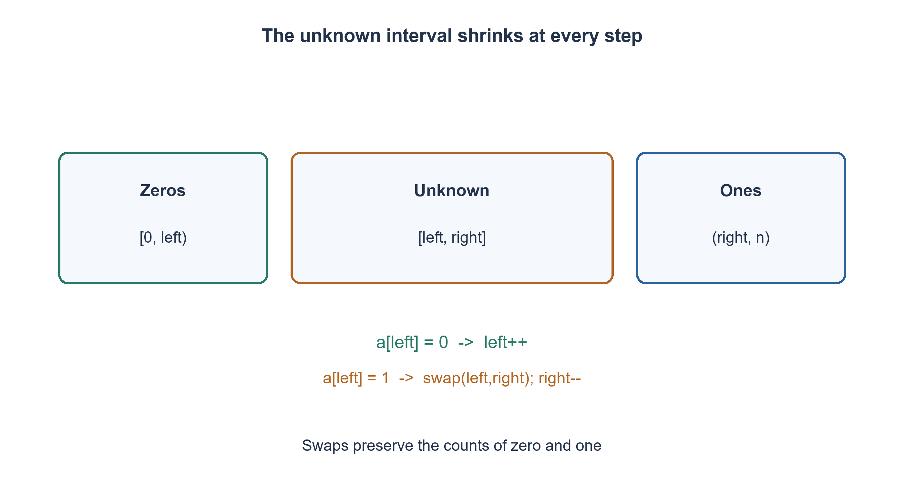

# PREP-019 — חלוקת מערך כדורים לשלושה צבעים בזמן לינארי ובזיכרון קבוע

פתרון מוצע בסיוע AI; ביקורת מקצועית אנושית ממתינה. הקושי אינו מכויל.

## עברית

### הרחבה: רק אפסים ואחדים
מיינו מערך שערכיו מובטחים להיות 0 או 1, כך שכל האפסים לפני כל האחדים. נדרש זמן מיטבי במקרה הגרוע ו־ O(1) מילות עזר, ללא מערך נוסף. אין דרישת יציבות או מגבלה חדשה על מספר סריקות; זהו מקרה פרטי של החלוקה לשלושה צבעים, לא החלפתה.

1. איך משתמשים בכך שקיימים רק שני ערכים?
2. שמרו אזור אפסים משמאל, אזור אחדים מימין ואזור שעוד לא נבדק ביניהם.
3. אם האיבר השמאלי הלא־מסווג הוא אפס, התקדמו; אחרת החליפו עם קצה האזור הלא־מסווג מימין והקטינו אותו. בדקו מחדש את האיבר שהגיע.

### אותה משפחת חלוקה, עם שני אזורים ידועים
מתחילים left=0, right=n−1. האינווריאנט הוא שכל מה שלפני left אפס וכל מה שאחרי right אחד. אם values[left]=0 מגדילים left. אחרת זהו אחד לפי הבטחת הקלט; מחליפים אותו עם values[right] ומקטינים right, בלי להתקדם משמאל. האיבר החדש משמאל עדיין לא סווג. בכל צעד אורך התחום הלא־מסווג קטן באחד, ולכן יש בדיוק n צעדי לולאה.

כשהתחום ריק נשארים רק אפסים ואז אחדים. החלפות שומרות את כל הריבויים ואת זהות המערך. למשל [1,0,1,0] נעשה [0,0,1,1]. ריק, כל־אפס וכל־אחד תקינים. האלגוריתם משתמש בזמן Θ(n), אופטימלי בקלט שרירותי שיש לקרוא, ובמספר קבוע של מילים; הוא אינו יציב. סריקה שסופרת אפסים ואז כותבת את הערכים חזרה גם תקינה במקור המצומצם, כי כאן לא נאסרה סריקה שנייה. אין להעביר לכאן בשקט את מגבלת המבט־היחיד של המקור הישן.

```python
"""In-place binary partition, promised 0/1 values; preserves multiplicities."""


def binary_partition(values):
    left, right = 0, len(values) - 1
    while left <= right:
        if values[left] == 0:
            left += 1
        else:
            values[left], values[right] = values[right], values[left]
            right -= 1
    return values
```




## English

### Extension: only zero and one
Sort a promised binary array so every zero precedes every one. Require worst-case optimal time and O(1) auxiliary words, with no auxiliary array. Stability and a new scan-count restriction are not required; this specializes the existing three-color problem.

1. How does having only two values help?
2. Maintain zeros on the left, ones on the right and an unclassified interval between them.
3. Advance past a zero at the left boundary; otherwise swap it with the right unclassified boundary and shrink that boundary. Recheck the arriving value.

### Two classified regions instead of three
Start left=0, right=n−1. Everything before left is zero and everything after right is one. Advance left for a zero. Otherwise the promised value is one; swap with values[right] and decrease right without advancing left. The arriving value remains unclassified. Each iteration shrinks the unknown interval by one, giving exactly n iterations.

At termination only zeros then ones remain. Swaps preserve multiplicities and the same list identity. For example [1,0,1,0] becomes [0,0,1,1]. Empty, all-zero and all-one arrays are valid. Runtime is worst-case Θ(n), optimal for arbitrary input inspection, with constant auxiliary words; stability is not guaranteed. Counting zeros then rewriting is another valid two-pass method for plain binary values here, because this new source does not prohibit a second scan. Do not silently transfer the old source's literal single-look wording to this specialization.

```python
"""In-place binary partition, promised 0/1 values; preserves multiplicities."""


def binary_partition(values):
    left, right = 0, len(values) - 1
    while left <= right:
        if values[left] == 0:
            left += 1
        else:
            values[left], values[right] = values[right], values[left]
            right -= 1
    return values
```




## חומר משלים / Supporting material

```json
{
  "assumptions": {
    "he": "רק 0/1, mutation מותר, אין יציבות.",
    "en": "Promised 0/1 values, mutation allowed, no stability."
  },
  "optimality": {
    "he": "Θ(n) זמן ו־ O(1) מילים; לא O(1) ביטים לכל n.",
    "en": "Theta(n) time and O(1) words, not fixed bit storage for arbitrary n."
  },
  "verification": {
    "he": "8,191 מערכים ממצים באורכים 0..12 מול מיון עצמאי ושימור זהות הרשימה.",
    "en": "8,191 exhaustive arrays of lengths 0..12 versus independent sorting and list identity."
  },
  "edge_cases": {
    "he": "ריק; כל הערכים זהים; סדר הפוך.",
    "en": "Empty; homogeneous; reversed."
  },
  "common_mistakes": {
    "he": "להתקדם אחרי swap מימין ולדלג על איבר חדש.",
    "en": "Advancing left after swapping in an unknown right item."
  },
  "interview_answer": {
    "he": "אשמור תחום לא מסווג ואצמצם אותו בכל צעד.",
    "en": "Maintain an unknown interval and shrink it at each step."
  },
  "source_ambiguities": {
    "he": "מספר סריקות אינו מוגבל במקור החדש.",
    "en": "The new source does not limit scan count."
  },
  "solution_extensions": {
    "he": [
      {
        "question": "איך ממיינים 0,1,2?",
        "answer_direction": "חוזרים לשלושת הגבולות בגרסה המקורית.",
        "principle": "הבטחת התחום מאפשרת התמחות."
      }
    ],
    "en": [
      {
        "question": "What changes for 0,1,2?",
        "answer_direction": "Use the original three-boundary partition.",
        "principle": "Domain promises permit specialization."
      }
    ]
  }
}
```
