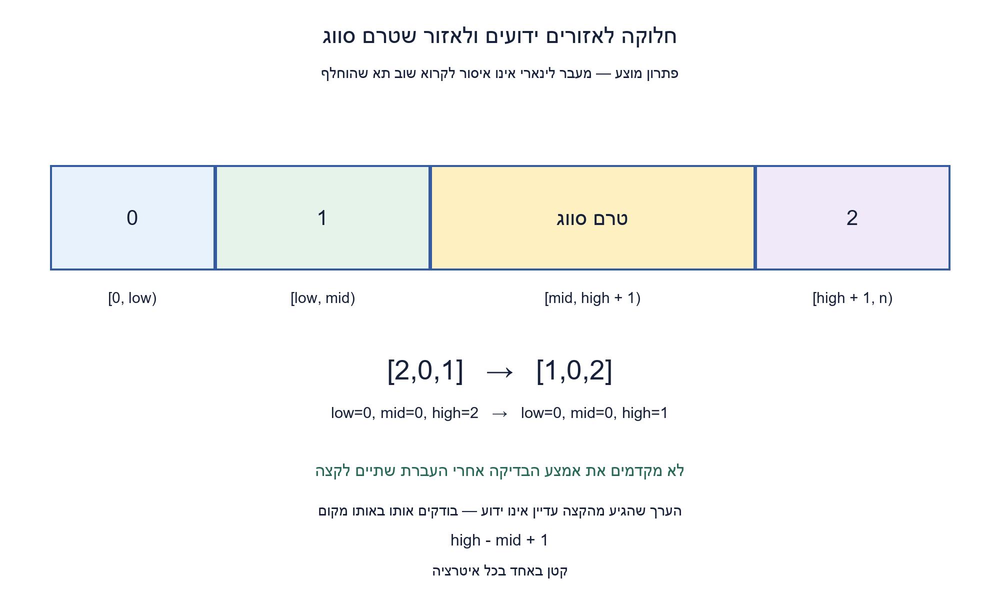
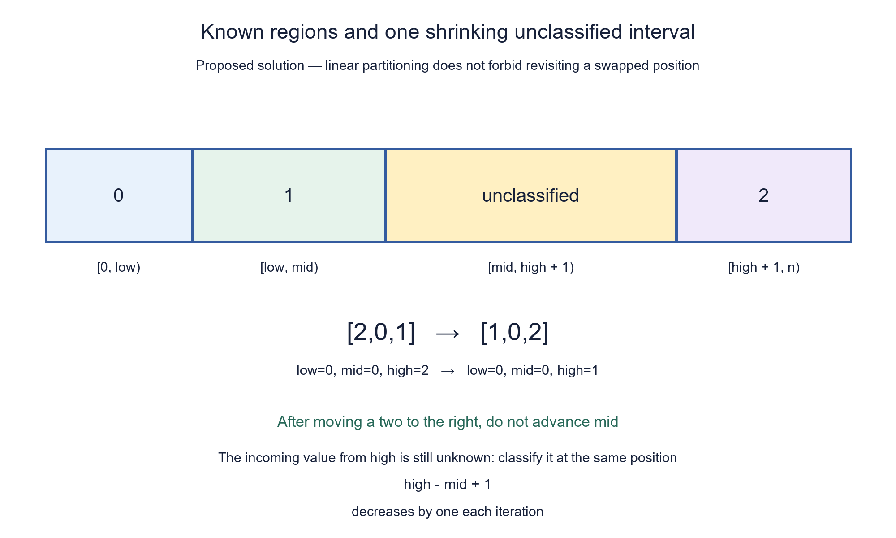

# PREP-019 — הרחבה מספרית 0,1,2

פתרון מוצע בסיוע AI; הרחבה ממתינה לביקורת אנושית.

[צילום המקור הנוסף](../sources/2026-10-25-batch11-03.png) — Apple מדווחת בצילום בלבד.

## עברית

סעיף נוסף — קידוד מספרי 0,1,2: נתון מערך באורך n של מספרים שלמים, שכל אחד מהם הוא 0,1 או 2. מיינו במקום, בסדר עולה, בזמן O(n) וב־O(1) מילות עזר, באמצעות מעבר חלוקה לינארי אחד וללא מערך עזר. הקלט מובטח להיות בתחום; אין דרישת יציבות. אין איסור לקרוא שוב כתובת שאליה הגיע ערך אחר אחרי החלפה. אין לבצע קודם סריקת ספירה ואחריה סריקת כתיבה. הסבירו איזה תחום עדיין אינו מסווג ומדוע הוא קטן בכל צעד. זוהי אותה חלוקה לשלוש קבוצות, עם 0/1/2 במקום כחול/ירוק/אדום, ולא שינוי של הסעיף המקורי.

1. שמרו בקצות המערך אזורים שמיקומם כבר ידוע: אפסים משמאל ושתיים מימין. מה צריך לשמור בין האזורים?
2. החזיקו שלושה אינדקסים: תחילת האחדים, תחילת האזור הלא־ידוע וסופו. כל צעד צריך להוציא איבר אחד מהאזור הלא־ידוע.
3. באפס מחליפים עם הגבול השמאלי ומקדמים שני אינדקסים; באחד מקדמים את האמצע; בשתיים מחליפים עם הגבול הימני ומקטינים אותו, בלי לקדם את האמצע.

### אותו עיקרון, קידוד מספרי
המיפוי כחול→0, ירוק→1, אדום→2 מחבר את המקור החדש לתרגיל הקיים. נשמור low,mid,high. בתחילה low=mid=0 ו־high=n−1, וכל המערך עדיין לא מסווג.

```text
[0,low)         מכיל רק 0
[low,mid)       מכיל רק 1
[mid,high+1)    עדיין לא סווג
[high+1,n)      מכיל רק 2
```

בודקים את values[mid]. אם הוא 0, מחליפים עם values[low] ומקדמים גם low וגם mid. אם low<mid, הערך שהגיע מ־low היה 1 ידוע; אם הם שווים, זו החלפה עם עצמו. בשני המקרים הגבולות החדשים נכונים.

אם הערך 1, הוא כבר בתחילת אזור האחדים ולכן מקדמים רק mid. אם הוא 2, מחליפים עם values[high] ומקטינים רק high. אסור לקדם את mid במקרה האחרון: הערך שהגיע מהקצה עדיין לא סווג. לדוגמה [2,0,1] נעשה [1,0,2] כאשר האינדקס mid עדיין 0; כעת צריך לסווג את ה־1 שהגיע אליו, ובהמשך את ה־0.

### הוכחה והמשמעות של מעבר אחד
האינווריאנט הוא ארבעת האזורים שלמעלה. הוא נכון בתחילה כי כל האזורים הידועים ריקים. כל אחד משלושת הצעדים מרחיב אזור ידוע בצורה תקינה ושומר על מספר ההופעות, כי השינוי היחיד בערכים הוא החלפה. גודל האזור הלא־ידוע high−mid+1 קטן באחד בכל איטרציה. אחרי בדיוק n איטרציות הוא ריק, ולכן מתקבל כל האפסים, אחריהם כל האחדים ואז כל השתיים.

״מעבר אחד״ כאן אינו אומר שכל כתובת פיזית נקראת פעם אחת בלבד. החלפה עשויה להביא ערך אחר לאותה כתובת, ואז נבדוק אותו. המדד המתקדם הוא האזור הלא־מסווג. בכל צעד יש לכל היותר שלוש קריאות איברים ושתי כתיבות; כך הזמן O(n), ומספר קבוע של אינדקסים וערך זמני נותנים O(1) מילות עזר. כתובת או אינדקס דורשים O(log n) ביטים במודל כללי. לא נטען ליציבות או למספר החלפות מינימלי.

### גבולות ואימות
מערך ריק, סוג ערך יחיד, סדר הפוך ומקרים עם הרבה שתיים בתחילת המערך נכללים באותו כלל. הקלט מובטח להיות שלמים 0/1/2. המימוש מזהה ערך שגוי כשהוא מגיע אליו, ואינו מבטיח לבטל החלפות שכבר נעשו; אין סריקת אימות נוספת לפני המיון.

הורצו כל 9,841 המילים מעל שלושת הערכים באורכים 0..8 ועוד 300 מערכים אקראיים. אורקל נפרד בנה פלט מתדירויות. מכשור חיצוני לבדיקה אימת שימור אובייקט הקלט וחסמי 3n קריאות ו־2n כתיבות. המכשור והמערך של האורקל אינם חלק ממימוש המיון.

```python
"""In-place three-way partition of promised exact integers 0,1,2.

One shrinking unclassified interval; positions may be read again after a swap.
No input-wide prevalidation pass, auxiliary array or stability guarantee.
An invalid value raises when reached; earlier mutations need not roll back.
"""


def partition_012(values):
    low = mid = 0
    high = len(values) - 1
    while mid <= high:
        value = values[mid]
        if type(value) is not int:
            raise ValueError("expected exact integers 0,1,2")
        if value == 0:
            values[low], values[mid] = values[mid], values[low]
            low += 1
            mid += 1
        elif value == 1:
            mid += 1
        elif value == 2:
            values[mid], values[high] = values[high], values[mid]
            high -= 1
        else:
            raise ValueError("expected exact integers 0,1,2")
```



## English

Additional part — numeric encoding 0,1,2: given an n-element array of integers promised to belong to {0,1,2}, sort it in place into ascending order in O(n) time with O(1) auxiliary words, using one linear partitioning traversal and no auxiliary array. Stability is not required. Re-reading a position after another value is swapped into it is allowed. Do not first count all values and then rewrite the array in another scan. Explain the unclassified interval and why it shrinks at every step. This specializes the existing three-group partition, with 0/1/2 replacing blue/green/red, rather than changing its original part.

1. Keep known regions at the ends: zeros on the left and twos on the right. What belongs between them?
2. Maintain three indices: the beginning of the ones, the beginning of the unknown region and its end. Every step must remove one item from the unknown interval.
3. For zero, swap with the left boundary and advance both left and middle. For one, advance middle. For two, swap with the right boundary and decrease right without advancing middle.

### The same partition with numeric labels
Map blue→0, green→1 and red→2. Keep low,mid,high, initially low=mid=0 and high=n−1. The entire array is initially unclassified.

```text
[0,low)         contains only 0
[low,mid)       contains only 1
[mid,high+1)    unclassified
[high+1,n)      contains only 2
```

Inspect values[mid]. For zero, swap with values[low] and increment both low and mid. If low<mid, the incoming item from low is a known one; if the indices coincide, the swap is with itself. Both preserve the new boundaries.

For one, advance mid only. For two, swap with values[high] and decrease high only. Do not advance mid in this last case: the incoming item from the right is still unknown. For example [2,0,1] becomes [1,0,2] with mid still zero; classify the incoming one, then the remaining zero.

### Correctness and what one traversal means
The four regions form the invariant. Initially all known regions are empty. Each case expands the correct known region and preserves multiplicities, since values are only swapped. The unclassified interval high−mid+1 decreases by one every iteration. After exactly n iterations it is empty, leaving zeros, then ones, then twos.

One traversal does not forbid reading a physical position again after a different item arrives through a swap. The unclassified interval is the monotone progress measure. Each iteration uses at most three element reads and two writes, hence O(n) time. A fixed number of indices and a temporary value use O(1) auxiliary words, or O(log n) bits for arbitrary indices. Neither stability nor a minimum swap count is claimed.

### Boundaries and verification
Empty arrays, a single repeated value, reverse order and many leading twos follow the same invariant. Exact integer values 0/1/2 are promised. Invalid data is rejected when reached; earlier mutations are not rolled back. There is no extra input-wide validation pass.

All 9,841 ternary words of lengths 0..8 and 300 seeded arrays were executed. An independent frequency oracle produced the expected result. External test instrumentation verified the input object's identity and bounds of 3n element reads and 2n writes. Neither the instrumentation nor the oracle's array belongs to the sorting implementation.

```python
"""In-place three-way partition of promised exact integers 0,1,2.

One shrinking unclassified interval; positions may be read again after a swap.
No input-wide prevalidation pass, auxiliary array or stability guarantee.
An invalid value raises when reached; earlier mutations need not roll back.
"""


def partition_012(values):
    low = mid = 0
    high = len(values) - 1
    while mid <= high:
        value = values[mid]
        if type(value) is not int:
            raise ValueError("expected exact integers 0,1,2")
        if value == 0:
            values[low], values[mid] = values[mid], values[low]
            low += 1
            mid += 1
        elif value == 1:
            mid += 1
        elif value == 2:
            values[mid], values[high] = values[high], values[mid]
            high -= 1
        else:
            raise ValueError("expected exact integers 0,1,2")
```


