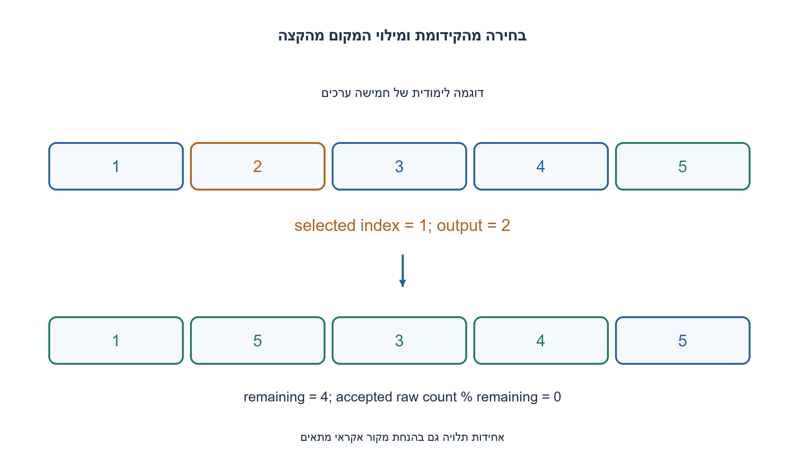
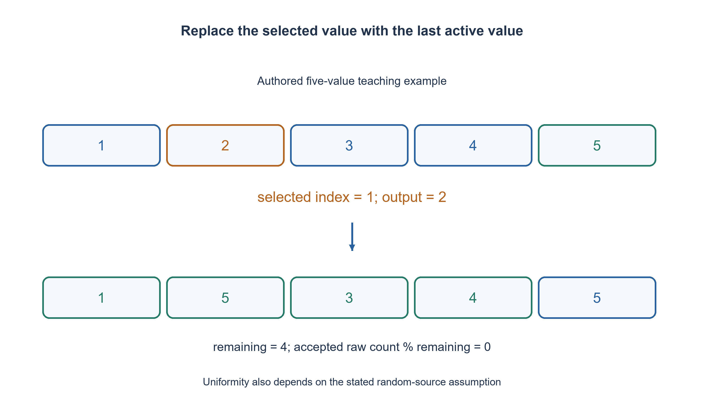

# PREP-022 — פרמוטציה אקראית ללא חזרות

פתרון מוצע בסיוע AI; ביקורת מקצועית אנושית ממתינה. הקושי אינו מכויל.

## עברית

### וריאציה: מאה תוצאות שונות מפונקציה בשפת C
בעזרת rand ממשו פונקציה ב־ C שמחזירה בכל קריאה מספר בתחום 1..100, כך שמאה הקריאות הראשונות יחזירו את כל המספרים ללא חזרה.

השלמת חוזה: C11, מצב Shuffle100 שמאותחל פעם אחת ומועבר לכל קריאה. shuffle100_next מחזירה bool וכותבת את המספר ב־ out בהצלחה; אחרי מאה תוצאות היא מחזירה false ואינה משנה out. אין ערבוב מחדש אוטומטי. rand מחזירה 0..RAND_MAX; אין להשתמש ב־ rand(m) דמיונית. כדי להוכיח אחידות מניחים במפורש דגימות גולמיות אחידות ועצמאיות; C אינה מבטיחה זאת לכל מימוש rand. שפרו את המרת הטווח כך שלא תוסיף הטיית מודולו, והסבירו את עלות הדחייה ואת ההבדל בין אי־חזרה לבין אחידות.

1. למה צריך מצב שנשמר בין הקריאות?
2. שמרו מאגר של מספרים שטרם הוחזרו; בחרו מתוכו והוציאו בהחלפה עם הקצה.
3. הקטינו את הקידומת הפעילה. לפני מודולו דחו זנב של טווח rand כך שמספר הערכים המקובלים יתחלק בגודל הקידומת.

### מאגר שלא יכול להחזיר אותו ערך פעמיים
מאתחלים את values לערכים 1..100 ואת remaining ל־ 100. בוחרים אינדקס בתחום הקידומת הפעילה, מחזירים את ערכו ומחליפים אותו באיבר הפעיל האחרון תוך הקטנת remaining. האינווריאנט הוא שהקידומת מכילה בדיוק את המספרים שלא הוחזרו, כל אחד פעם אחת. לכן גם בחירות לא אחידות אינן יוצרות חזרות, וכל מאה הצלחות מכסות את כל התחום. בקריאה הבאה מחזירים false ללא שינוי הפלט; אתחול מחדש הוא פעולה נפרדת.

### rand אינה rand(m)
לגודל פעיל m>1 מחשבים limit=RAND_MAX−(RAND_MAX%m). הוא חיובי עבור m≤100 כי תקן C מבטיח RAND_MAX≥32767, והוא כפולה של m. דוגמים שוב כל עוד הערך גדול או שווה ל־ limit. הערכים המקובלים 0..limit−1 מחלקים שווה בשווה את השאריות מודולו m. לכן דגימות גולמיות אחידות ועצמאיות נותנות בחירה מותנית אחידה. זוהי הנחה מפורשת לגבי המקור האקראי, לא הבטחת אבטחה או עצמאות של rand. עבור m=1 מחזירים אינדקס אפס בלי דגימה.

לא חייבים להשתמש בכל הערכים האפשריים: גם אם נזרק דלי מלא נוסף כשהטווח מתחלק, נותר תחום מחולק שווה והבחירה תקפה. הנוסחה נמנעת מ־ RAND_MAX+1 שעלול לגלוש ב־ int. תחת ההנחה ההסתברותית מספר ניסיונות הדחייה הצפוי חסום בקבוע; אין חסם דטרמיניסטי למספר הקריאות הגולמיות. המצב מכיל מאה ערכים ומונה; בגרסה פרמטרית עם 1≤N≤RAND_MAX הזמן הצפוי הכולל O(N), והאחסון O(N). עבור תחום גדול יותר יש לשלב דגימות גולמיות לפני המרת הטווח. מימוש C אמיתי נבדק בנפרד, והמודל הקטן מאמת חלוקת דליים, לא איכות סטטיסטית של PRNG.

```c
/* C11 shuffle bag. Initialize once, then call next at most 100 times. */
#include <stdbool.h>
#include <stdlib.h>

typedef struct {
    int values[100];
    unsigned remaining;
} Shuffle100;

typedef int (*ShuffleDraw)(void);

void shuffle100_init(Shuffle100 *bag) {
    for (unsigned i = 0; i < 100; ++i) bag->values[i] = (int)i + 1;
    bag->remaining = 100;
}

/* draw has the rand() range 0..RAND_MAX; uniformity is a stated assumption,
   not a guarantee that the C standard's pseudorandom sequence is independent. */
static unsigned shuffle100_below(unsigned bound, ShuffleDraw draw) {
    if (bound == 1) return 0;
    const unsigned limit = (unsigned)RAND_MAX - (unsigned)RAND_MAX % bound;
    unsigned value;
    do {
        value = (unsigned)draw();
    } while (value >= limit);
    return value % bound;
}

bool shuffle100_next_with(Shuffle100 *bag, int *out, ShuffleDraw draw) {
    if (bag == NULL || out == NULL || draw == NULL || bag->remaining > 100
            || bag->remaining == 0) return false;
    const unsigned index = shuffle100_below(bag->remaining, draw);
    *out = bag->values[index];
    bag->values[index] = bag->values[--bag->remaining];
    return true;
}

bool shuffle100_next(Shuffle100 *bag, int *out) {
    return shuffle100_next_with(bag, out, rand);
}
```




## English

### Variant: one hundred distinct results from a C function
Using rand, implement a C function returning 1..100 so the first 100 calls produce every number once.

Chosen contract: C11, a Shuffle100 state initialized once and supplied to each call. shuffle100_next returns bool and writes out on success; after 100 outputs it returns false without changing out. No automatic reshuffle. rand returns 0..RAND_MAX, not a fictional rand(m). A uniformity proof explicitly assumes independent uniform raw draws; the C standard does not promise that for every rand implementation. Avoid adding modulo bias during range conversion and explain rejection cost and uniqueness versus uniformity.

1. Why must state survive between calls?
2. Keep unreturned values, select one and remove it by swapping with the active boundary.
3. Shrink the active prefix. Before modulo, reject a tail so the accepted raw count is divisible by the active size.

### A pool cannot emit the same value twice
Initialize values 1..100 and remaining=100. Choose an index in the active prefix, return its value, replace it with the final active value and decrement remaining. The invariant says the prefix contains exactly unreturned values, once each. Thus even biased selections preserve uniqueness and 100 successes cover the domain. The next call fails unchanged; reinitialization is explicit.

### rand is not rand(m)
For active size m>1, choose limit=RAND_MAX−(RAND_MAX%m). It is positive for m≤100 because C guarantees RAND_MAX≥32767, and it is divisible by m. Reject raw draws≥limit. Accepted values 0..limit−1 have equally many representatives of every remainder modulo m. Hence independent uniform raw draws yield a uniform conditional index. This is an explicit source assumption, not a security or independence guarantee for library rand. For m=1 return index 0 without drawing.

It is acceptable to discard an extra complete bucket in some divisible-range cases: the accepted domain remains balanced. The expression avoids overflowing signed RAND_MAX+1. Under the probability assumption the expected rejection count is constant, but there is no deterministic maximum number of raw draws. Fixed state holds 100 values and one count; generalized size 1≤N≤RAND_MAX takes O(N) expected total time and O(N) storage. A larger range requires combining raw draws before bounded conversion. Native C checks cover implementation behavior, while finite bucket models establish the conversion argument, not PRNG statistical quality.

```c
/* C11 shuffle bag. Initialize once, then call next at most 100 times. */
#include <stdbool.h>
#include <stdlib.h>

typedef struct {
    int values[100];
    unsigned remaining;
} Shuffle100;

typedef int (*ShuffleDraw)(void);

void shuffle100_init(Shuffle100 *bag) {
    for (unsigned i = 0; i < 100; ++i) bag->values[i] = (int)i + 1;
    bag->remaining = 100;
}

/* draw has the rand() range 0..RAND_MAX; uniformity is a stated assumption,
   not a guarantee that the C standard's pseudorandom sequence is independent. */
static unsigned shuffle100_below(unsigned bound, ShuffleDraw draw) {
    if (bound == 1) return 0;
    const unsigned limit = (unsigned)RAND_MAX - (unsigned)RAND_MAX % bound;
    unsigned value;
    do {
        value = (unsigned)draw();
    } while (value >= limit);
    return value % bound;
}

bool shuffle100_next_with(Shuffle100 *bag, int *out, ShuffleDraw draw) {
    if (bag == NULL || out == NULL || draw == NULL || bag->remaining > 100
            || bag->remaining == 0) return false;
    const unsigned index = shuffle100_below(bag->remaining, draw);
    *out = bag->values[index];
    bag->values[index] = bag->values[--bag->remaining];
    return true;
}

bool shuffle100_next(Shuffle100 *bag, int *out) {
    return shuffle100_next_with(bag, out, rand);
}
```




## חומר משלים / Supporting material

```json
{
  "assumptions": {
    "he": [
      "מצב מתמשך שמאותחל פעם אחת; קריאה 101 נכשלת. אחידות דורשת מקור גולמי אחיד ועצמאי."
    ],
    "en": [
      "Persistent state initialized once; call101 fails. Uniformity assumes independent uniform raw draws."
    ]
  },
  "optimality": {
    "he": "עבור N חוקי, O(N) זמן צפוי ואחסון O(N); דחייה עשויה להימשך ללא חסם קבוע במספר ניסיונות.",
    "en": "For legal N, expected O(N) time and O(N) storage; rejection has no fixed worst-case draw count."
  },
  "verification": {
    "he": "372 תחומי דליים קטנים נבדקו לאחידות מותנית; קומפילציה והרצה ילידיות ב־ C11 עברו 6,665 בדיקות כיסוי, דחייה ומיצוי בדוח הילידי.",
    "en": "372 small bucket domains checked for conditional balance; native C11 compilation and execution passed 6,665 uniqueness, rejection and exhaustion checks in the native report."
  },
  "edge_cases": {
    "he": [
      "דגימת RAND_MAX נדחית, גודל פעיל 1 אינו מדגם, קריאה 101 אינה משנה out, מצבים נפרדים אינם משתפים מצב."
    ],
    "en": [
      "RAND_MAX rejected, active size 1 skips draws, call101 leaves out unchanged, separate bags keep separate state."
    ]
  },
  "common_mistakes": {
    "he": [
      "לא לאתחל בכל קריאה; לא להסתפק ב־ rand()%m להוכחת אחידות; לא לטעון לבטיחות קריפטוגרפית."
    ],
    "en": [
      "Do not initialize every call, rely on rand()%m for uniformity, or claim cryptographic security."
    ]
  },
  "interview_answer": {
    "he": "מגרילים מתוך המספרים שנותרו, מוציאים בהחלפה ושומרים מונה בין הקריאות.",
    "en": "Choose from remaining values, remove by swapping and retain the active count across calls."
  },
  "source_ambiguities": {
    "he": "המקור אינו קובע מיצוי, אתחול או תכונות rand. אלה הושלמו; C11 כאן שונה מממשק rand(m) המקורי.",
    "en": "Exhaustion/initialization/random-source properties are completed explicitly; C11 rand differs from the earlier rand(m) interface."
  },
  "solution_extensions": {
    "he": [
      {
        "question": "איך מתחילים סבב חדש או תומכים בלקוחות מקבילים?",
        "answer_direction": "אתחול מחדש צריך להיות מפורש; לכל לקוח מצב נפרד או סנכרון שמגן על כל בחירה והוצאה יחד.",
        "principle": "הרחבת חוזה באופן מפורש"
      }
    ],
    "en": [
      {
        "question": "How would a new cycle or concurrent clients work?",
        "answer_direction": "Reset explicitly; use separate client state or synchronization covering selection and removal atomically.",
        "principle": "Make an extension explicit"
      }
    ]
  }
}
```
