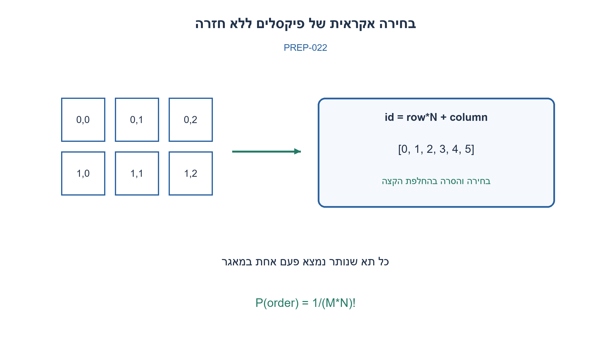
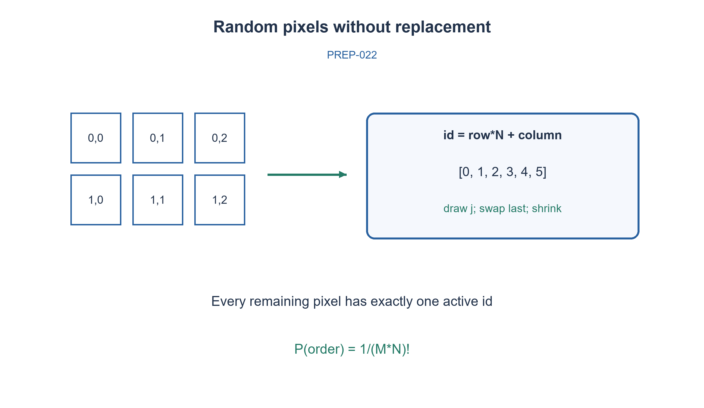

# PREP-022 — פרמוטציה אקראית ללא חזרות

פתרון מוצע בסיוע AI; ביקורת מקצועית אנושית ממתינה. הקושי אינו מכויל.

[צילום מקור פרטי](../sources/2026-10-30-batch110-02.png)

ברשותך מסך בגודל MxN פיקסלים בצורה של (x,y). תפקידך להדליק בצורה רנדומלית פיקסלים מבלי שיחזרו על עצמם. לא הייתה הגבלה על שימוש במבנה נתונים כלשהו.

## עברית

### וריאציה: פיקסלים אקראיים ללא חזרה
מסך מכיל M שורות ו־N עמודות. הפיקו סדר אקראי של כל זוגות הקואורדינטות (row,column), בלי להדליק פיקסל שכבר נבחר. כל מבנה נתונים מותר. נגדיר אינדקסים מאפס, ממדים שלמים אי שליליים והגרלות בלתי תלויות ואחידות. במימוש randbelow(k) מחזירה 0..k−1; זהו ממשק עזר מוצהר ולא rand החד־בסיסית בנוסח הראשי.

1. מספרו כל פיקסל במספר יחיד.
2. בחרו בכל פעם מתוך מאגר הפיקסלים שטרם הוצאו.
3. מיפוי id=row·N+column הפיך בעזרת divmod; ערבבו/הסירו בהחלפת קצה.

### אותו שק אקראי, עכשיו בקואורדינטות
מספרים את K=M·N הפיקסלים ב־0..K−1. בכל צעד מגרילים מיקום אחיד במערך שנותר, מוציאים את ערכו ומעבירים למקומו את הערך האחרון לפני הקטנת המערך. ממירים את המספר לזוג בעזרת divmod(id,N). לא מוחקים מאמצע ולא מגרילים שוב על פיקסל שכבר נבחר.

המיפוי בין מזהים לזוגות הוא חד־חד־ערכי, וכל החלפת קצה שומרת שכל מזהה שלא נבחר נמצא בדיוק פעם אחת בחלק הפעיל. כל פיקסל שנותר נבחר בהסתברות 1/k כשנותרו k, ולכן כל סדר מלא בהסתברות 1/K! בהנחת ההגרלות. הזמן Θ(K), המאגר Θ(K) ומספר משתני העזר קבוע; פלט כל הפיקסלים מחייב Ω(K) פעולות. אפשר להפסיק אחרי k פלטים ולקבל דגימה ללא החזרה, אך האתחול המוצג עדיין Θ(K). אם ממד אפס הפלט ריק ולא מגיעים לחלוקה באפס. בדיקה ממצה של 771 מסלולי הגרלה במסכים עד שישה תאים אימתה שכל תמורה מופיעה פעם אחת. זו הרחבה דו־ממדית של השאלה הקיימת; הרמזים המקוריים נשמרים.

```python
"""Draw a uniform permutation of M*N pixels; zero-based randbelow contract."""

def random_pixels(rows, columns, randbelow):
    if type(rows) is not int or type(columns) is not int or rows < 0 or columns < 0:
        raise ValueError('Dimensions must be nonnegative integers')
    remaining = list(range(rows*columns))
    while remaining:
        j = randbelow(len(remaining)) if len(remaining) > 1 else 0
        if type(j) is not int or not 0 <= j < len(remaining):
            raise ValueError('randbelow(k) must produce 0..k-1')
        chosen = remaining[j]
        remaining[j] = remaining[-1]
        remaining.pop()
        yield divmod(chosen, columns)
```




## English

### Variant: random pixels without repetition
A screen has M rows and N columns. Emit a random ordering of all (row,column) pixels without selecting one twice; any data structure is allowed. Use zero-based coordinates, nonnegative integer dimensions and independent uniform draws. Implementation randbelow(k) returns 0..k−1, an explicit helper contract different from the main question’s one-based rand.

1. Flatten every pixel to one integer.
2. Draw only from the remaining pool.
3. id=row·N+column is inverted by divmod; remove by exchanging with the active boundary.

### The same random bag, now as coordinates
Number K=M·N pixels 0..K−1. Draw a uniform position in the remaining array, emit its value, replace it by the last active value and shrink the array. Convert the id with divmod(id,N). No middle deletion or retrying an already chosen pixel is necessary.

Flattening is a bijection. Boundary replacement preserves every unchosen id exactly once in the active pool. With k remaining, each has probability 1/k, so each complete ordering has probability 1/K! under the stated draws. Time is Θ(K), pool storage Θ(K), and auxiliary variables constant; outputting every pixel costs Ω(K). Stopping after k outputs gives sampling without replacement, though this initialization still costs Θ(K). A zero dimension yields no outputs and never divides by zero. Exhaustive testing of 771 draw paths through screens of up to six cells established one occurrence per permutation. This is a two-dimensional extension; original hints remain unchanged.

```python
"""Draw a uniform permutation of M*N pixels; zero-based randbelow contract."""

def random_pixels(rows, columns, randbelow):
    if type(rows) is not int or type(columns) is not int or rows < 0 or columns < 0:
        raise ValueError('Dimensions must be nonnegative integers')
    remaining = list(range(rows*columns))
    while remaining:
        j = randbelow(len(remaining)) if len(remaining) > 1 else 0
        if type(j) is not int or not 0 <= j < len(remaining):
            raise ValueError('randbelow(k) must produce 0..k-1')
        chosen = remaining[j]
        remaining[j] = remaining[-1]
        remaining.pop()
        yield divmod(chosen, columns)
```




## חומר משלים / Supporting material

```json
{
  "source_ambiguities": {
    "he": [
      "הצילום אינו מגדיר אחידות, עצמאות או מתי מפסיקים. העריכה בוחרת סדר אחיד מלא ופלט מאפס."
    ],
    "en": [
      "The source does not specify uniformity, independence or stopping; the variant chooses a complete uniform zero-based ordering."
    ]
  },
  "verification": {
    "he": "נוספו 771 מסלולי הגרלה ממצים במסכים ריקים ועד שישה תאים, עם גבולות קואורדינטות וללא חזרה.",
    "en": "Added771 exhaustive draw paths for empty through six-cell screens, checking coordinate bounds and no repetition."
  },
  "prompt_variants": {
    "he": {
      "batch110_random_pixels": {
        "prompt": "### וריאציה: פיקסלים אקראיים ללא חזרה\nמסך מכיל M שורות ו־N עמודות. הפיקו סדר אקראי של כל זוגות הקואורדינטות (row,column), בלי להדליק פיקסל שכבר נבחר. כל מבנה נתונים מותר. נגדיר אינדקסים מאפס, ממדים שלמים אי שליליים והגרלות בלתי תלויות ואחידות. במימוש randbelow(k) מחזירה 0..k−1; זהו ממשק עזר מוצהר ולא rand החד־בסיסית בנוסח הראשי.",
        "hints": [
          "מספרו כל פיקסל במספר יחיד.",
          "בחרו בכל פעם מתוך מאגר הפיקסלים שטרם הוצאו.",
          "מיפוי id=row·N+column הפיך בעזרת divmod; ערבבו/הסירו בהחלפת קצה."
        ]
      }
    },
    "en": {
      "batch110_random_pixels": {
        "prompt": "### Variant: random pixels without repetition\nA screen has M rows and N columns. Emit a random ordering of all (row,column) pixels without selecting one twice; any data structure is allowed. Use zero-based coordinates, nonnegative integer dimensions and independent uniform draws. Implementation randbelow(k) returns 0..k−1, an explicit helper contract different from the main question’s one-based rand.",
        "hints": [
          "Flatten every pixel to one integer.",
          "Draw only from the remaining pool.",
          "id=row·N+column is inverted by divmod; remove by exchanging with the active boundary."
        ]
      }
    }
  }
}
```
