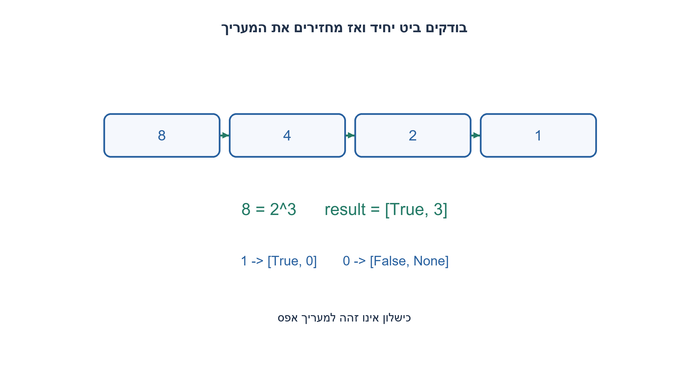
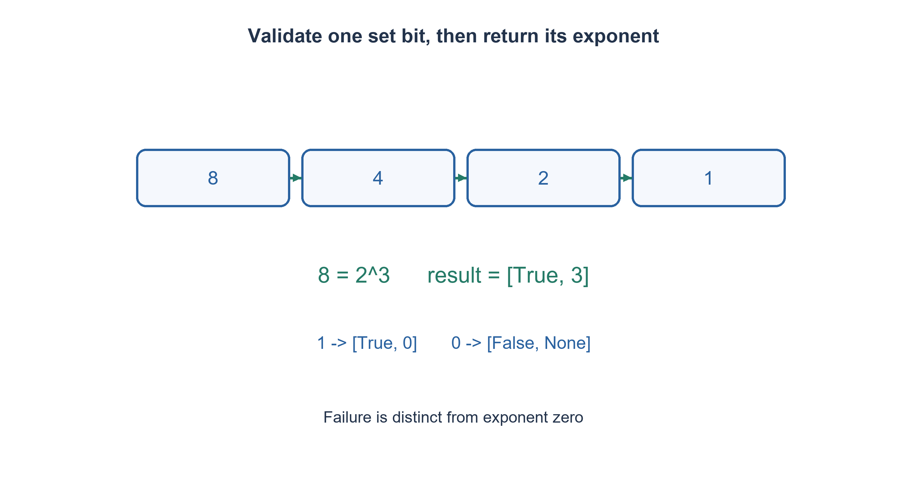

# PREP-023 — זיהוי חזקה של 2 במספר קבוע של פעולות

פתרון מוצע בסיוע AI; ביקורת מקצועית אנושית ממתינה. הקושי אינו מכויל.

## עברית

### בדיקת חזקה והחזרת המעריך
כתבו קוד המקבל מספר לא־מסומן בטווח uint32, בודק אם הוא 2^k, ואם כן מחזיר גם k. הגדירו פלט [true,k] להצלחה ו־[false,None] אחרת; 1 הוא 2^0 ואפס אינו חזקה. הסבירו את הדרישה ״פחות מ־O(N)״ לפי משמעות N: ערך המספר, רוחב המילה או מספר איברי קלט.

1. בדיקת ביט יחיד והחזרת מיקומו הן שתי משימות קשורות אך שונות.
2. תחילה פסלו אפס ומספרים שיש בהם יותר מביט אחד. אחר כך אפשר לספור הזזות עד אחד.
3. לאחר בדיקת n & (n−1), כל הזזה ימינה מחלקת חזקה בשתיים. מספר ההזזות עד 1 הוא המעריך; לא משתמשים ב־log עם עיגול.

### קודם מאמתים, אחר כך מונים הזזות
אם value=0 או value & (value−1) אינו אפס, מחזירים [False,None]. אחרת יש בדיוק ביט אחד דולק. מתחילים exponent=0 ומזיזים ימינה כל עוד value>1, עם הגדלת המונה. עבור 8 נקבל 8→4→2→1 ושלוש הזזות, ולכן [True,3]. עבור 1 אין אף הזזה ומוחזר מעריך אפס; עבור 12 הבדיקה הראשונית נכשלת.

אחרי c הזזות מתקיים value_current=value_original/2^c, כי הקלט שאושר הוא חזקה. נעצור ב־1 בדיוק כש־2^c שווה לקלט, ולכן c הוא המעריך. מדד העצירה הוא מיקום הביט הדולק. ב־uint32 יש לכל היותר 31 הזזות, מעט משתנים ומספר קבוע של בדיקות נוספות. עבור רוחב W כללי העלות O(W) במקרה הגרוע ו־O(1) מילות עזר. ביחס לערך המספר החיובי n מדובר ב־O(log n) צעדים, לא O(n); ביחס לאורך הכתיב זו סריקה לינארית. אין לפרש '<O(N)' כחסם פורמלי לפני הגדרת N.

אם ספריית השפה או המעבד מספקת bit-scan/CTZ, אפשר להשתמש בה אחרי אישור קלט שאינו אפס; מספר האפסים הנגררים הוא k. יש לבדוק את חוזה zero והרוחב של הפעולה, ולא להניח שהיא מוגדרת לכל קלט או קבועה עבור BigInt. אפשר גם חיפוש בינארי של מיקום הביט במילת מכונה עם מסכות, אך זה אלגוריתם חלופי, לא תוצאה אוטומטית של בדיקת AND אחת. אין צורך בלוגריתם נקודה צפה.

הבדיקה מיצתה את הטווח 0..65535 ועוד ארבעה גבולות uint32 מול טבלת חזקות מפורשת: 65,540 מקרים. הפלט הכפול מבדיל בין מספר שאינו חזקה לבין החזקה 1 שהמעריך שלה אפס. חוזה בדיקת החזקה הבוליאנית הקודם נשמר.

```python
"""Return [is_power, exponent_or_None] for a nonnegative uint32 value."""


def power_exponent(value):
    if type(value) is not int or not 0 <= value <= 0xffffffff:
        raise ValueError('uint32-range integer required')
    if value == 0 or value & (value - 1):
        return [False, None]
    exponent = 0
    while value > 1:
        value >>= 1
        exponent += 1
    return [True, exponent]
```




## English

### Test the power and return its exponent
For a uint32-range value, decide whether it equals 2^k and return k when it does. Use [true,k] for success and [false,None] otherwise; 1 is 2^0, zero is not a power. Interpret the source requirement below O(N) by specifying whether N denotes numeric value, word width or input length.

1. Testing for one bit and returning its position are related but distinct.
2. Reject zero and values with multiple set bits, then count right shifts until one.
3. After the n & (n−1) test, each right shift halves the power. The shift count until one is its exponent, without floating-point logarithm rounding.

### Validate first, then count shifts
Return [False,None] for zero or nonzero value & (value−1). Otherwise exactly one bit is set. Start exponent=0 and shift right while value>1, incrementing the counter. Input 8 follows 8→4→2→1 and returns [True,3]. One needs no shifts and has exponent zero; twelve fails the first test.

After c shifts, current value equals original/2^c because the approved input is a power. Reaching one means original=2^c, proving the returned exponent. For uint32 at most 31 shifts occur. General W-bit words require O(W) worst-case steps and constant auxiliary words; relative to numeric value n, this is O(log n), rather than O(n). Relative to representation length it is linear. The source phrase below O(N) needs a definition of N before a formal interpretation.

An available bit-scan/CTZ can return k after checking nonzero input. Its zero case and width must be specified; do not assume it is universally defined or constant for arbitrary-precision integers. Binary searching a machine word's bit position with masks is another algorithm, not an automatic consequence of one AND. Floating-point logarithms are unnecessary.

65,540 cases cover 0..65535 and four uint32 boundaries against an explicit power table. The pair result distinguishes a non-power from the valid power one with exponent zero. The earlier Boolean-only contract is retained.

```python
"""Return [is_power, exponent_or_None] for a nonnegative uint32 value."""


def power_exponent(value):
    if type(value) is not int or not 0 <= value <= 0xffffffff:
        raise ValueError('uint32-range integer required')
    if value == 0 or value & (value - 1):
        return [False, None]
    exponent = 0
    while value > 1:
        value >>= 1
        exponent += 1
    return [True, exponent]
```




## חומר משלים / Supporting material

```json
{
  "assumptions": {
    "he": [
      "uint32 בתחום; אפס נפסל ו־1 מחזיר מעריך אפס.",
      "None מציין מעריך לא מוגדר; אינו מתחלף במעריך אפס."
    ],
    "en": [
      "uint32 range; reject zero, return exponent zero for one.",
      "None denotes an undefined exponent, distinct from exponent zero."
    ]
  },
  "optimality": {
    "he": "עד 31 הזזות בתחום הקבוע; O(W) ברוחב כללי, O(log n) ביחס לערך n. אינו חסם קבוע ל־BigInt.",
    "en": "At most 31 shifts in the fixed domain; O(W) for general width, O(log n) in numeric value n. No unbounded-integer constant-time claim."
  },
  "verification": {
    "he": "65,540 מקרים מול טבלת חזקות עצמאית; נבדקו אפס, אחד, גבולות uint32 ושכנים של חזקות.",
    "en": "65,540 cases against an independent power table, including zero, one, uint32 boundaries and neighbors of powers."
  },
  "edge_cases": {
    "he": [
      "0; 1; 2; 12; הביט העליון; ערך מחוץ לתחום."
    ],
    "en": [
      "0; 1; 2; 12; highest bit; out-of-domain value."
    ]
  },
  "common_mistakes": {
    "he": [
      "להחזיר 0 עבור כישלון וגם עבור 1.",
      "לקרוא CTZ באפס בלי לבדוק חוזה.",
      "לכתוב O(1) עבור int בלתי חסום או להשתמש בלוגריתם מעוגל."
    ],
    "en": [
      "Returning zero for both failure and input one.",
      "Calling CTZ on zero without its contract.",
      "Claiming O(1) for unbounded int or using rounded logarithms."
    ]
  },
  "interview_answer": {
    "he": "אבדוק תחילה ביט דולק יחיד וקלט שאינו אפס. אחר כך אספור הזזות עד אחד; אפריד בין עלות ביחס לערך וביחס לרוחב.",
    "en": "First test a single set bit and reject zero. Then count shifts to one, distinguishing value-based and width-based cost."
  },
  "source_ambiguities": {
    "he": "N ופורמט פלט המעריך לא הוגדרו. נבחרו uint32 וזוג valid/exponent בלי לשנות את הבדיקה הבוליאנית הישנה.",
    "en": "N and the exponent result format were unspecified. This part uses uint32 and a valid/exponent pair while preserving the earlier Boolean test."
  },
  "solution_extensions": {
    "he": [
      {
        "question": "מתי floor(log2(n)) אינו מספיק כדי לבדוק חזקה?",
        "answer_direction": "גם 12 נותן רצפה 3, כמו מספרים אחרים בטווח 8..15. צריך להשוות לחזקה המתאימה או לוודא ביט יחיד.",
        "principle": "מיקום הביט הגבוה אינו מוכיח שכל שאר הביטים אפס."
      }
    ],
    "en": [
      {
        "question": "Why is floor(log2(n)) alone insufficient to test a power?",
        "answer_direction": "Twelve also has floor three, like all values eight through fifteen. Verify equality with the power or a single set bit.",
        "principle": "The highest-bit position does not prove other bits are zero."
      }
    ]
  }
}
```
