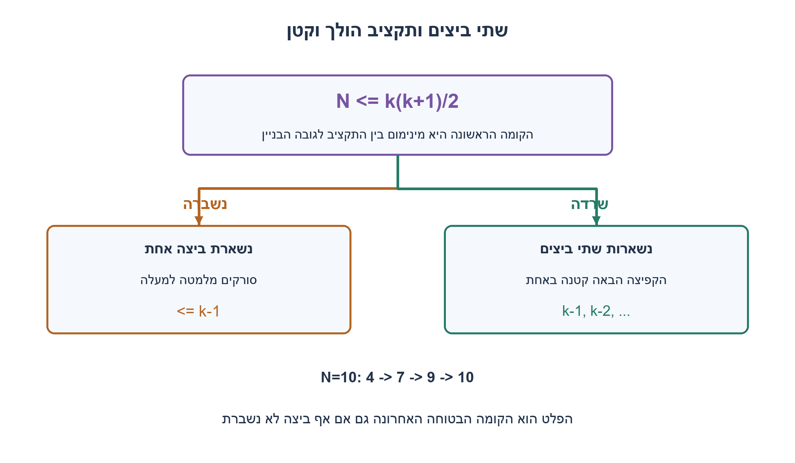
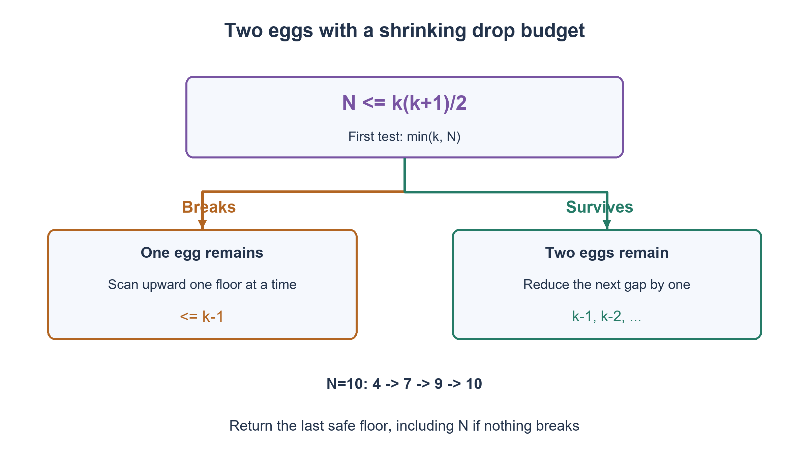

# PREP-025 — שתי ביצים: הקומה הבטוחה הגבוהה ביותר בבניין כללי

פתרון מוצע בסיוע AI; ביקורת מקצועית אנושית ממתינה. הקושי אינו מכויל.

[צילום מקור פרטי](../sources/2026-10-31-batch22-01.png)

יש בניין עם N קומות ואתה מקבל 2 ביצים. יש למצוא את הקומה המקסימלית לזריקת ביצה ללא שבירה שלה במספר איטרציות הנמוך ביותר. ניתן להשתמש בביצה שזרקת ולא נשברה. היה צריך להציג את הדרך לפתרון בצורה מתמטית ולהסביר.

## עברית

### שתי ביצים ו־N קומות: מחזירים את הקומה הבטוחה האחרונה
יש בניין בן N קומות ממוספרות 1..N ושתי ביצים זהות. ביצה שלא נשברה ניתנת לשימוש חוזר. קיימת התנהגות שבירה מונוטונית וקבועה: מתחת לסף הביצה שורדת, ומהסף ומעלה היא נשברת. קומה 0 ידועה כבטוחה. מותר גם שאף קומה בבניין לא תשבור ביצה.

מצאו את הקומה הגבוהה ביותר שממנה ביצה אינה נשברת, במינימום זריקות במקרה הגרוע. הציגו אסטרטגיה, נוסחה בתקציב זריקות והוכחת אופטימליות. התשובה יכולה להיות 0 או N. הסבירו בנפרד מה משתנה אם ידוע מראש שקומה N שוברת; זו הבטחה נוספת, לא הנחה ראשית.

1. אחרי שבירה ראשונה נשארת ביצה אחת, ולכן חייבים לסרוק את הטווח שנותר בלי לדלג על קומות.
2. בתקציב של k זריקות, קפיצה ראשונה גבוהה מ־k משאירה יותר מדי קומות לביצה האחרונה אם הראשונה נשברת.
3. בחרו פערים k,k−1,k−2,... כך שמספר הזריקות שכבר נוצלו והסריקה שנותרה אינם עוברים k. הכיסוי הכולל הוא סכום המספרים עד k.

### הפלט משתנה; רעיון החיפוש נשאר זהה
אם F היא הקומה השוברת הראשונה, הקומה הבטוחה הגבוהה ביותר היא H=F−1. כשאין שבירה בתוך הבניין נגדיר F=N+1 ונחזיר H=N. כך יש N+1 תשובות אפשריות, H=0..N, ולא מוציאים מן הבעיה את המקרה שבו כל הקומות בטוחות.

### תקציב מאוזן באמצעות פערים יורדים
בחרו את k השלם הקטן ביותר שעבורו k(k+1)/2≥N. מתחילים בביצה הראשונה בקומה min(k,N). אם היא שורדת, עולים בעוד k−1 קומות, אחר כך k−2, וכן הלאה, תוך חיתוך לקומה העליונה. לאחר השבירה הראשונה בודקים עם הביצה השנייה, מלמטה למעלה, את הקומות שמעל הבטוחה האחרונה ומתחת לקומה ששברה את הראשונה. בשבירה השנייה יודעים שהקומה הקודמת היא H; אם כולן שורדות, H היא זו שמתחת לשבירה הראשונה.

לדוגמה N=10 נותן k=4: זריקות הביצה הראשונה הן בקומות 4,7,9,10 כל עוד היא שורדת. אם נשברה בקומה 7, כבר נוצלו שתי זריקות ונשארים לבדוק 5 ו־6 עם הביצה השנייה: סך הכול לכל היותר ארבע. אם כל הקומות שורדות, מחזירים 10. עבור N=100 מתקבל שוב k=14; ההכללה אינה משנה את הדוגמה הקודמת.

### למה אי אפשר להבטיח פחות
נסמן C(k) כמספר הקומות הלא ידועות שאפשר להכריע עליהן עם שתי ביצים ועד k זריקות, כאשר גם אין שבירה הוא מצב אפשרי. בזריקה הראשונה מותר להשאיר לכל היותר k−1 קומות מתחת לקומה הנבדקת: אם תישבר, לביצה האחרונה נשארות רק k−1 זריקות, וחיפוש בטוח בהן הוא סריקה סדרתית. לכן הקומה הנבדקת יכולה לכסות לכל היותר k קומות עד אליה. בענף ההישרדות יש שוב שתי ביצים ורק k−1 זריקות, ולכן אפשר לכסות מעליה לכל היותר C(k−1) קומות. מכאן C(k)≤k+C(k−1), ו־C(0)=0, ולכן C(k)≤k(k+1)/2. האסטרטגיה משיגה את אותו מספר, ולכן החסם הדוק.

ההוכחה משתמשת בשתי תוצאות של כל זריקה ובתקציב הביצים, ולא מניחה התפלגות על הסף. חיפוש בינארי רגיל אינו שומר על המשאב: שבירה מוקדמת עשויה להשאיר טווח גדול מדי לביצה אחת.

### גבולות ועלות
N=0 נותן H=0 בלי זריקה; N=1 דורש זריקה אחת במודל הראשי. אם ידוע שקומה N שוברת, רק N−1 קומות הן לא ידועות, ומחליפים את תנאי הכיסוי ב־k(k+1)/2≥N−1. למשל N=2 דורש אז רק זריקה אחת, לעומת שתיים ללא ההבטחה. בבניין ריק ההבטחה על קומה עליונה שוברת אינה חוקית.

מספר הקריאות לבדיקה הוא k=Θ(√N) במקרה הגרוע, והליבה שומרת O(1) מילות מצב. קוד האימות יכול לשמור עקבה חיצונית בגודל O(k); אין צורך בה באסטרטגיה עצמה. את k מחשבים עם שורש שלם ובדיקת אי־השוויון, בלי שגיאות עיגול של float. עלות פעולות על שלמים בלתי חסומים תלויה ברוחבם ואינה מוצגת כ־O(1) בביטים.

האימות מיצה 10,201 תרחישי סף לכל N=0..100, בשני חוזי הקומה העליונה. אורקל minimax עצמאי ניסה כל בחירה אפשרית של זריקה ראשונה. נבדקו תשובת H, האופטימום, שימוש חוזר רק בביצים ששרדו, אי־חריגה מגובה הבניין, ומקרה של N בעל 101 ספרות לחישוב מדויק של k.

```python
"""Two reusable-until-broken eggs: return the highest safe floor, including N.

breaks(f) is deterministic and monotone. Floor zero is safe. Unless explicitly
known otherwise, floor N may also be safe. Optional trace belongs to the caller.
"""
from math import isqrt


def minimum_drops(floors: int, *, top_known_breaking: bool = False) -> int:
    if type(floors) is not int or floors < 0:
        raise ValueError("floors must be a nonnegative integer")
    if top_known_breaking and floors == 0:
        raise ValueError("a known breaking top needs at least one floor")
    unknown = floors - int(top_known_breaking)
    budget = (isqrt(1 + 8 * unknown) - 1) // 2
    return budget + int(budget * (budget + 1) // 2 < unknown)


def highest_safe_floor(floors: int, breaks, *, top_known_breaking: bool = False, trace=None) -> int:
    budget = minimum_drops(floors, top_known_breaking=top_known_breaking)
    upper = floors if top_known_breaking else floors + 1
    safe = 0

    def drop(egg, floor):
        broken = bool(breaks(floor))
        if trace is not None:
            trace.append((egg, floor, broken))
        return broken

    while upper - safe > 1:
        tested = min(safe + budget, upper - 1)
        budget -= 1
        if drop(1, tested):
            for candidate in range(safe + 1, tested):
                if drop(2, candidate):
                    return candidate - 1
            return tested - 1
        safe = tested
    return safe
```




## English

### Two eggs and N floors: return the highest safe floor
A building has N floors numbered 1..N and two identical eggs. An unbroken egg is reusable. Breakage is deterministic and monotone: an egg survives below a threshold and breaks at that threshold or above. Ground floor zero is known safe. It is possible that no building floor breaks an egg.

Find the highest safe floor with the minimum worst-case number of drops. Give a strategy, a drop-budget formula and an optimality proof. Answers zero and N are allowed. Separately explain the extra guarantee that floor N is known to break an egg; do not silently assume it in the main problem.

1. After the first break only one egg remains, requiring an upward scan without skipping unknown floors.
2. With a k-drop budget, a first gap larger than k leaves too many floors for the last egg if the first breaks.
3. Use gaps k,k−1,k−2,... so used drops plus the possible final scan never exceed k. Total coverage is the sum through k.

### A different return value, the same search principle
If F is the first breaking floor, the highest safe floor is H=F−1. With no breaking floor in the building, define F=N+1 and return H=N. Thus H has N+1 possible values, zero through N; the all-safe case is retained.

### Balance the budget with decreasing gaps
Choose the smallest integer k satisfying k(k+1)/2≥N. Test the first egg at min(k,N). After survival, increase the floor by k−1, then k−2, and so on, clipping to the building top. After its first break, scan upward with the remaining egg between the last known safe floor and the breaking floor. A second break identifies H as the preceding floor; if the intermediate floors all survive, H is just below the first breaking floor.

For N=10, k=4 gives first-egg floors 4,7,9,10 while it survives. A break at 7 has already used two drops, leaving tests at 5 and 6: at most four altogether. If every tested floor survives, return 10. N=100 again gives k=14, preserving the earlier concrete example.

### Why fewer drops cannot guarantee success
Let C(k) be the number of unknown floors resolvable with two eggs and at most k drops, including no breakage as a possibility. The first drop may leave at most k−1 floors below it: after breakage the last egg has only k−1 tests, and a guaranteed search cannot skip an unknown floor. Therefore that test can cover at most k floors up to its position. Survival leaves two eggs and k−1 drops, covering at most C(k−1) further floors. Hence C(k)≤k+C(k−1), with C(0)=0, giving C(k)≤k(k+1)/2. The decreasing-gap construction attains this bound, proving optimality.

This argument uses test outcomes and consumable resources, not a probability distribution on thresholds. Ordinary binary search can spend an egg too early and leave too large an interval for a single egg.

### Boundaries and cost
N=0 returns H=0 without a drop. N=1 needs one drop in the main model. If the top is guaranteed to break an egg, only N−1 floors are unknown, so use k(k+1)/2≥N−1. For example N=2 then needs one drop rather than two. A known breaking top is invalid for an empty building.

Worst-case test calls are k=Θ(√N), using O(1) state words in the strategy. The checker may keep an external O(k) trace, which the strategy does not require. Compute k using integer square root and an exact inequality rather than floating-point rounding. Unbounded-integer operation cost depends on bit width and is not claimed constant in bits.

The verification exhausted 10,201 threshold scenarios over N=0..100 under both top-floor contracts. An independent minimax oracle tried every first drop location. It checked H, the optimum, reuse only of surviving eggs, floor bounds and exact budget calculation for an N with 101 decimal digits.

```python
"""Two reusable-until-broken eggs: return the highest safe floor, including N.

breaks(f) is deterministic and monotone. Floor zero is safe. Unless explicitly
known otherwise, floor N may also be safe. Optional trace belongs to the caller.
"""
from math import isqrt


def minimum_drops(floors: int, *, top_known_breaking: bool = False) -> int:
    if type(floors) is not int or floors < 0:
        raise ValueError("floors must be a nonnegative integer")
    if top_known_breaking and floors == 0:
        raise ValueError("a known breaking top needs at least one floor")
    unknown = floors - int(top_known_breaking)
    budget = (isqrt(1 + 8 * unknown) - 1) // 2
    return budget + int(budget * (budget + 1) // 2 < unknown)


def highest_safe_floor(floors: int, breaks, *, top_known_breaking: bool = False, trace=None) -> int:
    budget = minimum_drops(floors, top_known_breaking=top_known_breaking)
    upper = floors if top_known_breaking else floors + 1
    safe = 0

    def drop(egg, floor):
        broken = bool(breaks(floor))
        if trace is not None:
            trace.append((egg, floor, broken))
        return broken

    while upper - safe > 1:
        tested = min(safe + budget, upper - 1)
        budget -= 1
        if drop(1, tested):
            for candidate in range(safe + 1, tested):
                if drop(2, candidate):
                    return candidate - 1
            return tested - 1
        safe = tested
    return safe
```




## חומר משלים / Supporting material

```json
{
  "assumptions": {
    "he": [
      "שתי ביצים זהות, שבירה מונוטונית ודטרמיניסטית, ושימוש חוזר בביצה ששרדה.",
      "קומה 0 בטוחה; במודל הראשי אין הבטחה שקומה N שוברת.",
      "N שלם לא שלילי; חוזה קומה עליונה ידועה כשוברת נדון בנפרד."
    ],
    "en": [
      "Two identical eggs, deterministic monotone breakage and reuse of surviving eggs.",
      "Floor zero is safe; the main model does not guarantee a breaking top.",
      "N is a nonnegative integer; a known breaking top is a separate contract."
    ]
  },
  "optimality": {
    "he": "מינימום זריקות k הוא השלם הקטן ביותר עם k(k+1)/2≥N. הליבה O(1) מילות עזר ומספר בדיקות Θ(√N); עקבת אימות אופציונלית דורשת O(k). אם קומה עליונה שוברת ידועה, מחליפים N ב־N−1.",
    "en": "The optimal budget is the least k with k(k+1)/2≥N. The strategy uses O(1) state words and Θ(√N) test calls; an optional verification trace costs O(k). A known breaking top replaces N by N−1."
  },
  "verification": {
    "he": "10,201 תרחישי סף לכל N=0..100 בשני חוזים התאימו ל־DP minimax עצמאי. נבדקו עקבות, שתי ביצים בלבד, הרצפה הבטוחה, גובה הבניין ושלם גדול ללא עיגול.",
    "en": "10,201 threshold scenarios for N=0..100 under both contracts matched independent minimax DP. Traces checked two-egg use, exact safe-floor return, building bounds and a large exact integer budget."
  },
  "edge_cases": {
    "he": [
      "N=0; N=1; שבירה בקומה 1; אין שבירה; N מספר משולשי או סמוך לו; קומה עליונה ידועה כשוברת."
    ],
    "en": [
      "N=0; N=1; breakage at floor one; no breakage; triangular N and neighbors; known breaking top."
    ]
  },
  "common_mistakes": {
    "he": [
      "להחזיר F במקום F−1.",
      "להניח שבירה בקומה העליונה בלי הבטחה.",
      "לחפש בינארית עם הביצה האחרונה או למחזר ביצה שנשברה.",
      "לעגל שורש ב־float עבור N גדול."
    ],
    "en": [
      "Returning F rather than F−1.",
      "Assuming a breaking top without a guarantee.",
      "Binary-searching with the last egg or reusing a broken egg.",
      "Rounding a floating-point square root for large N."
    ]
  },
  "interview_answer": {
    "he": "אבחר k מינימלי שסכומו המשולשי מכסה N ואקפוץ בפערים יורדים. אחרי השבירה הראשונה אסרוק עם הביצה האחרונה. אחזיר את הקומה הבטוחה הקודמת; אם הכול שרד אחזיר N. אותו כיסוי נותן גם חסם תחתון.",
    "en": "Choose the least k whose triangular capacity covers N and use decreasing gaps. After the first break, scan with the last egg. Return the preceding safe floor, or N if all survive. The same capacity argument supplies the lower bound."
  },
  "source_ambiguities": {
    "he": [
      "מינימום מוגדר במקרה הגרוע. ידיעת קומה שוברת משנה את מספר הספים האפשריים ולכן נבחנת בנפרד; אין כאן מטרה של תוחלת תחת התפלגות נתונה."
    ],
    "en": [
      "Minimum means worst case. Knowing a breaking floor changes the possible thresholds and is separate; expected cost under a distribution is not the objective."
    ]
  },
  "solution_extensions": {
    "he": [
      {
        "question": "אם קומה N ידועה כשוברת, האם תמיד עדיין צריך אותו מספר זריקות?",
        "answer_direction": "לא. נשארות N−1 קומות לא ידועות. למשל ב־N=2 מספיק לבדוק את קומה 1, בעוד בלי ההבטחה צריך לעתים שתי זריקות.",
        "principle": "ידע מוקדם משנה את עץ האפשרויות ואת החסם."
      }
    ],
    "en": [
      {
        "question": "If floor N is known to break, is the optimal drop count always unchanged?",
        "answer_direction": "No. Only N−1 floors remain unknown. For N=2, testing floor one suffices, whereas the unpromised case can need two drops.",
        "principle": "Prior knowledge changes the decision tree and its bound."
      }
    ]
  }
}
```
