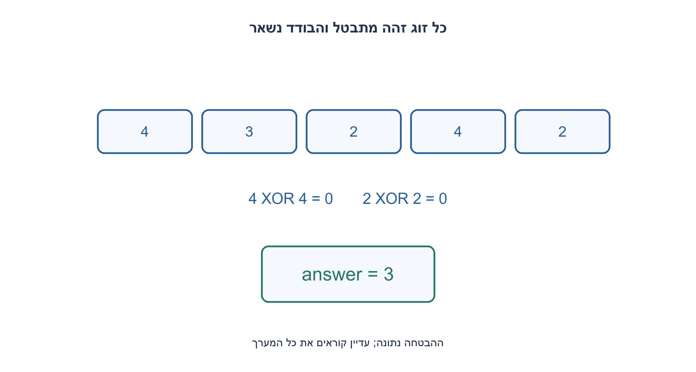
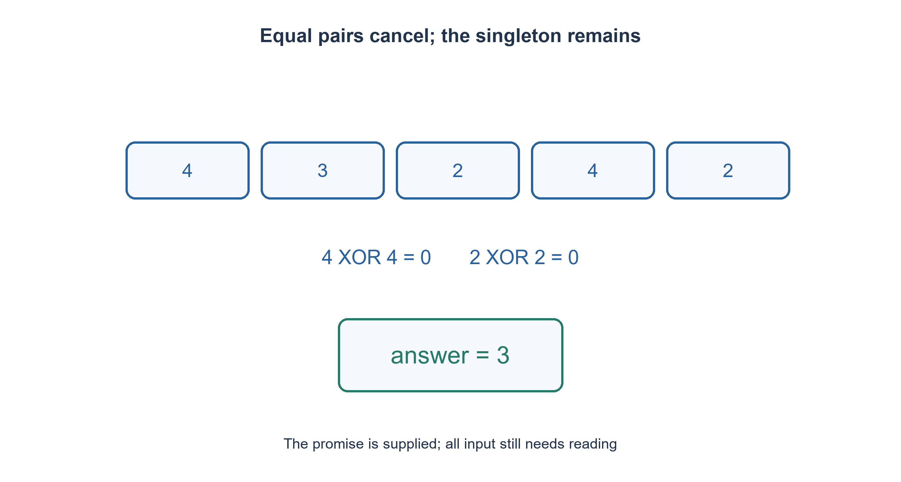

# PREP-027 — מציאת הספרה שמופיעה מספר אי־זוגי של פעמים

פתרון מוצע בסיוע AI; ביקורת מקצועית אנושית ממתינה. הקושי אינו מכויל.

## עברית

### מספר בודד בין זוגות של מספרים שלמים
נתון מערך סופי באורך L=2n+1: כל הערכים מופיעים בזוגות, למעט ערך אחד שמופיע פעם אחת. מצאו את הבודד והציעו חלופות עם ניתוח זמן ומקום. n אינו נתון בנפרד, אבל אורך המערך או ממשק סיום תקין זמינים. הערכים אינם מוגבלים לספרות; עבור מימוש מכונה נניח שלמים ברוחב W קבוע.

אין צורך למיין ואין לשנות את הקלט בפתרון הראשי. ההבטחה על הזוגות היא הנחת קלט, ולא משהו ש־XOR מוכיח בעצמו. דונו בנפרד במערך שאינו עומד בהבטחה ובמצביע C שאין לצדו אורך.

1. איזו פעולה על x ועל עותק זהה שלו מבטלת את שניהם?
2. XOR אסוציאטיבי וקומוטטיבי, ולכן סדר הזוגות אינו משנה.
3. צברו XOR החל מאפס. כל זוג מתאפס והבודד נשאר; עדיין חייבים לדעת היכן המערך מסתיים.

### מבטלים זוגות בכל מיקום ביט
נבצע answer=0 ואז answer XOR= value לכל איבר. בגלל x XOR x=0 ו־x XOR 0=x, וכללי חילוף וקיבוץ, אפשר לסדר מתמטית את הצבירה לזוגות מבוטלים ולערך הבודד. עבור [4,3,2,4,2] נשאר 3. האינווריאנט הוא שהמצטבר שווה ל־XOR של הקידומת שנקראה; בסיום הוא XOR של כל המערך. למעשה מספיק שכל יתר השכיחויות זוגיות, גם אם יש כמה זוגות מאותו ערך.

במודל של מילות W ביטים, הזמן Θ(L) ומקום העזר O(1) מילים. בגישה רגילה למערך חייבים לקרוא את הקלט במקרה הגרוע: על מערך של אפסים באורך אי־זוגי, שינוי תא שלא נקרא לאחד משאיר קלט מובטח אך משנה את התשובה. לכן אין פתרון כללי בתת־זמן לינארי במספר התאים. העובדה ש־n לא סופק אינה מונעת שימוש באורך L; מצביע C לבדו בלי אורך או סמן סיום מוסכם אינו מאפשר סריקה בטוחה.

חלופות: מילון שכיחויות נותן Θ(L) פעולות בתוחלת ו־O(U) מקום עבור U ערכים שונים, ויכול לבדוק את ההבטחה. מיון ואחריו בדיקת שכנים נותן O(L log L) זמן במיון השוואתי, עם עלות מקום ותלות בשינוי הקלט לפי הממיין. חיפוש כפילות לכל איבר בסריקה נוספת עולה O(L²) וזיכרון קבוע. נוסחת סכום לבדה אינה מבטלת זוגות ואינה מספיקה; יצירת set וסכומים מוסיפה מקום וגם שיקולי גלישה.

שלמים שליליים מותרים תחת רוחב ופעולות ביטים מוגדרים; Python תומכת ב־XOR גם להם, אבל זמן פעולת int בלתי חסום תלוי באורך הביטים. אפס יכול להיות הבודד ולכן אינו סמן 'לא נמצא'. בקלט ללא הבטחה, למשל [1,2,3], צבירת XOR אינה אימות ואין להמציא תוצאה יחידה נכונה. הבדיקה השוותה 8,911 קלטים מובטחים לאורקל שכיחויות עצמאי, כולל שליליים, מספרים רחבים ודוגמת המקור.

```python
"""Exactly one unpaired integer; every other value has even multiplicity.

The source's pair-only promise is stronger than needed. Array termination or
length must still be provided; an unknown n is not an unbounded raw pointer.
"""


def unpaired_value(values):
    answer = 0
    for value in values:
        answer ^= value
    return answer
```




## English

### An unpaired integer among equal pairs
A finite array has length L=2n+1: values occur in equal pairs except for one value occurring once. Find the unpaired value and compare solutions with time/space costs. n is not supplied separately, but array length or a valid terminating interface is available. Values are not restricted to digits; use fixed W-bit integers for machine-level analysis.

The main solution does not sort or mutate input. The pairing promise is an input assumption, not something XOR validates. Separately discuss invalid promises and a raw C pointer with no length.

1. Which operation cancels two equal copies of x?
2. XOR is associative and commutative, so pair order does not matter.
3. Accumulate XOR from zero. Pairs vanish and the unpaired value remains; array termination is still required.

### Cancel pairs independently at every bit position
Set answer=0 and XOR each item into it. Since equal values cancel, zero is neutral, and XOR is associative/commutative, the reduction can be regrouped into cancelled pairs plus the unpaired value. [4,3,2,4,2] leaves 3. The accumulator equals the consumed prefix XOR after every step. The promise can even allow multiple pairs of one value: all non-target frequencies only need to be even.

Fixed W-bit word operations give Θ(L) time and O(1) auxiliary words. Ordinary array access has a worst-case linear-read lower bound: on an odd all-zero array, changing an unread cell to one preserves the promise but changes the answer. Unknown n does not prevent using known length L. A raw C pointer without length or an agreed sentinel does not permit safe traversal.

Alternatives include expected-linear dictionary counting with O(U) distinct-value storage, which can validate the promise; comparison sorting plus adjacent scanning in O(L log L), with mutation/space depending on the sort; and repeated duplicate scans in O(L²) time with constant auxiliary words. An ordinary sum does not cancel equal pairs; set/sum methods add storage and overflow considerations.

Negative values require defined fixed-width bit semantics; Python XOR also supports them, but arbitrary-precision operation cost grows with bit length. Zero may be the unpaired answer and cannot mark failure. Without the promise, [1,2,3] demonstrates that XOR does not certify a unique unpaired value. Independent frequency counting checked 8,911 promised cases including negatives, wide integers and the source example.

```python
"""Exactly one unpaired integer; every other value has even multiplicity.

The source's pair-only promise is stronger than needed. Array termination or
length must still be provided; an unknown n is not an unbounded raw pointer.
"""


def unpaired_value(values):
    answer = 0
    for value in values:
        answer ^= value
    return answer
```




## חומר משלים / Supporting material

```json
{
  "assumptions": {
    "he": [
      "אורך או סיום ידועים; הבטחת זוגות וערך בודד; שלמים ברוחב מפורש לניתוח מכונה."
    ],
    "en": [
      "Known length/termination; paired-value promise with one unpaired value; explicit machine width."
    ]
  },
  "optimality": {
    "he": "Θ(L) קריאות ו־O(1) מילות XOR תחת ההבטחה; בדיקת ההבטחה או מפתחות רחבים משנה עלויות.",
    "en": "Θ(L) reads and O(1) XOR words under the promise; validating the promise or unbounded keys changes costs."
  },
  "verification": {
    "he": "8,911 מקרי Python מול שכיחויות; אינו אימות של כל ערך שלם אפשרי או של הקצאת מערך C.",
    "en": "8,911 Python cases against frequency counts; not exhaustion of every integer or validation of C array allocation."
  },
  "edge_cases": {
    "he": [
      "איבר יחיד; בודד אפס; שליליים; כמה זוגות מאותו ערך; קלט מפר הבטחה."
    ],
    "en": [
      "One item; zero target; negatives; repeated pairs of one value; invalid promise."
    ]
  },
  "common_mistakes": {
    "he": [
      "להשתמש באפס כסמן חסר.",
      "לטעון ש־XOR בודק בעצמו את הבטחת השכיחויות.",
      "לסרוק מצביע C בלי גבול."
    ],
    "en": [
      "Using zero as an absent marker.",
      "Claiming XOR validates frequencies.",
      "Walking a raw C pointer without bounds."
    ]
  },
  "interview_answer": {
    "he": "אצבור XOR של כל האיברים; כל זוג זהה מתבטל והבודד נשאר. אציין שהסריקה דורשת גבול ושההבטחה נתונה מראש.",
    "en": "XOR all items; pairs cancel and the unpaired value remains. State that traversal is bounded and the input promise is supplied."
  },
  "source_ambiguities": {
    "he": "n לא ידוע אינו אומר שאורך המערך לא זמין. הערכים הכלליים והזוגות המדויקים הם סעיף נוסף, בלי למחוק את חוזה הספרות המקורי.",
    "en": "Unknown n need not mean unknown array length. General integers and exact pairs are an additional part preserving the original digit contract."
  },
  "solution_extensions": {
    "he": [
      {
        "question": "כיצד תבדקו שיש בדיוק בודד אחד וכל היתר פעמיים?",
        "answer_direction": "ספירת שכיחויות או מיון מאפשרים אימות, במחירי זמן/מקום מפורשים. XOR לבדו מאבד מידע על כל השכיחויות.",
        "principle": "חישוב תחת הבטחה שונה מאימות ההבטחה."
      }
    ],
    "en": [
      {
        "question": "How can the exact one-singleton/rest-twice promise be validated?",
        "answer_direction": "Frequency counts or sorting permit validation with explicit costs. XOR alone loses full frequency information.",
        "principle": "Solving under a promise differs from validating it."
      }
    ]
  }
}
```
