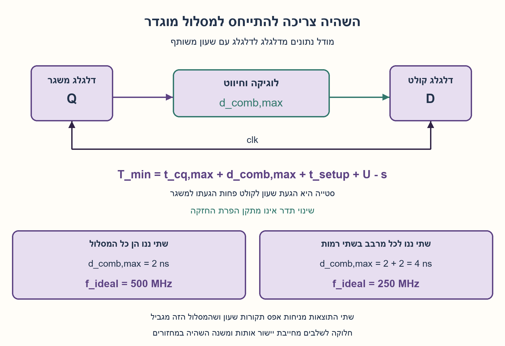
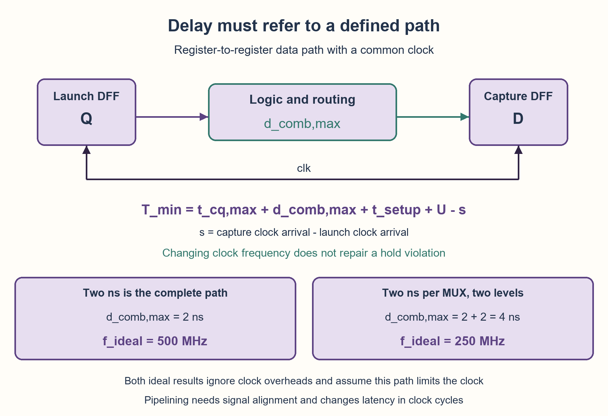

# PREP-031 — מקור נוסף / Additional source

פתרון מוצע בסיוע AI; ביקורת מקצועית ותרגום ממתינות. / AI-assisted proposed solution; professional and parity review pending.

## מקור / Source

[צילום מקור](../sources/2026-10-24-batch30-06.png)

1. לבנות xor בעזרת mux.
2. מה התדר המקסימלי אם זמן ההשהייה הוא 2 ננו.
3. כיצד ניתן להעלות את התדר המקסימלי

## עברית

### מקור נוסף: מרבבים, השהיה ותדר
א. בנו XOR בעזרת מרבבי MUX 2:1. ב. מהו התדר המרבי אם ההשהיה היא 2 ns? ג. כיצד אפשר להעלות את התדר המרבי?

המקור הנוסף אינו קובע אילו קבועים ושערים זמינים, למה בדיוק מתייחסות שתי הננו־שניות או מהו ממשק השעון. כדי לקשר לגרסה המקורית נשמרת כאן רשת המרבבים שלה עם קבוע 0 בלבד. נתחו בנפרד: (1) 2 ns הם ההשהיה המרבית של כל הלוגיקה והחיווט בין שני דלגלגים; (2) 2 ns הם ההשהיה של כל מרבב, ובמסלול המגביל עוברים שניים בטור. תנו תחילה גבול אידאלי ללא תקורות שעון, ואחר כך נוסחה הכוללת זמן שעון־למוצא, הכנה, סטיית שעון ואי־ודאות. הניחו אותות בינאריים, דלגלגים על אותה חזית ומסלולים חד־מחזוריים. הסבירו מה ניתן לשנות בלי לשנות פונקציה ומה מחייב הסכמה על השהיה במחזורים. אין כאן נתוני ספריית תאים או תדר פיזי מובטח.

### רמזים

1. הפרידו בין מימוש פונקציה לוגית לבין תזמון שלה. האם ההשהיה הנתונה מתייחסת לרכיב יחיד או לכל הדרך מדלגלג לדלגלג?
2. השוו את שני הענפים לפי a. אחר כך ספרו מרבבים בטור במסלול הארוך; מסלולים במקביל אינם מחוברים זה לזה בזמנים.
3. ברשת המקורית t=MUX(b,a,0) ו־y=MUX(a,b,t). אם כל מרבב עולה 2 ns יש מסלול של 4 ns. הוסיפו את תקורות הדלגלגים וחשבו מה חלוקה לשלבים עושה למספר המחזורים.

### תחילה בודקים מה בעצם נתון
המשפט ״השהיה של 2 ns״ אינו מספיק כדי לקבוע תדר פיזי יחיד. שער צירופי בפני עצמו אינו מקבל שעון, ולכן אין לו תדר מרבי סינכרוני בלי להגדיר מי משגר ומי דוגם. כאן נוסיף במפורש מודל של דלגלג משגר, לוגיקה וחיווט, ודלגלג קולט במחזור הבא. נפריד בין שתי משמעויות אפשריות של המספר במקור.

### מימוש ה־XOR המקורי נשאר תקף
נגדיר MUX(S,D0,D1): כאשר S=0 בוחרים D0, וכאשר S=1 בוחרים D1. נשתמש רק ב־a,b ובקבוע 0, כפי שנדרש בגרסה המקורית:

```text
t = MUX(b, a, 0)
y = MUX(a, b, t)
```

אם a=0, המרבב האחרון מעביר b: זהו 0 XOR b. אם a=1, המרבב האחרון בוחר t, והראשון בוחר 1 כאשר b=0 או 0 כאשר b=1. לכן t מתנהג כמו NOT b בדיוק בענף שבו צריך אותו. ארבע שורות האמת הן 00→0,01→1,10→1,11→0. אין קבוע 1 ואין שער NOT שהוברח למימוש.

לשתי הרמות יש מסלול סידורי אמיתי: כש־a=1 ו־b יורד מ־1 ל־0, השינוי עובר דרך המרבב הראשון ואז דרך כניסת הנתונים של השני. זמן שתי הרמות מצטבר. העובדה של־b יש גם חיבור ישיר למרבב השני אינה מבטלת את המסלול הארוך. אם מותר אות משלים מוכן, אפשר לחבר MUX(a,b,NOT b); זהו מרבב אחד בתוספת העלות וההשהיה של יצירת NOT b, ולא שער היפוך חינם תחת אילוצי המקור. הוכחת המינימום המקורית מתייחסת למספר מרבבי 2:1 תחת קבוע 0 בלבד, ולא לתדר מיטבי בכל ספרייה.

### שתי תשובות מותנות למספר שתי ננו־שניות
אם 2 ns הם כבר ההשהיה המרבית של כל המסלול הצירופי, ובמודל האידאלי כל תקורות השעון אפס ואין מסלול אחר שמגביל, אז T≥2 ns ולכן f≤1/(2×10⁻⁹)=500 MHz.

אם 2 ns הם ההשהיה המרבית של כל מרבב ברשת המקורית, מתעלמים מחיווט נוסף, ושתי הרמות הן המסלול המגביל, אז T≥2+2=4 ns ולכן f≤250 MHz באותו מודל אידאלי. אין להכפיל שוב בשתיים רק משום שגל שעון כולל גם עלייה וגם ירידה: השיגור והדגימה כאן הם בחזיתות עולות עוקבות, שהמרחק ביניהן הוא מחזור שלם. במעגל חזיתות הפוכות יידרש ניתוח אחר.

### מה מוסיפים במערכת אמיתית?
נסמן s כזמן הגעת השעון לקולט פחות זמן הגעתו למשגר, ו־U כאי־ודאות שמקצרים בגינה את חלון ההכנה. עבור מסלול חד־מחזורי:

```text
T_min >= t_cq,max + d_comb,max + t_setup + U - s
f_max <= 1 / T_min
hold: t_cq,min + d_comb,min >= s + t_hold
```

האי־שוויון הראשון הוא תנאי על תקופת השעון, ולא הבטחה שהתכנון כולו פועל בתדר הזה. d_comb כולל לוגיקה וחיווט; יש לבדוק את כל המסלולים והפינות הרלוונטיים. זמן ההשהיה המרבי צריך לכסות עליות וירידות ותלויות כניסה/מוצא, עומס, שיפוע כניסה ותנאי העבודה. אם 2 ns הם נתון אופייני בלבד, אין ממנו גבול בטוח. במודל זה s חיובי נותן יותר זמן להכנה אבל מקשה על החזקה; אין להסיק שסטיית שעון מועילה בלי לבדוק את שניהם. תנאי ההחזקה אינו נעשה תקין מעצם הארכת המחזור.

דוגמה ערוכה: d_comb=2 ns, t_cq,max=0.2 ns, t_setup=0.3 ns, U=0.1 ns ו־s=0 נותנים T_min=2.6 ns, כלומר גבול של כ־384.6 MHz למסלול הזה. המספרים פרט לשתי הננו־שניות נוספו להמחשה, ואינם נתוני המקור.

### כיצד מעלים את התדר?
אפשר לקצר את המסלול המגביל באמצעות מימוש לוגי מתאים לאילוצים, תאים מהירים יותר, הפחתת עומס/פיצול, תכנון חיווט ומיקום טובים יותר. תא מהיר יותר עלול לעלות בשטח ובהספק; נתון 2 ns אינו כולל אוטומטית את כל השינויים האלה. הורדת השהיה במסלול שאינו מגביל אינה בהכרח משפרת את תדר המערכת.

אם הממשק מתיר תוספת השהיה במחזורים, אפשר לשקול חלוקה לשלבי צינור או תזמון מחדש. הוספת אוגר באמצע רשת שני המרבבים מחייבת לשמור גם את a,b המתאימים לאותו פריט נתונים, כדי שלא לשלב t ממחזור קודם עם קלט חדש. שלבים מאוזנים יכולים לשפר קצב קבלת תוצאות, אך מוסיפים אוגרים ותקורות ומשנים את מספר המחזורים עד לתוצאה. אין הבטחה להכפלת התדר: תקורות הדלגלגים, חוסר איזון ומסלולים אחרים נשארים. אם החוזה דורש אותה תגובה צירופית או אותה השהיה במחזורים, אי אפשר להציע שלב נוסף כאילו לא שינה את החוזה.

### עלות ואימות
המימוש נשאר שני מרבבים ברשת המקורית, ללא שינוי בפונקציה. עלות/תדר של מימוש אחר תלויים במשאבים המותרים ובספרייה. בדקנו ארבע שורות אמת, שמונה שינויי קלט יחיד במודל השהיית מעבר אידאלי שווה של 2 ns למרבב, 48 השוואות זמן הגעה מול מועד הכנה ו־36 מקרי החזקה בחשבון רציונלי מדויק. ההשהיה המרבית במודל המעבר היא 4 ns. זהו מודל פייתון והוכחה, לא הרצת HDL, סינתזה, STA או מדידה פיזית.

שלושת הרמזים המקוריים והתור שלהם נשמרו. שלושה רמזים לווריאנט התזמון נשמרו בנפרד בחומר המשלים ובמסמך; התור הקיים אינו בוחר אותם אוטומטית לפי וריאנט. התוכן החדש הוא הצעה בסיוע AI, ללא אישור מקצועי חדש.



## English

### Additional source: MUXes, delay and frequency
(a) Build XOR using 2:1 MUXes. (b) What is the maximum frequency if the delay is 2 ns? (c) How can the maximum frequency be increased?

This source does not specify available constants/gates, what exactly the two nanoseconds measure, or the clock interface. To link it to the original, retain the original zero-only MUX network. Analyze separately: (1) 2 ns is the maximum delay of the complete combinational logic and routing between two flip-flops; (2) each MUX has 2 ns delay and the limiting path crosses two in series. First give an ideal bound ignoring clock overheads, then a formula including clock-to-Q, setup, clock skew and uncertainty. Assume binary signals, same-edge registers and single-cycle paths. Explain changes preserving function and changes needing agreement on latency in cycles. No cell-library characterization or guaranteed physical frequency is supplied.

### Hints

1. Separate Boolean implementation from its timing. Does the supplied delay describe one cell or the entire register-to-register path?
2. Condition on a to check the two branches, then count serial MUX levels on the longest path; parallel paths do not add to each other.
3. The original wiring is t=MUX(b,a,0), y=MUX(a,b,t). At 2 ns per MUX there is a 4 ns path. Include register overheads and ask how pipelining changes the number of cycles.

### First establish what the number describes
“A delay of 2 ns” cannot determine one physical maximum frequency. A combinational gate itself has no clock; define a launching register, logic/routing and a register capturing at the next edge. We explicitly add that model and distinguish two possible meanings of the source's number.

### Retain the original XOR circuit
Let MUX(S,D0,D1) select D0 for S=0 and D1 for S=1. Use only a,b and constant zero, as required by the original:

```text
t = MUX(b, a, 0)
y = MUX(a, b, t)
```

When a=0, the last MUX forwards b, giving 0 XOR b. When a=1, it selects t; the first MUX gives one for b=0 and zero for b=1. Thus t acts as NOT b exactly in the branch needing it. The truth rows are 00→0,01→1,10→1,11→0. No constant one or hidden inverter was introduced.

There is a real serial two-level path: hold a=1 and change b from one to zero. Its effect passes through the first MUX and then the second MUX's data input. Those delays add. The direct b connection to the second MUX does not remove that longer path. If a complement is supplied, MUX(a,b,NOT b) uses one final MUX, but complement generation still has a cost and delay; it is not free under the original constraints. The original minimum-cell proof concerns 2:1 MUX count with only zero, not optimal frequency in every library.

### Two conditional answers for two nanoseconds
If 2 ns already measures the complete combinational path, every clock overhead is ignored and no other path limits the design, T≥2 ns and f≤1/(2×10⁻⁹)=500 MHz in that ideal model.

If each original MUX has maximum delay 2 ns, extra routing is neglected and the two serial levels are limiting, T≥2+2=4 ns and f≤250 MHz under the same ideal assumptions. Do not multiply by two again just because a clock has rising and falling edges: launch and capture here use consecutive rising edges, one whole period apart. An opposite-edge design needs a different analysis.

### Include register and clock effects
Define s as capture-clock arrival minus launch-clock arrival, and U as setup uncertainty reducing the available window. For a single-cycle path:

```text
T_min >= t_cq,max + d_comb,max + t_setup + U - s
f_max <= 1 / T_min
hold: t_cq,min + d_comb,min >= s + t_hold
```

The first inequality constrains the clock period; it does not guarantee the entire design works at that frequency. d_comb includes logic and routing; check all relevant paths and operating corners. A maximum delay must cover rising/falling transitions, pin arcs, loading, input slew and operating conditions. A typical-only 2 ns number is not a guaranteed bound. Positive s helps setup but hurts hold in this model; neither conclusion replaces the other check. Simply making the clock period longer does not repair hold.

Editorial example: d_comb=2 ns, t_cq,max=0.2 ns, t_setup=0.3 ns, U=0.1 ns and s=0 give T_min=2.6 ns, or a path bound of about 384.6 MHz. Numbers other than two nanoseconds are added illustrations, not supplied facts.

### How can maximum frequency increase?
Shorten the limiting path using a legal logic implementation, faster cells, reduced fanout/loading or better placement/routing. Faster cells may cost area and power; the single 2 ns figure does not characterize all these choices. Improving a nonlimiting path need not improve the system clock.

If the interface permits additional latency in cycles, consider pipelining or retiming. Registering the intermediate t in this two-MUX network also requires retaining the matching a,b for that same data item, rather than combining an old t with new inputs. Balanced stages may improve output throughput while adding registers/overheads and changing latency in cycles. Frequency need not double: register overhead, imbalance and other paths remain. A contract requiring unchanged combinational response or cycle latency cannot silently accept an extra pipeline stage.

### Cost and actual verification
The original implementation remains two MUXes with unchanged Boolean function. Other implementations' cost/frequency depends on the allowed resources and library. Checked four truth rows, eight single-input transitions in an ideal equal-2-ns transport-delay model, 48 arrival-versus-setup-deadline comparisons and 36 hold cases using exact rational arithmetic. The transition model's worst delay is 4 ns. These are Python checks plus reasoning, not HDL simulation, synthesis, static timing analysis or physical measurements.

All original hints and their queue remain. Three timing-variant hints are saved in supplementary material and the addendum, but the existing queue does not automatically select hints by variant. New content is AI-assisted proposed material without new professional approval.



## חומר משלים / Supplementary material

```json
{
  "assumptions": {
    "he": [
      "לפתרון העיקרי משמשים MUXים רגילים ולא מהפכים בגודל 2:1; הגודל אינו מוגדר במקור.",
      "זמינים רק a,b המקוריים, אפס קבוע ומוצאי MUXים קודמים; החיווט קומבינטורי וללא מעגלים.",
      "ערכי אמת בינאריים רגילים ו־fanout ללא הגבלה.",
      "וריאנט התזמון משתמש באותה רשת קבוע־אפס; שתי הננו־שניות נבחנות בנפרד כנתון לכל המסלול או לכל מרבב. דלגלגים בחזיתות עולות עוקבות, מסלול חד־מחזורי והגדרת סטייה מפורשת."
    ],
    "en": [
      "Ordinary non-inverting 2:1 MUXes for primary solution; source size unspecified.",
      "Only raw a,b, constant zero and earlier MUX outputs available; combinational acyclic wiring.",
      "Standard binary truth values and unrestricted fanout.",
      "The timing variant retains the zero-only network; two ns is separately interpreted as whole-path or per-MUX delay. Consecutive rising-edge registers, a single-cycle path and explicit skew convention are added."
    ]
  },
  "optimality": {
    "he": {
      "criterion": "מספר רכיבי ה־MUX המותרים",
      "result": "שני MUXים מסוג 2:1; MUX אחד מסוג 4:1 אם הוא מותר.",
      "proof": "חלוקה למקרים לפי כל אותות הבחירה האפשריים של MUX יחיד: 0,a,b; אף אחד מהם אינו מספק את קופקטור המשלים הנדרש באמצעות הנתונים המקוריים.",
      "scope": "מספר רכיבים בגודל MUX מוגדר, ללא משלימים או קבועים נוספים; אין טענה לשטח/תזמון פיזי.",
      "batch30_variant": "500 MHz הוא גבול אידאלי רק ל־2 ns לכל המסלול ללא תקורות; שתי רמות של 2 ns נותנות 250 MHz באותן הנחות. אין טענת תדר פיזי מיטבי או שיפור מובטח בחלוקה לשלבים."
    },
    "en": {
      "criterion": "Number of permitted MUX components",
      "result": "Two 2:1 MUXes; one 4:1 MUX if allowed.",
      "proof": "Case split on all possible one-MUX selects 0,a,b; none provides required complement cofactor with raw data.",
      "scope": "Component count with specified MUX size, no complements or extra constants; not physical area/timing.",
      "batch30_variant": "500 MHz is an ideal bound only for a complete 2 ns path without overheads; two 2 ns levels yield 250 MHz under the same assumptions. No globally optimal physical frequency or guaranteed pipeline speedup is claimed."
    }
  },
  "edge_cases": {
    "he": [
      "00 חייב להחזיר 0",
      "11 חייב להחזיר 0",
      "01 ו־10 חייבים להחזיר 1",
      "t אינו NOT b באופן גלובלי",
      "אין מקור נסתר של קבוע אחת",
      "העמימות בין 4:1 ל־2:1",
      "נתון אופייני אינו נתון מרבי; מסלול אחר עשוי להגביל; סטייה חיובית עוזרת להכנה אך פוגעת בהחזקה; שעון איטי יותר אינו מתקן החזקה. קלטים חדשים אינם רשאים להתערבב עם תוצאת ביניים ישנה אחרי הוספת אוגר."
    ],
    "en": [
      "00 must give 0",
      "11 must give 0",
      "01 and 10 must give 1",
      "t is not globally NOT b",
      "No hidden constant-one source",
      "4:1 vs 2:1 ambiguity",
      "Typical is not maximum delay; another path may limit frequency. Positive skew helps setup but hurts hold, which a slower clock does not repair. Pipelining must not mix new inputs with an old intermediate result."
    ]
  },
  "verification": {
    "he": {
      "status": "passed",
      "checked_on": "2026-09-29",
      "script_path": "checks/check_prep_031.py",
      "method": "כל ארבעת מקרי הקלט וכל 27 חיבורי ה־MUX היחיד; טבלת אמת לחלופת 4:1.",
      "scope": "מודל פונקציונלי ב־Python בלבד.",
      "batch30_variant": "וריאנט התזמון: 4 שורות אמת, 8 מעברי קלט יחיד, 48 השוואות הכנה מדויקות ו־36 מקרי החזקה; מודל שווה־השהיה מצא מסלול מרבי 4 ns. ללא HDL, STA או מדידת חומרה."
    },
    "en": {
      "status": "passed",
      "checked_on": "2026-09-29",
      "script_path": "checks/check_prep_031.py",
      "method": "All four input cases and all 27 one-MUX wirings; alternative 4:1 truth table.",
      "scope": "Functional Python model only.",
      "batch30_variant": "Timing variant: four truth rows, eight single-input transitions, 48 exact setup-deadline comparisons and 36 hold cases; equal-delay model worst path is 4 ns. No HDL, STA or hardware measurement."
    }
  },
  "relationship_note": {
    "he": "סינתזה עם MUX תחת הגבלת קבועים ויצירת XOR מאבני בניין אחרות; צירוף נפרד של פונקציה ואילוצים.\n\nזהו מקור נוסף ל־PREP-031 עם שאלות תזמון, לא שאלת XOR חדשה. PREP-074/104 מרחיבות תזמון דלגלגים, אך משוב וחשד להפרת תזמון אינם מתווספים כאן בשקט.",
    "en": "MUX synthesis with restricted constants and XOR from other primitives; distinct function/constraint combination.\n\nThis is another PREP-031 source with timing followups, not a new XOR question. PREP-074/104 explore register timing; feedback or timing violations are not silently imported into this contract."
  },
  "common_mistakes": {
    "he": [
      "שימוש בקבוע 1 או בקלט מהופך שלא סופק",
      "הנחה ש־t חייב להיות NOT b באופן גלובלי",
      "טענה לאי אפשרות רק כי אי אפשר לבנות NOT עצמאי",
      "מתן מינימום בלי לציין את גודל ה־MUX",
      "תשובה לא מותנית של 500 MHz; ספירת שני מרבבים כאילו היו רכיב אחד; הכפלת תקופה בגלל שתי חזיתות; הוספת שער NOT חינם; הבטחת הכפלת תדר או שמירת השהיה במחזורים אחרי צינור."
    ],
    "en": [
      "Using constant 1 or an unprovided inverted input",
      "Assuming t must equal NOT b globally",
      "Claiming impossibility merely because standalone NOT cannot be built",
      "Giving a minimum without specifying MUX size",
      "Unconditionally answering 500 MHz; treating two serial MUXes as one; doubling period merely for two edges; assuming a free inverter; promising doubled frequency or unchanged cycle latency after pipelining."
    ]
  },
  "interview_answer": {
    "he": "הרשת המקורית היא t=MUX(b,a,0),y=MUX(a,b,t). אם 2 ns הם כל המסלול, הגבול האידאלי 500 MHz; אם לכל מרבב בשתי רמות, 250 MHz. מוסיפים CQ, הכנה, אי־ודאות וסטייה, בודקים החזקה, ומשפרים רק מסלול מגביל. צינור דורש היתר לשינוי השהיה ויישור נתונים.",
    "en": "Use t=MUX(b,a,0),y=MUX(a,b,t). Two ns for the whole path gives an ideal 500 MHz; two ns per MUX across two levels gives 250 MHz. Include CQ/setup/uncertainty/skew and check hold. Optimize the limiting path; pipelining requires permitted latency and aligned inputs."
  },
  "solution_extensions": {
    "he": {
      "batch30_variant": "מה קורה כשמוסיפים אוגר אחרי t? צריך לרשום וליישר גם את a,b הנלווים לאותו פריט. השוו קצב תוצאות והשהיה במחזורים לפני ההחלטה; תכנון צינור מלא ו־HDL לא מומשו כאן."
    },
    "en": {
      "batch30_variant": "What if a register is added after t? Register and align the matching a,b for that item. Compare throughput and latency in cycles before accepting it. A complete pipelined design/HDL is not implemented here."
    }
  },
  "source_ambiguities": {
    "he": {
      "batch30_variant": "הצילום הנוסף אינו אומר אם 2 ns הם השהיית מרבב, כל המסלול, זמן אופייני או מרבי; אינו נותן דלגלגים, חיווט, תקורות, קבועים זמינים או תקציב השהיה במחזורים. הענפים והמודל כאן הם הבהרות עריכה מפורשות."
    },
    "en": {
      "batch30_variant": "The added source does not identify MUX versus complete-path delay, typical versus maximum delay, registers, routing, overheads, available constants or cycle-latency budget. Branches and the timing model are explicit editorial choices."
    }
  },
  "prompt_variants": {
    "he": {
      "batch30_variant": {
        "prompt": "### מקור נוסף: מרבבים, השהיה ותדר\nא. בנו XOR בעזרת מרבבי MUX 2:1. ב. מהו התדר המרבי אם ההשהיה היא 2 ns? ג. כיצד אפשר להעלות את התדר המרבי?\n\nהמקור הנוסף אינו קובע אילו קבועים ושערים זמינים, למה בדיוק מתייחסות שתי הננו־שניות או מהו ממשק השעון. כדי לקשר לגרסה המקורית נשמרת כאן רשת המרבבים שלה עם קבוע 0 בלבד. נתחו בנפרד: (1) 2 ns הם ההשהיה המרבית של כל הלוגיקה והחיווט בין שני דלגלגים; (2) 2 ns הם ההשהיה של כל מרבב, ובמסלול המגביל עוברים שניים בטור. תנו תחילה גבול אידאלי ללא תקורות שעון, ואחר כך נוסחה הכוללת זמן שעון־למוצא, הכנה, סטיית שעון ואי־ודאות. הניחו אותות בינאריים, דלגלגים על אותה חזית ומסלולים חד־מחזוריים. הסבירו מה ניתן לשנות בלי לשנות פונקציה ומה מחייב הסכמה על השהיה במחזורים. אין כאן נתוני ספריית תאים או תדר פיזי מובטח.",
        "hints": [
          "הפרידו בין מימוש פונקציה לוגית לבין תזמון שלה. האם ההשהיה הנתונה מתייחסת לרכיב יחיד או לכל הדרך מדלגלג לדלגלג?",
          "השוו את שני הענפים לפי a. אחר כך ספרו מרבבים בטור במסלול הארוך; מסלולים במקביל אינם מחוברים זה לזה בזמנים.",
          "ברשת המקורית t=MUX(b,a,0) ו־y=MUX(a,b,t). אם כל מרבב עולה 2 ns יש מסלול של 4 ns. הוסיפו את תקורות הדלגלגים וחשבו מה חלוקה לשלבים עושה למספר המחזורים."
        ],
        "integration_status": "הרמזים הוכנו כתוכן משלים; התור הקיים אינו בוחר אותם אוטומטית לפי וריאנט."
      }
    },
    "en": {
      "batch30_variant": {
        "prompt": "### Additional source: MUXes, delay and frequency\n(a) Build XOR using 2:1 MUXes. (b) What is the maximum frequency if the delay is 2 ns? (c) How can the maximum frequency be increased?\n\nThis source does not specify available constants/gates, what exactly the two nanoseconds measure, or the clock interface. To link it to the original, retain the original zero-only MUX network. Analyze separately: (1) 2 ns is the maximum delay of the complete combinational logic and routing between two flip-flops; (2) each MUX has 2 ns delay and the limiting path crosses two in series. First give an ideal bound ignoring clock overheads, then a formula including clock-to-Q, setup, clock skew and uncertainty. Assume binary signals, same-edge registers and single-cycle paths. Explain changes preserving function and changes needing agreement on latency in cycles. No cell-library characterization or guaranteed physical frequency is supplied.",
        "hints": [
          "Separate Boolean implementation from its timing. Does the supplied delay describe one cell or the entire register-to-register path?",
          "Condition on a to check the two branches, then count serial MUX levels on the longest path; parallel paths do not add to each other.",
          "The original wiring is t=MUX(b,a,0), y=MUX(a,b,t). At 2 ns per MUX there is a 4 ns path. Include register overheads and ask how pipelining changes the number of cycles."
        ],
        "integration_status": "Hints are prepared supplementary content; the current queue does not automatically select them by variant."
      }
    }
  }
}
```
