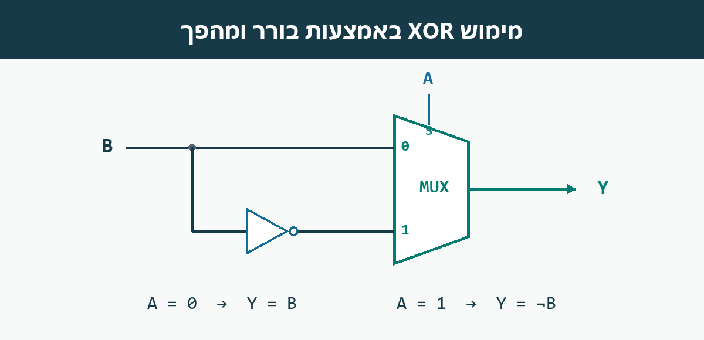
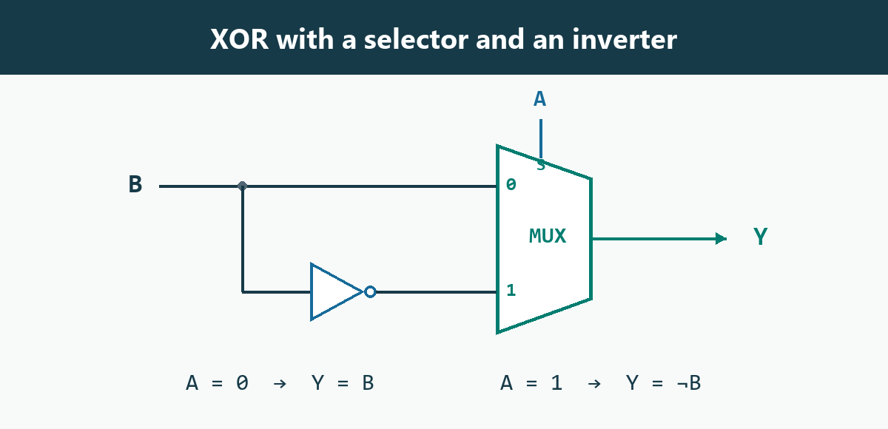

# PREP-031 — מימוש XOR באמצעות מוקסים וקבוע 0 בלבד

הצעה לפתרון. ביקורת מקצועית אנושית ממתינה.

## עברית

### הרחבה: XOR עם בורר ושערי היפוך
כעת מותר להשתמש גם בשער NOT. ממשו XOR של שני ביטים עם בורר 2:1 אחד ומהפך. תנו את חיבורי שלוש רגלי הכניסה לבורר ובדקו את ארבעת המצבים.

1. קבעו את A לאפס ובדקו מה נותר במוצא כפונקציה של B.
2. חזרו על הבדיקה כאשר A הוא אחת.
3. חברו את שתי הפונקציות שמצאתם ל־D0 ול־D1 לפי ערך A.

### בחירה בין B לבין היפוכו

#### כיווני חשיבה להרחבה
1. קבעו את A לאפס ובדקו מה נותר במוצא כפונקציה של B.
2. חזרו על הבדיקה כאשר A הוא אחת.
3. חברו את שתי הפונקציות שמצאתם ל־D0 ול־D1 לפי ערך A.

קשרו את A לקו הבחירה, את B ל־D0 ואת מוצא המהפך של B ל־D1. כאשר A=0 הבורר מעביר את B. כאשר A=1 הוא מעביר את NOT B. לפיכך לצירופים 00, 01, 10, 11 מתקבלים בהתאמה 0, 1, 1, 0. הבנייה משתמשת בבורר אחד ובמהפך אחד, ללא קבועים. על הנתיב מ־B דרך ההיפוך נמצאים שני רכיבים.

## English

### Follow-up: XOR with a selector and NOT gates
Now a NOT gate is available. Implement two-bit XOR using one 2:1 MUX and an inverter. Give all three MUX input connections and check the four input pairs.

1. Fix A at zero and express the output in terms of B.
2. Repeat with A set to one.
3. Wire those two functions to D0 and D1 in the order selected by A.

### Select between B and its complement

#### Hints for the follow-up
1. Fix A at zero and express the output in terms of B.
2. Repeat with A set to one.
3. Wire those two functions to D0 and D1 in the order selected by A.

Wire A to select, B to D0 and the inverter output NOT B to D1. At A=0 the MUX passes B. At A=1 it passes NOT B. In input order 00, 01, 10, 11 the outputs are 0, 1, 1, 0. The implementation uses one MUX and one inverter with no constants. The inverted B path crosses two components.

[צילום מקור פנימי 10](../sources/2026-11-18-batch21-10.png)
[קובץ המימוש](../solutions/digital1118b.sv)
[תוצאות בדיקות](../checks/digital1118b-verification.json)
