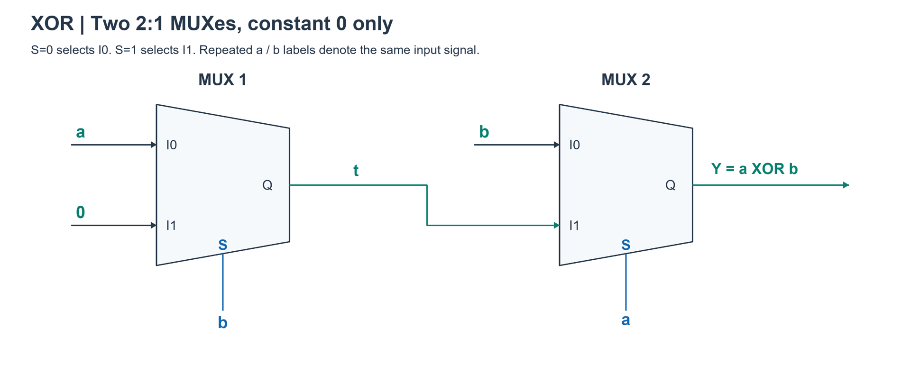

# PREP-031 — XOR באמצעות MUX וקבוע 0

## נוסח המקור

ממש XOR בעזרת MUX-ים וערך קבוע '0'.


חברות לפי המקור: NVIDIA, Apple, Intel; תווית ראשית אינטל. שיוך לא מאומת. תגית מקור: hardware. סיווג נוסף: מוקסים, XOR, לוגיקה קומבינטורית ומימוש תחת אילוצים.

עדיפות גבוהה כחזרה קצרה על יסודות שכבר נלמדו, לא תחזית לראיון.

## שלושה רמזים

1. כתוב מה הפלט צריך להיות כאשר אחת הכניסות היא 0 ומה הוא צריך להיות כאשר היא 1. זכור שלרשותך רק קבוע 0, בלי קבוע 1 או שער NOT.

2. אין צורך לייצר את השלילה של כניסה בכל המצבים: אפשר לייצר אות שמתנהג כמו השלילה רק כאשר המוקס הבא באמת בוחר בו.

3. בחר a כסלקטור של המוקס האחרון. כש־a=0 צריך להעביר b. כש־a=1 צריך להעביר NOT b: האם a עצמו יכול לשמש ערך 1 בענף הזה בלבד?

## הצעה לפתרון

הנחה: MUX רגיל 2:1 בעל מוצא לא מהופך, כניסות הנתונים והסלקטור יכולים להיות a,b,0 או מוצא מוקס קודם. אין קבוע 1, כניסות משלימות, שערים נוספים או משוב. סוג המוקס לא צוין במקור, ולכן יש לציין הנחה זו ולא לטעון למינימום גורף לכל גודל MUX.

הצעה לפתרון: שני מוקסים. החיבורים נכתבים בנפרד מהעברית כדי למנוע היפוך כיווניות:

```text
Convention: MUX(S, I0, I1) = I0 when S=0; I1 when S=1
MUX1: S=b, I0=a, I1=0 -> t
MUX2: S=a, I0=b, I1=t -> Y
```

כאשר a=0, המוקס האחרון בוחר b, בדיוק כנדרש ב־XOR. כאשר a=1, המוקס הראשון מקבל בכניסות הנתונים 1 ו־0, ולכן מוציא את השלילה של b, והאחרון בוחר במוצא הזה. ה־1 אינו מקור קבוע שהוספנו; זהו ערכה של כניסת a במקרה הנדון. האות t אינו NOT b בכל המצבים: כאשר a=0 הוא 0, אבל אז המוקס האחרון אינו בוחר בו. זהו הרעיון המרכזי: לנצל תנאי שבו ענף נבחר, ולא לנסות לבנות NOT כללי שאין עבורו קבוע 1.

```text
t = a AND NOT b
Y = (NOT a AND b) OR (a AND t)
  = (NOT a AND b) OR (a AND b') = a XOR b

a b | t Y
0 0 | 0 0
0 1 | 0 1
1 0 | 1 1
1 1 | 0 0
```

מינימום בשימוש במוקסי 2:1: ללא מוקסים a,b,0 אינם XOR. במוקס יחיד הסלקטור הוא 0,a או b. עם סלקטור 0 נבחר חוט גולמי בלבד. עם סלקטור a, בענף a=1 צריך NOT b, אך הנתונים הזמינים בענף הם רק 0,1,b, ואף אחד אינו NOT b עבור שני ערכי b. עם סלקטור b ההוכחה סימטרית. לכן צריך לפחות שניים, והמימוש משיג שניים.

אם מותר MUX של 4:1, מספיק אחד: חבר את a ל־S1 ואת b ל־S0 ואת I0,I1,I2,I3 אל 0,b,a,0 בהתאמה. כאשר הבחירה 01, b כבר 1; כאשר 10, a כבר 1. גם כאן אין קבוע 1. לכן מספר הרכיבים האופטימלי תלוי בגודל הרכיב המותר.

בלי שום קבוע, רשת של מוקסים רגילים על a,b בלבד שומרת 1: בקלט 11 כל חוט וכל מוצא יהיו 1, בעוד XOR דורש 0. לכן קבוע 0 הוא מהותי כאן. אין סתירה לחוסר האפשרות לבנות NOT כללי עם מוקסים וקבוע 0 בלבד, כי כל הרשתות האלה שומרות 0; XOR עצמו שומר 0.

בדיקה: ארבע שורות טבלת האמת נבדקו בפייתון; נבדקו כל 27 החיווטים למוקס יחיד שכניסותיו נלקחות מ־0,a,b ואף אחד לא מממש XOR. נבדקה גם חלופת 4:1. אין בכך בדיקת השהיה, glitches או שערוך פיזי. תשובה קצרה לראיון: מחברים מוקס ראשון שבוחר a או 0 לפי b, ומוקס שני שבוחר b או מוצא הראשון לפי a. ההיפוך של b נדרש רק כש־a=1, ובתנאי זה a מספק את ה־1 הדרוש בלי קבוע 1.

[בדיקות](../checks/check_prep_031.py)

## English

Implement XOR using MUXes and the constant value '0'.

1. Split the XOR truth table by one input. Only constant zero is available; no constant one or NOT gate.

2. An intermediate signal need not equal an inverted input for every case, only when the final MUX selects it.

3. Select the last MUX with a. At a=0 pass b; at a=1 pass NOT b. Could a itself serve as one within that selected case?

Assume ordinary non-inverting 2:1 MUXes with raw a,b, constant zero and earlier MUX outputs as wires, without extra gates, complements or feedback. The source does not specify MUX size.
With MUX(S,I0,I1) selecting I0 at S=0, use t=MUX(b,a,0), Y=MUX(a,b,t). At a=0 the output is b. At a=1, the first MUX has data 1 and 0 and outputs NOT b, which is selected by the last MUX. No constant-one source is introduced: a is one only in the relevant case. t=a AND NOT b globally, not NOT b. Truth rows (a,b,t,Y): (0,0,0,0),(0,1,0,1),(1,0,1,1),(1,1,0,0).
Two 2:1 MUXes are minimal. Zero MUXes provide only raw a,b,0. One MUX has select 0,a or b: select 0 chooses a raw wire; select a requires NOT b when a=1, but available raw data reduce to 0,1,b, none equal NOT b. Select b is symmetric. Exhaustively verified all four truth rows and rejected all 27 one-MUX raw-input wirings.
If a 4:1 MUX is permitted, one suffices with S1=a,S0=b and data (0,b,a,0); also verified on all four rows. Without any constants, ordinary MUX networks preserve the all-one input and cannot implement XOR. With only zero, general NOT is impossible by zero preservation, but XOR is zero-preserving and this conditional inversion is possible. No HDL/timing/glitch claim. Scope optimality to the allowed MUX size and count, not general physical area/delay.


## שרטוט המימוש בשני מוקסים



כניסות בעלות אותו שם הן אותו אות; I0 נבחרת כשהסלקטור 0 ו־I1 כשהוא 1.


## מקור נוסף — batch30 / Additional source — batch30

[נוסח, שלושה רמזים ופתרון משלים בשתי השפות / Bilingual variant, three hints and solution](prep-031-timing-variant-batch30.md)

### עברית

### מקור נוסף: מרבבים, השהיה ותדר
א. בנו XOR בעזרת מרבבי MUX 2:1. ב. מהו התדר המרבי אם ההשהיה היא 2 ns? ג. כיצד אפשר להעלות את התדר המרבי?

המקור הנוסף אינו קובע אילו קבועים ושערים זמינים, למה בדיוק מתייחסות שתי הננו־שניות או מהו ממשק השעון. כדי לקשר לגרסה המקורית נשמרת כאן רשת המרבבים שלה עם קבוע 0 בלבד. נתחו בנפרד: (1) 2 ns הם ההשהיה המרבית של כל הלוגיקה והחיווט בין שני דלגלגים; (2) 2 ns הם ההשהיה של כל מרבב, ובמסלול המגביל עוברים שניים בטור. תנו תחילה גבול אידאלי ללא תקורות שעון, ואחר כך נוסחה הכוללת זמן שעון־למוצא, הכנה, סטיית שעון ואי־ודאות. הניחו אותות בינאריים, דלגלגים על אותה חזית ומסלולים חד־מחזוריים. הסבירו מה ניתן לשנות בלי לשנות פונקציה ומה מחייב הסכמה על השהיה במחזורים. אין כאן נתוני ספריית תאים או תדר פיזי מובטח.

### תחילה בודקים מה בעצם נתון
המשפט ״השהיה של 2 ns״ אינו מספיק כדי לקבוע תדר פיזי יחיד. שער צירופי בפני עצמו אינו מקבל שעון, ולכן אין לו תדר מרבי סינכרוני בלי להגדיר מי משגר ומי דוגם. כאן נוסיף במפורש מודל של דלגלג משגר, לוגיקה וחיווט, ודלגלג קולט במחזור הבא. נפריד בין שתי משמעויות אפשריות של המספר במקור.

### מימוש ה־XOR המקורי נשאר תקף
נגדיר MUX(S,D0,D1): כאשר S=0 בוחרים D0, וכאשר S=1 בוחרים D1. נשתמש רק ב־a,b ובקבוע 0, כפי שנדרש בגרסה המקורית:

```text
t = MUX(b, a, 0)
y = MUX(a, b, t)
```

אם a=0, המרבב האחרון מעביר b: זהו 0 XOR b. אם a=1, המרבב האחרון בוחר t, והראשון בוחר 1 כאשר b=0 או 0 כאשר b=1. לכן t מתנהג כמו NOT b בדיוק בענף שבו צריך אותו. ארבע שורות האמת הן 00→0,01→1,10→1,11→0. אין קבוע 1 ואין שער NOT שהוברח למימוש.

לשתי הרמות יש מסלול סידורי אמיתי: כש־a=1 ו־b יורד מ־1 ל־0, השינוי עובר דרך המרבב הראשון ואז דרך כניסת הנתונים של השני. זמן שתי הרמות מצטבר. העובדה של־b יש גם חיבור ישיר למרבב השני אינה מבטלת את המסלול הארוך. אם מותר אות משלים מוכן, אפשר לחבר MUX(a,b,NOT b); זהו מרבב אחד בתוספת העלות וההשהיה של יצירת NOT b, ולא שער היפוך חינם תחת אילוצי המקור. הוכחת המינימום המקורית מתייחסת למספר מרבבי 2:1 תחת קבוע 0 בלבד, ולא לתדר מיטבי בכל ספרייה.

### שתי תשובות מותנות למספר שתי ננו־שניות
אם 2 ns הם כבר ההשהיה המרבית של כל המסלול הצירופי, ובמודל האידאלי כל תקורות השעון אפס ואין מסלול אחר שמגביל, אז T≥2 ns ולכן f≤1/(2×10⁻⁹)=500 MHz.

אם 2 ns הם ההשהיה המרבית של כל מרבב ברשת המקורית, מתעלמים מחיווט נוסף, ושתי הרמות הן המסלול המגביל, אז T≥2+2=4 ns ולכן f≤250 MHz באותו מודל אידאלי. אין להכפיל שוב בשתיים רק משום שגל שעון כולל גם עלייה וגם ירידה: השיגור והדגימה כאן הם בחזיתות עולות עוקבות, שהמרחק ביניהן הוא מחזור שלם. במעגל חזיתות הפוכות יידרש ניתוח אחר.

### מה מוסיפים במערכת אמיתית?
נסמן s כזמן הגעת השעון לקולט פחות זמן הגעתו למשגר, ו־U כאי־ודאות שמקצרים בגינה את חלון ההכנה. עבור מסלול חד־מחזורי:

```text
T_min >= t_cq,max + d_comb,max + t_setup + U - s
f_max <= 1 / T_min
hold: t_cq,min + d_comb,min >= s + t_hold
```

האי־שוויון הראשון הוא תנאי על תקופת השעון, ולא הבטחה שהתכנון כולו פועל בתדר הזה. d_comb כולל לוגיקה וחיווט; יש לבדוק את כל המסלולים והפינות הרלוונטיים. זמן ההשהיה המרבי צריך לכסות עליות וירידות ותלויות כניסה/מוצא, עומס, שיפוע כניסה ותנאי העבודה. אם 2 ns הם נתון אופייני בלבד, אין ממנו גבול בטוח. במודל זה s חיובי נותן יותר זמן להכנה אבל מקשה על החזקה; אין להסיק שסטיית שעון מועילה בלי לבדוק את שניהם. תנאי ההחזקה אינו נעשה תקין מעצם הארכת המחזור.

דוגמה ערוכה: d_comb=2 ns, t_cq,max=0.2 ns, t_setup=0.3 ns, U=0.1 ns ו־s=0 נותנים T_min=2.6 ns, כלומר גבול של כ־384.6 MHz למסלול הזה. המספרים פרט לשתי הננו־שניות נוספו להמחשה, ואינם נתוני המקור.

### כיצד מעלים את התדר?
אפשר לקצר את המסלול המגביל באמצעות מימוש לוגי מתאים לאילוצים, תאים מהירים יותר, הפחתת עומס/פיצול, תכנון חיווט ומיקום טובים יותר. תא מהיר יותר עלול לעלות בשטח ובהספק; נתון 2 ns אינו כולל אוטומטית את כל השינויים האלה. הורדת השהיה במסלול שאינו מגביל אינה בהכרח משפרת את תדר המערכת.

אם הממשק מתיר תוספת השהיה במחזורים, אפשר לשקול חלוקה לשלבי צינור או תזמון מחדש. הוספת אוגר באמצע רשת שני המרבבים מחייבת לשמור גם את a,b המתאימים לאותו פריט נתונים, כדי שלא לשלב t ממחזור קודם עם קלט חדש. שלבים מאוזנים יכולים לשפר קצב קבלת תוצאות, אך מוסיפים אוגרים ותקורות ומשנים את מספר המחזורים עד לתוצאה. אין הבטחה להכפלת התדר: תקורות הדלגלגים, חוסר איזון ומסלולים אחרים נשארים. אם החוזה דורש אותה תגובה צירופית או אותה השהיה במחזורים, אי אפשר להציע שלב נוסף כאילו לא שינה את החוזה.

### עלות ואימות
המימוש נשאר שני מרבבים ברשת המקורית, ללא שינוי בפונקציה. עלות/תדר של מימוש אחר תלויים במשאבים המותרים ובספרייה. בדקנו ארבע שורות אמת, שמונה שינויי קלט יחיד במודל השהיית מעבר אידאלי שווה של 2 ns למרבב, 48 השוואות זמן הגעה מול מועד הכנה ו־36 מקרי החזקה בחשבון רציונלי מדויק. ההשהיה המרבית במודל המעבר היא 4 ns. זהו מודל פייתון והוכחה, לא הרצת HDL, סינתזה, STA או מדידה פיזית.

שלושת הרמזים המקוריים והתור שלהם נשמרו. שלושה רמזים לווריאנט התזמון נשמרו בנפרד בחומר המשלים ובמסמך; התור הקיים אינו בוחר אותם אוטומטית לפי וריאנט. התוכן החדש הוא הצעה בסיוע AI, ללא אישור מקצועי חדש.

### English

### Additional source: MUXes, delay and frequency
(a) Build XOR using 2:1 MUXes. (b) What is the maximum frequency if the delay is 2 ns? (c) How can the maximum frequency be increased?

This source does not specify available constants/gates, what exactly the two nanoseconds measure, or the clock interface. To link it to the original, retain the original zero-only MUX network. Analyze separately: (1) 2 ns is the maximum delay of the complete combinational logic and routing between two flip-flops; (2) each MUX has 2 ns delay and the limiting path crosses two in series. First give an ideal bound ignoring clock overheads, then a formula including clock-to-Q, setup, clock skew and uncertainty. Assume binary signals, same-edge registers and single-cycle paths. Explain changes preserving function and changes needing agreement on latency in cycles. No cell-library characterization or guaranteed physical frequency is supplied.

### First establish what the number describes
“A delay of 2 ns” cannot determine one physical maximum frequency. A combinational gate itself has no clock; define a launching register, logic/routing and a register capturing at the next edge. We explicitly add that model and distinguish two possible meanings of the source's number.

### Retain the original XOR circuit
Let MUX(S,D0,D1) select D0 for S=0 and D1 for S=1. Use only a,b and constant zero, as required by the original:

```text
t = MUX(b, a, 0)
y = MUX(a, b, t)
```

When a=0, the last MUX forwards b, giving 0 XOR b. When a=1, it selects t; the first MUX gives one for b=0 and zero for b=1. Thus t acts as NOT b exactly in the branch needing it. The truth rows are 00→0,01→1,10→1,11→0. No constant one or hidden inverter was introduced.

There is a real serial two-level path: hold a=1 and change b from one to zero. Its effect passes through the first MUX and then the second MUX's data input. Those delays add. The direct b connection to the second MUX does not remove that longer path. If a complement is supplied, MUX(a,b,NOT b) uses one final MUX, but complement generation still has a cost and delay; it is not free under the original constraints. The original minimum-cell proof concerns 2:1 MUX count with only zero, not optimal frequency in every library.

### Two conditional answers for two nanoseconds
If 2 ns already measures the complete combinational path, every clock overhead is ignored and no other path limits the design, T≥2 ns and f≤1/(2×10⁻⁹)=500 MHz in that ideal model.

If each original MUX has maximum delay 2 ns, extra routing is neglected and the two serial levels are limiting, T≥2+2=4 ns and f≤250 MHz under the same ideal assumptions. Do not multiply by two again just because a clock has rising and falling edges: launch and capture here use consecutive rising edges, one whole period apart. An opposite-edge design needs a different analysis.

### Include register and clock effects
Define s as capture-clock arrival minus launch-clock arrival, and U as setup uncertainty reducing the available window. For a single-cycle path:

```text
T_min >= t_cq,max + d_comb,max + t_setup + U - s
f_max <= 1 / T_min
hold: t_cq,min + d_comb,min >= s + t_hold
```

The first inequality constrains the clock period; it does not guarantee the entire design works at that frequency. d_comb includes logic and routing; check all relevant paths and operating corners. A maximum delay must cover rising/falling transitions, pin arcs, loading, input slew and operating conditions. A typical-only 2 ns number is not a guaranteed bound. Positive s helps setup but hurts hold in this model; neither conclusion replaces the other check. Simply making the clock period longer does not repair hold.

Editorial example: d_comb=2 ns, t_cq,max=0.2 ns, t_setup=0.3 ns, U=0.1 ns and s=0 give T_min=2.6 ns, or a path bound of about 384.6 MHz. Numbers other than two nanoseconds are added illustrations, not supplied facts.

### How can maximum frequency increase?
Shorten the limiting path using a legal logic implementation, faster cells, reduced fanout/loading or better placement/routing. Faster cells may cost area and power; the single 2 ns figure does not characterize all these choices. Improving a nonlimiting path need not improve the system clock.

If the interface permits additional latency in cycles, consider pipelining or retiming. Registering the intermediate t in this two-MUX network also requires retaining the matching a,b for that same data item, rather than combining an old t with new inputs. Balanced stages may improve output throughput while adding registers/overheads and changing latency in cycles. Frequency need not double: register overhead, imbalance and other paths remain. A contract requiring unchanged combinational response or cycle latency cannot silently accept an extra pipeline stage.

### Cost and actual verification
The original implementation remains two MUXes with unchanged Boolean function. Other implementations' cost/frequency depends on the allowed resources and library. Checked four truth rows, eight single-input transitions in an ideal equal-2-ns transport-delay model, 48 arrival-versus-setup-deadline comparisons and 36 hold cases using exact rational arithmetic. The transition model's worst delay is 4 ns. These are Python checks plus reasoning, not HDL simulation, synthesis, static timing analysis or physical measurements.

All original hints and their queue remain. Three timing-variant hints are saved in supplementary material and the addendum, but the existing queue does not automatically select hints by variant. New content is AI-assisted proposed material without new professional approval.


## מקורות נוספים — 25.10.2026, מקבץ20

[צילום11](../sources/2026-10-25-batch20-11.png) חוזר על XOR בשני מרבבים, זמן השהיה2 ננו ושיפור תדר. סעיף התזמון וההנחות כבר קיימים; הטקסט, הרמזים והגרסה נשמרו.


## מקור נוסף — 30.10.2026, מקבץ110

[צילום מקור פרטי 9](../sources/2026-10-30-batch110-09.png)

לבנות שער XOR באמצעות MUX שתיים לאחד.

שיוכי מקור מדווחים: Apple, Intel.

מקור נוסף בלבד; הגרסה, הנוסח, הרמזים והפתרון נשמרו.
