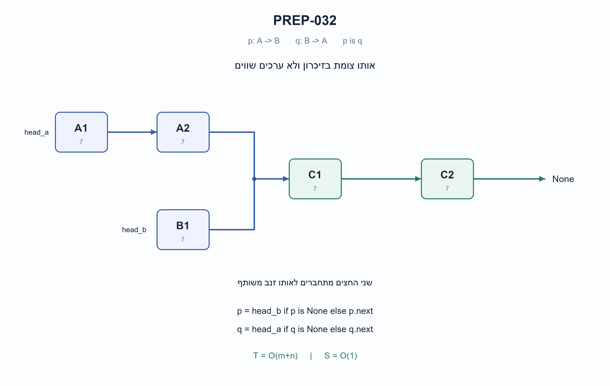
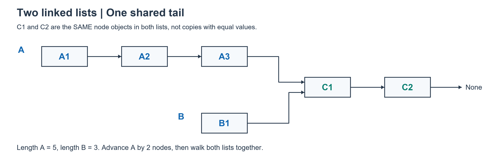
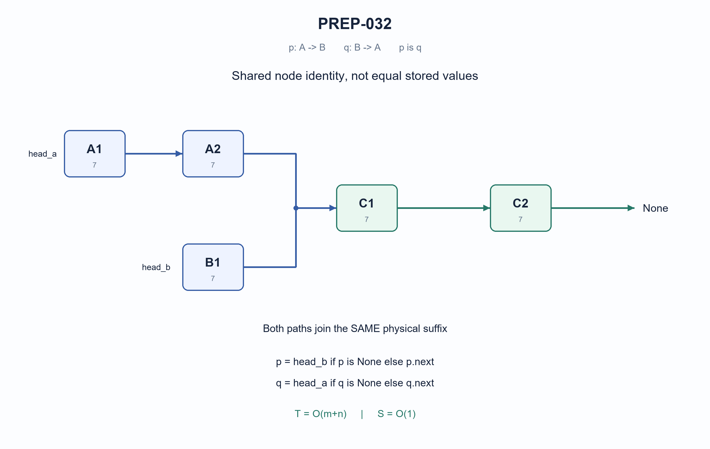

# PREP-032 — מציאת הצומת הראשון המשותף לשתי רשימות מקושרות

**Status:** in review; AI-assisted proposed solution; difficulty uncalibrated. No human approval or learner tracking.

## Preserved original source

יש 2 רשימות מקושרות נפרדות. בשלב מסויים, עקב טעות של מהנדס, הרשימות מתאחדות. לא ידוע באיזה איבר בכל אחת מהרשימות זה קורה.
האיברים יכולים להיות שונים.
כתוב אלגוריתם שמוצא מתי הרשימות מתאחדות.

- [sources/prep-032.png](../sources/prep-032.png)
- [sources/prep-032-additional-2026-10-20.png](../sources/prep-032-additional-2026-10-20.png)

Companies reported only by supplied sources: Amazon, Arm, NVIDIA, Check Point, Microsoft, Apple, Broadcom, Mellanox.

## he: מציאת הצומת הראשון המשותף לשתי רשימות מקושרות

יש 2 רשימות מקושרות נפרדות. בשלב מסויים, עקב טעות של מהנדס, הרשימות מתאחדות. לא ידוע באיזה איבר בכל אחת מהרשימות זה קורה.
האיברים יכולים להיות שונים.
כתוב אלגוריתם שמוצא מתי הרשימות מתאחדות.

### Hints

1. איחוד פירושו שהמצביעים מגיעים לאותו צומת בזיכרון, לא לשני צמתים בעלי אותו ערך. מרגע זה, האם המשך הרשימות יכול להיות שונה?
2. אם לשתי הרשימות היה אותו אורך, שני מצביעים שמתחילים בראשיהן ומתקדמים יחד היו מגיעים לנקודת החיבור באותו זמן. מה מפריע כשאורכיהן שונים?
3. חשב את שני האורכים. קדם רק את המצביע ברשימה הארוכה במספר צעדים השווה להפרש האורכים; אחר כך קדם את שניהם יחד והשווה זהות צמתים.

### Proposed solution

הנחות: שתי רשימות חד־כיווניות, סופיות וללא מעגלים, כמתואר בציור המסתיים ב־NULL. יש גישה לשני הראשים ולשדה next של כל צומת, ואין שינוי מקביל ברשימות. אין צורך שהערכים יהיו ממוינים, למרות האזכור של טעות הנדסית. האיחוד הוא אותו צומת פיזי בזיכרון, שממנו ואילך יש זנב משותף: לצומת יחיד יש שדה next יחיד. שני צמתים שערכם שווה אינם בהכרח אותו צומת. אם בצומת המשותף רואים שתי רשימות, גם ערכו הוא אותו ערך משום שזה אותו אובייקט, אבל הערכים לפניו יכולים להיות שונים או שווים.

הצעה לפתרון — יישור לפי האורכים:
1. עוברים על כל רשימה וסופרים את אורכה, n ו־m.
2. מתחילים מצביע בראש כל רשימה. מקדמים רק את הארוכה בהפרש האורכים.
3. כעת לשני המצביעים נותר אותו מספר צמתים עד הסוף. כל עוד אינם מצביעים לאותו אובייקט, מתקדמים צעד בכל רשימה.
4. הצומת הזהה הראשון הוא נקודת האיחוד. אם שניהם מגיעים ל־None, אין איחוד. הקוד מטפל גם ברשימות ריקות ובאיחוד כבר בראש. הרשימות אינן משתנות.

היגיון: כל ההפרש באורכי הרשימות מגיע מהקטעים שלפני נקודת החיבור; הזנב המשותף מוסיף לשתיהן בדיוק אותו אורך. נסמן אורכי קטעים פרטיים p,q ואורך זנב משותף c. אורכי הרשימות הם p+c ו־q+c, ולכן הפרשם p−q. כשמדלגים על ההפרש בקטע הפרטי הארוך, לשני המצביעים נותר מרחק זהה עד החיבור. הליכה משותפת תביא אותם לצומת המשותף הראשון באותו צעד. לפניו אינם יכולים להיות זהים, לפי הגדרת הקטעים הפרטיים.

```text
A: A1 -> A2 -> A3 -> C1 -> C2 -> None   (length 5)
B:             B1 -> C1 -> C2 -> None   (length 3)

Advance A by 2:  p=A3, q=B1
One step each:   p=C1, q=C1  => first shared node
```

C1 ו־C2 בשתי השורות הם אותם צמתים ממש. זו אינה העתקה של שני צמתים בעלי אותו שם או ערך. בפייתון משווים באמצעות is; אין להשוות value או להסתמך על == שעשוי להיות מוגדר להשוואת תוכן.

סיבוכיות: O(n+m) זמן ו־O(1) זיכרון עזר במודל מצביעים/מילות מכונה. אלה כמה מעברים ליניאריים, לא לולאה מקוננת. זהו זמן מיטבי במקרה הגרוע ברשימות כלליות ללא מטא־דאטה או מבני עזר; ייתכן שהחיבור יתגלה רק בסוף קטעים פרטיים ארוכים. קוד נתון ב־solutions/prep_032_list_intersection.py. אפשרות פשוטה יותר משתמשת בקבוצת כתובות הצמתים של הרשימה הראשונה ובודקת שייכות תוך מעבר בשנייה, אך דורשת O(n) זיכרון ובדרך כלל O(n+m) זמן צפוי במימוש hash. אין צורך בה לצורך המימוש בזיכרון קבוע.

בדיקות: כל 343 שילובי האורכים 0..6 של שני קטעים פרטיים וזנב משותף, בשני סדרי הארגומנטים; שני מקרים ארוכים נוספים עם קטע פרטי באורך 10000. כל הערכים בכוונה זהים (7), כדי לוודא שימוש בזהות ולא בשוויון ערכים. נבדק שאין שינוי בשדות next או בערכים. מעגלים ומוטציות מקבילות אינם מכוסים ואינם חלק מהמודל שבתמונה.

תעדוף: בינוני כחזרה קצרה על מצביעים, זהות אובייקטים ובדיקת מקרי קצה. בתקופת הכנה קצרה אין צורך להעמיק מעבר להבנת השיטה. אין להסיק מכך שהמראיינים לא יודעים על קורס מסוים שלא ישאלו על תכנות בסיסי; זו הערכת הכנה לפי תיאור המשרה ולא תחזית לראיון.

### חלופה נוספת — החלפת ראשים ללא ספירת אורכים

אפשר גם להתחיל מצביע בכל ראש. בכל סבב מקדמים כל מצביע צעד אחד; אם הוא כבר None, מחזירים אותו לראש הרשימה האחרת. עוצרים כשהמצביעים הם אותו אובייקט:

```python
def first_shared_node(head_a, head_b):
    p, q = head_a, head_b
    while p is not q:
        p = head_b if p is None else p.next
        q = head_a if q is None else q.next
    return p
```

נניח אורכי קטעים פרטיים u,v וזנב משותף באורך c. כל מצביע עובר את הרשימה הראשונה שלו ואחר כך את הקטע הפרטי של האחרת. עד נקודת החיבור בסיבוב השני שניהם עברו u+v+c צמתים, ובשניהם יש אותה פעולת מעבר דרך None. לכן ההפרש הראשוני מתבטל והם נפגשים בתחילת הזנב, אם לא נפגשו קודם. אם אין חיבור, שניהם מגיעים ל־None אחרי מסלולים באורך כולל שווה. יש גם עצירה מיידית אם שני הראשים זהים. זמן O(m+n) וזיכרון עזר קבוע, בלי לשנות שום קישור. קובץ הפייתון הנוסף מדגים את החלופה; שתי השיטות מתקבלות.

המקור הנוסף מ־20 באוקטובר 2026 מתאר אותה שאלה, ולכן צורף לרשומה הקיימת בלי ליצור כפילות או לשנות היסטוריית משתמשים. לחלופה נוספו בדיקות של 729 שלשות אורכי קטעים בכל שני סדרי הארגומנטים, 1,458 קריאות בסך הכול, ושני מקרים ארוכים. אובייקטי הבדיקה זורקים שגיאה אם משתמשים ב־==; כל הערכים זהים והקישורים נשארים ללא שינוי.




### assumptions

```json
[
  "רשימות חד־כיווניות סופיות וללא מעגלים; הקישורים אינם משתנים במקביל.",
  "איחוד פירושו אותו אובייקט בזיכרון, לא שוויון ערכים.",
  "צומת משותף גורר זנב משותף כי לכל צומת קישור המשך יחיד."
]
```

### optimality

```json
{
  "criterion": "זמן מעבר וזיכרון עזר במקרה הגרוע.",
  "result": "שתי החלופות פועלות בזמן O(m+n) ובמספר קבוע של מילות עזר.",
  "proof": "יישור אורכים משווה מרחקים; החלפת ראשים נותנת לשני המצביעים מסלול כולל באותו אורך ומבטלת את ההפרש. ייתכן שצריך לעבור קטעים פרטיים ארוכים לפני שניתן לשלול חיבור.",
  "scope": "רשימות כלליות ללא מידע מוקדם או אינדקס; מעגלים אינם מכוסים."
}
```

### verification

```json
{
  "status": "בדיקות מודל פייתון עברו; ביקורת מקצועית עצמאית ממתינה.",
  "method": "השוואת התוצאה לזהות הצומת המשותף שנבנה; אובייקטים האוסרים שוויון, ערכים זהים ובדיקת אי־שינוי.",
  "coverage": "729 שלשות אורכי קטעים 0–8 בשני סדרים: 1,458 קריאות; שני מקרים ארוכים. הבדיקות המקוריות נשמרו בנפרד.",
  "script_path": "checks/check_prep_056_058_059_and_032_update.py",
  "scope": "בדיקות קוד ואלגוריתם בלבד; אין בכך אישור מקצועי אנושי או בדיקה בחשבון חי."
}
```

### edge_cases

```json
[
  "שני ראשים ריקים או רק אחד ריק.",
  "ראשים זהים או ראש שנמצא בתוך הרשימה האחרת.",
  "צמתים שונים עם אותם ערכים אינם חיבור.",
  "זנב משותף של צומת אחד או אורכי קטעים פרטיים שונים מאוד."
]
```

### common_mistakes

```json
[
  "השוואת ערכים במקום זהות צמתים.",
  "התקדמות משני הראשים בלי ליישר את הפרש האורכים.",
  "שינוי קישורים כדי למצוא חיבור בלי צורך.",
  "הפעלת הפתרון ללא מעגלים על רשימות עם מעגלים."
]
```

### interview_answer

```json
"אשווה זהות צמתים, כי מהחיבור ואילך הזנב משותף. אפשר לספור אורכים, לדלג על ההפרש ולהתקדם יחד; או להעביר כל מצביע לראש הרשימה האחרת כשהוא מגיע לסוף. כך מתבטל הפרש האורכים. נעצור בצומת הזהה הראשון או כששניהם None. הזמן ליניארי והזיכרון קבוע."
```

### solution_extensions

```json
{
  "question": "מה משתנה אם אחת הרשימות מכילה מעגל?",
  "answer_outline": "אי אפשר להשתמש אוטומטית בשיטות הסופיות; יש לזהות מעגלים וכניסות אליהם ולהגדיר מהו צומת משותף ראשון במקרה של מעגל משותף.",
  "integration_status": "שאלת המשך מוכנה בתוכן; אינה מחוברת לתהליך ההמשך החי."
}
```

## en: Find the first shared node of two linked lists

There are two separate linked lists. At some point, due to an engineer's mistake, the lists merge. It is not known at which element in either list this occurs. The elements may be different. Write an algorithm that finds where the lists merge.

### Hints

1. Merging means reaching the very same node object, not equal data values. Can the remaining tails differ after sharing a node?
2. With equal list lengths, two pointers advancing together would reach the merge point simultaneously. What changes with unequal lengths?
3. Count both lengths, advance the longer list by the difference, then move both pointers together and compare node identity.

### Proposed solution

Assume finite acyclic singly linked lists, as the source's NULL-terminated drawing indicates, with two head pointers, readable next links and no concurrent mutation. Lists need not be sorted. Intersection means the identical physical node, not equal data values. Once a node is shared, the suffix is shared because that node has one next pointer.
Count lengths n,m. Advance the longer list's pointer by abs(n-m). Both pointers now have the same remaining length. Move them together until they are identical; return that node, or None if both reach the end. Empty lists and sharing at either head are supported without mutation. In Python use is, not value equality or an overloaded ==.
Proof: with private prefixes p,q and common suffix c, lengths are p+c,q+c. Their difference p-q is entirely due to the private prefixes. Removing the excess prefix aligns distances to the first shared node, which is reached simultaneously. Example: A1->A2->A3->C1->C2 and B1->C1->C2 have lengths 5 and 3; advance A twice, then A3/B1 step together to C1.
O(n+m) time and O(1) auxiliary machine words; worst-case optimal for general pointer-access lists without metadata/indexing. A hash set of node identities is a simpler expected-linear alternative but uses O(n) space. The saved Python code is tested on all 343 prefix/prefix/suffix length triples in 0..6, in both argument orders, plus two long cases. Every node deliberately contains the same value to catch identity mistakes; all links and values are checked for immutability. Cycles/concurrent mutation are outside scope. Medium preparation priority as a short pointer/identity/edge-case revision, not a forecast of interview questions; undisclosed coursework does not rule out basic programming questions.

### Additional alternative — switch heads without counting lengths

Start one pointer at each head. At each iteration advance each by one node; if it is already None, redirect it to the other list's head. Stop on object identity:

```python
def first_shared_node(head_a, head_b):
    p, q = head_a, head_b
    while p is not q:
        p = head_b if p is None else p.next
        q = head_a if q is None else q.next
    return p
```

Let private-prefix lengths be u,v and shared-tail length c. Each pointer traverses its first list followed by the other's private prefix. At the second-pass merge each has traversed u+v+c nodes and the same None-to-head transition, cancelling the original offset. Thus they meet at the first shared node unless they have met earlier. Without an intersection, both reach None after equal total traversals. Identical heads return immediately. Time O(m+n), constant auxiliary words, and no link mutation. Both this method and the original length-alignment solution are accepted.

The additional source received 20 October 2026 states the same task, so it is attached to this existing record without a duplicate item or any learner-history change. The alternative was checked on all 729 prefix/prefix/suffix length triples in both orders (1,458 calls), plus two long cases. Test nodes deliberately raise on ==, all stored values are equal, and links remain unchanged.






### assumptions

```json
[
  "Finite acyclic singly linked lists with None terminators.",
  "Intersection means shared node identity, not equal values.",
  "Access to head pointers and next fields; no concurrent mutation.",
  "Ordering of stored values is irrelevant."
]
```

### optimality

```json
{
  "criterion": "Worst-case traversal time and auxiliary storage.",
  "result": "Both alternatives use O(m+n) time and constant auxiliary words.",
  "proof": "Length alignment equalizes remaining distance; head switching equalizes total traversals. Long private prefixes may need traversal before intersection can be ruled out.",
  "scope": "General lists without indexing or precomputed metadata; cycles excluded."
}
```

### verification

```json
{
  "status": "Python-model checks passed; independent professional review pending.",
  "method": "Compare identity to the constructed shared node; hostile equality, identical data values and immutability checks.",
  "coverage": "729 length triples 0..8 in both argument orders: 1,458 calls, plus two long cases. Existing original-method checks are retained separately.",
  "script_path": "checks/check_prep_056_058_059_and_032_update.py",
  "scope": "Code/algorithm verification only; not human expert approval or authenticated live-account validation."
}
```

### edge_cases

```json
[
  "Both heads empty",
  "One head empty",
  "Disjoint equal-value lists",
  "Identical heads",
  "One head within the other list",
  "Single shared tail node",
  "Different prefix lengths",
  "Repeated data values"
]
```

### common_mistakes

```json
[
  "Comparing node values instead of identity",
  "Advancing both original heads immediately despite unequal prefix lengths",
  "Assuming the lists must be sorted",
  "Mutating next pointers unnecessarily",
  "Using the acyclic algorithm on lists with cycles"
]
```

### interview_answer

```json
"Compare node identity because sharing a node implies a shared suffix. Either align lengths and advance together or redirect each exhausted pointer to the other head. Both cancel the prefix-length difference. Stop at the first identical node, or both None; linear time and constant auxiliary storage."
```

### solution_extensions

```json
{
  "question": "What changes if a list contains a cycle?",
  "answer_outline": "Finite-list methods no longer apply automatically. Detect cycles and entries, and define what “first shared” means for a shared cycle.",
  "integration_status": "Follow-up prepared in content; not connected to the live follow-up workflow."
}
```

## Implementation and verification

- [solutions/prep_032_list_intersection.py](../solutions/prep_032_list_intersection.py)
- [solutions/prep_032_head_switch_intersection.py](../solutions/prep_032_head_switch_intersection.py)
- [checks/check_prep_056_058_059_and_032_update.py](../checks/check_prep_056_058_059_and_032_update.py)
- [checks/prep-032-update-verification.json](../checks/prep-032-update-verification.json)

Follow-ups are authored but not connected to the live queue. No HDL compilation/simulation or physical-device test is implied.


## נוסח תצוגה פעיל לאחר מיזוג המקור הנוסף — 20 באוקטובר 2026

הנוסחים והרמזים הערוכים שכבר פורסמו נשמרו. התוספת לפתרון להלן אינה מחליפה את הנוסח הקיים במקור הגולמי.

### he

נתונים הראשים של שתי רשימות מקושרות חד־כיווניות, סופיות וללא מעגלים. ייתכן שמנקודה מסוימת הן חולקות את אותם צמתים בזיכרון, ולכן את אותו זנב. ערכים שווים בשני צמתים שונים אינם נחשבים חיבור.

מצאו את הצומת המשותף הראשון, או החזירו שאין כזה. אין לשנות את הרשימות. נתחו זמן וזיכרון עזר.

הנחות: שתי רשימות חד־כיווניות, סופיות וללא מעגלים, כמתואר בציור המסתיים ב־NULL. יש גישה לשני הראשים ולשדה next של כל צומת, ואין שינוי מקביל ברשימות. אין צורך שהערכים יהיו ממוינים, למרות האזכור של טעות הנדסית. האיחוד הוא אותו צומת פיזי בזיכרון, שממנו ואילך יש זנב משותף: לצומת יחיד יש שדה next יחיד. שני צמתים שערכם שווה אינם בהכרח אותו צומת. אם בצומת המשותף רואים שתי רשימות, גם ערכו הוא אותו ערך משום שזה אותו אובייקט, אבל הערכים לפניו יכולים להיות שונים או שווים.

הצעה לפתרון — יישור לפי האורכים:
1. עוברים על כל רשימה וסופרים את אורכה, n ו־m.
2. מתחילים מצביע בראש כל רשימה. מקדמים רק את הארוכה בהפרש האורכים.
3. כעת לשני המצביעים נותר אותו מספר צמתים עד הסוף. כל עוד אינם מצביעים לאותו אובייקט, מתקדמים צעד בכל רשימה.
4. הצומת הזהה הראשון הוא נקודת האיחוד. אם שניהם מגיעים ל־None, אין איחוד. הקוד מטפל גם ברשימות ריקות ובאיחוד כבר בראש. הרשימות אינן משתנות.

היגיון: כל ההפרש באורכי הרשימות מגיע מהקטעים שלפני נקודת החיבור; הזנב המשותף מוסיף לשתיהן בדיוק אותו אורך. נסמן אורכי קטעים פרטיים p,q ואורך זנב משותף c. אורכי הרשימות הם p+c ו־q+c, ולכן הפרשם p−q. כשמדלגים על ההפרש בקטע הפרטי הארוך, לשני המצביעים נותר מרחק זהה עד החיבור. הליכה משותפת תביא אותם לצומת המשותף הראשון באותו צעד. לפניו אינם יכולים להיות זהים, לפי הגדרת הקטעים הפרטיים.

```text
A: A1 -> A2 -> A3 -> C1 -> C2 -> None   (length 5)
B:             B1 -> C1 -> C2 -> None   (length 3)

Advance A by 2:  p=A3, q=B1
One step each:   p=C1, q=C1  => first shared node
```

C1 ו־C2 בשתי השורות הם אותם צמתים ממש. זו אינה העתקה של שני צמתים בעלי אותו שם או ערך. בפייתון משווים באמצעות is; אין להשוות value או להסתמך על == שעשוי להיות מוגדר להשוואת תוכן.

סיבוכיות: O(n+m) זמן ו־O(1) זיכרון עזר במודל מצביעים/מילות מכונה. אלה כמה מעברים ליניאריים, לא לולאה מקוננת. זהו זמן מיטבי במקרה הגרוע ברשימות כלליות ללא מטא־דאטה או מבני עזר; ייתכן שהחיבור יתגלה רק בסוף קטעים פרטיים ארוכים. קוד נתון ב־solutions/prep_032_list_intersection.py. אפשרות פשוטה יותר משתמשת בקבוצת כתובות הצמתים של הרשימה הראשונה ובודקת שייכות תוך מעבר בשנייה, אך דורשת O(n) זיכרון ובדרך כלל O(n+m) זמן צפוי במימוש hash. אין צורך בה לצורך המימוש בזיכרון קבוע.

בדיקות: כל 343 שילובי האורכים 0..6 של שני קטעים פרטיים וזנב משותף, בשני סדרי הארגומנטים; שני מקרים ארוכים נוספים עם קטע פרטי באורך 10000. כל הערכים בכוונה זהים (7), כדי לוודא שימוש בזהות ולא בשוויון ערכים. נבדק שאין שינוי בשדות next או בערכים. מעגלים ומוטציות מקבילות אינם מכוסים ואינם חלק מהמודל שבתמונה.

### חלופה נוספת — החלפת ראשים ללא ספירת אורכים

אפשר גם להתחיל מצביע בכל ראש. בכל סבב מקדמים כל מצביע צעד אחד; אם הוא כבר None, מחזירים אותו לראש הרשימה האחרת. עוצרים כשהמצביעים הם אותו אובייקט:

```python
def first_shared_node(head_a, head_b):
    p, q = head_a, head_b
    while p is not q:
        p = head_b if p is None else p.next
        q = head_a if q is None else q.next
    return p
```

נניח אורכי קטעים פרטיים u,v וזנב משותף באורך c. כל מצביע עובר את הרשימה הראשונה שלו ואחר כך את הקטע הפרטי של האחרת. עד נקודת החיבור בסיבוב השני שניהם עברו u+v+c צמתים, ובשניהם יש אותה פעולת מעבר דרך None. לכן ההפרש הראשוני מתבטל והם נפגשים בתחילת הזנב, אם לא נפגשו קודם. אם אין חיבור, שניהם מגיעים ל־None אחרי מסלולים באורך כולל שווה. יש גם עצירה מיידית אם שני הראשים זהים. זמן O(m+n) וזיכרון עזר קבוע, בלי לשנות שום קישור. קובץ הפייתון הנוסף מדגים את החלופה; שתי השיטות מתקבלות.

המקור הנוסף מ־20 באוקטובר 2026 מתאר אותה שאלה, ולכן צורף לרשומה הקיימת בלי ליצור כפילות או לשנות היסטוריית משתמשים. לחלופה נוספו בדיקות של 729 שלשות אורכי קטעים בכל שני סדרי הארגומנטים, 1,458 קריאות בסך הכול, ושני מקרים ארוכים. אובייקטי הבדיקה זורקים שגיאה אם משתמשים ב־==; כל הערכים זהים והקישורים נשארים ללא שינוי.


### en

Given the heads of two finite, acyclic singly linked lists, find their first shared node, or report no intersection. Sharing means the identical node in memory and therefore a common tail; equal values in different nodes do not count. Do not modify either list. Analyze time and auxiliary space.

Assume finite acyclic singly linked lists, as the source's NULL-terminated drawing indicates, with two head pointers, readable next links and no concurrent mutation. Lists need not be sorted. Intersection means the identical physical node, not equal data values. Once a node is shared, the suffix is shared because that node has one next pointer.
Count lengths n,m. Advance the longer list's pointer by abs(n-m). Both pointers now have the same remaining length. Move them together until they are identical; return that node, or None if both reach the end. Empty lists and sharing at either head are supported without mutation. In Python use is, not value equality or an overloaded ==.
Proof: with private prefixes p,q and common suffix c, lengths are p+c,q+c. Their difference p-q is entirely due to the private prefixes. Removing the excess prefix aligns distances to the first shared node, which is reached simultaneously. Example: A1->A2->A3->C1->C2 and B1->C1->C2 have lengths 5 and 3; advance A twice, then A3/B1 step together to C1.
O(n+m) time and O(1) auxiliary machine words; worst-case optimal for general pointer-access lists without metadata/indexing. A hash set of node identities is a simpler expected-linear alternative but uses O(n) space. The saved Python code is tested on all 343 prefix/prefix/suffix length triples in 0..6, in both argument orders, plus two long cases. Every node deliberately contains the same value to catch identity mistakes; all links and values are checked for immutability. Cycles/concurrent mutation are outside scope.

### Additional alternative — switch heads without counting lengths

Start one pointer at each head. At each iteration advance each by one node; if it is already None, redirect it to the other list's head. Stop on object identity:

```python
def first_shared_node(head_a, head_b):
    p, q = head_a, head_b
    while p is not q:
        p = head_b if p is None else p.next
        q = head_a if q is None else q.next
    return p
```

Let private-prefix lengths be u,v and shared-tail length c. Each pointer traverses its first list followed by the other's private prefix. At the second-pass merge each has traversed u+v+c nodes and the same None-to-head transition, cancelling the original offset. Thus they meet at the first shared node unless they have met earlier. Without an intersection, both reach None after equal total traversals. Identical heads return immediately. Time O(m+n), constant auxiliary words, and no link mutation. Both this method and the original length-alignment solution are accepted.

The additional source received 20 October 2026 states the same task, so it is attached to this existing record without a duplicate item or any learner-history change. The alternative was checked on all 729 prefix/prefix/suffix length triples in both orders (1,458 calls), plus two long cases. Test nodes deliberately raise on ==, all stored values are equal, and links remain unchanged.
