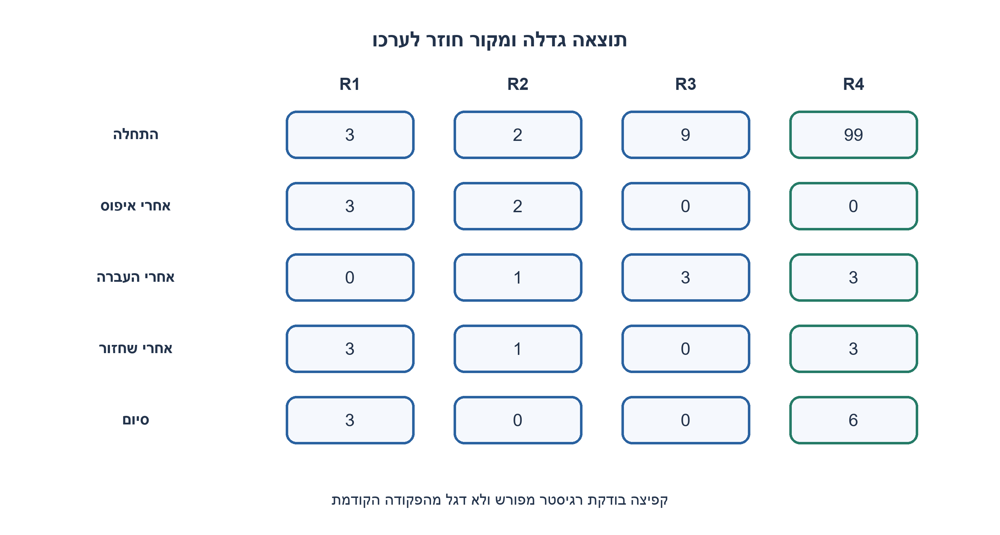
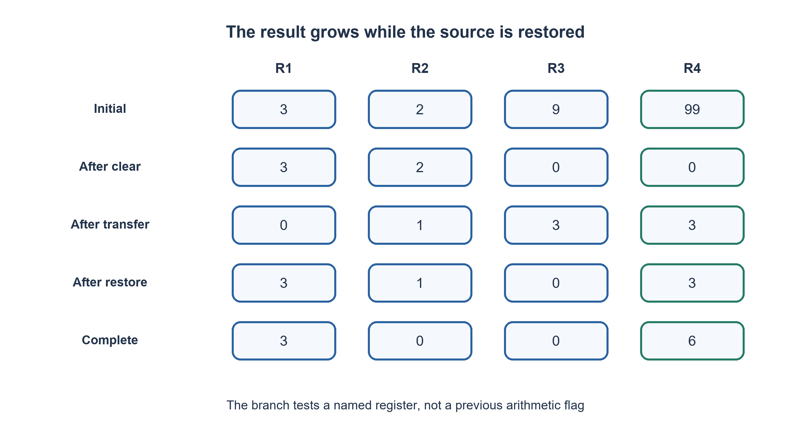

# PREP-035 — כפל באמצעות ארבעה רגיסטרים ופקודות הגדלה והקטנה בלבד

פתרון מוצע בסיוע AI; ביקורת מקצועית אנושית ממתינה. הקושי אינו מכויל.

## עברית

### הרחבה: CLEAR וקפיצה לפי רגיסטר מפורש
יש רק R1, R2, R3, R4. בתחילה R1=a, R2=b, כאשר a, b טבעיים כולל 0; R3, R4 אינם בהכרח מאופסים. מותרות רק INC R, DEC R, CLEAR R ו־ Jump_nz R, label הבודקת ישירות את ערך הרגיסטר. סיימו עם R4=a·b.

במודל העריכתי הרגיסטרים טבעיים בלתי חסומים ואסור DEC על 0. END הוא מעבר לסוף רשימת הפקודות במפרש הלימודי, לא HALT. אין פקודת קפיצה לא מותנית. זו אינה פקודת JNZ שבודקת את תוצאת הפקודה הקודמת.

1. איזו פקודה מותרת כאן שמסירה את התלות בערך ההתחלתי של רגיסטרי העזר?
2. אפסו תוצאה ועזר. לכל יחידה ב־ R2 העבירו את R1 לתוצאה דרך עזר והחזירו אותו.
3. Jump_nz מציין רגיסטר, לכן אפשר לבדוק את מונה ההעברה בלי תלות בפקודה האחרונה. למסלול האפס צרו 1 בעזר שכבר אופס וקפצו בעזרתו ל־ END.

### קוראים בדיוק את חוזה הקפיצה
CLEAR מאפס את R3, R4 בלי לצרוך את הקלט. נבדוק את R1: אם הוא אפס, נגדיל R3 מאפס לאחד ונקפוץ בעזרתו ל־ END; R4 כבר אפס. אם R2 אפס עושים אותו מסלול סיום. אלו קפיצות מותנות אמיתיות עם ערך ידוע, לא פקודת JMP שהומצאה. במודל הזה מותר Jump_nz R לבדוק רגיסטר ישירות; הקוד אינו מתאים ללא שינוי למכונה שבודקת רק flags.

כאשר שני הקלטים חיוביים, מקטינים R2 ומעבירים יחידות מ־ R1 אל R3 ו־ R4. אז משחזרים מ־ R3 אל R1. בגבול כל סבב נשמר (R1, R2, R3, R4)=(a, b−k,0, k·a). אחרי b סבבים R4=ab. לא מקטינים אפס: ADD ו־ RESTORE נכנסים עם מונה חיובי, והקפיצה מבוצעת רק כשהוא נותר חיובי. בדוגמה 3,2 מתקבלים בסוף (3,0,0,6); ערכי R3, R4 ההתחלתיים לא משפיעים.

כאשר a>0 הזמן Θ(ab+b+1) במודל פקודות יחידה; בקלט a=0 מסיימים בזמן O(1). עבור חיוביים Θ(ab), עם חסם של ab הגדלות כי R4 אופס ורק INC יכול להעלות אותו. משתמשים בארבעה רגיסטרים בלבד; אין טענה למינימום מספר הפקודות המדויק או לזיכרון קבוע בביטים למספרים בלתי חסומים. END מתאר סיום המפרש מעבר לרשימה ואינו הבטחה שמעבד פיזי ייעצר. נבדק Listing מדויק במפרש שמכיר רק את ארבע הפקודות, עם אפסים ועזר מלוכלך.

```asm
; R1=a,R2=b are naturals. R3,R4 may initially be arbitrary.
; Only CLEAR/INC/DEC/JUMP_NZ register,label. No flag-based branches.
; END is beyond the listing (educational fall-through completion).
CLEAR R3
CLEAR R4
JUMP_NZ R1, CHECK_B
INC R3
JUMP_NZ R3, END
CHECK_B:
JUMP_NZ R2, OUTER
INC R3
JUMP_NZ R3, END
OUTER:
DEC R2
ADD:
DEC R1
INC R3
INC R4
JUMP_NZ R1, ADD
RESTORE:
DEC R3
INC R1
JUMP_NZ R3, RESTORE
JUMP_NZ R2, OUTER
END:
```




## English

### Extension: CLEAR and explicit named-register branching
Only R1, R2, R3, R4 exist. Initially R1=a, R2=b for naturals including zero; R3, R4 may be dirty. Only INC R, DEC R, CLEAR R and Jump_nz R, label are allowed, with the branch directly testing that register. Finish with R4=a*b.

The editorial model uses unbounded naturals and forbids DEC at zero. END is beyond the educational listing, not a HALT instruction. No unconditional jump exists. This differs from JNZ testing the immediately preceding arithmetic result.

1. Which allowed instruction removes dependence on dirty scratch values?
2. Clear output and scratch; for each R2 unit, transfer R1 into the result while preserving it through scratch, then restore.
3. Jump_nz names a register, so its value does not depend on the last arithmetic instruction. For the zero path create one in cleared scratch and branch to END.

### Read the branch contract literally
CLEAR initializes R3, R4 without consuming inputs. If R1 is zero, increment cleared R3 to one and branch on it to END, leaving R4 zero; R2=0 uses the same exit. These are legal conditional branches on known values, not an invented JMP. Jump_nz explicitly tests a named register, so this listing cannot be copied unchanged to a previous-result-flags machine.

For positive inputs decrement R2, transfer R1 units into both R3 and R4, then restore R1 from R3. At each outer boundary (R1, R2, R3, R4)=(a, b−k,0, k*a). After b rounds R4=ab. ADD and RESTORE only enter with positive counters, and branch only if a counter remains positive; DEC at zero never occurs. For 3,2 the final state is (3,0,0,6), regardless of initial R3, R4.

For a>0 cost is Theta(ab+b+1) unit instructions; a=0 exits in O(1). For positive inputs it is Theta(ab), with the ab output-increment lower bound after CLEAR. Only four registers are used. There is no exact minimum-instruction or fixed-bit-space claim for unbounded values. END means educational fall-through completion, not a promise that a physical processor halts. The exact listing was interpreted using only the four allowed opcodes, including zero and dirty-scratch cases.

```asm
; R1=a,R2=b are naturals. R3,R4 may initially be arbitrary.
; Only CLEAR/INC/DEC/JUMP_NZ register,label. No flag-based branches.
; END is beyond the listing (educational fall-through completion).
CLEAR R3
CLEAR R4
JUMP_NZ R1, CHECK_B
INC R3
JUMP_NZ R3, END
CHECK_B:
JUMP_NZ R2, OUTER
INC R3
JUMP_NZ R3, END
OUTER:
DEC R2
ADD:
DEC R1
INC R3
INC R4
JUMP_NZ R1, ADD
RESTORE:
DEC R3
INC R1
JUMP_NZ R3, RESTORE
JUMP_NZ R2, OUTER
END:
```




## חומר משלים / Supporting material

```json
{
  "assumptions": {
    "he": "טבעיים, ללא גלישה; CLEAR ו־ Jump_nz R, label בלבד לצד INC/DEC.",
    "en": "Naturals without overflow; CLEAR and named-register Jump_nz plus INC/DEC only."
  },
  "optimality": {
    "he": "a=0: O(1); a>0: Θ(ab+b+1). ארבעה רגיסטרים; לא מינימום פקודות מדויק.",
    "en": "a=0: O(1); a>0: Theta(ab+b+1). Four registers; not exact minimum instruction count."
  },
  "verification": {
    "he": "5,625 שילובי קלט ועזר התחלתי, מול מכפלה עצמאית; אין DEC באפס.",
    "en": "5,625 input/dirty-scratch combinations versus independent multiplication; no DEC at zero."
  },
  "edge_cases": {
    "he": "a=0, b=0; עזר שאינו אפס; 1; ערך גדול שמחייב רוחב.",
    "en": "Either/both inputs zero; dirty scratch; one; sufficient width."
  },
  "common_mistakes": {
    "he": "להשתמש ב־ flags של הפקודה האחרונה או JMP שאינו מותר.",
    "en": "Using previous-instruction flags or an unallowed JMP."
  },
  "interview_answer": {
    "he": "אאפס את העזר והתוצאה, אבצע חיבור חוזר עם שחזור מקור ואבדוק את הרגיסטרים בשמם.",
    "en": "Clear scratch/output, repeat addition with source restoration, and branch directly on named registers."
  },
  "source_ambiguities": {
    "he": "אין רוחב או HALT במקור; טבעיים ו־ fall-through נבחרו במפורש.",
    "en": "Source omits width and HALT; naturals and fall-through are explicit choices."
  },
  "solution_extensions": {
    "he": [
      {
        "question": "מה אם Jump_nz מקבלת רק label?",
        "answer_direction": "צריך להפיק את הבדיקה בפקודה הקודמת; זו מכונת PREP-125 השונה.",
        "principle": "סמנטיקת הפקודה היא חלק מהבעיה."
      }
    ],
    "en": [
      {
        "question": "What if Jump_nz accepts only a label?",
        "answer_direction": "Generate the tested arithmetic result immediately before the branch; this is the distinct PREP-125 machine.",
        "principle": "Instruction semantics are part of the problem."
      }
    ]
  }
}
```
