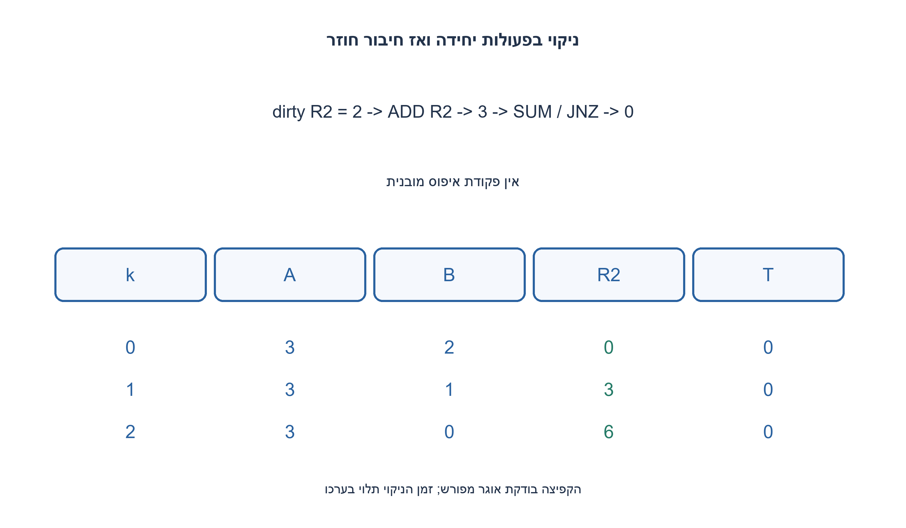
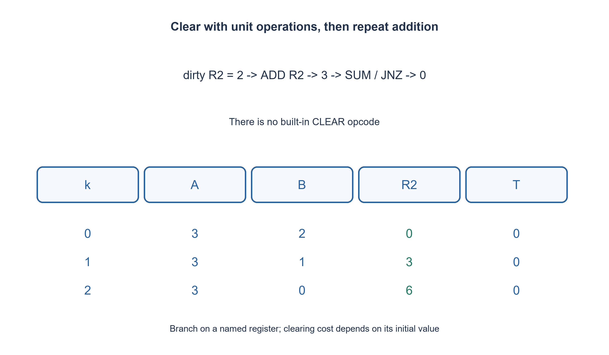

# PREP-035 — כפל באמצעות ארבעה רגיסטרים ופקודות הגדלה והקטנה בלבד

פתרון מוצע בסיוע AI; ביקורת מקצועית אנושית ממתינה. הקושי אינו מכויל.

## עברית

### וריאציה: ADD ו־ SUM הן פעולות יחידה, ללא CLEAR
ממשו R2=A·B. שמות הפקודות במקור נשמרים: ADD R מוסיפה 1, SUM R מחסירה 1, ו־ JNZ R, label קופצת אם האוגר המצוין אינו אפס. SUM נבחרה כשם פקודת ההקטנה, ולא כרגיסטר מיוחד; זו הבהרת הפיסוק המעורפל במקור.

השלמת חוזה: ארבעה אוגרים טבעיים בלתי חסומים A, B, R2, T. A, B הם הקלט, ו־ R2, T עשויים להכיל טבעיים שרירותיים בתחילה. אסור להניח שהם אפס ואסור CLEAR. DEC באפס, כלומר SUM באפס, אסורה. משתמשים רק ב־ ADD, SUM, JNZ עם תוויות; אין קפיצה לא מותנית או HALT. END מסמן נפילה מעבר לסוף התוכנית במפרש. יש לשמר את A, ומותר לצרוך את B. זהו חוזה קפיצה לפי אוגר, לא דגל הפקודה הקודמת.

1. איך מאפסים אוגר שערכו לא ידוע כשמותרות רק פעולות יחידה?
2. הגדילו פעם אחת, ואז הקטינו בלולאה עד אפס. כך גם ערך התחלתי אפס אינו גורם להקטנת אפס.
3. אחרי ניקוי התוצאה והעזר, לכל יחידה ב־ B העבירו יחידות מ־ A לתוצאה ולעזר, ואז שחזרו את A מן העזר.

### ניקוי חוקי במקום CLEAR
תחילה מבצעים ADD על R2, ואז SUM ו־ JNZ R2 בלולאה עד אפס. אם הערך ההתחלתי d, ההגדלה מביאה ל־ d+1, ולולאת ההקטנה מבצעת d+1 צעדים חוקיים. אותו תהליך מנקה את T. אין פקודת איפוס מוסתרת ואין הנחת עזר מאופס.

כעת אם A או B אפס, התוצאה נשארת אפס. מכיוון ש־ T נוקתה, אפשר להגדיל אותה ל־ 1 ולהשתמש ב־ JNZ T, END כקפיצה מותנית שערכה ידוע. כששני הקלטים חיוביים, כל סבב צורך יחידה מ־ B. מעבירים את כל A ל־ R2 ול־ T, ואז מעבירים את T חזרה ל־ A.

בגבול הסבב k מתקיים A=A₀, B=B₀−k, R2=kA₀ ו־ T=0. כל העברה שומרת את סכום היחידות, והשחזור מחזיר את הכופל. אחרי B₀ סבבים התוצאה A₀B₀. הקטנות מתבצעות רק על מונים חיוביים, וקפיצות בודקות את האוגר המתאים ישירות; שינוי אוגר אחר בין הקטנה לקפיצה אינו משנה את התנאי במודל הזה.

### סיבוכיות תלויה גם בלכלוך
עלות הניקוי היא Θ(d_R2+d_T+1), בניגוד ל־ CLEAR בעלת עלות יחידה. עבור A₀>0 העלות הכוללת Θ(d_R2+d_T+A₀B₀+B₀+1); כאשר A₀=0 מסיימים אחרי הניקוי בזמן Θ(d_R2+d_T+1). אין לטעון O(1) לאפס בלי להביא בחשבון עזר מלוכלך. ארבעה אוגרים הם מספר קבוע של אוגרים, לא מספר קבוע של ביטים. הרשימה נבדקה במפרש שמקבל רק את שלוש הפקודות במודל הקפיצה המפורש.

```text
; Natural unbounded registers A,B,R2,T; R2,T may be dirty.
; ADD R = increment1; SUM R = decrement1, forbidden at zero.
; JNZ R,label directly tests the named register, not flags.
ADD R2
CLEAR_RESULT:
SUM R2
JNZ R2,CLEAR_RESULT
ADD T
CLEAR_TEMP:
SUM T
JNZ T,CLEAR_TEMP
JNZ A,CHECK_B
ADD T
JNZ T,END
CHECK_B:
JNZ B,OUTER
ADD T
JNZ T,END
OUTER:
SUM B
TRANSFER:
SUM A
ADD T
ADD R2
JNZ A,TRANSFER
RESTORE:
SUM T
ADD A
JNZ T,RESTORE
JNZ B,OUTER
END:
```




## English

### Variant: ADD/SUM are unit operations, with no CLEAR
Compute R2=A·B. Preserve the source opcode names: ADD R increments by 1, SUM R decrements by 1, and JNZ R, label branches when the named register is nonzero. SUM is chosen as the decrement opcode, not a special register; this explicitly resolves ambiguous source punctuation.

Chosen contract: four unbounded natural registers A, B, R2, T. Inputs are A, B; result/scratch R2, T may initially be arbitrary naturals. Do not assume zero or use CLEAR. SUM at zero is forbidden. Only ADD, SUM, JNZ and labels; no unconditional branch or HALT. END means educational fall-through completion. Preserve A; B may be consumed. Branching directly tests the named register rather than the previous arithmetic flag.

1. How can unit operations clear a register with unknown contents?
2. Increment once, then decrement in a loop until zero, avoiding decrement-at-zero even for an initial zero.
3. After clearing output/scratch, consume one B unit per outer round, transfer A into output/scratch, then restore A from scratch.

### Legal clearing instead of CLEAR
Increment R2 once, then loop SUM and named-register JNZ until zero. Starting from d, the increment yields d+1 and the loop performs d+1 legal decrements. Clear T the same way. No hidden reset instruction or assumed-zero scratch is used.

If A or B is zero, output remains zero. Known-cleared T can be incremented to 1 and used for a legal conditional branch to END. With positive inputs, each outer round consumes one B unit, transfers all A units into both R2 and T, then restores A from T.

At round k, A=A₀, B=B₀−k, R2=kA₀ and T=0. Transfers preserve counts and restoration recovers the multiplicand. After B₀ rounds the result is A₀B₀. Every decrement consumes a positive counter. Branches test their named registers, so modifying another register between decrement and branch does not change the tested condition in this model.

### Cost includes dirty state
Clearing costs Θ(d_R2+d_T+1), unlike a constant-cost CLEAR opcode. For A₀>0 total cost is Θ(d_R2+d_T+A₀B₀+B₀+1); A₀=0 exits after clearing in Θ(d_R2+d_T+1). Do not call the zero-input path O(1) while ignoring dirty scratch magnitudes. Four registers are a constant register count, not constant bits for unbounded integers. The exact listing is checked by an interpreter accepting only these three opcodes and this branch contract.

```text
; Natural unbounded registers A,B,R2,T; R2,T may be dirty.
; ADD R = increment1; SUM R = decrement1, forbidden at zero.
; JNZ R,label directly tests the named register, not flags.
ADD R2
CLEAR_RESULT:
SUM R2
JNZ R2,CLEAR_RESULT
ADD T
CLEAR_TEMP:
SUM T
JNZ T,CLEAR_TEMP
JNZ A,CHECK_B
ADD T
JNZ T,END
CHECK_B:
JNZ B,OUTER
ADD T
JNZ T,END
OUTER:
SUM B
TRANSFER:
SUM A
ADD T
ADD R2
JNZ A,TRANSFER
RESTORE:
SUM T
ADD A
JNZ T,RESTORE
JNZ B,OUTER
END:
```




## חומר משלים / Supporting material

```json
{
  "assumptions": {
    "he": [
      "ארבעה אוגרים טבעיים, R2 ו־ T עשויים להיות מלוכלכים, אין CLEAR וקפיצה לפי אוגר."
    ],
    "en": [
      "Four natural registers, dirty R2/T, no CLEAR, named-register branches."
    ]
  },
  "optimality": {
    "he": "עלות כוללת כוללת את d_R2+d_T בנוסף לעלות החיבור החוזר; ארבעה אוגרים, ללא טענה למינימום מדויק.",
    "en": "Total cost includes initial d_R2+d_T plus repeated addition; four registers, no exact minimum claim."
  },
  "verification": {
    "he": "2,704 צירופי קלט ועזר מלוכלך נבדקו מול כפל חשבוני נפרד, תוך שימור A ודחיית CLEAR.",
    "en": "2,704 input/dirty-scratch combinations checked against arithmetic multiplication, preserving A and rejecting CLEAR."
  },
  "edge_cases": {
    "he": [
      "A או B אפס, עזר אפס, עזר חיובי גדול ותוצאה קטנה יותר מערכה הראשוני."
    ],
    "en": [
      "Zero A/B, zero scratch, positive dirty scratch and output smaller than its initial value."
    ]
  },
  "common_mistakes": {
    "he": [
      "לא לקרוא ל־ SUM חיסור של שני אוגרים; לא להוסיף CLEAR; לא להשתמש במפרש flags במקום JNZ R."
    ],
    "en": [
      "SUM is not binary subtraction; do not add CLEAR or use a flag-based interpreter for JNZ R."
    ]
  },
  "interview_answer": {
    "he": "מנקים בעזרת הגדלה ואז הקטנות, ומבצעים חיבור חוזר תוך שחזור הכופל.",
    "en": "Clear with increment then decrements, then repeat addition while restoring the multiplicand."
  },
  "source_ambiguities": {
    "he": "המקור מבולבל בפיסוק ADD/SUM אך מגדיר במפורש קפיצה לפי ערך רגיסטר. שמות האוגרים והנחות האתחול הושלמו, בלי לשנות את הסמנטיקה ל־ flags.",
    "en": "ADD/SUM punctuation is ambiguous but named-register branching is explicit. Registers/initialization are completed without replacing that semantics with flags."
  },
  "solution_extensions": {
    "he": [
      {
        "question": "מה משתנה אם JNZ מקבלת רק תווית ובודקת flags?",
        "answer_direction": "צריך לשנות סדר פקודות ולייצר בדיקות אפס חוקיות; הרשימה הזאת אינה ניתנת להעתקה בלי שינוי.",
        "principle": "הרחבת חוזה באופן מפורש"
      }
    ],
    "en": [
      {
        "question": "What changes if JNZ accepts only a label and tests flags?",
        "answer_direction": "Reorder arithmetic and synthesize legal zero tests; this listing cannot be copied unchanged.",
        "principle": "Make an extension explicit"
      }
    ]
  }
}
```
