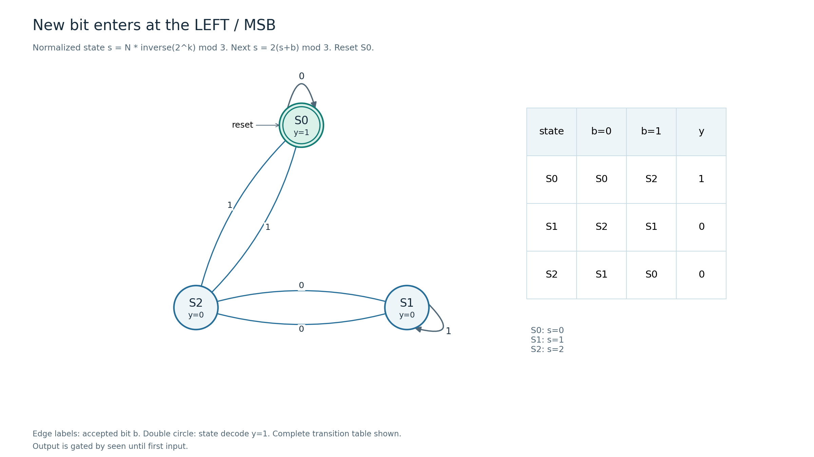

# PREP-036 — וריאציית MSB חדש משמאל / New-left-MSB variant

Append-only supplement; original question and explanations remain authoritative for their own right-append contract.

Source: [archived screenshot13](../sources/2026-10-31-batch20-13.png). Reported company: Apple; not independently verified.

## he

וריאציית מקור נוספת מ־31.10.2026 (Apple): בנו FSM שקולט בכל פעם ביט חדש בצד שמאל, במיקום ה־MSB החדש, ומחזיר1 אם המספר שנבנה מתחלק ב־3 ללא שארית. כאן אחרי k ביטים וקבלת b, המספר הבא הוא N+b·2^k; אין להזיז את הביטים הישנים שמאלה. הווריאציה מצטרפת לשאלת הצירוף מימין ואינה מחליפה אותה. נבחר אפס כמתחלק, ואות seen/valid מונע הצגת תשובה לפני קליטת נתון ראשון.

### וריאציה: ביט חדש בצד שמאל / MSB
הספרות הישנות נשארות במקומן והביט החדש מקבל משקל2^k, לכן N'=N+b·2^k. אפשר לשמור שארית רגילה ופריט parity של k, כי2^k mod3 מתחלף בין1 ל־2. אבל אין צורך בשישה מצבים: ננרמל את השארית לפי החזקה ההפיכה של2.

נגדיר s=N·2^(−k) mod3. מכיוון ש־2·2=1 mod3, ההופכי של2 הוא2. אחרי קבלת b מתקבל:

```text
s' = (N + b*2^k) * 2^(-(k+1)) mod3
   = 2*(s+b) mod3
```

| מצב מנורמל | קלט0 | קלט1 | מתחלק |
|---|---|---|---|
| S0 | S0 | S2 | 1 |
| S1 | S2 | S1 | 0 |
| S2 | S1 | S0 | 0 |

reset הוא S0; s=0 אם ורק אם N מתחלק ב־3, כי הכפלה בגורם הפיך אינה משנה אם השארית אפס. זה מוכיח באינדוקציה את אינווריאנט המספר, לא רק התאמה בפלט. נדרשים3 מצבים ו־2 FF בקידוד בינארי; seen הוא דגל נוסף אם לפני נתון ראשון יש לדרוש פלט0. אחרי נתון0 ראשון הפלט1 לפי הגדרת ההתחלקות הרגילה. אם רוצים כפולות חיוביות בלבד צריך גם להבחין בין all-zero לבין ערך חיובי, כפי שמוסבר בגרסה המקורית.

חשוב: מכונת הצירוף מימין r'=(2r+b) mod3 בונה מספר אחר, אך תיתן בדיוק אותו דגל התחלקות לכל קידומת של אותה סדרת קבלות! עבור k ביטים a0..a(k−1), ערך שמאל הוא L=Σai2^i וערך צירוף מימין הוא R=Σai2^(k−1−i). מודולו3, מאחר ש־2^2=1, מתקיים R=2^(k−1)L, ולכן R=0 אם ורק אם L=0. באורך0 שניהם0 אך התוקף טרם נקבע. למשל קבלות1,0 בונות משמאל1 ומימין2, ושניהם אינם מתחלקים. לכן בדיקות שמאמתות רק את הדגל לא מגלות טעות בכיוון הבנייה; חייבים לבדוק את N ואת אינווריאנט s.

כל32,767 הרצפים באורכים0..14 נבדקו:425,986 קידומות השוו N שנבנה בהוספת משקלים, s=N·2^(−k), דגל חלוקה והדגל החלופי של צירוף מימין. נבדקו גם hold ו־reset. מצורפים תרשים נקי, מודל Python ו־RTL prep036_left_mod3. לא בוצע אימות חומרה פיזית. תשובת ראיון: אני מקבל MSB חדש ולכן המשקל הוא2^k; נרמול ב־2^(−k) מצמצם את המכונה לשלושה מצבים עם s'=2(s+b) mod3.

אימות RTL שבוצע בפועל: prep036_left_mod3 קומפל והורץ מול assertions בכל511 הרצפים באורכים0..8, עם3,586 קידומות ואינווריאנט מספרי, seen, hold ו־reset. טווח0..14 הוא בדיקת Python נפרדת. זהו אימות סימולציה עם assertions, ללא סינתזה, מדידת תזמון/הספק או בדיקת חומרה פיזית. ההרצה הגדולה הראשונית הסתיימה ב־timeout; רק ההרצה המוגבלת הושלמה.



## en

Additional31 October2026 source variant (Apple): build an FSM receiving each new bit at the left, as the new MSB, and output one when the built number is divisible by3. After k bits, inserting b gives N+b·2^k; the old bits do not shift left. This supplements rather than replaces the original right-append question. Zero counts as divisible; seen/valid suppresses output before the first accepted bit.

### Variant: each new bit enters at the left / MSB
Existing digits retain their positions and the new bit has weight2^k, so N'=N+b·2^k. One approach stores the ordinary remainder and k parity because2^k mod3 alternates1,2. Six states are unnecessary: normalize the remainder by an invertible power of2.

Define s=N·2^(−k) mod3. Since2·2=1 mod3, the inverse of2 is2. After accepting b:

```text
s' = (N + b*2^k) * 2^(-(k+1)) mod3
   = 2*(s+b) mod3
```

| Normalized state | Input0 | Input1 | Divisible |
|---|---|---|---|
| S0 | S0 | S2 | 1 |
| S1 | S2 | S1 | 0 |
| S2 | S1 | S0 | 0 |

Reset is S0. Invertible multiplication preserves a zero remainder, so s=0 iff N is divisible by3. This inductively proves the numeric invariant, not merely matching output flags. Three states need2 binary FFs. Add seen if output must be zero before the first accepted input; after an accepted zero, output is one under ordinary divisibility. Positive multiples only need a separate all-zero/positive distinction as discussed in the original question.

Crucially, the original right-append machine r'=(2r+b) mod3 constructs a different number yet gives the SAME divisibility flag for every prefix of the same arrival sequence. For k arrivals a0..a(k−1), left value L=Σai2^i and right-append value R=Σai2^(k−1−i). Modulo3,2^2=1 implies R=2^(k−1)L, so one is zero iff the other is zero. At length0 both are zero but validity is not established. For arrivals1,0 the left value is1 and the right value2; neither is divisible. Flag-only tests cannot detect reversed construction direction: verify N and the normalized invariant as well.

All32,767 streams of lengths0..14 were checked:425,986 prefixes compared explicit left-weighted N, s=N·2^(−k), divisibility and the alternative right-append flag. Hold and reset were also checked. Clean diagram, Python model and prep036_left_mod3 RTL are supplied. No physical hardware test is claimed. Oral answer: a new MSB has weight2^k; normalization by2^(−k) reduces this to three states with s'=2(s+b) mod3.

Actual RTL validation: prep036_left_mod3 compiled and passed assertions on all511 streams of lengths0..8, with3,586 numeric-invariant prefixes plus seen, hold and reset. Lengths0..14 were separately checked in Python. This is assertion-based simulation, without synthesis, physical timing/power measurement or hardware testing. An initial larger run timed out; only the bounded RTL run completed.


```json
{
  "assumptions": {
    "he": [
      "וריאציית MSB: ביט חדש נוסף משמאל במשקל2^k; ביט תקף בחזית; אפס מתחלק; seen מבדיל מצב לפני קלט; reset ל־S0."
    ],
    "en": [
      "MSB variant: new leftmost bit has weight2^k; edge acceptance; zero is divisible; seen distinguishes pre-input; reset S0."
    ]
  },
  "optimality": {
    "he": "לבדיקת החלוקה בווריאציה המנורמלת:3 מצבים,2 FF, ועוד seen אם נדרש תוקף לפני נתון. אין צורך לשמור את N הגדל או מונה אורך.",
    "en": "Normalized divisibility variant:3 states,2 FFs plus seen if pre-input validity is required; no growing N or length counter."
  },
  "verification": {
    "he": "וריאציית שמאל:32,767 רצפים עד אורך14 ו־425,986 קידומות עם אינווריאנט מספרי, השוואת כיוונים, hold/reset. כל דגלי החלוקה זהים לשיטת צירוף מימין בתחום הנבדק, כנדרש גם מההוכחה. אימות RTL שבוצע בפועל: prep036_left_mod3 קומפל והורץ מול assertions בכל511 הרצפים באורכים0..8, עם3,586 קידומות ואינווריאנט מספרי, seen, hold ו־reset. טווח0..14 הוא בדיקת Python נפרדת. זהו אימות סימולציה עם assertions, ללא סינתזה, מדידת תזמון/הספק או בדיקת חומרה פיזית. ההרצה הגדולה הראשונית הסתיימה ב־timeout; רק ההרצה המוגבלת הושלמה.",
    "en": "Left variant:32,767 streams up to length14 and425,986 prefixes with numeric invariant, direction comparison and hold/reset. Divisibility flags match right-append throughout, as also proved. Actual RTL validation: prep036_left_mod3 compiled and passed assertions on all511 streams of lengths0..8, with3,586 numeric-invariant prefixes plus seen, hold and reset. Lengths0..14 were separately checked in Python. This is assertion-based simulation, without synthesis, physical timing/power measurement or hardware testing. An initial larger run timed out; only the bounded RTL run completed."
  },
  "edge_cases": {
    "he": [
      "לפני נתון ראשון לעומת נתון0; רצף אפסים; הוספת0 כ־MSB משאירה N אך משנה k;1,0 נותן N=1 ולא2; idle אינו מגדיל k."
    ],
    "en": [
      "Before first input versus accepted zero; all zeros; a new zero MSB holds N but advances k;1,0 gives N=1 rather than2; idle does not advance k."
    ]
  },
  "common_mistakes": {
    "he": [
      "להשתמש בנוסחת2N+b כדי לתאר הוספה משמאל.",
      "להסיק נכונות של כיוון הבנייה מבדיקת דגל בלבד: כאן שני הכיוונים תמיד מסכימים על התחלקות.",
      "לחשוב ש־s הוא השארית הרגילה N mod3 במקום השארית המנורמלת."
    ],
    "en": [
      "Using2N+b to describe left insertion.",
      "Inferring direction correctness from flags alone: both directions always agree on divisibility here.",
      "Interpreting s as ordinary N mod3 instead of the normalized remainder."
    ]
  },
  "interview_answer": {
    "he": "בגרסת MSB החדש משמאל אשתמש ב־s=N2^(−k) mod3; המעבר הוא2(s+b) mod3. שלושה מצבים מספיקים, ו־seen מונע תשובה לפני קלט. אבדוק אינווריאנט מספרי כי דגלי הכיוונים זהים.",
    "en": "For new-left-MSB input use s=N2^(−k) mod3 with transition2(s+b) mod3. Three states suffice, with seen for pre-input validity. Check the numeric invariant because directional flags coincide."
  },
  "source_ambiguities": {
    "he": [
      "מקור13 מוסיף במפורש משמאל/MSB בניגוד לצירוף מימין במקור הישן; נשמר כווריאציה. אפס ותוקף קדם־נתון הובהרו בעריכה."
    ],
    "en": [
      "Source13 explicitly says left/MSB, unlike original right appending; preserved as a variant. Zero and pre-input validity are clarified editorially."
    ]
  },
  "solution_extensions": {
    "he": {
      "question": "האם אותו נרמול עובד לחלוקה ב־5?",
      "direction": "כן, כי2 הפיך מודולו5:2^(−1)=3, ולכן next_s=3(s+b) mod5. אין להסיק שכיווני הקבלה יתנו אותו דגל לכל קידומת; המיוחד ל־3 הוא2^2=1.",
      "integration": "מוכן בתוכן; אינו מחובר לתור אינטראקטיבי."
    },
    "en": {
      "question": "Does normalization also work modulo5?",
      "direction": "Yes: inverse(2) modulo5 is3, giving next_s=3(s+b) mod5. Do not assume both directions give identical prefix flags; the modulo3 argument uses2^2=1.",
      "integration": "Prepared in content; not connected to the interactive queue."
    }
  }
}
```
