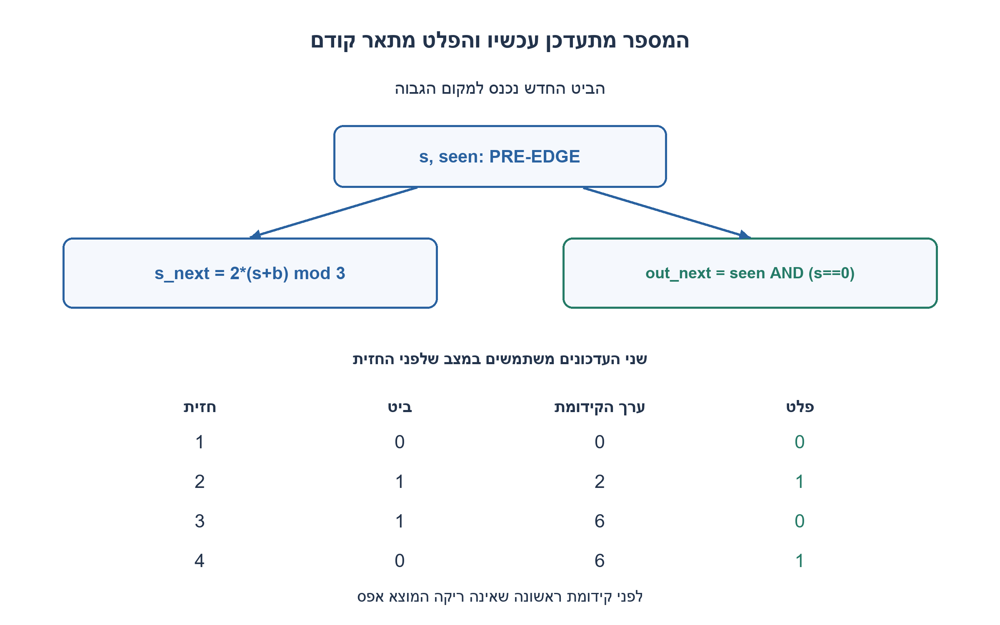
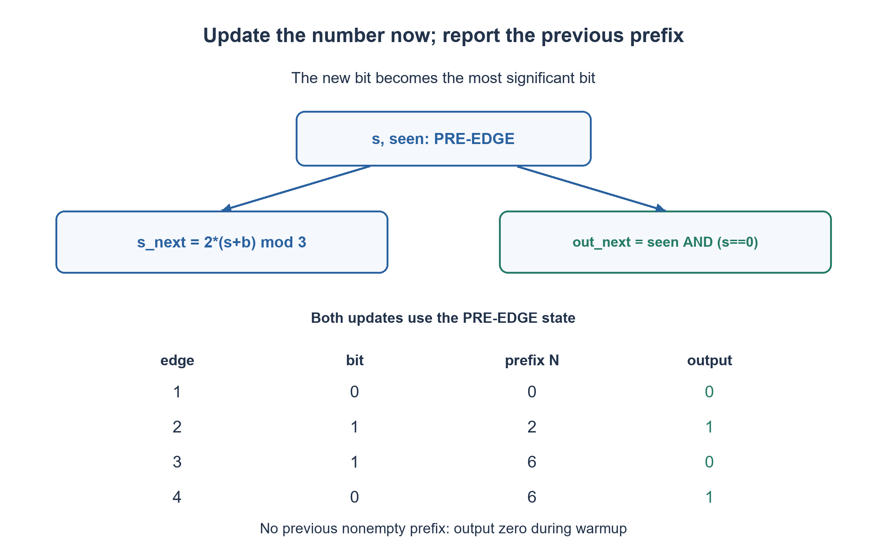

# PREP-036 — מכונת מצבים לבדיקת התחלקות ב־3 של מספר בינארי טורי

פתרון מוצע בסיוע AI; ביקורת מקצועית אנושית ממתינה. הקושי אינו מכויל.

## עברית

### וריאציה: ביט חדש משמאל ופלט של המחזור הקודם
בכל חזית עולה מתקבל ביט חדש שהופך ל־MSB של המחרוזת: אחרי k ביטים המספר הוא N_k=Σ b_i·2^(i−1). הוסיפו פלט רשום כך שלאחר החזית ה־k הוא 1 אם ורק אם המחרוזת הלא־ריקה שלאחר החזית k−1 התחלקה ב־3. כלומר יש השהיה נוספת של מחזור שעון אחד ביחס לבדיקת הקידומת שהתקבלה עכשיו.

הנחות ההשלמה: reset סינכרוני פעיל בגבוה; לאחר reset המוצא 0, ובחזית הראשונה הוא עדיין 0 כי אין קידומת קודמת שאינה ריקה. המספר 0 עצמו מתחלק ב־3. מתקבל ביט בכל חזית ללא enable; אין להסיק על התנהגות stalls שלא הוגדרה. דרשו FSM בגודל קבוע למרות אורך המחרוזת שאינו חסום.

1. אל תחליפו את N ב־2N+b: הביט החדש מגיע למקום הגבוה, והביטים הקיימים נשארים באותם מקומות. מהו משקל הביט החדש?
2. אפשר לנרמל את השארית על ידי הכפלה ב־2^(−k) מודולו 3. מאחר ש־2 הפיך, הבדיקה שווה לאפס אינה משתנה.
3. למצב המנורמל מתקבל s_next=2(s+b) modulo 3. באותה חזית עדכנו את המצב, אבל את המוצא טענו מהמצב הישן יחד עם seen.

### מוצא מושהה אינו סדר סיביות אחר
לאחר k ביטים, `N_k=N_(k−1)+b_k·2^(k−1)`. נגדיר `s_k=N_k·2^(−k) mod 3`. מכיוון שההופכי של 2 מודולו 3 הוא 2, נקבל `s_k=2(s_(k−1)+b_k) mod 3`. הכפלה בגורם הפיך משמרת אפס, ולכן s_k=0 בדיוק כאשר N_k מתחלק ב־3. שלושת מצבי השארית והמעברים המנורמלים נשארים כפי שכבר תוארו; אין צורך לאחסן מספר אינסופי או חזקה הולכת וגדלה.

כדי שהמוצא יתאר קידומת אחת קודם, משתמשים ב־FF נפרד: בחזית נכתוב `divisible <= seen && state==0`, ובמקביל נחשב את state הבא. השמות state ו־seen בצד ימין הם ערכיהם לפני החזית. seen מתחיל ב־0 והופך ל־1 לאחר קבלת הביט הראשון; לכן המוצא הראשון הוא 0, ואפס שהתקבל כביט אמיתי מזוהה מהחזית הבאה.

| חזית | ביט נכנס | מספר הקידומת משמאל | המוצא אחרי החזית |
|---|---|---|---|
|1|0|0|0: עדיין אין קידומת קודמת|
|2|1|2|1: הקידומת הקודמת הייתה 0|
|3|1|6|0: הקידומת הקודמת הייתה 2|
|4|0|6|1: הקידומת הקודמת הייתה 6|

מימוש ישיר ושקוף משתמש בשתי סיביות לקידוד שלושת מצבי s, בסיבית seen ובסיבית מוצא. כל חזית דורשת מספר קבוע של שערים ו־FF, ללא תלות באורך הקלט. זו עלות המימוש המצורף, לא הוכחה שהוא מזערי במספר כל המצבים הנגישים כולל warmup: ניתן לצמצם מכונה מורכבת לאחר הגדרת כל מוצאיה והבדלי האתחול.

ל־LSB-first ולשרשור הרגיל מימין יש אותה תוצאת חלוקה ב־3 לכל קידומת ביטים, אף שהמספרים שונים: היפוך המילה מכפיל את השארית בגורם הפיך של 2. לכן בדיקה שרק משווה divisible אינה מוכיחה שסדר הבנייה הפנימי נכון. האורקל המצורף בונה במפורש את N עם חזקה של 2, משווה גם את אינווריאנט הנרמול וגם את השהיית המוצא, ובוחן את החזית הראשונה, reset וכל המחרוזות הסופיות בטווח הבדיקה. זוהי בדיקה סופית בנוסף להוכחת האינווריאנט, ולא ספירת כל המחרוזות האינסופיות.

```systemverilog
module prep036_left_div3_lag(input logic clk, rst, bit_in,
                            output logic divisible);
    logic [1:0] state;
    logic seen;
    // state = prefix * 2^(-accepted_length) mod3. Two binary bits encode3states.
    always_ff @(posedge clk) begin
        if (rst) begin state <= 2'd0; seen <= 1'b0; divisible <= 1'b0; end
        else begin
            divisible <= seen && (state == 2'd0);
            seen <= 1'b1;
            case (state)
                2'd0: state <= bit_in ? 2'd2 : 2'd0;
                2'd1: state <= bit_in ? 2'd1 : 2'd2;
                2'd2: state <= bit_in ? 2'd0 : 2'd1;
                default: begin state <= 2'd0; seen <= 1'b0; divisible <= 1'b0; end
            endcase
        end
    end
endmodule
```




## English

### Variant: new bits on the left, previous-cycle output
Every rising edge accepts a bit which becomes the new MSB: after k bits, N_k=Σ b_i·2^(i−1). Add a registered output which after edge k is one exactly when the nonempty prefix after edge k−1 was divisible by three. This is one additional clock cycle beyond classifying the prefix just accepted.

Chosen completion: synchronous active-high reset sets output zero. The first accepted edge still outputs zero because no nonempty previous prefix exists. The value zero itself is divisible by three. One bit arrives on every edge, without enable; no unspecified stall behavior is implied. Use a constant-size FSM although the stream is unbounded.

1. Do not use N_next=2N+b: a new high bit is added while existing bits retain their positions. What is its weight?
2. Normalize the remainder by 2^(−k) modulo three. Since two is invertible, the zero-remainder test is preserved.
3. The normalized recurrence is s_next=2(s+b) mod 3. At the same edge update state, but load output from the old state and seen flag.

### Delayed output is separate from bit order
After k bits, `N_k=N_(k−1)+b_k·2^(k−1)`. Define `s_k=N_k·2^(−k) mod 3`. Two has inverse two modulo three, giving `s_k=2(s_(k−1)+b_k)mod3`. Multiplication by an invertible factor preserves zero, so s_k is zero exactly when N_k is divisible by three. The existing three normalized-remainder transitions still apply; no unbounded number or growing power must be stored.

To report one prefix earlier, add an output FF: on an edge assign `divisible <= seen && state==0` while updating state in parallel. Right-hand values are the old pre-edge state and seen. Seen starts false and becomes true after the first bit. Therefore the first output is zero, while an actual zero-valued nonempty prefix can be recognized on the following edge.

| Edge | Accepted bit | New-MSB prefix value | Output after edge |
|---|---|---|---|
|1|0|0|0:no previous nonempty prefix|
|2|1|2|1:previous prefix was zero|
|3|1|6|0:previous prefix was two|
|4|0|6|1:previous prefix was six|

The direct implementation uses two bits encoding the three s states, one seen bit and one output bit. Per-edge work and storage are constant regardless of stream length. This is the shown implementation's cost, not a minimum-state proof for the composite machine including warmup; such minimization requires fixing all outputs and reset distinctions first.

LSB-first arrival and ordinary right-appending give the same divisibility-by-three flag for every bit prefix even though their numeric values differ: reversal changes the remainder by an invertible power of two. A flag-only test therefore cannot establish correct internal bit-order semantics. The independent oracle explicitly builds N using powers of two, checks the normalization invariant as well as the delayed output, and covers reset, the first edge and every finite stream in its stated range. Finite tests complement the invariant proof; they do not enumerate infinite streams.

```systemverilog
module prep036_left_div3_lag(input logic clk, rst, bit_in,
                            output logic divisible);
    logic [1:0] state;
    logic seen;
    // state = prefix * 2^(-accepted_length) mod3. Two binary bits encode3states.
    always_ff @(posedge clk) begin
        if (rst) begin state <= 2'd0; seen <= 1'b0; divisible <= 1'b0; end
        else begin
            divisible <= seen && (state == 2'd0);
            seen <= 1'b1;
            case (state)
                2'd0: state <= bit_in ? 2'd2 : 2'd0;
                2'd1: state <= bit_in ? 2'd1 : 2'd2;
                2'd2: state <= bit_in ? 2'd0 : 2'd1;
                default: begin state <= 2'd0; seen <= 1'b0; divisible <= 1'b0; end
            endcase
        end
    end
endmodule
```




## חומר משלים / Supporting material

```json
{
  "assumptions": {
    "he": [
      "ביט בכל חזית; zero מתחלק; קידומת ריקה אינה תקפה; השהיה נוספת אחת."
    ],
    "en": [
      "One bit per edge, zero divisible, empty prefix invalid, one additional output cycle."
    ]
  },
  "optimality": {
    "he": "המימוש מציג 2 FF למצב, seen ו־FF פלט: ארבעה FF בסך הכול, ללא טענת מינימום כולל.",
    "en": "The direct design has two state FFs, seen and an output FF: four FFs total, without an overall minimum claim."
  },
  "verification": {
    "he": [
      "בנייה עצמאית של N, בדיקת הנרמול והשוואה לקידומת הקודמת בכל חזית; reset ו־warmup.",
      "ראיית סימולציה נפרדת: רתמת SystemVerilog הודרה והורצה ב־Icarus בסביבה מבודדת; חלק התרגיל בדק 18,434 מקרי מודל. הדוח הוא checks/night1107n30-native-verification.json. אין זו בדיקת נתב אמיתי, STA או אישור חומרה."
    ],
    "en": [
      "Independently construct N, check normalization, and compare with the previous prefix at each edge, including reset and warmup.",
      "Separate native evidence: the SystemVerilog harness was compiled and run with Icarus in an isolated environment; this exercise contributed 18,434 model cases. Evidence: checks/night1107n30-native-verification.json. This is not real-router validation, STA or hardware signoff."
    ]
  },
  "edge_cases": {
    "he": [
      "ביט ראשון 0 או 1; אפסים רצופים; מעבר אל וממספר שמתחלק; reset באמצע."
    ],
    "en": [
      "First zero/one, repeated zeros, entering/leaving divisible prefixes, and mid-stream reset."
    ]
  },
  "common_mistakes": {
    "he": [
      "עדכון פלט מהמצב החדש במקום הישן, הכרזה שהריקה תקפה, או הוספת enable בלי להגדיר יחידות השהיה."
    ],
    "en": [
      "Using new rather than old state for output, accepting the empty prefix, or adding enable without defining latency units."
    ]
  },
  "interview_answer": {
    "he": "אני מנרמל את השארית כדי לא לשמור חזקה, ומוסיף FF שמקבל את בדיקת השארית הישנה. seen מונע פלט שגוי לפני שהייתה קידומת אמיתית.",
    "en": "Normalize the remainder to avoid storing a growing power, then register the old remainder test. Seen suppresses an empty-prefix result."
  },
  "source_ambiguities": {
    "he": [
      "זמן t הוגדר כאן כדגימה שאחרי החזית; קידומת קודמת ריקה מדווחת 0 במפורש."
    ],
    "en": [
      "Time t means the sample after an edge; an empty previous prefix explicitly produces zero."
    ]
  },
  "solution_extensions": {
    "he": [
      {
        "question": "מה קורה כאשר אין ביט תקף בחלק ממחזורי השעון?",
        "answer_direction": "קבעו האם ההשהיה היא מחזור שעון או ביט מתקבל. החזיקו את state ו־seen כשאין valid, והוסיפו valid לפייפליין או אפשרו לפלט להתקדם בכל שעון בהתאם לחוזה שנבחר.",
        "principle": "הפרדת משמעות זרם הביטים מתזמון המוצא."
      }
    ],
    "en": [
      {
        "question": "What if some clocks carry no valid bit?",
        "answer_direction": "Choose wall-clock versus accepted-bit latency. Hold state/seen without valid and either pipeline validity or advance the output each clock according to the chosen contract.",
        "principle": "Separate stream semantics from output timing."
      }
    ]
  }
}
```
