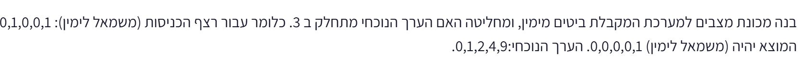
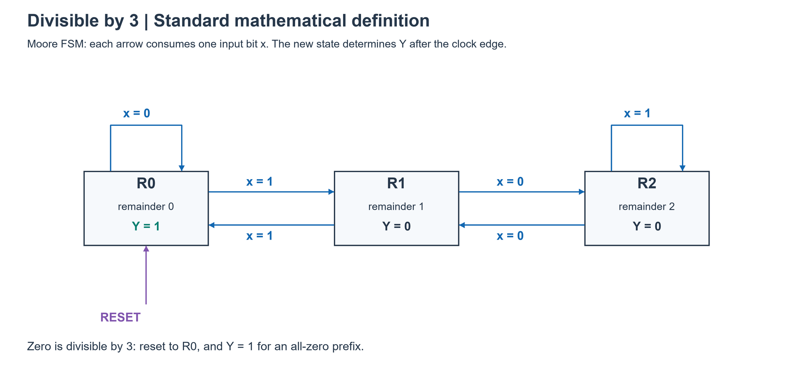
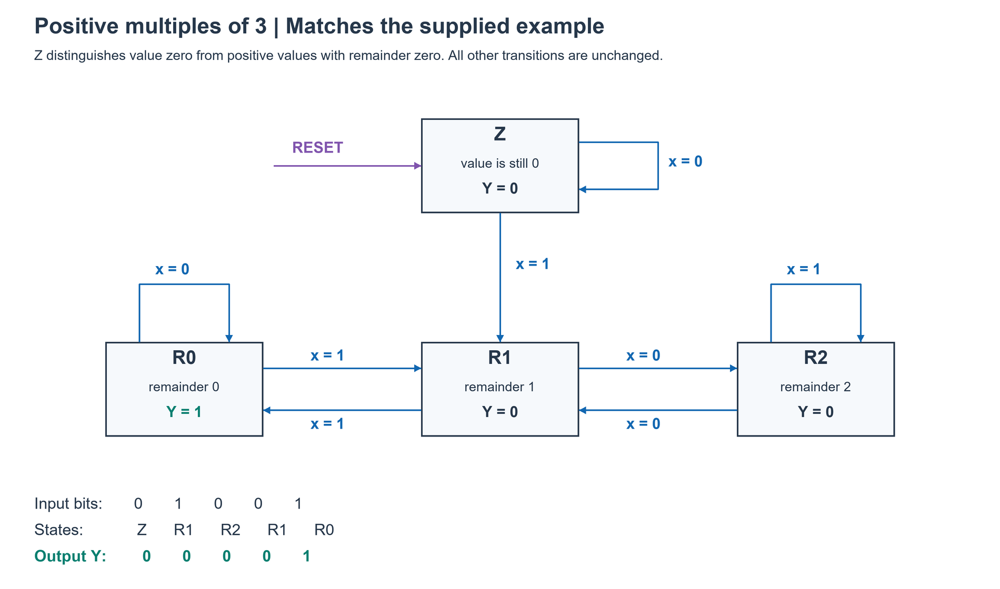
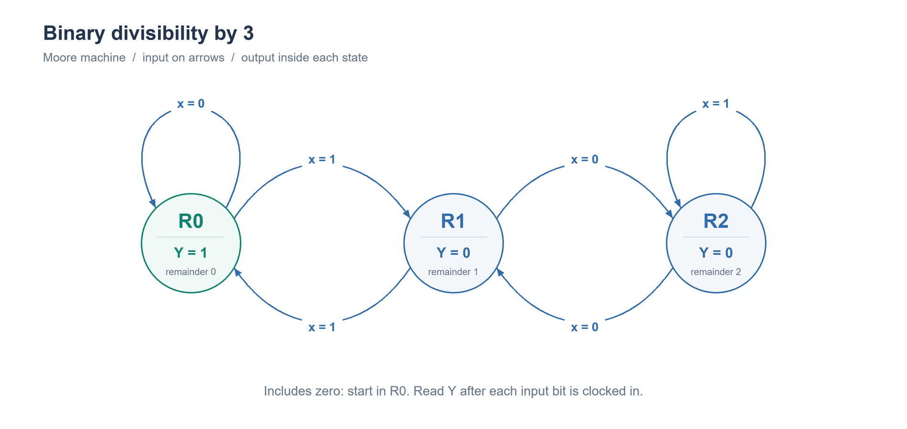
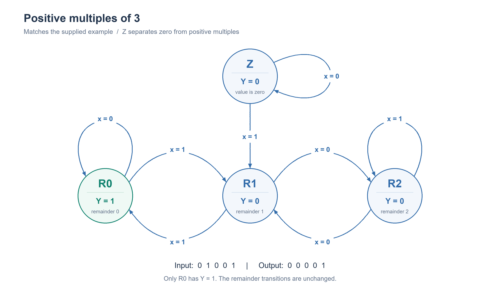
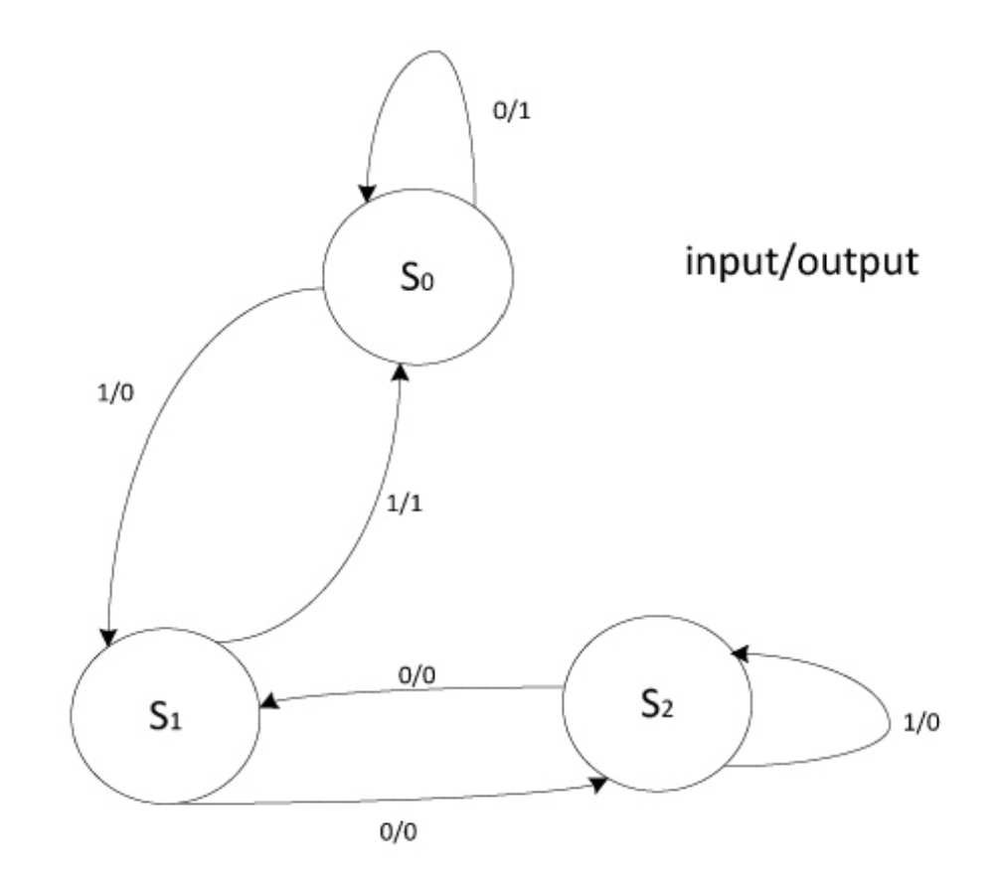

# PREP-036 — מכונת מצבים לבדיקת התחלקות ב־3 של מספר בינארי טורי



בנה מכונת מצבים למערכת המקבלת ביטים מימין, ומחליטה האם הערך הנוכחי מתחלק ב־3. כלומר עבור רצף הכניסות (משמאל לימין): 0,1,0,0,1 המוצא יהיה (משמאל לימין) 0,0,0,0,1. הערך הנוכחי: 0,1,2,4,9.

## סיווג

FSM, לוגיקה סדרתית, שאריות, איפוס ומקרי קצה. עדיפות גבוהה לפי התפקיד שסופק. לא מופיעות תגיות חברה בצילום. שאלה חדשה, קשורה ל־PREP-010 אך אינה אותה משימת מונה.

## רמזים

1. מה הקשר בין הערך הישן לערך החדש כאשר מצרפים ביט מימין לייצוג בינארי?
2. האם צריך לזכור את כל המספר, או שמספיק לזכור מידע מצומצם כדי לדעת אם הוא מתחלק ב־3?
3. עקוב אחרי השארית בחלוקה ל־3: לכל שארית ולכל ביט כניסה חשב את השארית הבאה. בדוק בנפרד כיצד לפרש את המוצא שניתן בדוגמה עבור אפס.

## הצעה לפתרון

הצעה לפתרון — תחילה מבהירים את הדוגמה. צירוף ביט מימין פירושו הכפלת הערך הקודם ב־2 והוספת הביט. אין פירושו שהביטים מגיעים בסדר LSB-first: רצף 01001 בונה בהדרגה את הערכים 0,1,2,4,9. נניח ביט תקף אחד בכל חזית שעון ומוצא המתאר את הערך אחרי קליטת הביט. באיפוס מתחילים מערך אפס.

יש סתירה בין התנאי המתמטי לדוגמה: אפס מתחלק ב־3, ולכן התנאי הרגיל מחזיר 1 בביט הראשון. אין לשנות את ההגדרה בשקט. יש להציג שתי אפשרויות: דוגמה שגויה באיבר הראשון, או דרישה לזהות כפולות חיוביות בלבד. בפרשנות השנייה מוסיפים הבחנה בין ערך אפס לבין כפולה חיובית של 3. אם הכוונה במקום זאת לאות valid מיוחד, צריך להגדיר אותו; הוא אינו נתון.

### אפשרות א — התחלקות רגילה, כולל אפס

מספיק לשמור רק את השארית r ולא את המספר הגדל. אם V=3q+r, אז 2V+x=6q+2r+x, ולכן השארית הבאה תלויה רק ב־r ובביט x:

```text
V_next = 2*V + x
r_next = (2*r + x) mod 3
```

שלושה מצבי Moore: R0,R1,R2 מציינים שאריות 0,1,2. המצב ההתחלתי R0. המוצא 1 רק ב־R0.

| מצב נוכחי | x=0 | x=1 | מוצא במצב |
|---|---|---|---|
| R0 | R0 | R1 | 1 |
| R1 | R2 | R0 | 0 |
| R2 | R1 | R2 | 0 |

לדוגמה R2 עם ביט 1: הערך הרלוונטי לשארית הוא 2*2+1=5, והשארית 2, ולכן נשארים ב־R2. אין צורך לממש מחלק או לשמור מספר בלתי מוגבל: טבלת המעברים היא לוגיקה צירופית קטנה.

לכניסה 01001 נקבל R0,R1,R2,R1,R0 ומוצאים 1,0,0,0,1. זהו הפתרון לניסוח המתמטי אך לא לפלט הראשון שבצילום.

### אפשרות ב — התאמה מדויקת לדוגמה: כפולות חיוביות בלבד

נוסיף מצב Z: הערך המצטבר עדיין אפס, כלומר לא נקלט אף 1. R0 יתאר מעתה כפולה חיובית של 3. מתחילים ב־Z, והמוצא בו 0. אחרי שנקלט 1, המספר חיובי ולעולם לא יחזור לאפס באמצעות הוספת ביטים מימין.

| מצב נוכחי | x=0 | x=1 | מוצא במצב |
|---|---|---|---|
| Z | Z | R1 | 0 |
| R0 | R0 | R1 | 1 |
| R1 | R2 | R0 | 0 |
| R2 | R1 | R2 | 0 |

ברצף 01001 המצבים לאחר כל ביט הם Z,R1,R2,R1,R0, ולכן המוצא 0,0,0,0,1, בדיוק בדוגמה. גם כל רצף אפסים מחזיר 0, לפי פרשנות הכפולות החיוביות.

### מימוש, נכונות ומינימליות

בשתי האפשרויות מספיקים שני DFF, כי צריך לקודד שלושה או ארבעה מצבים. המוצאים Q נכנסים יחד עם x ללוגיקת המצב הבא; שני ביטי התוצאה מזינים את D של שני ה־FF. לוגיקת המוצא מפענחת R0 מן המצב הרשום. אפשר לקודד בפתרון החיובי Z=00,R0=01,R1=10,R2=11; המוצא הוא NOT(Q1) AND Q0, והמעברים נקבעים מהטבלה. בפתרון הרגיל אפשר R0=00,R1=01,R2=10 ולקבוע התאוששות מהקוד הלא־בשימוש 11 אל R0. איפוס חייב לבחור את הקוד המתאים לפרשנות. אם אין ביט תקף בחלק מהמחזורים, יש להוסיף enable לשמירת המצב; זה אינו נדרש בנוסח.

הוכחת נכונות באינדוקציה: באיפוס השארית נכונה; הנוסחה לעיל משמרת את השארית בכל קליטת ביט, ופענוח R0 מחזיר בדיוק את ההתחלקות. במכונה החיובית Z משמר את ההבחנה בין ערך אפס לערך חיובי, ומאז המעבר הראשון ל־R1 אי אפשר לחזור לאפס.

שלושה מצבי Moore הם מינימום בהגדרה הרגילה: R0 מובחן משני האחרים במוצא הנוכחי, ו־R1 מובחן מ־R2 על ידי סיומת 1. ארבעה הם מינימום בפרשנות החיובית: R0 מובחן מכולם במוצא; R1 לעומת R2 וגם Z לעומת R1 מובחנים בסיומת 1; Z לעומת R2 בסיומת 01. כל המצבים נגישים מאיפוס. שתי סיביות זיכרון הן לכן מינימום למימוש Moore בינארי זה. אין טענה למינימום שערים, להסרת גליצ'ים או למבנה Mealy מינימלי; המינימליות כאן מתייחסת למכונה ולתזמון המוצא שהוגדרו.

תשובה קצרה לראיון: צירוף ביט מימין משנה את הערך ל־2V+x. כדי לבדוק חלוקה ב־3 מספיק לזכור את השארית, ולבנות טבלה עבור שלוש שאריות ושני ביטי כניסה. הדוגמה אינה מקבלת את אפס, ולכן אברר אם זו טעות או שנדרשות כפולות חיוביות; במקרה החיובי אפריד את מצב האפס.

טעויות נפוצות: בלבול בין צירוף ביט מימין לבין קבלת LSB ראשון; מונה שסופר אחדות או מחזורים במקום ערך בינארי; מוצא לפי מצב ישן בלי להסביר תזמון; התעלמות מאפס; שמירת המספר כולו ברגיסטר שרוחבו מוגבל. זו שאלה בעדיפות גבוהה לתרגול FSM, מצבים, איפוס ומקרי קצה, על בסיס התפקיד שסופק, ללא תחזית לשאלת ראיון. בצילום אין תגיות חברות.

## English

Build an FSM receiving bits appended on the right and deciding whether the current value is divisible by 3. For input bits (left to right) 0,1,0,0,1, the given outputs are 0,0,0,0,1 and the successive values are 0,1,2,4,9.

How does appending a bit on the right change a binary value?
Must you retain the full number, or is a smaller summary sufficient for divisibility?
Track the remainder modulo 3. Compute the next remainder for every current remainder and input bit, and separately clarify the example output at zero.

Proposed solution: a bit appended on the right gives V_next=2V+x (not an LSB-first weighted stream). Assume one valid bit per active clock edge and a Moore output describing the value after that edge, reset value zero. Only the remainder is needed: if V=3q+r, then 2V+x=6q+2r+x, so r_next=(2r+x) mod 3.

The source is ambiguous: mathematically zero is divisible by 3, but the sample outputs zero for the first zero value. Do not silently ignore this. Ordinary divisibility needs three Moore states with reset R0, output one in R0 only, and transitions R0:(0->R0,1->R1), R1:(0->R2,1->R0), R2:(0->R1,1->R2). Sample 01001 then yields outputs 10001, correcting the first sample output.

To match the sample by recognizing positive multiples only, add reset state Z with output zero and transitions 0->Z,1->R1. Keep the other three states/transitions; R0 now denotes a positive multiple. The same input visits Z,R1,R2,R1,R0 and yields 00001 exactly. Leading/all zeros stay Z. Once positive, appending bits cannot return to zero. A separate input-valid interpretation would require an additional specification; it is not supplied.

Both versions require two DFFs plus next-state combinational logic and output decode. Positive encoding Z=00,R0=01,R1=10,R2=11 gives output NOT(Q1) AND Q0; implement next state from the table. Ordinary encoding R0=00,R1=01,R2=10 can recover unused 11 to R0. Reset differs by encoding; if not every cycle has a valid bit, add a hold enable. No divider or growing value register is needed.

Induction on received bits proves the remainder invariant; in the positive version the extra state tracks whether the value is still zero. Moore-state minimality: R0 differs from every other state immediately; R1/R2 and Z/R1 differ after suffix 1, Z/R2 after suffix 01. All states are reachable. Thus three or four states respectively are minimal under this Moore output/reset model, and two state bits suffice and are necessary. No gate-count or Mealy-minimality claim.

Interview summary: track remainder via (2r+x) modulo 3, clarify zero, then give the transition table and reset/output timing. Avoid confusing appended bits with LSB-first, counting ones, omitting reset, ignoring zero or returning a stale pre-edge output. High preparation priority based on FSM design and validation boundary cases in the supplied role; no company tags are visible in this screenshot.

Verification: 8191 words, 90114 prefixes, both models and state distinction passed. AI-assisted; no expert review, HDL simulation or synthesis claimed.


## שרטוטי מכונת המצבים

כל חץ מסומן בביט הכניסה, ובכל קופסה רשום המוצא של המצב.






## השרטוטים המועדפים — מצבים עגולים וחצים מעוגלים

לפי בקשת המשתמש, מכונות מצבים מוצגות בעיגולים ובחצים מעוגלים. שרטוטי רכיבים יישארו בקופסאות. תמונת הסגנון משתמשת בסימון Mealy על החצים; הפתרונות שלנו נשארים Moore והמוצא בתוך המצב.








## מקור נוסף — 25.10.2026

הצילום מבקש התחלקות בשלוש בלי לדרוש מספר חיובי בלבד. הוא ממופה לענף הרגיל, הכולל אפס, שכבר נשמר בפתרון; הדרישה החיובית מהמקור הישן נשארת בגרסה הראשית ולא נוספה לצילום החדש.

## קליטה נוספת — 31.10.2026 / Additional intake

- מקור 13: [sources/2026-10-31-batch20-13.png](../sources/2026-10-31-batch20-13.png)

יש לבנות מכונת מצבים, אשר מקבלת בכל פעם ביט שנכנס ל-MSB (מצד שמאל) ומחזירה 1 או 0 אם המספר הכולל שנבנה מתחלק ב-3 בלשארית

התוכן הבא הוא הרחבה מוצעת בסיוע AI; הוא אינו אישור אנושי לפתרון המקורי או החדש.

### he — הרחבה / Extension

וריאציית מקור נוספת מ־31.10.2026 (Apple): בנו FSM שקולט בכל פעם ביט חדש בצד שמאל, במיקום ה־MSB החדש, ומחזיר1 אם המספר שנבנה מתחלק ב־3 ללא שארית. כאן אחרי k ביטים וקבלת b, המספר הבא הוא N+b·2^k; אין להזיז את הביטים הישנים שמאלה. הווריאציה מצטרפת לשאלת הצירוף מימין ואינה מחליפה אותה. נבחר אפס כמתחלק, ואות seen/valid מונע הצגת תשובה לפני קליטת נתון ראשון.

#### רמזים להרחבה / Variant hints

1. בגרסה שמוסיפה MSB משמאל, איזה משקל מקבל הביט החדש?
2. נסו לשמור שארית מנורמלת s=N·2^(−k) mod3 כדי להעלים את תלות האורך.
3. ההופכי של2 מודולו3 הוא2, ולכן s הבא הוא2(s+b) mod3. בדקו מספרים ולא רק דגלי חלוקה.

#### הצעה לפתרון / Proposed solution

### וריאציה: ביט חדש בצד שמאל / MSB
הספרות הישנות נשארות במקומן והביט החדש מקבל משקל2^k, לכן N'=N+b·2^k. אפשר לשמור שארית רגילה ופריט parity של k, כי2^k mod3 מתחלף בין1 ל־2. אבל אין צורך בשישה מצבים: ננרמל את השארית לפי החזקה ההפיכה של2.

נגדיר s=N·2^(−k) mod3. מכיוון ש־2·2=1 mod3, ההופכי של2 הוא2. אחרי קבלת b מתקבל:

```text
s' = (N + b*2^k) * 2^(-(k+1)) mod3
   = 2*(s+b) mod3
```

| מצב מנורמל | קלט0 | קלט1 | מתחלק |
|---|---|---|---|
| S0 | S0 | S2 | 1 |
| S1 | S2 | S1 | 0 |
| S2 | S1 | S0 | 0 |

reset הוא S0; s=0 אם ורק אם N מתחלק ב־3, כי הכפלה בגורם הפיך אינה משנה אם השארית אפס. זה מוכיח באינדוקציה את אינווריאנט המספר, לא רק התאמה בפלט. נדרשים3 מצבים ו־2 FF בקידוד בינארי; seen הוא דגל נוסף אם לפני נתון ראשון יש לדרוש פלט0. אחרי נתון0 ראשון הפלט1 לפי הגדרת ההתחלקות הרגילה. אם רוצים כפולות חיוביות בלבד צריך גם להבחין בין all-zero לבין ערך חיובי, כפי שמוסבר בגרסה המקורית.

חשוב: מכונת הצירוף מימין r'=(2r+b) mod3 בונה מספר אחר, אך תיתן בדיוק אותו דגל התחלקות לכל קידומת של אותה סדרת קבלות! עבור k ביטים a0..a(k−1), ערך שמאל הוא L=Σai2^i וערך צירוף מימין הוא R=Σai2^(k−1−i). מודולו3, מאחר ש־2^2=1, מתקיים R=2^(k−1)L, ולכן R=0 אם ורק אם L=0. באורך0 שניהם0 אך התוקף טרם נקבע. למשל קבלות1,0 בונות משמאל1 ומימין2, ושניהם אינם מתחלקים. לכן בדיקות שמאמתות רק את הדגל לא מגלות טעות בכיוון הבנייה; חייבים לבדוק את N ואת אינווריאנט s.

כל32,767 הרצפים באורכים0..14 נבדקו:425,986 קידומות השוו N שנבנה בהוספת משקלים, s=N·2^(−k), דגל חלוקה והדגל החלופי של צירוף מימין. נבדקו גם hold ו־reset. מצורפים תרשים נקי, מודל Python ו־RTL prep036_left_mod3. לא בוצע אימות חומרה פיזית. תשובת ראיון: אני מקבל MSB חדש ולכן המשקל הוא2^k; נרמול ב־2^(−k) מצמצם את המכונה לשלושה מצבים עם s'=2(s+b) mod3.

אימות RTL שבוצע בפועל: prep036_left_mod3 קומפל והורץ מול assertions בכל511 הרצפים באורכים0..8, עם3,586 קידומות ואינווריאנט מספרי, seen, hold ו־reset. טווח0..14 הוא בדיקת Python נפרדת. זהו אימות סימולציה עם assertions, ללא סינתזה, מדידת תזמון/הספק או בדיקת חומרה פיזית. ההרצה הגדולה הראשונית הסתיימה ב־timeout; רק ההרצה המוגבלת הושלמה.

#### assumptions

[
  "וריאציית MSB: ביט חדש נוסף משמאל במשקל2^k; ביט תקף בחזית; אפס מתחלק; seen מבדיל מצב לפני קלט; reset ל־S0."
]

#### optimality

"לבדיקת החלוקה בווריאציה המנורמלת:3 מצבים,2 FF, ועוד seen אם נדרש תוקף לפני נתון. אין צורך לשמור את N הגדל או מונה אורך."

#### verification

"וריאציית שמאל:32,767 רצפים עד אורך14 ו־425,986 קידומות עם אינווריאנט מספרי, השוואת כיוונים, hold/reset. כל דגלי החלוקה זהים לשיטת צירוף מימין בתחום הנבדק, כנדרש גם מההוכחה. אימות RTL שבוצע בפועל: prep036_left_mod3 קומפל והורץ מול assertions בכל511 הרצפים באורכים0..8, עם3,586 קידומות ואינווריאנט מספרי, seen, hold ו־reset. טווח0..14 הוא בדיקת Python נפרדת. זהו אימות סימולציה עם assertions, ללא סינתזה, מדידת תזמון/הספק או בדיקת חומרה פיזית. ההרצה הגדולה הראשונית הסתיימה ב־timeout; רק ההרצה המוגבלת הושלמה."

#### edge_cases

[
  "לפני נתון ראשון לעומת נתון0; רצף אפסים; הוספת0 כ־MSB משאירה N אך משנה k;1,0 נותן N=1 ולא2; idle אינו מגדיל k."
]

#### common_mistakes

[
  "להשתמש בנוסחת2N+b כדי לתאר הוספה משמאל.",
  "להסיק נכונות של כיוון הבנייה מבדיקת דגל בלבד: כאן שני הכיוונים תמיד מסכימים על התחלקות.",
  "לחשוב ש־s הוא השארית הרגילה N mod3 במקום השארית המנורמלת."
]

#### interview_answer

"בגרסת MSB החדש משמאל אשתמש ב־s=N2^(−k) mod3; המעבר הוא2(s+b) mod3. שלושה מצבים מספיקים, ו־seen מונע תשובה לפני קלט. אבדוק אינווריאנט מספרי כי דגלי הכיוונים זהים."

#### source_ambiguities

[
  "מקור13 מוסיף במפורש משמאל/MSB בניגוד לצירוף מימין במקור הישן; נשמר כווריאציה. אפס ותוקף קדם־נתון הובהרו בעריכה."
]

#### solution_extensions

{
  "question": "האם אותו נרמול עובד לחלוקה ב־5?",
  "direction": "כן, כי2 הפיך מודולו5:2^(−1)=3, ולכן next_s=3(s+b) mod5. אין להסיק שכיווני הקבלה יתנו אותו דגל לכל קידומת; המיוחד ל־3 הוא2^2=1.",
  "integration": "מוכן בתוכן; אינו מחובר לתור אינטראקטיבי."
}

### en — הרחבה / Extension

Additional31 October2026 source variant (Apple): build an FSM receiving each new bit at the left, as the new MSB, and output one when the built number is divisible by3. After k bits, inserting b gives N+b·2^k; the old bits do not shift left. This supplements rather than replaces the original right-append question. Zero counts as divisible; seen/valid suppresses output before the first accepted bit.

#### רמזים להרחבה / Variant hints

1. For the new-left-MSB variant, what weight belongs to the new bit?
2. Try normalized remainder s=N·2^(−k) mod3 to remove length dependence.
3. The inverse of2 modulo3 is2, so next_s=2(s+b) mod3. Check numeric construction, not only divisibility flags.

#### הצעה לפתרון / Proposed solution

### Variant: each new bit enters at the left / MSB
Existing digits retain their positions and the new bit has weight2^k, so N'=N+b·2^k. One approach stores the ordinary remainder and k parity because2^k mod3 alternates1,2. Six states are unnecessary: normalize the remainder by an invertible power of2.

Define s=N·2^(−k) mod3. Since2·2=1 mod3, the inverse of2 is2. After accepting b:

```text
s' = (N + b*2^k) * 2^(-(k+1)) mod3
   = 2*(s+b) mod3
```

| Normalized state | Input0 | Input1 | Divisible |
|---|---|---|---|
| S0 | S0 | S2 | 1 |
| S1 | S2 | S1 | 0 |
| S2 | S1 | S0 | 0 |

Reset is S0. Invertible multiplication preserves a zero remainder, so s=0 iff N is divisible by3. This inductively proves the numeric invariant, not merely matching output flags. Three states need2 binary FFs. Add seen if output must be zero before the first accepted input; after an accepted zero, output is one under ordinary divisibility. Positive multiples only need a separate all-zero/positive distinction as discussed in the original question.

Crucially, the original right-append machine r'=(2r+b) mod3 constructs a different number yet gives the SAME divisibility flag for every prefix of the same arrival sequence. For k arrivals a0..a(k−1), left value L=Σai2^i and right-append value R=Σai2^(k−1−i). Modulo3,2^2=1 implies R=2^(k−1)L, so one is zero iff the other is zero. At length0 both are zero but validity is not established. For arrivals1,0 the left value is1 and the right value2; neither is divisible. Flag-only tests cannot detect reversed construction direction: verify N and the normalized invariant as well.

All32,767 streams of lengths0..14 were checked:425,986 prefixes compared explicit left-weighted N, s=N·2^(−k), divisibility and the alternative right-append flag. Hold and reset were also checked. Clean diagram, Python model and prep036_left_mod3 RTL are supplied. No physical hardware test is claimed. Oral answer: a new MSB has weight2^k; normalization by2^(−k) reduces this to three states with s'=2(s+b) mod3.

Actual RTL validation: prep036_left_mod3 compiled and passed assertions on all511 streams of lengths0..8, with3,586 numeric-invariant prefixes plus seen, hold and reset. Lengths0..14 were separately checked in Python. This is assertion-based simulation, without synthesis, physical timing/power measurement or hardware testing. An initial larger run timed out; only the bounded RTL run completed.

#### assumptions

[
  "MSB variant: new leftmost bit has weight2^k; edge acceptance; zero is divisible; seen distinguishes pre-input; reset S0."
]

#### optimality

"Normalized divisibility variant:3 states,2 FFs plus seen if pre-input validity is required; no growing N or length counter."

#### verification

"Left variant:32,767 streams up to length14 and425,986 prefixes with numeric invariant, direction comparison and hold/reset. Divisibility flags match right-append throughout, as also proved. Actual RTL validation: prep036_left_mod3 compiled and passed assertions on all511 streams of lengths0..8, with3,586 numeric-invariant prefixes plus seen, hold and reset. Lengths0..14 were separately checked in Python. This is assertion-based simulation, without synthesis, physical timing/power measurement or hardware testing. An initial larger run timed out; only the bounded RTL run completed."

#### edge_cases

[
  "Before first input versus accepted zero; all zeros; a new zero MSB holds N but advances k;1,0 gives N=1 rather than2; idle does not advance k."
]

#### common_mistakes

[
  "Using2N+b to describe left insertion.",
  "Inferring direction correctness from flags alone: both directions always agree on divisibility here.",
  "Interpreting s as ordinary N mod3 instead of the normalized remainder."
]

#### interview_answer

"For new-left-MSB input use s=N2^(−k) mod3 with transition2(s+b) mod3. Three states suffice, with seen for pre-input validity. Check the numeric invariant because directional flags coincide."

#### source_ambiguities

[
  "Source13 explicitly says left/MSB, unlike original right appending; preserved as a variant. Zero and pre-input validity are clarified editorially."
]

#### solution_extensions

{
  "question": "Does normalization also work modulo5?",
  "direction": "Yes: inverse(2) modulo5 is3, giving next_s=3(s+b) mod5. Do not assume both directions give identical prefix flags; the modulo3 argument uses2^2=1.",
  "integration": "Prepared in content; not connected to the interactive queue."
}

- [solutions/prep_216_220_sequential.py](../solutions/prep_216_220_sequential.py)
- [solutions/prep_216_220_sequential.sv](../solutions/prep_216_220_sequential.sv)
- [diagrams/prep-036-batch20-left-msb.png](../diagrams/prep-036-batch20-left-msb.png)
- [diagrams/prep-036-batch20-left-msb-he.png](../diagrams/prep-036-batch20-left-msb-he.png)
