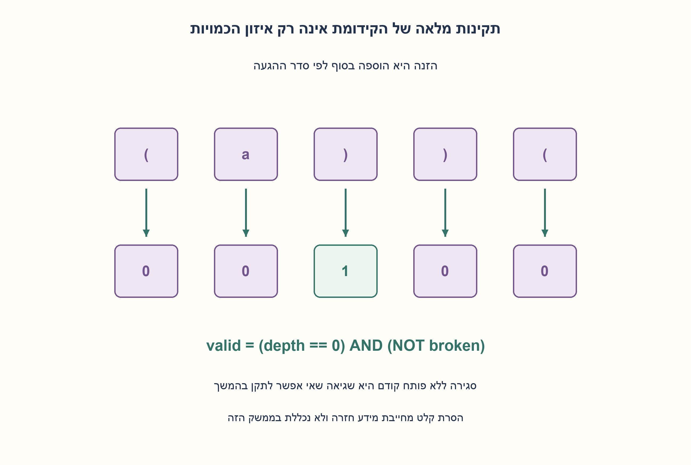
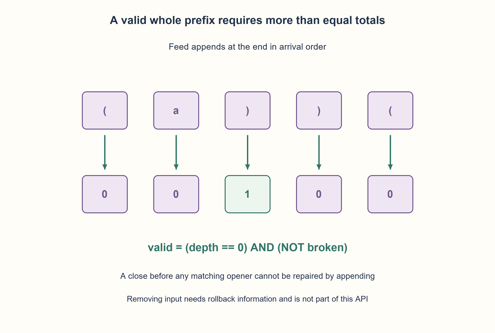

# PREP-037 — בדיקת תקינות סוגריים במחרוזת עם טקסט

פתרון מוצע בסיוע AI; ביקורת מקצועית אנושית ממתינה.

## מקור פרטי / Private source

ישנה מחסנית שאליה מוכנסים סימנים (אותיות, מספרים, וסימנים אחרים). נדרש לבנות מערכת שבכל זמן נתון תוציא 0 או 1 בהתאם לתקינות הקלט. קלט תקין נחשב למספר שווה של סוגריים פותחות וסוגרות ובסדר נכון (כלומר, ")" לפני "(" לא נחשב תקין).

[צילום מקור פרטי](../sources/2026-10-30-batch70-06.png)

## נוסח ערוך

### הרחבה: סטטוס לאחר כל הוספה לזרם
המקור הנוסף מתאר סימנים שנדחפים למחסנית ומבקש 0/1 בכל רגע. נפרש push כהוספת תו לסוף סדר ההגעה, לא כסריקה מהראש של מחסנית קיימת. בחוזה ההרחבה רק () הם סוגריים וכל תו אחר מוזנח; הגרסה הקודמת של שלושת הסוגים נשמרת.

feed מקבלת תו אחד ומחזירה 1 בדיוק אם כל הקידומת עד כה מאוזנת וחוקית. ריק תקין; קידומת עם פותחים לא סגורים היא כרגע 0 גם אם ניתנת להשלמה. סגירה ללא פותח יוצרת שגיאה שלא תתוקן על ידי הוספה. יש reset וקריאת valid, אך אין פעולת הסרת תו במקור. הסבירו בנפרד מה יידרש כדי לתמוך ב־pop.

### שלושה רמזים

1. האם קידומת "(" תקינה כרגע או רק ניתנת להשלמה? הגדירו מה הפלט אומר.
2. לסוג יחיד מספיק עומק, אבל צריך לזכור גם אם הייתה אי־פעם סגירה ללא פותח.
3. אחרי הוספה valid הוא not broken ועומק 0. שגיאת prefix נשארת עד reset; כדי לבטל הוספות צריך לשמור מצבים קודמים.

### הצעה לפתרון

### פלט על הקידומת הנוכחית
נחזיק depth ומצב broken. פותח מגדיל עומק, סוגר מוריד אם יש פותח; סוגר בעומק 0 מדליק broken. אחריו כל הוספה תשאיר את התוצאה 0. תו רגיל אינו משנה מצב. valid מתקיים בדיוק כש־broken כבוי והעומק 0. "(" מחזירה 0, אחריה")" מחזירה 1; לעומת זאת ")(" נשארת 0 למרות שסך הכמויות שווה. זהו אינדוקציה על הקידומת: העומק הוא מספר הפותחים הלא סגורים כל עוד אין שגיאה, ושגיאת סדר אינה ניתנת לתיקון בהוספה.

לסוג יחיד יש O(1) מילות מצב ועבודה קבועה לאירוע במודל מילה, אבל העומק דורש O(log N) ביטים. לשלושת סוגי הסוגריים במקור הקודם דרושה גם מחסנית סדר, עד O(N) זיכרון, ולא רק מונה. המימוש החדש אינו מחליף את החוזה המקורי.

המקור אינו נותן pop. אם צריך להסיר את התו האחרון ולשאול שוב, אי אפשר להסתפק בדגל שגיאה דביק: אחרי הסרת")" מקידומת")" חוזרים לריק חוקי. דרך פשוטה היא מחסנית היסטוריית (depth, broken) לכל push ושחזור ב־pop, בתוספת מקום לינארי. זו הרחבה מתוארת, לא API שהמצאנו כמקור. נבדקו 29524 זרמים ו־ 250959 סטטוסי קידומת מול בדיקה עצמאית של הטקסט המלא, כולל reset וקריאות לא תקינות.

```python
"""Append-only () monitor; incoming tokens are chronological pushes.

No pop is part of this API. Ordinary characters, including other bracket
characters in this single-type extension, are ignored. Original mixed-type
stack validation remains a separate contract.
"""


class ParenthesisMonitor:
    def __init__(self):
        self.reset()

    def reset(self):
        self.depth, self.broken = 0, False

    @property
    def valid(self):
        return not self.broken and self.depth == 0

    def feed(self, symbol):
        if not isinstance(symbol, str) or len(symbol) != 1:
            raise ValueError("feed one character per append")
        if not self.broken:
            if symbol == "(":
                self.depth += 1
            elif symbol == ")":
                if self.depth == 0:
                    self.broken = True
                else:
                    self.depth -= 1
        return self.valid
```




### assumptions

[
  "הזנה היא הוספת תו אחד בסדר כרונולוגי; רק () מיוחדים בהרחבה.",
  "valid מתארת תקינות מלאה כרגע ולא אפשרות להשלמה; אין pop."
]

### optimality

O(1) מילות מצב ועבודה לאירוע במודל מילה; עומק צורך O(log N) ביטים. תמיכה ב־undo דורשת חוזה ומידע נוספים.

### edge_cases

[
  "ריק, אותיות בלבד, פותח שנותר פתוח וסוגר לפני פותח.",
  "reset אחרי שגיאה; תו בודד בלבד בכל feed."
]

### common_mistakes

[
  "לכנות קידומת ניתנת להשלמה מאוזנת כבר עכשיו.",
  "לשכוח הפרת סדר אחרי שכמויות השתוו.",
  "להניח pop ללא היסטוריה או להשתמש במונה יחיד לשלושה סוגים."
]

### interview_answer

אשמור עומק ודגל הפרת prefix, ואחזיר 1 רק אם אין הפרה והעומק 0. קליטת push אינה pop; לשחזור צריך לשמור היסטוריה.

### source_ambiguities

לא ברור אם נדרשות הסרות או איזון מלא לעומת תקינות קידומת אפשרית. נבחר חוזה append מפורש ונשמר המקור.

### verification

29524 זרמים ו־ 250959 בדיקות prefix מול סריקה נפרדת; Python בפועל.

### solution_extensions

[
  {
    "question": "איך מוסיפים תמיכה בביטול ההזנה האחרונה?",
    "direction": "שומרים מצב קודם במחסנית ומחזירים אותו בעת pop; לא מנחשים מתוך המצב הנוכחי בלבד.",
    "principle": "מצב מספיק לעדכון קדימה לא בהכרח מספיק ל־undo."
  }
]

## Edited prompt

### Extension: status after each appended symbol
The additional source describes symbols pushed into a stack and asks for 0/1 at every moment. Interpret push as appending in arrival order, not reading an existing stack top-down. This extension treats only() as brackets and ignores other characters; the original three-type contract remains.

feed accepts one character and returns 1 exactly when the entire prefix so far is balanced and valid. Empty input is valid; unmatched openers yield 0 now even when completion remains possible. An unmatched close cannot be repaired by appending. Provide reset/valid but do not invent a removal operation; explain separately what pop would require.

### Three hints

1. Does prefix"(" count as valid now or only completable? Define the output.
2. One bracket type needs a depth counter plus whether an unmatched close ever occurred.
3. After append, valid means not broken and depth 0. Prefix failure remains until reset; undo requires previous-state information.

### Proposed solution

### Report the current whole prefix
Keep depth and broken. An opener increments depth; a closer decrements if an opener exists, otherwise sets broken. Further appends cannot repair that violation. Ordinary characters leave state unchanged. Valid means not broken and depth 0. "(" returns 0 and then")" returns 1; ")(" stays 0 despite equal totals. Induction gives depth as unmatched opener count before failure, while a bad-order prefix remains irreparable by appending.

For one type use O(1) state words/constant word work per event, but depth needs O(log N) bits. The preserved three-type version also requires a nesting-order stack, up to O(N) memory. This extension does not replace that contract.

No pop is specified. Supporting removal cannot simply invert a sticky failure flag: popping the sole")" must restore valid empty input. A simple rollback stack saves(depth, broken) on each push and restores on pop, adding linear history storage. This is a described extension, not a source-attributed API.29,524 streams and 250,959 prefix observations matched independent full-prefix checking, including reset/invalid calls.

```python
"""Append-only () monitor; incoming tokens are chronological pushes.

No pop is part of this API. Ordinary characters, including other bracket
characters in this single-type extension, are ignored. Original mixed-type
stack validation remains a separate contract.
"""


class ParenthesisMonitor:
    def __init__(self):
        self.reset()

    def reset(self):
        self.depth, self.broken = 0, False

    @property
    def valid(self):
        return not self.broken and self.depth == 0

    def feed(self, symbol):
        if not isinstance(symbol, str) or len(symbol) != 1:
            raise ValueError("feed one character per append")
        if not self.broken:
            if symbol == "(":
                self.depth += 1
            elif symbol == ")":
                if self.depth == 0:
                    self.broken = True
                else:
                    self.depth -= 1
        return self.valid
```




### assumptions

[
  "Feed appends one character chronologically; only() are special in the extension.",
  "valid means complete current validity, not mere completable prefix; no pop."
]

### optimality

O(1) state words/work per event in a word model; depth uses O(log N) bits. Undo needs another contract/history.

### edge_cases

[
  "Empty, letters only, incomplete open and close-before-open.",
  "Reset after failure; exactly one character per feed."
]

### common_mistakes

[
  "Treating a completable prefix as already balanced.",
  "Forgetting earlier order violations after counts equalize.",
  "Assuming pop without history or one counter for three types."
]

### interview_answer

Retain depth and a prefix-failure flag; return 1 only when no failure and depth 0. Append is not pop; rollback requires history.

### source_ambiguities

Removal and complete-valid versus completable-prefix meaning are unspecified. State the append-only contract and retain source.

### verification

29524 streams/250959 prefix observations against separate scanning; actual Python.

### solution_extensions

[
  {
    "question": "How is undo of the last feed supported?",
    "direction": "Save prior state on a rollback stack and restore it on pop rather than guessing from current state alone.",
    "principle": "Forward-update state need not support undo."
  }
]
