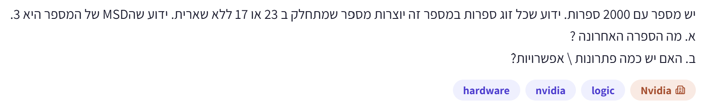
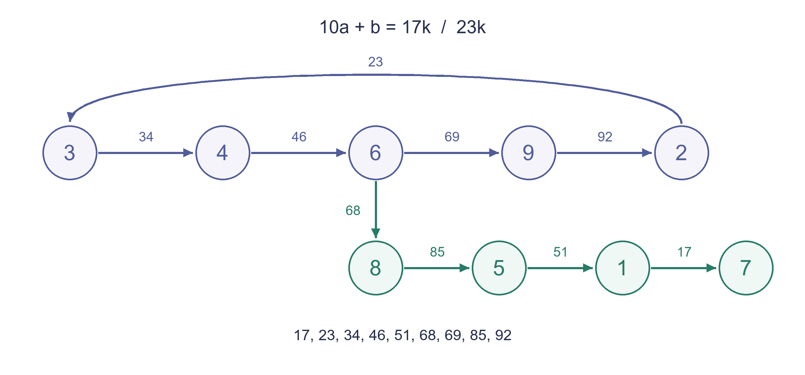

# PREP-038 — מספר בן 2,000 ספרות עם זוגות שמתחלקים ב־17 או ב־23

נקלטה ב־18 באוקטובר 2026. מקור: צילום שסופק בשיחה; ייחוס ל־NVIDIA לפי התגיות בלבד, לא אומת עצמאית. פתרון בסיוע AI, בביקורת מקצועית. קושי אינו מכויל. רלוונטיות בינונית להכנה לתפקיד: היגיון, מידול ובדיקת גבולות; לא נושא ליבה ייעודי לוולידציה.

## מקור ללא שינוי



יש מספר עם 2000 ספרות. ידוע שכל זוג ספרות במספר הן יוצרות מספר שמתחלק ב 23 או 17 ללא שארית. ידוע שהMSD של המספר היא 3.
א. מה הספרה האחרונה?
ב. האם יש כמה פתרונות \ אפשרויות?

## נוסח לאתר

נתון מספר עשרוני חיובי בן 2,000 ספרות. הספרה המשמעותית ביותר שלו, `MSD (Most Significant Digit)`, היא `3`.

כל זוג ספרות סמוכות במספר, לפי סדר הופעתן משמאל לימין, יוצר מספר דו־ספרתי שמתחלק ב־`17` או ב־`23` ללא שארית. הזוגות חופפים: הספרות במקומות 1–2, אחריהן 2–3, וכן הלאה.

א. אילו ערכים יכולה לקבל הספרה האחרונה?

ב. כמה מספרים בני 2,000 ספרות מקיימים את התנאים? נמקו מדוע הרשימה מלאה.

## רמזים

1. אין צורך לכתוב מספר עם אלפי ספרות. התחילו ברשימה הקצרה של כל המספרים הדו־ספרתיים שמתחלקים ב־17 או ב־23.
2. שני זוגות סמוכים חולקים ספרה. אם זוג מסתיים בספרה מסוימת, הזוג הבא חייב להתחיל בה. שרטטו אילו ספרות יכולות להגיע אחרי כל ספרה, החל מ־3.
3. חפשו מסלול מחזורי ומסלול שאי אפשר להמשיך בו לעד. מספרו את המקומות החל מ־1 ובדקו מתי אפשר לצאת מהמחזור ועדיין להגיע בדיוק למקום 2,000.

## הצעה לפתרון

### מבהירים את התנאי

הפתרון הראשי מתייחס לזוגות סמוכים וחופפים, בסדר משמאל לימין. התנאי הוא על כל זוג בנפרד; אין דרישה שכל המספר בן 2,000 הספרות יתחלק ב־17 או ב־23.

### 1. מקטינים את הבעיה לרשימה קצרה

לא מחפשים מספר ענק. מספיק לדעת אילו זוגות ספרות מותרים:

```text
17: 17, 34, 51, 68, 85
23: 23, 46, 69, 92
```

זוהי הרשימה המלאה של הכפולות החיוביות בעלות שתי ספרות. התנאי ״או״ אינו משנה כאן אם מפרשים אותו ככולל או כבלעדי: אין מספר דו־ספרתי שמתחלק בשניהם, כי הכפולה המשותפת הקטנה ביותר היא `391`.

### 2. חופפים את הזוגות ומתקדמים ספרה אחת בכל פעם

אם מתחילים ב־`3`, הזוג הראשון חייב להיות `34`. כעת הספרה האחרונה היא `4`, ולכן הזוג הבא חייב להתחיל בה: רק `46` מתאים. לכן ההתחלה מוכרחת להיות `346`.

לפי אותו רעיון מתקבלות כל האפשרויות:

| הספרה הנוכחית | הספרה הבאה המותרת |
|---|---|
| 3 | 4 |
| 4 | 6 |
| 6 | 9 או 8 |
| 9 | 2 |
| 2 | 3 |
| 8 | 5 |
| 5 | 1 |
| 1 | 7 |
| 7 | אין המשך |

אין מעבר שמגיע ל־`0`, ולכן הוא אינו יכול להופיע במספר הזה. לא צריך לשער זאת מראש: זה נובע מהרשימה.

```text
cycle: 3 -> 4 -> 6 -> 9 -> 2 -> 3
exit:            6 -> 8 -> 5 -> 1 -> 7 -> stop
```

ההסתעפות היחידה היא אחרי `6`. אפשר להישאר במחזור, או לצאת למסלול שמסתיים אחרי ארבע ספרות נוספות. ברגע שיוצאים אי אפשר לחזור.

### 3. נשארים במחזור עד סוף המספר

הספרות במחזור חוזרות בקבוצות של חמש:

```text
position: 1 2 3 4 5 | 6 7 8 9 10 | ...
digit:    3 4 6 9 2 | 3 4 6 9  2 | ...
```

`2000 = 5 * 400`, ולכן אם לא יוצאים מהמחזור, הספרה האחרונה היא `2`. המספר כולו נקבע: הבלוק `34692` חוזר 400 פעמים.

### 4. האם אפשר לצאת מהמחזור לקראת הסוף?

כאן קל לפספס אפשרות. למסלול היציאה מותר להסתיים בכל אחת מהספרות `8, 5, 1, 7`; אין חובה להגיע דווקא ל־`7`. אבל אם מגיעים אליה לפני המקום האחרון, המספר אינו יכול להימשך.

הספרה `6` מופיעה במחזור במקומות `3 + 5k`, כאשר `k` הוא מספר שלם לא שלילי. אחרי יציאה ממקום כזה אפשר להוסיף לכל היותר ארבע ספרות. לכן, אם יוצאים במספר בן 2,000 ספרות, חייב להתקיים:

```text
1 <= 2000 - (3 + 5k) <= 4
```

ההפרש חייב להיות בין 1 ל־4, ובו בזמן הוא שקול ל־2 מודולו 5. האפשרות היחידה היא `2`: יוצאים מה־`6` שבמקום `1998`, מוסיפים `8` במקום `1999` ואז `5` במקום `2000`.

יציאה מוקדמת יותר אינה אפשרית: ה־`6` הקודמת נמצאת במקום `1993`, וממנה מגיעים ל־`7` כבר במקום `1997`, בלי דרך להוסיף שלוש ספרות נוספות. כל יציאה מוקדמת ממנה נתקעת אף מוקדם יותר.

### התשובות לשני הסעיפים

**א. הספרה האחרונה יכולה להיות `2` או `5`; היא אינה נקבעת באופן יחיד.**

**ב. יש בדיוק שני מספרים שונים בני 2,000 ספרות, אחד לכל ספרה אחרונה:**

```python
first  = "34692" * 400
second = "34692" * 399 + "34685"
```

הכוכבית כאן מציינת חזרה של מחרוזת, ולא כפל של הערך המספרי. בכל אחד מהמספרים יש בדיוק 2,000 ספרות. בזוגות שעל גבול בלוקים מופיע `23`, שגם הוא מותר. במקרה השני הסיום מכיל את הזוגות `34, 46, 68, 85`.

### למה אלה כל הפתרונות?

רשימת הזוגות ממצה, ולכן כל מספר תקין מתאים למסלול בתרשים. עד היציאה האפשרית, כל הצעדים מוכרחים מלבד הבחירה היחידה אחרי `6`. מסלול תקין באורך המבוקש או שאינו יוצא כלל, או שיוצא פעם אחת. הראינו שרק יציאה במקום `1998` מספיקה להגיע בדיוק לסוף. בכל אחת משתי האפשרויות כל הספרות נקבעות, ולכן אין מספרים נוספים, גם לא כאלה עם אותה ספרה אחרונה.

### אימות וסיבוכיות

אפשר לבדוק את התוצאה גם בלי ליצור מספר גדול: שומרים לכל ספרה את מספר הקידומות התקינות שמסתיימות בה, ומעבירים את הספירות לפי תשעת הזוגות המותרים. אחרי 1,999 מעברים מתקבלות שתי קידומות באורך 2,000, אחת שמסתיימת ב־2 ואחת ב־5. הקוד המצורף מממש זאת.

לבעיה הזו הנימוק המחזורי דורש מספר קבוע של צעדים חשבוניים, במודל שבו חשבון על האורך הוא פעולה אחת; כתיבת מספר בן `n` ספרות דורשת לפחות `Omega(n)` תווים. מימוש הספירה המצורף משתמש ב־`O(n)` צעדי מעבר ובעשר ספירות בלבד. אין כאן טענה למינימום זיכרון או זמן תחת כל מודל חישוב; אם האורך עצמו אינו נכנס למילת מכונה, גם לחשבון עליו יש עלות ביטים.

### אם המרצה התכוון לפירוש אחר

אם ״כל זוג״ פירושו כל שני מקומות, גם לא סמוכים, בסדר הופעתם: **אין פתרון** אפילו באורך 3 שמתחיל ב־3. כל ספרה שאחרי ה־3 חייבת להיות 4, אבל שתי הספרות הבאות יוצרות `44`, שאינו מתחלק ב־17 או ב־23.

אם מחלקים לזוגות נפרדים בלבד — מקומות 1–2, אחריהם 3–4 וכן הלאה — זו שאלה אחרת: הזוג הראשון הוא `34`, וכל אחד מ־999 הזוגות הנותרים יכול להיות אחד מתשעת הזוגות. יש `9**999` מספרים, והספרה האחרונה יכולה להיות כל אחת מהספרות 1–9. לכן חשוב לברר שהכוונה לזוגות **סמוכים וחופפים**.



[קוד ספירה בפייתון](../solutions/prep_038_adjacent_digits.py) · [בדיקה עצמאית](../checks/check_prep_038.py) · [תוצאות האימות](../checks/prep-038-verification.json)

## תשובה קצרה לראיון

ארשום את תשע הכפולות הדו־ספרתיות ואחפוף זוגות סמוכים. מ־3 מתקבל המחזור `3→4→6→9→2→3`, עם יציאה מ־6 למסלול `8→5→1→7` שאין ממנו חזרה. הישארות במחזור לאורך 2,000 ספרות נותנת סיום ב־2. אפשר לצאת רק מה־6 במקום 1998 ולהוסיף 85, ולכן יש גם סיום ב־5. כל יתר הבחירות מוכרחות: בדיוק שני מספרים. אבהיר מראש שהזוגות סמוכים וחופפים.

## שאלת המשך

שאלת המשך מוכנה: מה משתנה אם אורך המספר הוא `n` במקום 2,000? כיוון: הספרה במחזור היא האיבר במקום `((n-1) mod 5)` ברשימה `[3,4,6,9,2]`. עבור `n>=4` יש גם סיום אחד במסלול היציאה אם `(n-3) mod 5` הוא 1, 2, 3 או 4; הסיום הוא בהתאמה 8, 5, 1 או 7. כש־`n mod 5 = 3` יש רק מספר אחד. האורכים 1–3 מוכרחים: 3, 34, 346. ההמשך בודק ספירת מקומות ומחזוריות. זהו תוכן מוכן בארכיון, שטרם חובר לתור שאלות ההמשך האינטראקטיבי.

## English website copy

A positive decimal integer has 2,000 digits. Its `MSD (Most Significant Digit)` is `3`.

Every pair of adjacent digits, read in their original left-to-right order, forms a two-digit number divisible by `17` or `23`. Pairs overlap: positions 1–2, then 2–3, and so on.

a. Which values can the last digit take?

b. How many 2,000-digit integers meet the conditions? Justify completeness.

### Hints

1. Do not write thousands of digits. First list all two-digit multiples of 17 or 23.
2. Consecutive pairs share a digit: the next pair must start with the final digit of the previous pair. Draw the possible next digits, starting from 3.
3. Find a repeating route and a route that eventually stops. Number positions from 1, and determine when an exit from the cycle can still reach exactly position 2,000.

## Proposed solution

### Clarify the rule

The main solution uses overlapping adjacent pairs in left-to-right order. Each pair must be divisible by 17 or 23; the whole 2,000-digit integer need not be divisible by either.

### 1. Replace a huge integer with a short list

All positive two-digit multiples are:

```text
17: 17, 34, 51, 68, 85
23: 23, 46, 69, 92
```

The list is exhaustive. Inclusive versus exclusive “or” makes no difference here: the least common multiple is 391, so no two-digit number is divisible by both.

### 2. Overlap consecutive pairs

Starting at 3 forces pair 34. Its last digit is 4, so the next pair must start at 4: only 46 fits. The prefix is therefore 346. Applying the same rule gives:

| Current digit | Allowed next digit |
|---|---|
| 3 | 4 |
| 4 | 6 |
| 6 | 9 or 8 |
| 9 | 2 |
| 2 | 3 |
| 8 | 5 |
| 5 | 1 |
| 1 | 7 |
| 7 | None |

No allowed pair reaches 0, so zero cannot occur in a number starting at 3.

```text
cycle: 3 -> 4 -> 6 -> 9 -> 2 -> 3
exit:            6 -> 8 -> 5 -> 1 -> 7 -> stop
```

The only choice occurs after 6. Staying in the cycle allows indefinite continuation; leaving it allows at most four additional digits and never returns to the cycle.

### 3. Stay in the cycle

```text
position: 1 2 3 4 5 | 6 7 8 9 10 | ...
digit:    3 4 6 9 2 | 3 4 6 9  2 | ...
```

Since `2000 = 5 * 400`, staying throughout ends at 2. Every digit is fixed: repeat block 34692 exactly 400 times.

### 4. Can the route leave near the end?

A valid finite number may stop at any digit of the exit route: 8, 5, 1 or 7. It need not reach 7, but reaching 7 before the last position makes further continuation impossible.

On the cycle, digit 6 occupies positions `3 + 5k` for nonnegative integers k. Leaving there must add between one and four digits to reach position 2,000:

```text
1 <= 2000 - (3 + 5k) <= 4
```

The difference is congruent to 2 modulo 5, so the only possible difference is 2. Leave the 6 at position 1998, append 8 at position 1999, then 5 at position 2000.

Leaving the preceding 6 at position 1993 already reaches 7 at position 1997, with no way to add the remaining three digits. Any earlier exit stops earlier still.

### Answers and explicit witnesses

**a. The last digit can be 2 or 5; it is not uniquely determined.**

**b. Exactly two 2,000-digit integers satisfy the conditions, one per final digit:**

```python
first  = "34692" * 400
second = "34692" * 399 + "34685"
```

Here `*` repeats a string rather than multiplying its numerical value. Both strings have length 2,000 and begin with 3. A block boundary produces pair 23, which is allowed. The second number ends with pairs 34, 46, 68, 85.

### Completeness proof

The pair list is exhaustive, so every valid number traces a route in the digit graph. All moves before a possible exit are forced except the choice after 6. A route of the required length either never exits or exits once. Only an exit at position 1998 can reach exactly position 2000. In each case every digit is determined; therefore there are exactly two numbers, not merely two witnessed endings.

### Verification and complexity

An independent implementation counts valid prefixes by their last digit, propagating ten counters along the nine legal pairs. After 1,999 transitions it gives one length-2,000 prefix ending at 2 and one ending at 5. The attached Python solution implements this without constructing a huge integer.

For this fixed graph, the cycle argument needs a constant number of arithmetic operations when the length fits a machine word. Writing an n-digit answer still requires Omega(n) output characters. The attached counting algorithm uses O(n) transition rounds and ten counters. This is not a universal minimum-time or minimum-memory claim; arithmetic on an arbitrarily large encoded length has a bit cost too.

### Other possible readings of the source

If “every pair” means every pair of positions, including nonadjacent positions in original order, there is **no solution**, even of length three starting at 3. Every following digit would have to be 4 to make pair 34 with the first 3, but the next two digits would form forbidden pair 44.

If the integer is split into disjoint two-digit blocks only, the first block is 34 and each remaining block is any of the nine legal pairs. This different problem has `9**999` length-2,000 numbers, and the last digit can be any of 1 through 9. Clarify overlapping adjacency before solving.

### Interview answer

List the nine legal two-digit multiples and overlap pairs. Starting at 3 gives cycle `3→4→6→9→2→3`, with a one-way exit from 6 through `8→5→1→7`. Staying for 2,000 digits ends at 2. The only feasible exit is from position 1998, appending 85 and ending at 5. All other moves are forced, so exactly two numbers exist. First clarify that pairs overlap and are adjacent.

### Follow-up

Prepared follow-up: what changes for length n? Direction: the cycle ending is element `((n-1) mod 5)` of `[3,4,6,9,2]`. For `n>=4`, an additional exit ending exists when `(n-3) mod 5` is 1, 2, 3 or 4, giving 8, 5, 1 or 7 respectively. When `n mod 5 = 3` there is only one number. Lengths 1–3 are forced: 3, 34, 346. This tests indexing and periodicity. Prepared archive content only; not wired into the interactive follow-up queue.

## שילוב באתר ואימות בפועל — 18 באוקטובר 2026

- מזהה קבוע: `PREP-038`. מפתח אתר: `prep-two-thousand-digits-adjacent-multiples`.
- נוספה שאלה אחת בלבד למסד המאומת. מזהה הרשומה: `b5234227-2f8d-4687-8d2b-e18046c27e19`. כל תוכן השאלות הקודמות, התרגומים והקישורים למיומנויות נשמרו; אין כתיבה להתקדמות משתמשים.
- המאגר מכיל כעת 38 שאלות הכנה ו־68 שאלות בסך הכול. המצב באתר הוא פיילוט (`trial`), ובארכיון `in_review`: זהו פתרון מוצע בסיוע AI, בלי אישור מומחה ובלי זכאות להערכת שליטה או לניקוד תחרותי.
- נשמר גיבוי לפני ההוספה מחוץ לגיט. שלושת הקבצים החדשים הועלו לאחסון פרטי ואומתו לפי גיבוב. צילום המקור נשאר מחוץ לתצוגת הלומדים; התרשים והקוד נחשפים לאחר חשיפת פתרון מורשית.
- קריאה חוזרת מהמסד התאימה בדיוק ל־27 שדות השאלה, לשני התרגומים, לשלושה רמזים בכל שפה ולקישור המיומנות.
- עברו 58 בדיקות שרת ממוקדות ובדיקת הקטלוג והייבוא. 346 בדיקות דפדפן מקומיות לכל 38 השאלות ועוד 13 בדיקות ממוקדות לשאלה החדשה: שתי שפות, פתיחת הסברים, החלפת שפה וחלון טלפון מדומה, ללא שגיאות. תצוגת השאלה נבדקה גם בתמונות מסך. ראיות מקומיות תחת `.impeccable/review/prep-038-intake/` (תיקייה מוחרגת מגיט).
- היקף בדיקת הדפדפן: רכיבי התצוגה האמיתיים בסביבה מקומית מבודדת. לא בוצעה בדיקת לחיצות בחשבון חי ולא נבדק טלפון פיזי.
- לבדיקה ידנית: היכנסו לאתר, לחצו ״מאגר״, חפשו ״זוגות״ ופתחו את השאלה ״מספר בן 2,000 ספרות עם זוגות שמתחלקים ב־17 או ב־23״. בדקו את הבהרת הסמיכות, תגית NVIDIA ושלושת הרמזים. חשפו במפורש את הפתרון, פתחו את התרשים והקוד ואת סעיפי ההסבר. החליפו לאנגלית כאשר הסעיפים פתוחים ובדקו שכל התוכן מתחלף, ואז חזרו לעברית. פתרון מלא מוצג בשיחה רק לפי בקשה.
- שאלת ההמשך הכללית לפי אורך n מוכנה בארכיון בשתי השפות, אך עדיין אינה מחוברת לתור ההמשך האינטראקטיבי.

## הבהרת ניסוח שאושרה בשיחה

ב־18 באוקטובר 2026 הראל אישר במפורש זוגות ספרות סמוכות וביקש להרחיב את הקיצור בנוסח השאלה ל־`MSD (Most Significant Digit)`. הנוסח ללומדים עודכן בעברית ובאנגלית באמצעות שכבת העריכה. ההבהרה ההיסטורית נשמרת בפתרון ובארכיון; צילום המקור ונוסח המקור לא שונו. מזהה השאלה, הפתרון, הרמזים, מצב הביקורת ונתוני התרגול נשמרים.


## מקור נוסף — 21.10.2026

נשמר [צילום דיווח נוסף](../sources/prep-038-additional-2026-10-21-1.png), עם תגיות מקור logic, nvidia, actelis-networks. הנוסח, הרמזים והפתרון המוצע הקיימים נשמרו. הדיווח אינו אימות עצמאי לשיוך לחברה.
