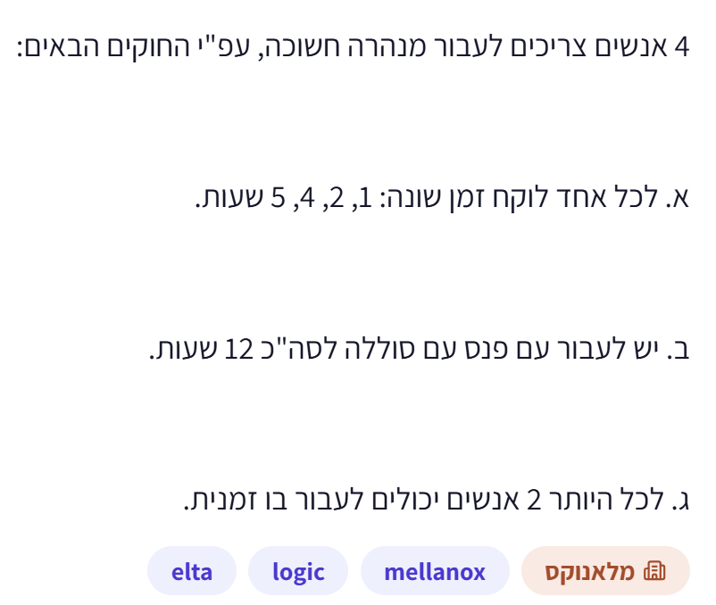
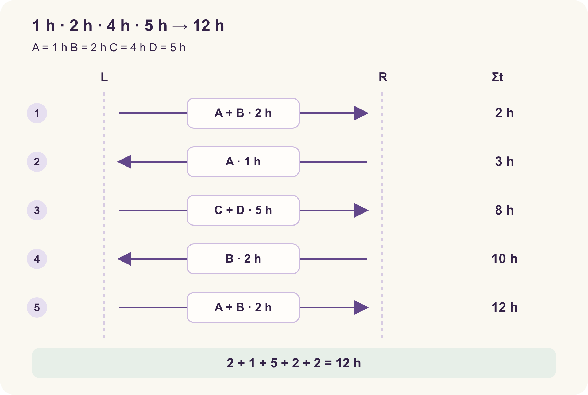

# PREP-039 — ארבעה אנשים, מנהרה ופנס ל־12 שעות

נקלטה ב־18 באוקטובר 2026. פתרון מוצע בסיוע AI, ממתין לסקירה מקצועית. קושי אינו מכויל. חברות לפי צילום המקור בלבד, ללא אימות עצמאי: Elta, Mellanox.

## מקור ללא שינוי



4 אנשים צריכים לעבור מנהרה חשוכה, עפ״י החוקים הבאים:
א. לכל אחד לוקח זמן שונה: 1, 2, 4, 5 שעות.
ב. יש לעבור עם פנס עם סוללה לסה״כ 12 שעות.
ג. לכל היותר 2 אנשים יכולים לעבור בו זמנית.

## נוסח השאלה לאתר

ארבעה אנשים צריכים לעבור מנהרה חשוכה. זמן המעבר של כל אחד הוא 1, 2, 4 או 5 שעות. יש פנס אחד שסוללתו מספיקה ל־12 שעות, ולכל היותר שני אנשים יכולים לעבור במנהרה בו־זמנית.

מצאו סדר מעברים שמביא את כל הארבעה לצד השני בזמן חיי הסוללה. מהו הזמן המינימלי, ומדוע אי אפשר בפחות?

הבהרות שנוספו לעריכה: כולם והפנס מתחילים באותו צד. כל מעבר, גם חזרה, דורש את הפנס ומחויב בזמן. זוג נע בקצב האיטי מבין השניים; אדם יחיד נע בזמן האישי שלו. אין מסירה או זריקה של הפנס בין הצדדים. הסוללה אינה נטענת או מוחלפת, וזמן ההכנות והעברת הפנס בין אנשים זניח. אפשר להגיע בדיוק בתום 12 השעות.

### שלושה רמזים

1. אל תספרו רק את המעברים אל היעד: מי מחזיר את הפנס כדי לאפשר את המעבר הבא? בדקו קודם את הרעיון שבו האדם המהיר ביותר מלווה כל אחד.
2. כשהאנשים האיטיים עוברים בנפרד משלמים על שניהם. מה נחסך אם הם עוברים יחד, ומי יצטרך להמתין להם בצד היעד?
3. שלחו תחילה את שני המהירים. החזירו את המהיר ביותר והשאירו את השני ביעד. עכשיו בדקו מי חוצה עם מי ומי מחזיר את הפנס אחרי מעבר האיטיים.

## הצעה לפתרון

התוצאה: אפשר להעביר את כולם בתוך **12 שעות בדיוק**. זהו גם הזמן המינימלי לפי ההנחות המפורטות בשאלה. הפתרון המוצע עדיין ממתין לסקירה מקצועית.

### 1. מה קשה כאן?

לא מספיק לשלוח כל זוג לצד השני: הפנס צריך לחזור כדי לאפשר את המעבר הבא. נסמן את האנשים לפי זמנם: `A=1`, `B=2`, `C=4`, `D=5` שעות.

רעיון טבעי הוא לתת לאדם המהיר ביותר ללוות כל אדם אחר ולהחזיר את הפנס. כך נקבל `2+1+4+1+5=13` שעות, שעה אחת יותר מהסוללה. זו הצעה חוקית, אבל היא אינה מספיקה.

### 2. איך חוסכים את השעה?

כדאי ששני האיטיים יעברו **יחד**: הזוג של 4 ו־5 שעות משלם 5 שעות, במקום שתי הליכות נפרדות שעולות לפחות 4 ועוד 5.

אבל אם המהיר ביותר חוזר בכל פעם, אחרי המעבר של שני האיטיים אין בצד השני מחזיר מהיר. לכן קודם מעבירים את שני המהירים, מחזירים את האדם של שעה אחת, ומשאירים את האדם של שעתיים בצד היעד כדי שיוכל להחזיר את הפנס אחרי מעבר האיטיים.

### 3. סדר המעברים

| שלב | מי עובר | כיוון | משך בשעות | זמן מצטבר |
|---|---|---|---|---|
| 1 | A ו־B | מההתחלה אל היעד | 2 | 2 |
| 2 | A | מהיעד אל ההתחלה | 1 | 3 |
| 3 | C ו־D | מההתחלה אל היעד | 5 | 8 |
| 4 | B | מהיעד אל ההתחלה | 2 | 10 |
| 5 | A ו־B | מההתחלה אל היעד | 2 | 12 |

בכל מעבר יש לכל היותר שני אנשים והפנס נמצא עם העוברים. בסוף כל הארבעה נמצאים בצד היעד. סכום הזמנים הוא:

```text
2 + 1 + 5 + 2 + 2 = 12
```

מותר להגיע בדיוק ברגע שבו הסוללה נגמרת; לכן 12 שעות מספיקות ללא מרווח ביטחון.

### 4. למה אי אפשר בפחות מ־12 שעות?

נוכיח חסם תחתון, ולא רק נראה שמצאנו סדר שנכנס בתקציב.

**אם אחד האיטיים חוזר אחורה:** האדם של 5 שעות צריך אז לפחות שלושה מעברים, שעולים לפחות 15 שעות. אם האדם של 4 שעות חוזר, שלושת מעבריו עולים לפחות 12. גם האדם של 5 צריך לעבור: אם הוא נמצא באחד משלושת המעברים, אותו מעבר עולה לפחות 5 במקום 4, ולכן הסכום לפחות 13; אם הוא עובר בנפרד, הסכום גדול עוד יותר. לכן פתרון קצר מ־12 לא יכול לכלול חזרה של אחד האיטיים.

כעת נותרו שני מקרים, כאשר האיטיים אינם חוזרים:

1. **האיטיים עוברים בנפרד.** שני מעברי הלוך עולים לפחות 4 ועוד 5 שעות. כדי להעביר ארבעה אנשים עם פנס אחד וקיבולת של שניים נדרשים לפחות שלושה מעברי הלוך ושתי חזרות: אחרי שני מעברי הלוך וחזרה אחת, לכל היותר שלושה אנשים יכולים להיות ביעד. כל אחד משלושת המעברים הנוספים עולה לפחות שעה. לכן הזמן הכולל הוא לפחות `4+5+1+1+1=12` שעות.
2. **האיטיים עוברים יחד.** מעברם עולה לפחות 5. לפניו צריך להשאיר מהיר אחד ביעד ולהחזיר את הפנס עם המהיר האחר; אחרת, אחרי מעבר האיטיים לא יהיה אדם מהיר שיוכל להחזיר את הפנס לאדם שנותר בהתחלה. השגת מצב ההכנה מחייבת מעבר משותף של שני המהירים בעלות לפחות 2 וחזרה של אחד מהם. אחרי מעבר האיטיים, המהיר שהמתין ביעד חייב לחזור, ואז שני המהירים עוברים שוב יחד בעלות לפחות 2. כל אחד משני המהירים מחזיר את הפנס לפחות פעם אחת, בעלות כוללת לפחות `1+2`. לכן הזמן הכולל הוא לפחות `2+1+5+2+2=12` שעות. מעברים נוספים רק מוסיפים זמן חיובי.

מצאנו תוכנית של 12 שעות והוכחנו שאף תוכנית חוקית אינה מהירה יותר. לכן 12 הוא המינימום.

### 5. אימות עצמאי

קוד האימות מייצג מצב באמצעות הצד שבו נמצא כל אדם והצד של הפנס. לארבעה אנשים יש לכל היותר 32 מצבים. מעבר חוקי מעביר אדם אחד או שניים שנמצאים עם הפנס, ועלותו הזמן של האיטי מביניהם.

אלגוריתם דייקסטרה מצא מינימום 12. מודל נפרד, המייצג צדדים באמצעות רשימות סיביות ובונה את כל קשתות המצב באופן עצמאי, אימת זאת באמצעות בלמן–פורד. בנוסף נבדקה תעודת חסם תחתון על כל 112 המעברים החוקיים. זוהי בדיקה ממצה של המודל, לא ניסוי אקראי ולא בדיקת פנס פיזי.

החידה עצמה אינה דורשת לממש אלגוריתם: התשובה לראיון היא סדר המעברים וההסבר. הקוד המצורף הוא כלי אימות מדויק. עבור ארבעת האנשים הקבועים, הצגת חמשת המעברים דורשת זמן וזיכרון קבועים; חיפוש כללי על מספר משתנה של אנשים הוא מעריכי, ואינו מוצג כפתרון יעיל למקרה הכללי.

### הנחות והבהרות

- כל הארבעה והפנס מתחילים באותו צד; כולם צריכים לסיים בצד השני.

- הפנס חייב ללוות כל מעבר במנהרה, כולל חזרות; אין זריקה או מסירה בין הצדדים.

- במנהרה נמצאים לכל היותר שני אנשים בו־זמנית, וזוג מתקדם בזמן האיטי מביניהם. אין מעברי ביניים או החלפות בתוך המנהרה.

- זמן כל מעבר קבוע ודטרמיניסטי. הסוללה מספיקה ל־12 שעות פעילות, ללא החלפה או טעינה. אין זמן הכנה; לא ממתינים בין מעברים. לכן סכום זמני המעברים שווה לזמן שחלף גם אם הסוללה דולקת ברציפות.

- אפשר לסיים בדיוק ברגע שבו נגמרות 12 השעות. הבהרות אלה הן הנחות עריכה, ואינן כולן מופיעות במפורש בצילום המקור.

### נכונות ויעילות

המדד הוא זמן מצטבר עד שכל הארבעה הגיעו ליעד. התוכנית משיגה 12 שעות. ההוכחה בפתרון מחלקת את כל התוכניות לפי חזרה של אחד האיטיים ולפי מעבר האיטיים יחד או בנפרד, ומקבלת חסם תחתון 12. בנוסף נבדק חסם תחתון ממוחשב: לכל מצב ניתן ערך h, עם h(התחלה)=12 ו־h(סיום)=0; בכל אחד מ־112 המעברים מתקיים h(s)≤עלות(s,t)+h(t). חיבור האי־שוויונות לאורך כל תוכנית מוכיח שעלותה לפחות 12, בלי להגביל מראש את מספר המעברים.

### בדיקות שבוצעו

- הורצו בפועל פותר דייקסטרה, שחזור נפרד של המעברים ומודל בלמן–פורד עצמאי הבונה את כל קשתות המצב.

- במקרה המקור נבדקו כל 32 המצבים וכל 112 המעברים המכוונים החוקיים; תעודת החסם התחתון והמסלול בן חמשת המעברים מאשרים מינימום 12.

- נבדקו כל 209 וקטורי הזמנים הלא־יורדים באורך 1 עד 4 עם זמני מעבר 1 עד 6, ועוד שתי דוגמאות: 1,2,5,10 ושינוי סדר האנשים. בכל מקרה תוצאת דייקסטרה תאמה למודל הנפרד והמסלול הוחזר ונבדק.

- נדחו תשע תוכניות לא תקינות ושישה קלטי זמן לא חוקיים. אומת שהאסטרטגיה שבה האדם המהיר מלווה כל אחד בנפרד עולה 13. אלה בדיקות מודל מדויקות; לא בוצעו ניסוי פיזי או בדיקת חשבון באתר כחלק מהבדיקה הזאת.

### מקרי קצה

- תקציב של 11 שעות אינו מספיק לפי אותו מודל; 12 מספיק בדיוק.

- אם דורשים מרווח ביטחון חיובי לפני תום הסוללה, התוכנית אינה עומדת בדרישה הזאת.

- המתנה או כיבוי הפנס בין מעברים אינם מקצרים את 12 שעות ההליכה ההכרחיות. אם יש זמן הכנה חיובי או זמני מעבר לא ודאיים, צריך לתקצב אותם בנפרד.

- שינוי בקיבולת, זמן זוג שאינו זמן האיטי, פנס נוסף, מסירה בתוך המנהרה או מצב התחלתי אחר יוצרים בעיה אחרת; אין להחיל עליה אוטומטית את תשובת 12 השעות.

### טעויות נפוצות

- לשכוח את חזרת הפנס או להניח שפנס יכול לחזור לבדו.

- לדרוש שתמיד האדם המהיר ביותר יחזיר את הפנס; במקרה הזה ההחלטה הזאת עלולה לגרור 13 שעות.

- לחבר את זמני שני האנשים שעוברים יחד; זוג משלם את זמן האיטי, לא את הסכום.

- להציג תוכנית של 12 שעות כהוכחת מינימום בלי לשלול תוכניות מהירות יותר.

- לטעון שיש מרווח ביטחון: התוכנית צורכת את מלוא 12 השעות.

### תשובה קצרה לראיון

אשלח את בעלי זמני המעבר 1 ו־2 יחד, אחזיר את 1, אשלח את 4 ו־5 יחד, אחזיר את 2, ולבסוף אשלח את 1 ו־2 יחד. העלות היא 2+1+5+2+2=12 שעות. שני האיטיים חולקים מעבר אחד, והמהיר השני ממתין ביעד כדי להחזיר את הפנס. זה מינימלי: חזרה של איטי יקרה מדי, ובשני המקרים האחרים — האיטיים יחד או בנפרד — מתקבל חסם תחתון 12.

### הרחבות ושאלת המשך

שאלת המשך מוכנה, אך לא חוברה למנגנון שאלות ההמשך באתר: מה משתנה אם הזמנים הם 1,2,5,10 והתקציב הוא 17? כיוון לתשובה: אותו רעיון נותן 2+1+10+2+2=17, בעוד ליווי נפרד עם האדם המהיר עולה 19. הרחבה נוספת: למספר משתנה של אנשים, הגדירו מצב של צדדי האנשים והפנס והציעו חיפוש בעל עלויות חיוביות; הסבירו שמספר המצבים גדל מעריכית. ההרחבה בודקת העברת רעיון ומידול, ואינה חובה בפתרון המקורי.



## English question

Four people must cross a dark tunnel. Their individual crossing times are 1, 2, 4, and 5 hours. They have one torch whose battery lasts 12 hours, and at most two people may be in the tunnel at once.

Find a schedule that gets all four to the other side within the 12-hour battery life. What is the minimum elapsed time, and why can no schedule be faster?

Editorial clarifications: everybody and the torch start on the same side. Every crossing, including a return, requires the torch and counts toward elapsed time. A pair travels at the slower person's speed; a lone person takes their individual time. The torch cannot be thrown or passed between banks. Its battery cannot be recharged or replaced. Preparation and handing the torch between people take negligible time. Finishing exactly at 12 hours is allowed.

### Three progressive hints

1. Count the return trips as well: who brings the torch back for the next crossing? First examine the idea of letting the fastest person accompany each of the others.
2. Sending the slow people separately makes you pay for each of their crossing times. What can you save by sending them together, and who should be waiting at the destination?
3. Send the two fast people first. Bring the fastest back and leave the other at the destination. Now work out who crosses together and who returns the torch after the slow pair.

## Proposed solution

All four people can reach the other side in **exactly 12 hours**. Under the stated assumptions, 12 is also the minimum possible elapsed time. This proposed solution still awaits professional review.

### 1. What makes the puzzle difficult?

Sending pairs across is not enough: the torch must return before another trip can begin. Label the people by their times: `A=1`, `B=2`, `C=4`, and `D=5` hours.

A natural strategy lets the fastest person accompany each of the others and bring the torch back. This costs `2+1+4+1+5=13` hours, one hour beyond the battery. It is a valid schedule, but it misses the deadline.

### 2. Where can we save an hour?

Send the two slowest people **together**: the 4-hour and 5-hour pair costs 5 hours instead of two separate trips costing at least 4 and 5.

However, if the fastest person always returns, nobody fast will be waiting on the destination side after the slow pair crosses. First send both fast people across, return the 1-hour person, and leave the 2-hour person at the destination to bring the torch back after the slow pair.

### 3. The crossing schedule

| Step | Travellers | Direction | Duration in hours | Total |
|---|---|---|---|---|
| 1 | A and B | Start to destination | 2 | 2 |
| 2 | A | Destination to start | 1 | 3 |
| 3 | C and D | Start to destination | 5 | 8 |
| 4 | B | Destination to start | 2 | 10 |
| 5 | A and B | Start to destination | 2 | 12 |

Every trip has at most two people, the torch accompanies them, and all four finish at the destination. Total elapsed time is:

```text
2 + 1 + 5 + 2 + 2 = 12
```

Finishing exactly when the battery runs out is allowed, so 12 hours is sufficient, with no safety margin.

### 4. Why is less than 12 hours impossible?

We need a lower bound, not just a schedule that fits the budget.

**If either slow person returns:** the 5-hour person would need at least three crossings, costing at least 15 hours. If the 4-hour person returns, their three crossings cost at least 12. The 5-hour person must also cross: sharing one of those three trips raises its cost from at least 4 to at least 5, giving at least 13 overall; crossing separately costs even more. Therefore a schedule faster than 12 cannot return either slow person.

With neither slow person returning, two cases remain:

1. **The slow people cross separately.** Their two forward trips cost at least 4 and 5 hours. Moving four people with one torch and capacity two requires at least three forward trips and two returns: after two forward trips and one return, at most three people can be at the destination. Each of the remaining three trips costs at least one hour, so the total is at least `4+5+1+1+1=12`.
2. **The slow people cross together.** Their trip costs at least 5. Before it, one fast person must be left at the destination and the other must bring the torch back; otherwise no fast person could return the torch for anyone remaining at the start. Establishing this state requires both fast people to cross together, costing at least 2, and one to return. After the slow pair crosses, the fast person waiting at the destination must return, then both fast people cross together again, costing at least 2. Each fast person therefore returns at least once, costing at least `1+2` in total. The overall lower bound is `2+1+5+2+2=12`. Extra trips only add positive time.

The schedule achieves 12, and every legal schedule costs at least 12. Hence 12 is optimal.

### 5. Independent verification

The verification code records each person's bank and the torch's bank. Four people produce at most 32 states. Each legal transition moves one or two people who are beside the torch and costs their slowest crossing time.

Dijkstra finds an optimum of 12. A separate model represents positions as bit tuples, independently constructs all state transitions, and confirms the result using Bellman–Ford. A lower-bound certificate was also checked on all 112 legal directed transitions. This is exhaustive verification of the stated model, not random sampling or a physical torch experiment.

The interview puzzle does not require implementing a graph algorithm: the answer is the schedule and its reasoning. The attached code is an exact verification tool. For the fixed four-person instance, reporting the five trips takes constant time and space. Searching a varying number of people is exponential and is not presented as an efficient general-purpose solver.

### Assumptions and clarifications

- All four people and the torch start on the same side; everyone must finish on the other side.

- The torch accompanies every trip through the tunnel, including returns; it cannot be thrown or passed between banks.

- At most two people occupy the tunnel at once, and a pair takes the slower person's time. No intermediate handoffs or changes inside the tunnel are allowed.

- Crossing times are fixed and deterministic. The battery supplies 12 hours of use, without replacement or recharging. Preparation takes no time and the schedule never waits. Thus summed trip time also equals wall-clock time if the torch stays on continuously.

- Finishing exactly at 12 hours is allowed. These are editorial assumptions; the source screenshot does not state all of them explicitly.

### Correctness and efficiency

The objective is elapsed time until everyone reaches the destination. The witness achieves 12 hours. The solution's proof partitions schedules by whether a slow person returns and whether the slow people cross together, establishing a lower bound of 12. An additional exact certificate assigns h to every reachable state, with h(start)=12 and h(goal)=0, and checks h(s)≤cost(s,t)+h(t) on all 112 legal transitions. Summing these inequalities along any complete schedule proves a cost of at least 12 without assuming a fixed number of crossings.

### Verification performed

- Executed Dijkstra, a separate schedule replay, and an independent Bellman–Ford model that constructs every legal state transition.

- For the supplied instance, checked all 32 states and all 112 legal directed transitions. The lower-bound certificate and five-trip witness establish an optimum of 12.

- Checked all 209 nondecreasing crossing-time vectors of length 1 through 4 with values 1 through 6, plus two cases: 1,2,5,10 and a permutation of the supplied times. Every Dijkstra result matched the independent model and its returned schedule replayed successfully.

- Rejected nine invalid schedules and six invalid time inputs. Confirmed that the fastest-person shuttle strategy takes 13. These are exact model checks, not a physical experiment or an authenticated website test.

### Edge cases

- An 11-hour budget is insufficient under the same model; 12 is exactly sufficient.

- If a strictly positive safety margin before battery exhaustion is required, this schedule does not satisfy it.

- Waiting or switching the torch off between trips cannot reduce the required 12 hours of crossing. Positive preparation times or uncertain crossing times require separate budgeting.

- Changing capacity, pair speed, the number of torches, intermediate handoffs, or the initial distribution changes the problem; the 12-hour answer does not automatically apply.

### Common mistakes

- Forgetting a torch return or allowing it to return without a person.

- Insisting that the fastest person must return every time; here that choice can produce 13 hours.

- Adding the times of people crossing together; a pair takes the slower time, not their sum.

- Treating a 12-hour witness alone as proof of optimality without ruling out faster schedules.

- Claiming a safety margin: the schedule uses all 12 hours.

### Interview answer

Send 1 and 2 across, return 1, send 4 and 5 across together, return 2, then send 1 and 2 across. The cost is 2+1+5+2+2=12 hours. The slow people share one trip, while the second-fastest waits at the destination to return the torch. This is minimal: returning a slow person is already too expensive, and both remaining cases—slow people together or separately—give a lower bound of 12.

### Extensions and follow-up

Prepared follow-up, not connected to the website's interactive follow-up flow: what changes if the times are 1,2,5,10 and the budget is 17? Answer direction: the same structure costs 2+1+10+2+2=17, whereas escorting each person separately with the fastest costs 19. Further extension: for a varying number of people, define a state containing everyone's bank and the torch's bank, and propose a positive-weight shortest-path search; explain that the state count grows exponentially. This tests transfer and modelling and is not required for the original puzzle.


## קבצים ובדיקות

[prep_039_bridge_torch.py](../solutions/prep_039_bridge_torch.py) · [check_prep_039.py](../checks/check_prep_039.py) · [prep-039-verification.json](../checks/prep-039-verification.json)

שאלת ההמשך מוכנה בשתי השפות אך טרם חוברה לתור האינטראקטיבי. ההערכה המקצועית ורמת הקושי עדיין בביקורת; אין להעניק לשאלה זו ראיות שליטה או ניקוד תחרותי. שאלות חומרה אומתו במודל Python בלבד; אין בכך טענה לסימולציית HDL או לבדיקה פיזית.
