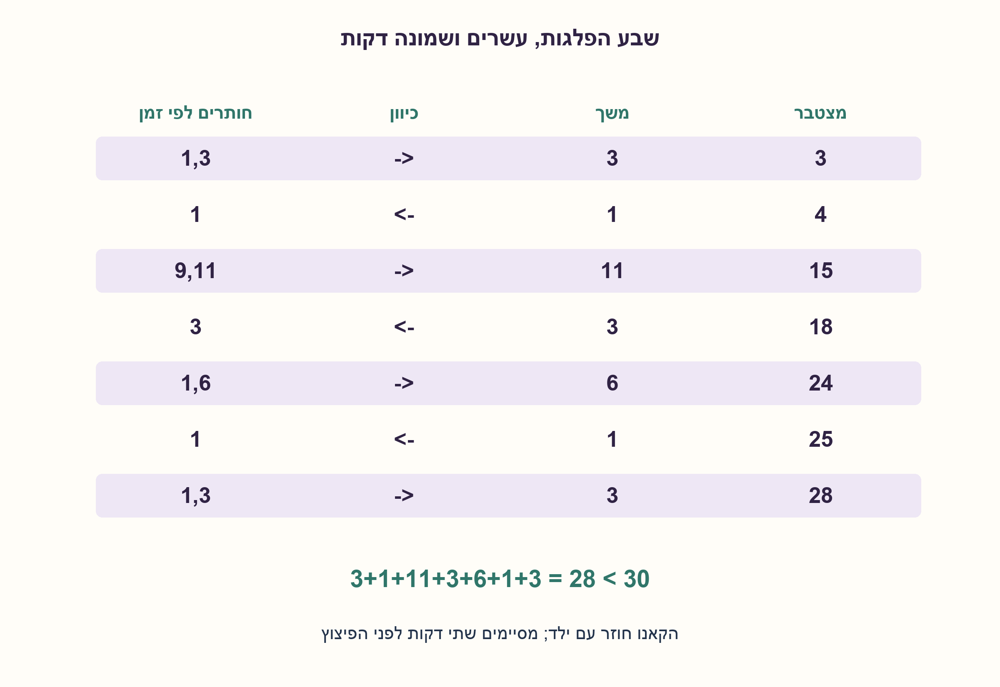
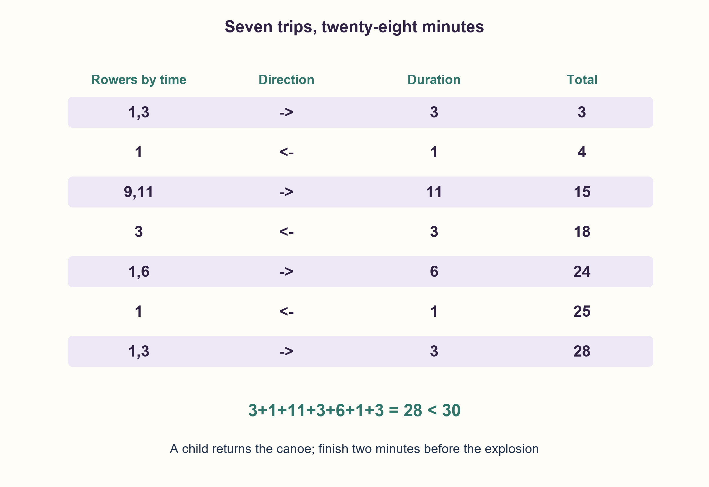

# PREP-039 — וריאציית קאנו / Canoe variant

פתרון מוצע בסיוע AI; ביקורת מקצועית ממתינה. המקור הישן נשמר.

[צילום מקור פרטי](../sources/2026-10-30-batch110-14.png)

בסכר בנהר האמזונס הוטמנה פצצה שתתפוצץ בעוד 30 דקות בדיוק. ישנם 5 ילדים בצד אחד במורד הסכר שחייבים לעבור לצד השני כדי להינצל. ברשותם קאנו אחד שיכול להעביר מינימום ילד אחד ומקסימום 2 ילדים. כששניים חותרים יחד זמן המעבר נקבע לפי האיטי מביניהם. זמני החתירה: 1,3,6,9,11. העבר את הילדים לפני פיצוץ הסכר.

## עברית

### וריאציה נוספת: חמישה ילדים וקאנו לפני פיצוץ הסכר
סכר יתפוצץ בעוד 30 דקות בדיוק. חמישה ילדים מתחילים באותה גדת נהר ועליהם להגיע לגדה השנייה לפני הפיצוץ. יש קאנו אחד, המכיל ילד אחד או שניים בכל הפלגה. זמני החתירה האישיים בדקות הם 1,3,6,9,11; זוג חותר בזמן האיטי מביניהם.

מצאו תוכנית שמביאה את כולם ליעד לפני הדקה ה־30, ובדקו את הזמן הכולל. אפשר גם לברר מהו המינימום.

הבהרות: הקאנו מתחיל עם הילדים, מלווה כל הפלגה וחייב לחזור עם ילד אחד לפחות כשנדרשת חזרה. אין אפשרות לשחות, לגרור קאנו ריק, להחליף חותרים באמצע או לבצע הפלגות מקבילות. הזמנים קבועים וזהים בשני הכיוונים; אין זמן הכנה או זרם נוסף. צריך לסיים בזמן קטן ממש מ־30, להבדיל מגרסת הפנס המקורית שמרשה סיום בדיוק בתקציב.

1. גם הקאנו צריך לחזור. מי צריך להימצא בגדה השנייה אחרי הפלגת שני הילדים האיטיים?
2. השתמשו בילדים של דקה ושלוש דקות כדי להעביר יחד את הילדים של 9 ו־11 דקות, בלי לחייב את אחד האיטיים לחזור.
3. 1 ו־3 עוברים, 1 חוזר, 9 ו־11 עוברים, 3 חוזר. כעת נשאר להעביר את 1,3,6; בדקו את כל שבע ההפלגות ואת הזמן המצטבר.

### חוסכים בכך שהאיטיים עוברים יחד
אם הילד של דקה ילווה כל אחד מהאחרים, העלות היא 3+1+6+1+9+1+11=32 דקות, מאוחר מדי. העברת שני האיטיים יחד חוסכת זמן, אבל צריך להשאיר חותר מהיר בגדה השנייה כדי שיחזיר אחריהם את הקאנו.

| שלב | זמני הילדים שמפליגים | כיוון | משך | מצטבר |
|---|---|---|---|---|
| 1 | 1,3 | אל היעד | 3 | 3 |
| 2 | 1 | חזרה | 1 | 4 |
| 3 | 9,11 | אל היעד | 11 | 15 |
| 4 | 3 | חזרה | 3 | 18 |
| 5 | 1,6 | אל היעד | 6 | 24 |
| 6 | 1 | חזרה | 1 | 25 |
| 7 | 1,3 | אל היעד | 3 | 28 |

כל הפלגה כוללת ילד אחד או שניים שנמצאים עם הקאנו, ובסיום כולם ביעד. העלות 3+1+11+3+6+1+3=28 דקות. יש מרווח של שתי דקות לפני הפיצוץ: 28<30. מרווח זה מניח שזמני העלייה והירידה זניחים; אין טענה לעמידות בכל עיכוב לא מוגדר.

### כיצד נבדק שזה גם המינימום במודל?
מצב שומר חמישה ביטים המציינים באיזו גדה כל ילד נמצא, ועוד ביט לצד הקאנו: לכל היותר 64 מצבים. קשת חוקית בוחרת ילד אחד או שניים שנמצאים עם הקאנו, מעבירה אותם ואת הקאנו, ומשלמת את זמן האיטי. כך ממודלים גם חזרות וגם תוכניות בעלות מספר הפלגות כלשהו.

נבנו כל 320 המעברים המכוונים, ודייקסטרה נתן מרחק מינימלי 28. מימוש נפרד של בלמן–פורד בכיוון ההפוך נתן לכל מצב נגיש פוטנציאל h של עלות ההגעה ליעד. אומתו h(התחלה)=28, h(יעד)=0, ובכל מעבר חוקי s→t בעלות w התקיים h(s)≤w+h(t). חיבור האי־שוויונות לאורך כל תוכנית חוקית מבטל את ערכי הביניים ומוכיח שעלותה לפחות 28, בלי להגביל מראש את מספר הפלגותיה. יחד עם התוכנית שלעיל מתקבל מינימום מדויק של 28 למודל הסופי, ולא רק תוצאה של חיפוש מקרי.

הקוד המוצג משחזר את התוכנית ובודק מיקום נוסעים, קיבולת, זמן וסיום. קוד הבדיקה הנפרד בונה את גרף המצבים ומוודא את החסם. עבור חמשת הילדים הקבועים התוכנית והמודל סופיים בגודל קבוע. כשמספר הילדים n משתנה, יש עד 2^(n+1) מצבים ו־O(n²·2^n) מעברים; חיפוש מלא הוא מעריכי ואינו מוצג כשיטת תכנון יעילה למספר גדול של ילדים.

תשובה בעל פה: אעביר תחילה 1 ו־3, אחזיר 1, אעביר יחד 9 ו־11, ואחזיר 3. נשארים 1,3,6; אעביר 1 ו־6, אחזיר 1 ואעביר 1 ו־3. הסכום 28 ולכן מסיימים לפני הדקה ה־30.

```python
"""A legal 28-minute witness for the five-child canoe variant.

The separate checker proves optimality with exhaustive shortest-path models.
"""

TIMES = (1, 3, 6, 9, 11)
SCHEDULE = ((0, 1), (0,), (3, 4), (1,), (0, 2), (0,), (0, 1))


def replay_schedule(times=TIMES, schedule=SCHEDULE):
    if not times or any(not isinstance(t, int) or t <= 0 for t in times):
        raise ValueError("Crossing times must be positive integers")
    destination = set()
    boat, elapsed = 0, 0
    timeline = []
    for travellers in schedule:
        if len(travellers) not in (1, 2) or len(set(travellers)) != len(travellers):
            raise ValueError("One or two different children must accompany the canoe")
        for child in travellers:
            if child not in range(len(times)) or (child in destination) != bool(boat):
                raise ValueError("A traveller is not on the canoe's bank")
        duration = max(times[child] for child in travellers)
        for child in travellers:
            if boat:
                destination.remove(child)
            else:
                destination.add(child)
        elapsed += duration
        timeline.append((boat, tuple(travellers), duration, elapsed))
        boat ^= 1
    if len(destination) != len(times):
        raise ValueError("The schedule leaves a child on the initial bank")
    return elapsed, timeline
```




## English

### Additional variant: five children and a canoe before the dam explodes
A dam will explode in exactly 30 minutes. Five children start on one riverbank and must reach the opposite bank before the explosion. One canoe carries either one or two children per trip. Their individual rowing times in minutes are 1,3,6,9,11; a pair takes the slower child's time.

Find a schedule that gets everybody across strictly before minute 30 and check its total time. The minimum time is an optional additional objective.

Clarifications: the canoe starts with the children, accompanies every crossing and must return with at least one child when a return is needed. No swimming, empty-canoe return, midriver handoff or parallel trips. Times are fixed and identical in both directions, with no preparation overhead or additional current. Finishing time must be strictly less than 30, unlike the original torch version which permits equality with its budget.

1. The canoe must return too. Who should already be waiting on the destination bank after the two slowest cross?
2. Use the 1- and 3-minute children to move the 9- and 11-minute pair together, without returning a slow child.
3. Send 1 and 3, return 1, send 9 and 11, return 3. Then transfer 1,3,6; check all seven trips and cumulative time.

### Save time by transporting the slow pair together
If the 1-minute child escorts everybody separately, the cost is 3+1+6+1+9+1+11=32 minutes, too late. Moving the two slowest together saves time, but a fast returner must already be waiting at the destination.

| Step | Travellers' times | Direction | Duration | Total |
|---|---|---|---|---|
| 1 | 1,3 | To destination | 3 | 3 |
| 2 | 1 | Return | 1 | 4 |
| 3 | 9,11 | To destination | 11 | 15 |
| 4 | 3 | Return | 3 | 18 |
| 5 | 1,6 | To destination | 6 | 24 |
| 6 | 1 | Return | 1 | 25 |
| 7 | 1,3 | To destination | 3 | 28 |

Every trip contains one or two children on the canoe's current bank, and all finish at the destination. The total is 3+1+11+3+6+1+3=28 minutes. There are two minutes before the explosion: 28<30. This margin assumes negligible embarkation overhead; it is not a promise against every unspecified delay.

### How is optimality checked in the model?
A state contains five bits for the children's banks and one for the canoe's bank: at most 64 states. A legal edge chooses one or two children beside the canoe, transfers them and the canoe, and charges the slower time. This models returns and schedules of any number of trips.

All 320 directed transitions were built, and Dijkstra found shortest distance 28. A separate reverse Bellman–Ford pass assigned each reachable state a potential h equal to its cost to the goal. Checks established h(start)=28, h(goal)=0 and h(s)≤w+h(t) on every legal edge s→t of cost w. Summing along any legal complete schedule cancels the intermediate potentials and lower-bounds its total by 28, without restricting its trip count. Together with the witness, this certifies an exact optimum of 28 for the finite model, rather than merely the best random trial.

The displayed code replays the schedule and checks location, capacity, cost and completion. The separate checker constructs the state graph and verifies the bound. At the fixed five-child instance the schedule and model have constant finite size. For variable n there are up to 2^(n+1) states and O(n²·2^n) transitions; exhaustive search is exponential, not advertised as efficient planning for many children.

Oral answer: send 1 and 3, return 1, send 9 and 11 together, return 3. Then send 1 and 6, return 1, and send 1 and 3. The total is 28, strictly before minute 30.

```python
"""A legal 28-minute witness for the five-child canoe variant.

The separate checker proves optimality with exhaustive shortest-path models.
"""

TIMES = (1, 3, 6, 9, 11)
SCHEDULE = ((0, 1), (0,), (3, 4), (1,), (0, 2), (0,), (0, 1))


def replay_schedule(times=TIMES, schedule=SCHEDULE):
    if not times or any(not isinstance(t, int) or t <= 0 for t in times):
        raise ValueError("Crossing times must be positive integers")
    destination = set()
    boat, elapsed = 0, 0
    timeline = []
    for travellers in schedule:
        if len(travellers) not in (1, 2) or len(set(travellers)) != len(travellers):
            raise ValueError("One or two different children must accompany the canoe")
        for child in travellers:
            if child not in range(len(times)) or (child in destination) != bool(boat):
                raise ValueError("A traveller is not on the canoe's bank")
        duration = max(times[child] for child in travellers)
        for child in travellers:
            if boat:
                destination.remove(child)
            else:
                destination.add(child)
        elapsed += duration
        timeline.append((boat, tuple(travellers), duration, elapsed))
        boat ^= 1
    if len(destination) != len(times):
        raise ValueError("The schedule leaves a child on the initial bank")
    return elapsed, timeline
```




## חומר משלים / Supporting material

```json
{
  "assumptions": {
    "he": [
      "וריאציית הקאנו: חמישה ילדים בזמנים 1,3,6,9,11 דקות; מתחילים יחד עם קאנו אחד בעל קיבולת 1–2.",
      "כל חזרה כוללת חותר; הזמן הוא המקסימום בין החותרים, ללא הכנות או זרם נוסף.",
      "צריך להגיע לפני 30 ממש, ולא בדיוק בדקה 30."
    ],
    "en": [
      "Canoe variant: five children with times 1,3,6,9,11 minutes, initially together with one canoe of capacity 1..2.",
      "Every return has a rower; cost is the slower rower's time, with no overhead or extra current.",
      "Arrival must be strictly before 30, not exactly at minute 30."
    ]
  },
  "optimality": {
    "he": "וריאציית הקאנו משיגה מינימום 28 דקות: תוכנית חוקית וחסם פוטנציאל מאומת על כל 320 המעברים. 28<30 נותן מרווח שתי דקות. זו הוכחה במודל זמנים קבועים, לא בדיקת שיט פיזית.",
    "en": "The canoe variant has optimum 28 minutes: a legal witness plus a potential lower-bound certificate checked on all 320 edges. 28<30 leaves two minutes. This is an exact fixed-time model, not a physical canoe test."
  },
  "verification": {
    "he": "נוספו בדיקת שחזור שבע ההפלגות, דייקסטרה ובלמן–פורד על 64 מצבים ו־320 קשתות. 62 מצבים נגישים; כל 320 אי־שוויונות החסם עברו. הסכומים המצטברים 3,4,15,18,24,25,28.",
    "en": "Added seven-trip replay, Dijkstra and Bellman–Ford over 64 states and 320 edges. 62 states are reachable; all 320 potential inequalities passed. Cumulative times are 3,4,15,18,24,25,28."
  },
  "edge_cases": {
    "he": [
      "תקציב של 28 בדיוק מספיק רק אם מותר שוויון; דרישה להגיע לפני 28 אינה אפשרית במודל.",
      "תוכנית שמסתיימת ב־30 אינה עומדת במועד שבצילום החדש.",
      "עיכובי עלייה וירידה נספרים בנפרד אם אינם זניחים."
    ],
    "en": [
      "A budget of exactly 28 is enough only when equality is allowed; strictly before 28 is impossible in this model.",
      "A schedule ending at 30 fails the new source deadline.",
      "Nonnegligible boarding delays require separate budgeting."
    ]
  },
  "common_mistakes": {
    "he": [
      "להחזיר קאנו בלי ילד או לשכוח אחת משלוש החזרות.",
      "להעתיק את תשובת 12 השעות של המנהרה לנתונים החדשים בדקות.",
      "לשלוח את המהיר עם כולם ולהסתפק ב־32 דקות.",
      "להציג מסלול של 28 בלבד כהוכחת מינימום בלי חסם."
    ],
    "en": [
      "Returning an empty canoe or omitting one of the three returns.",
      "Copying the original 12-hour torch result into the new minute-based instance.",
      "Escorting everybody with the fastest and accepting 32 minutes.",
      "Calling a 28-minute witness alone a proof of minimality."
    ]
  },
  "interview_answer": {
    "he": "בקאנו: 1,3 הלוך; 1 חזור; 9,11 הלוך; 3 חזור; 1,6 הלוך; 1 חזור; 1,3 הלוך. הסכום 28 דקות וקטן מ־30. האיטיים עוברים יחד והילד של 3 דקות מחזיר אחריהם את הקאנו.",
    "en": "For the canoe: 1,3 forward; 1 back; 9,11 forward; 3 back; 1,6 forward; 1 back; 1,3 forward. Total 28<30. The slow pair travels together and the 3-minute child returns their canoe."
  },
  "source_ambiguities": {
    "he": [
      "הצילום החדש מתאר חמישה ילדים וקאנו ומועד קשיח של פיצוץ; ההוספה נשמרת כווריאציה ולא מחליפה את שאלת המנהרה המקורית.",
      "אין פירוט לזרם, הכנות או עייפות; זמנים דטרמיניסטיים לשני הכיוונים הם הנחה גלויה."
    ],
    "en": [
      "The new screenshot has five children, a canoe and a strict explosion deadline. It is appended as a variant, without replacing the old tunnel problem.",
      "Current, overhead and fatigue are unspecified; deterministic bidirectional times are an explicit assumption."
    ]
  },
  "solution_extensions": {
    "he": [
      {
        "question": "אם כל הפלגה מוסיפה חצי דקה של הכנה, האם התוכנית עדיין עומדת במועד?",
        "answer_direction": "שבע הפלגות מוסיפות 3.5 דקות והתוכנית אורכת 31.5, ולכן אינה מספיקה. כדי להסיק על כל תוכנית צריך לשנות את משקלי הקשתות ולחשב מחדש.",
        "principle": "מרווח נמדד לפי כל הפעולות; אי־הצלחת תוכנית אחת אינה הוכחת אי־אפשרות."
      }
    ],
    "en": [
      {
        "question": "What if every trip adds half a minute of preparation?",
        "answer_direction": "Seven trips add 3.5 minutes, so this schedule becomes 31.5 and misses the deadline. To decide whether any schedule succeeds, change edge weights and solve again.",
        "principle": "Budget every operation; failure of one schedule is not an impossibility proof."
      }
    ]
  }
}
```
