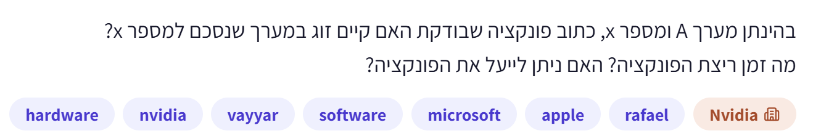
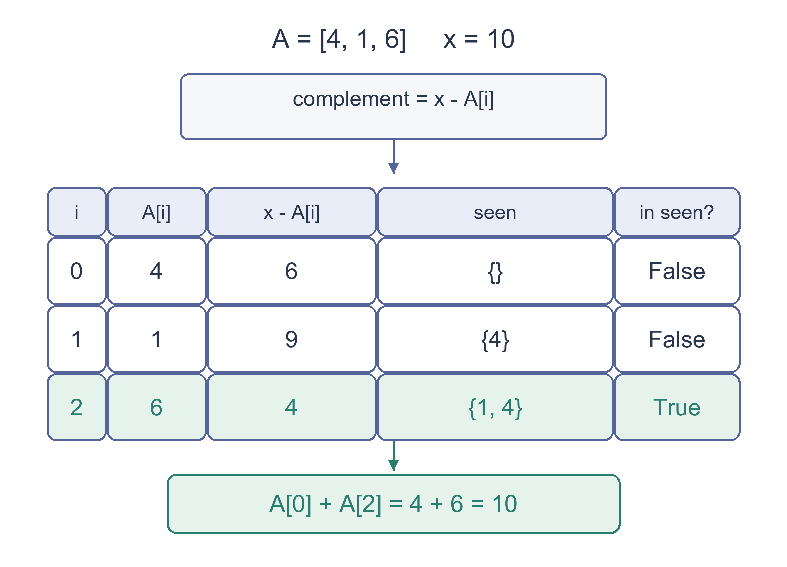

# PREP-040 — האם קיים במערך זוג שסכומו נתון?

נקלטה ב־18 באוקטובר 2026. פתרון מוצע בסיוע AI, ממתין לסקירה מקצועית. קושי אינו מכויל. חברות לפי צילום המקור בלבד, ללא אימות עצמאי: NVIDIA, Vayyar, Microsoft, Apple, Rafael.

## מקור ללא שינוי



בהינתן מערך A ומספר x, כתוב פונקציה שבודקת האם קיים זוג במערך שנסכם למספר x?
מה זמן ריצת הפונקציה? האם ניתן לייעל את הפונקציה?

## נוסח השאלה לאתר

נתונים מערך לא ממוין `A` של מספרים שלמים ומספר שלם `x`. כתבו פונקציה שמחזירה האם קיימים שני אינדקסים שונים `i` ו־`j` שעבורם `A[i] + A[j] == x`.

מותר שערכי שני האיברים יהיו שווים אם הם נמצאים במקומות שונים; אסור להשתמש באותו מופע פעמיים. אין צורך לשנות את המערך או להחזיר את הזוג עצמו.

א. הציעו פתרון פשוט ונתחו את זמן הריצה ואת זיכרון העזר.

ב. האם אפשר לשפר את זמן הריצה? הסבירו את הרעיון, את תנאי הניתוח ואת המחיר בזיכרון. אפשר להשתמש בזיכרון עזר.

הבהרות העריכה: המקור לא ציין שהמערך ממוין ולא הגדיר סוג מספרים. כאן מניחים מערך לא ממוין של שלמים; בניתוח הסיבוכיות יש לציין את הנחות המודל.

### שלושה רמזים

1. התחילו בפתרון שבודק כל זוג מקומות שונים. איזו עבודה הוא חוזר לבצע עבור כל איבר?
2. אם האיבר הנוכחי ידוע, איזה ערך מדויק צריך בן הזוג שלו לקבל? האם תוכלו לזכור אילו ערכים כבר הופיעו?
3. שמרו קבוצה של ערכים קודמים. חפשו בה את המשלים ליעד לפני הוספת האיבר הנוכחי. למה הסדר הזה נחוץ עבור `[6]` לעומת `[6, 6]` עם יעד `12`?

## הצעה לפתרון

**הצעה לפתרון**

נניח שהמערך אינו ממוין, שערכיו שלמים ושמותר להשתמש בזיכרון עזר. זוג פירושו שני מקומות שונים במערך: ערכים שווים מותרים אם הם מופיעים פעמיים. מבקשים תשובת אמת או שקר; אין צורך להחזיר את הזוג עצמו. נסמן את מספר האיברים ב־`n`.

**1. מתחילים מפתרון פשוט שקל לבדוק**

עבור כל איבר, בודקים אותו עם כל האיברים שאחריו. אם מצאנו זוג שסכומו היעד, מחזירים אמת. אם סיימנו את כל הזוגות בלי הצלחה, מחזירים שקר. התנאי `j > i` מבטיח שאין שימוש באותו מקום פעמיים, וגם אינו בודק כל זוג פעמיים.

```python
def has_pair_quadratic(values, target):
    for i in range(len(values)):
        for j in range(i + 1, len(values)):
            if values[i] + values[j] == target:
                return True
    return False
```

במקרה הגרוע נבדקים `n(n-1)/2` זוגות, ולכן הזמן ריבועי, `O(n²)`, וזיכרון העזר קבוע, `O(1)` מילים. חזרה מוקדמת יכולה לחסוך עבודה במקרה מסוים; היא אינה משנה את החסם במקרה הגרוע.

**2. מזהים איזו עבודה מיותרת**

אם האיבר הנוכחי הוא `value`, בן הזוג הדרוש ידוע בדיוק: `target - value`. במקום להשוות אותו שוב לכל האיברים הקודמים, נרצה לשאול במהירות: האם הערך המשלים כבר הופיע?

נשמור קבוצה של הערכים שכבר עברנו עליהם. בכל צעד נבדוק קודם אם הערך המשלים בקבוצה. אם כן, נמצא זוג. רק אם לא נמצא זוג, נוסיף את האיבר הנוכחי לקבוצה ונמשיך.

```python
def has_pair_sum(values, target):
    seen = set()
    for value in values:
        if target - value in seen:
            return True
        seen.add(value)
    return False
```

לדוגמה, עבור `[4, 1, 7, 3]` והיעד `8`: מתחילים מקבוצה ריקה. עבור `4`, המשלים `4` עדיין לא נשמר, ולכן מוסיפים `4`. עבור `1`, המשלים `7` עדיין לא נשמר, ולכן מוסיפים `1`. עבור `7`, המשלים `1` כבר נמצא בקבוצה, ולכן מחזירים אמת.

**למה בודקים לפני שמוסיפים?** עבור `[6]` ויעד `12`, אסור לחבר את האיבר היחיד לעצמו. כשהוא נבדק, הקבוצה עדיין ריקה ולכן התוצאה שקר. עבור `[6, 6]`, ה־`6` השני מוצא את הראשון שכבר נשמר, ולכן התוצאה אמת. קבוצה מספיקה לשאלת הקיום: אין צורך לשמור ספירה, כי סדר הבדיקה מבדיל בין המופע הנוכחי למופע הקודם.

**3. נימוק נכונות**

לפני בדיקת המקום `i`, הקבוצה מכילה בדיוק את הערכים במקומות שלפניו. אם נמצא בה `target - values[i]`, הוא שייך למקום מוקדם יותר, ולכן מדובר בשני מקומות שונים שסכומם היעד. בכיוון ההפוך, אם קיים זוג במקומות `p < q`, בזמן בדיקת `q` הערך שבמקום `p` כבר נשמר, ולכן יימצא זוג לכל המאוחר אז. אם הסריקה מסתיימת ללא התאמה, אין זוג חוקי.

**4. זמן וזיכרון**

לכל היותר קוראים `n` איברים. בהנחה שפעולות חיפוש והוספה בטבלת גיבוב אורכות זמן קבוע צפוי וממוצע על פני הפעולות, הזמן הכולל צפוי להיות `O(n)`. זיכרון העזר הוא `O(n)`, או באופן מדויק יותר לפי מספר הערכים השונים שנשמרו לפני העצירה. אין להבטיח זמן לינארי במקרה הגרוע: התנגשויות גיבוב רבות עלולות להביא לזמן ריבועי.

הניתוח סופר פעולות על מספרים בגודל מילה כפעולות קבועות. בפייתון אין גלישה של שלמים, אבל חיסור, חיבור וגיבוב של מספרים בעלי מספר ביטים בלתי מוגבל אינם בעלי עלות קבועה. קריאת קלט כללי עשויה לדרוש מספר לינארי של גישות לאיברים; זו הצדקה לסדר גודל לינארי בזמן צפוי במודל הרגיל, ולא טענה לזיכרון מינימלי או לזמן לינארי מובטח לכל גיבוב.

**5. חלופה בלי טבלת גיבוב: מיון ושני מצביעים**

ממיינים עותק של המערך. מצביע אחד מתחיל בערך הקטן ביותר והשני בגדול ביותר. אם סכומם קטן מהיעד, מזיזים את השמאלי ימינה: אין ערך שנותר בצד ימין שיכול להשלים את הערך השמאלי הנוכחי, כי אפילו הגדול ביותר אינו מספיק. אם הסכום גדול מהיעד, מזיזים את הימני שמאלה, מהסיבה הסימטרית. אם הסכום מתאים, מחזירים אמת. תנאי הלולאה הוא `left < right` כדי לשמור על שני מקומות שונים.

```python
def has_pair_sum_sorted(values, target):
    ordered = sorted(values)  # Copy; original input stays unchanged.
    left, right = 0, len(ordered) - 1
    while left < right:
        total = ordered[left] + ordered[right]
        if total == target:
            return True
        if total < target:
            left += 1
        else:
            right -= 1
    return False
```

המיון נותן זמן `O(n log n)` במקרה הגרוע והסריקה אחריו זמן `O(n)`. הקוד משתמש ב־`sorted`, שיוצר רשימה חדשה, ולכן זיכרון העזר בו `O(n)` והקלט המקורי נשמר. גם למיון של פייתון יכול להיות זיכרון עבודה לינארי; החלפה ב־`list.sort()` אינה מצדיקה טענה אוטומטית לזיכרון קבוע. אם מותר לשנות את הקלט, אפשר לבחור מיון במקום בעל זיכרון עזר קבוע, כמו מיון ערימה, ואחריו שני מצביעים. אם המערך כבר ממוין מראש, שני מצביעים נותנים `O(n)` זמן ו־`O(1)` זיכרון עזר, ללא מיון נוסף.

**הרחבה: אם מבקשים גם את המקומות המקוריים**

במקום קבוצה שומרים מילון מערך למקום קודם שבו הופיע. החיפוש עדיין מתבצע לפני ההכנסה.

```python
def pair_sum_indices(values, target):
    seen = {}
    for i, value in enumerate(values):
        complement = target - value
        if complement in seen:
            return seen[complement], i
        seen[value] = i
    return None
```

כל זוג חוקי מתקבל; אין דרישה לזוג מסוים או לכל הזוגות. כל הפונקציות המצורפות משאירות את הקלט המקורי ללא שינוי.

**תשובה קצרה לראיון:** אתחיל בשתי לולאות שבודקות כל זוג, בזמן ריבועי ובזיכרון קבוע. כדי לשפר, אעבור פעם אחת ואשמור ערכים שכבר ראיתי בקבוצת גיבוב. לכל איבר אחפש קודם את המשלים שלו ליעד, ורק אחר כך אוסיף אותו. כך אין שימוש באותו מופע פעמיים. הזמן צפוי להיות לינארי והזיכרון לינארי; מיון ושני מצביעים הם חלופה עם זמן `O(n log n)` שאינו תלוי בהנחת גיבוב.

אימות: ארבעת המימושים נבדקו ב־215,863 מקרי קלט ויעד מול אורקל עצמאי של זוגות אינדקסים, כולל בדיקה ממצה עבור כל המערכים באורכים 0–6 מעל הערכים `-2` עד `2` וכל יעד מ־`-5` עד `5`. נבדקו גם שליליים, כפילויות, מספרי פייתון גדולים, התנגשויות גיבוב ושמירת הקלט. זהו אימות תוכנה והצעת פתרון בסיוע AI; סקירה מקצועית עצמאית עדיין ממתינה.

### הנחות והבהרות

- הנחות עריכה: מערך לא ממוין של מספרים שלמים; קלט חסר איברים או בעל איבר יחיד מחזיר שקר.

- שני מקומות שונים נדרשים; ערכים זהים בשני מקומות שונים מותרים.

- נדרשת תשובת קיום בלבד. אין צורך להחזיר את כל הזוגות או לבחור זוג מסוים.

- זיכרון עזר מותר לשיפור זמן צפוי. המימושים שסופקו משאירים את הקלט המקורי ללא שינוי.

- חסמי הסיבוכיות מניחים פעולות על שלמים בגודל מילה. שלמים בלתי מוגבלים בפייתון אינם גולשים, אך לפעולות עליהם עלות התלויה באורך הייצוג.

### נכונות ויעילות

```json
{
  "criterion": "פשרה בין זמן ריצה לזיכרון עזר במערך כללי לא ממוין.",
  "result": "בדיקת כל הזוגות: זמן ריבועי במקרה הגרוע וזיכרון קבוע. קבוצת גיבוב: זמן לינארי צפוי וזיכרון לינארי. מיון ושני מצביעים: זמן O(n log n) במקרה הגרוע; הקוד משתמש בעותק ולכן בזיכרון לינארי.",
  "proof": "בחיפוש עם קבוצה נשמרים רק ערכים ממקומות קודמים; זוג במקומות p<q מתגלה כשהמקום המאוחר נבדק. בשני מצביעים המיון מאפשר לפסול ערך קטן מדי או גדול מדי בלי לאבד זוג אפשרי.",
  "scope": "אין הבטחת זמן לינארי במקרה הגרוע לטבלת גיבוב. אין טענה למינימום זיכרון מוחלט. אם המערך כבר ממוין, שני מצביעים לבדם נותנים זמן לינארי וזיכרון קבוע."
}
```

### בדיקות שבוצעו

```json
{
  "status": "עברו בדיקות תוכנה; סקירה מקצועית עצמאית ממתינה.",
  "method": "215,863 מקרי מערך ויעד מול אורקל עצמאי של צירופי שני אינדקסים. בכל מקרה נבדקו שלושה פתרונות קיום ופתרון המחזיר אינדקסים, כולל תקינות האינדקסים ושמירת הקלט.",
  "coverage": "214,841 מקרים ממצים: 19,531 מערכים באורכים 0–6 מעל חמישה ערכים, כפול 11 יעדים. בנוסף 16 מקרי גבול מפורשים, שני מקרי התנגשות גיבוב, 1,000 דגימות עם seed קבוע וארבעה מקרי קלט בלתי ניתן לשינוי.",
  "script_path": "checks/check_prep_040.py",
  "scope": "אימות פונקציונלי סופי ונדגם; נימוק הסיבוכיות נפרד. לא נערך מבחן ביצועים שמוכיח זמן ריצה ולא נרשם אישור מומחה."
}
```

### מקרי קצה

- מערך ריק או בעל איבר יחיד: אין שני אינדקסים שונים.

- `[6]`, יעד `12`: שקר; `[6, 6]`, יעד `12`: אמת.

- `[0]`, יעד `0`: שקר; `[0, 0]`, יעד `0`: אמת.

- מספרים שליליים ויעד שלילי מותרים: `[-8, -2, 4]` עם יעד `-10` מחזיר אמת.

- ייתכנו כמה זוגות חוקיים; מחזירים אמת עם הראשון שנמצא.

- יעד שלא ניתן להגיע אליו מחייב חזרה תקינה של שקר בסוף הסריקה.

- בפייתון שלמים גדולים אינם גולשים. במימוש בעל רוחב קבוע יש למנוע גלישה בחישוב סכום או משלים.

### טעויות נפוצות

- הכנסת הערך לקבוצה לפני החיפוש, שמאפשרת להשתמש במופע יחיד פעמיים.

- דחיית `[6, 6]` בטענה שקבוצה אינה שומרת כפילויות; חיפוש לפני הוספה כבר מבטיח מופע קודם נפרד.

- טענה שפעולת חיפוש ברשימה היא קבועה; שימוש ברשימה במקום בקבוצת גיבוב יכול להחזיר זמן ריבועי.

- הבטחת זמן לינארי במקרה הגרוע בלי הנחת גיבוב מתאימה.

- שימוש בשני מצביעים על מערך לא ממוין, או שכחת התנאי `left < right`.

- ייחוס זיכרון קבוע לקוד שיוצר עותק באמצעות `sorted`, או התעלמות מזיכרון העבודה של מיון פייתון.

- מיון ואז החזרת המקומות הממוינים כאילו היו האינדקסים המקוריים.

### תשובה קצרה לראיון

אתחיל בשתי לולאות על i<j, בזמן ריבועי ובזיכרון קבוע. כדי לשפר, אעבור פעם אחת עם קבוצה של ערכים קודמים. לכל ערך אחפש את המשלים ליעד לפני שאוסיף אותו, כך שאי אפשר להשתמש באותו מופע פעמיים. הזמן צפוי להיות לינארי והזיכרון לינארי בהנחות גיבוב רגילות; מיון ושני מצביעים הם חלופה בזמן O(n log n). אם מבקשים אינדקסים, אשמור מילון מערך לאינדקס קודם.

### הרחבות ושאלת המשך

```json
{
  "question": "אם נדרשים האינדקסים המקוריים של זוג חוקי במקום תשובת קיום, מה משנים? ומה אם המערך כבר ממוין ואסור זיכרון עזר לינארי?",
  "answer_outline": "למקומות המקוריים שומרים מילון מערך לאינדקס קודם ומחזירים את ההתאמה לפני הכנסת האיבר הנוכחי. במערך שכבר ממוין משתמשים בשני מצביעים בזמן לינארי ובזיכרון עזר קבוע, בתנאי שמבקשים זוג או קיום ולא את כל הזוגות.",
  "integration_status": "שאלת המשך מוכנה בתוכן הארכיון; חיבור לתהליך שאלות ההמשך החי טרם בוצע."
}
```

## English question

Given an unsorted integer array `A` and integer target `x`, write a function that returns whether two distinct indices `i` and `j` satisfy `A[i] + A[j] == x`.

Equal values at different positions are allowed; the same occurrence cannot be used twice. You need not modify the array or return the pair itself.

a. Give a straightforward solution and analyze its runtime and auxiliary storage.

b. Can the runtime be improved? Explain the idea, the assumptions behind the bound and the memory tradeoff. Auxiliary storage is permitted.

Editorial clarification: the source does not specify sortedness or numeric type. Here assume an unsorted integer array, and state the operation model used for complexity.

### Three progressive hints

1. Start by checking every pair of different positions. Which work is repeated for each element?
2. Given the current value, what exact value must its partner have? Could you remember which values have already appeared?
3. Keep a set of earlier values. Look for the complement before inserting the current value. Why does that order matter for `[6]` versus `[6, 6]` with target `12`?

## Proposed solution

**Proposed solution**

Assume an unsorted integer array and allow auxiliary storage. A pair uses two distinct array positions; equal values are allowed when they occur at different positions. The requested output is a Boolean, not the actual pair. Let `n` be the number of elements.

**1. Start with a simple, checkable solution**

For each element, try every later element. Return true as soon as their sum equals the target; otherwise return false after checking all pairs. Requiring `j > i` avoids both reusing an occurrence and testing each pair twice.

```python
def has_pair_quadratic(values, target):
    for i in range(len(values)):
        for j in range(i + 1, len(values)):
            if values[i] + values[j] == target:
                return True
    return False
```

There are `n(n-1)/2` candidate pairs, giving `O(n²)` worst-case time and `O(1)` auxiliary words. Early return can help an individual input but does not improve the worst-case bound.

**2. Identify the repeated work**

For the current `value`, the required partner is already determined: `target - value`. Instead of comparing against every earlier item again, ask whether that exact complement has appeared before.

Keep a set of previously seen values. First check for the complement; if found, return true. Only after an unsuccessful lookup, insert the current value and continue.

```python
def has_pair_sum(values, target):
    seen = set()
    for value in values:
        if target - value in seen:
            return True
        seen.add(value)
    return False
```

For `[4, 1, 7, 3]` and target `8`, the set starts empty. Value `4` needs `4`, which is absent, so insert `4`. Value `1` needs `7`, which is absent, so insert `1`. Value `7` needs `1`, which is present, so return true.

**Why lookup before insertion?** For `[6]` and target `12`, the only element cannot pair with itself. Its lookup sees an empty set and the answer is false. For `[6, 6]`, the second occurrence finds the first and the answer is true. A set is enough for existence: storing counts is unnecessary because the lookup order separates the current occurrence from earlier ones.

**3. Correctness**

Before checking position `i`, the set contains exactly the values at earlier positions. Finding `target - values[i]` therefore identifies a different, earlier position with the required sum. Conversely, if a valid pair exists at positions `p < q`, the value at `p` has already been inserted when `q` is checked. The algorithm must find a valid pair no later than that step. Finishing the scan without a match means that no pair exists.

**4. Time and memory**

At most `n` elements are read. Assuming expected, amortized constant-time hash lookup and insertion, the total expected time is `O(n)`. Auxiliary storage is `O(n)`, more precisely proportional to the distinct values stored before stopping. This is not a linear worst-case guarantee: heavy hash collisions can cause quadratic time.

These bounds use a word-operation model. Python integers do not overflow, but arithmetic and hashing on integers with unbounded bit length are not constant-cost operations. General input inspection can require a linear number of element accesses, supporting the expected-linear order under the stated model. This does not claim globally minimal space or unconditional worst-case linear hashing.

**5. An alternative without hashing: sort and use two pointers**

Sort a copy, then place one pointer at the smallest value and the other at the largest. If their sum is too small, move the left pointer right: even the largest remaining partner is too small for the current left value, so that value cannot participate in a solution. If the sum is too large, discard the current right value by the symmetric argument. If equal, return true. Continue only while `left < right` so the two positions differ.

```python
def has_pair_sum_sorted(values, target):
    ordered = sorted(values)  # Copy; original input stays unchanged.
    left, right = 0, len(ordered) - 1
    while left < right:
        total = ordered[left] + ordered[right]
        if total == target:
            return True
        if total < target:
            left += 1
        else:
            right -= 1
    return False
```

Sorting costs `O(n log n)` worst-case time, followed by an `O(n)` scan. This implementation uses `sorted`, which creates a new list, so its auxiliary storage is `O(n)` and the original input remains unchanged. Python sorting can also use linear working memory; replacing `sorted` with `list.sort()` does not automatically give constant auxiliary space. If input mutation is allowed, a genuinely constant-auxiliary-space in-place sort such as heapsort followed by two pointers is another tradeoff. If the input is already sorted, two pointers alone take `O(n)` time and `O(1)` auxiliary words.

**Extension: return the original positions too**

Replace the set with a dictionary mapping a seen value to an earlier index. Still look up before insertion.

```python
def pair_sum_indices(values, target):
    seen = {}
    for i, value in enumerate(values):
        complement = target - value
        if complement in seen:
            return seen[complement], i
        seen[value] = i
    return None
```

Any valid pair is accepted; the problem does not require a particular pair or all pairs. Every supplied implementation preserves the original input.

**Interview answer:** Begin with two nested loops, giving quadratic time and constant extra words. Improve by scanning once with a hash set of earlier values. For each value, look up its complement before inserting it, preventing reuse of the same occurrence. This gives expected linear time and linear auxiliary storage. Sorting and two pointers give an `O(n log n)` alternative independent of hash assumptions.

Verification: the four implementations passed 215,863 array/target cases against an independent index-pair oracle. This includes exhaustive arrays of lengths 0–6 over `-2` through `2`, with targets `-5` through `5`, plus negatives, duplicates, large Python integers, hash collisions and input-preservation checks. This is software verification of an AI-assisted proposal; independent expert review remains pending.

### Assumptions and clarifications

- Editorial assumptions: an unsorted integer array; empty and one-element inputs return false.

- Two distinct positions are required; equal values at different positions are allowed.

- Only existence is required, not all pairs or a prescribed pair.

- Auxiliary storage is allowed to improve expected time. Supplied implementations preserve the input.

- Complexity uses word-sized integer operations. Python arbitrary-precision integers avoid overflow but incur bit-length-dependent arithmetic and hashing costs.

### Correctness and efficiency

```json
{
  "criterion": "Runtime versus auxiliary storage for a general unsorted array.",
  "result": "All pairs: quadratic worst-case time and constant extra words. Hash set: expected linear time and linear space. Sorting and two pointers: O(n log n) worst-case time; the supplied copy-preserving code uses linear storage.",
  "proof": "The set contains only earlier positions; any pair p<q is discovered when q is checked. Sorted two-pointer elimination safely discards a value too small or too large to participate in any remaining solution.",
  "scope": "No linear worst-case hashing guarantee or universal minimum-space claim. For already-sorted input, two pointers alone take linear time and constant extra words."
}
```

### Verification performed

```json
{
  "status": "Software checks passed; independent expert review remains pending.",
  "method": "215,863 array/target cases against an independent index-combination oracle. Each case checks three Boolean solvers and the index-returning extension, including index validity and input preservation.",
  "coverage": "214,841 exhaustive cases: 19,531 arrays of lengths 0–6 over five values, each with 11 targets. Also 16 explicit boundaries, two hash-collision cases, 1,000 seeded samples and four immutable-sequence cases.",
  "script_path": "checks/check_prep_040.py",
  "scope": "Finite exhaustive and sampled functional checks; complexity is justified separately. No benchmark-based runtime proof or expert sign-off."
}
```

### Edge cases

- Empty and one-element arrays have no two distinct indices.

- `[6]`, target `12`: false; `[6, 6]`, target `12`: true.

- `[0]`, target `0`: false; `[0, 0]`, target `0`: true.

- Negative values and targets are allowed: `[-8, -2, 4]` with target `-10` returns true.

- Several valid pairs may exist; return true on the first match.

- An unreachable target must return false after a completed scan.

- Python integers do not overflow. Fixed-width implementations must prevent overflow in sums and complements.

### Common mistakes

- Inserting before lookup, which lets a single occurrence pair with itself.

- Rejecting `[6, 6]` because a set does not retain duplicate counts; lookup-before-insert already guarantees a separate earlier occurrence.

- Treating list membership as constant-time; a list of seen values can retain quadratic runtime.

- Promising worst-case linear time without suitable hash assumptions.

- Using two pointers on unsorted input or forgetting `left < right`.

- Claiming constant storage for code using `sorted`, or ignoring Python sorting workspace.

- Returning sorted positions as if they were original indices.

### Interview answer

Start with nested loops over i<j: quadratic time and constant extra words. Improve with one pass and a set of earlier values. Look up the complement before inserting the current value so the same occurrence cannot be reused. This gives expected linear time and linear storage under ordinary hash assumptions. Sorting and two pointers give an O(n log n) alternative. To return indices, store a value-to-earlier-index dictionary.

### Extensions and follow-up

```json
{
  "question": "How would you return original indices rather than just existence? What if the input is already sorted and linear auxiliary storage is forbidden?",
  "answer_outline": "For original indices, store a value-to-earlier-index map and return a match before insertion. For already-sorted input use two pointers in linear time and constant extra words when only existence or one pair is required.",
  "integration_status": "Follow-up prepared in archived content; not connected to the live follow-up workflow."
}
```

## קבצים ובדיקות

[prep_040_two_sum.py](../solutions/prep_040_two_sum.py) · [check_prep_040.py](../checks/check_prep_040.py) · [prep-040-verification.json](../checks/prep-040-verification.json)

שאלת ההמשך מוכנה בשתי השפות אך טרם חוברה לתור האינטראקטיבי. ההערכה המקצועית ורמת הקושי עדיין בביקורת; אין להעניק לשאלה זו ראיות שליטה או ניקוד תחרותי. שאלות חומרה אומתו במודל Python בלבד; אין בכך טענה לסימולציית HDL או לבדיקה פיזית.

## המחשה נוספת — 19 באוקטובר 2026

בתרשים ההמחשה A=[4,1,6] והיעד 10. עמודת seen היא הקבוצה לפני בדיקת האיבר הנוכחי; העמודה האחרונה בודקת אם המשלים נמצא בה. רק לאחר כישלון מוסיפים את הערך. בשורה השלישית המשלים 4 כבר הופיע, ולכן הזוג הוא באינדקסים 0 ו־2.

The trace uses A=[4,1,6] and target 10. The seen column is the set before testing the current entry; the final column tests membership of the complement. Insert only after an unsuccessful check. On the third row complement 4 is already present, identifying distinct indices 0 and 2.


