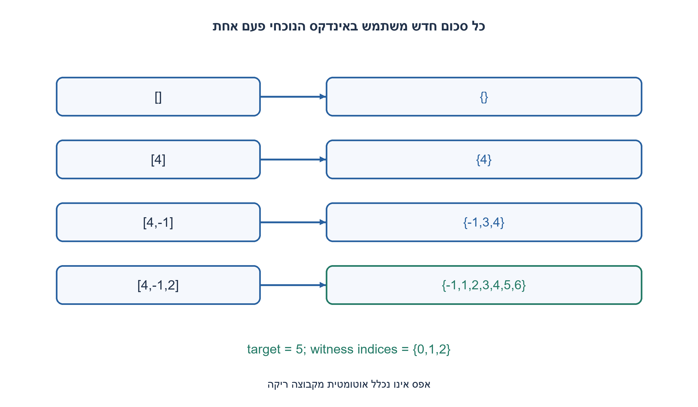
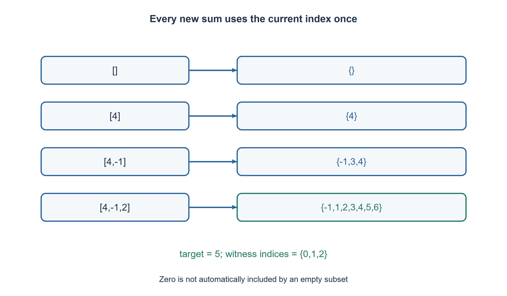

# PREP-040 — האם קיים במערך זוג שסכומו נתון?

פתרון מוצע בסיוע AI; ביקורת מקצועית אנושית ממתינה. הקושי אינו מכויל.

## עברית

### הרחבה: סכום של תת־קבוצה בגודל 1 עד n
הסעיף הראשון בצילום חוזר על שאלת שני האינדקסים המקורית. בסעיף החדש יש רשימת n שלמים ויעד K, ויש להחזיר האם תת־קבוצה לא ריקה של 1..n איברים מסתכמת ב־ K. 1..n הם גדלי תת־הקבוצה, לא הגבלה על ערכי המערך.

נבחר במפורש: שליליים, אפסים וכפילויות מותרים; כל אינדקס זמין לכל היותר פעם אחת, והקלט אינו משתנה. מותר זיכרון עזר. הפלט bool בלבד, לא כל תתי־הקבוצות. רשימה ריקה מחזירה False גם ל־ K=0; [0] או [3, −3] מאפשרות True ל־ 0. הסבירו למה קיצוץ ענף לפי סכום גדול מ־ K אינו נכון כשיש שליליים.

1. איך מתארים את כל הסכומים שאפשר לקבל מהאיברים שכבר נקראו?
2. כאשר מוסיפים ערך v, תת־קבוצה חדשה היא או v לבדו או סכום קודם ועוד v. הסכומים הקודמים נשארים אפשריים.
3. החזיקו set של סכומים מתתי־קבוצות לא ריקות. חשבו new_sums מתוך snapshot של ה־ set הישן בלבד, ורק אחר כך חברו; כך אין שימוש כפול באינדקס הנוכחי. אל תאתחלו את ה־ set ב־ 0.

### שני איברים ומספר כלשהו של איברים אינם אותה בעיה
שאלת הזוג המקורית והפתרונות שלה נשמרים. הכללה לגודל כלשהו דורשת יותר ממפת complements: תת־קבוצה יכולה להכיל איבר יחיד, שלושה איברים או את כל הרשימה. אין צורך להדפיס את כל האפשרויות, רק לדעת אם קיימת אחת. כפילויות ערך מותרות, אבל שני עותקים דורשים שני אינדקסים אמיתיים.

נחזיק reachable, קבוצת סכומים של תתי־קבוצות לא ריקות מהקידומת שכבר עובדה. מתחילים בקבוצה ריקה, ולכן לא ״מוצאים״ את הסכום 0 באמצעות תת־קבוצה ריקה. לערך הבא v בונים קבוצה נפרדת עם v לבדו וכל s+v עבור s שהיה reachable לפני הצעד. מאחדים אותה עם הסכומים הישנים, ואם K קיים מחזירים אמת. רק כשכל הקלט נגמר בלי K מחזירים שקר.

אינווריאנט ונכונות לפי אינדוקציה: לפני האיבר הראשון אין תת־קבוצה לא ריקה, וה־ set ריק. תת־קבוצה בקידומת החדשה או אינה מכילה את האינדקס הנוכחי ואז סכומה כבר נשמר, או מכילה אותו. במקרה השני היא יחידון v, או תת־קבוצה לא ריקה מהקידומת הישנה ועוד v. אלה בדיוק הסכומים שהוספנו. הסכומים נוצרים מהמצב הישן בלבד, ולכן אין שימוש פעמיים באותו אינדקס.

לדוגמה [4, −1,2] ו־ K=5: אחרי 4 נשמר {4}; אחרי ‎−1 נשמרים {4, −1,3}; אחרי 2 נוספים {2,6,1,5}, וה־ 5 מגיע מכל שלושת האיברים. [2] לא יכול ליצור 4; [2,2] כן. [0] יוצר 0 כחוק, בעוד [] אינו יוצר כלום. אין לקצץ אחרי סכום 4 כשהיעד 3, כי ‎−1 בהמשך יכול להשלים אותו.

אם R_i הוא מספר הסכומים השונים אחרי i איברים, העלות היא O(Σ(R_(i−1)+1)) פעולות set צפויות, עם O(max R_i) ערכים באחסון, כולל קבוצת הביניים. במקרה הגרוע יכולים להיות Θ(2^n) סכומים שונים, ולכן חסם גרוע־ביותר O(2^n) פעולות על מילים ומקום מעריכי. אין כאן פתרון כללי לינארי. בהגבלת סכומים ל־[L, U] ניתן לתאר גם עלות תלויה בטווח, אך זו עלות פסאודו־פולינומית, ושלמים גדולים מגדילים עלות חשבון ו־ hash. עץ החלטה include/exclude עם פחות זיכרון הוא חלופה.

למקרה של ערכים חיוביים או אי־שליליים ויעד קטן יש DP צפוף על סכומים; הוא אינו אותה הבטחת קלט כמו שליליים בלתי חסומים. אם בהמשך מבקשים להדפיס את כל תתי־הקבוצות, עצם הפלט יכול להיות מעריכי, למשל n אפסים ליעד 0. החסם הזה אינו נימוק לעלות פלט של ההחלטה הבוליאנית הנוכחית. נבדקו 10,043 מקרים מול מנייה עצמאית של מסכות אינדקס לא ריקות, כולל שליליים, אפסים ואי־שימוש חוזר.

```python
"""Nonempty subset existence; each index is used at most once, signed ints allowed."""


def has_subset_sum(values, target):
    reachable = set()
    for value in values:
        new_sums = {value}
        for previous in reachable:
            new_sums.add(previous + value)
        reachable.update(new_sums)
        if target in reachable:
            return True
    return False
```




## English

### Extension: a subset containing one through n elements
The screenshot's first part repeats the existing two-distinct-index question. The new part receives n integers and target K and asks whether some nonempty subset of one through n elements sums to K. One through n refers to subset cardinality, not a restriction on array values.

Explicitly allow negatives, zeroes and duplicate values; use each index at most once and preserve input. Auxiliary storage is allowed. Return bool, not every subset. Empty input returns False even for K=0; [0] and [3, -3] can return True for zero. Explain why pruning when a partial sum exceeds K is invalid with negative values.

1. How can all sums obtainable from the processed prefix be represented?
2. With a new v, a new subset is either v alone or an old subset plus v. Old sums remain possible too.
3. Store sums of nonempty subsets. Build new_sums from the old set before updating it, preventing reuse of the current index. Do not initialize the set with zero.

### A pair and an arbitrary-size subset are different tasks
The original two-sum question and solutions are preserved. An arbitrary-size subset needs more than a complement map: it may use one item, three or the whole list. Only existence is requested, not every result. Duplicate values are allowed but two copies require two physical indices.

Maintain reachable, the sums of all nonempty subsets of the processed prefix. Begin with an empty set, not {0}, so an empty subset cannot falsely satisfy target zero. For each v build a separate set containing v alone and s+v for every sum in the old reachable set. Union new and old sums; return true if target is present. If the input ends without it, return false.

Inductive invariant: before reading any item, there are no nonempty subsets and the set is empty. Any nonempty subset of the enlarged prefix either excludes the current index, so its sum was already retained, or includes it. In the latter case it is the singleton v or an old nonempty subset plus v, exactly the new sums. Building from the old snapshot before updating prevents reusing the current index.

For [4, -1,2] and target five, after four the set is {4}; after minus one it is {4, -1,3}; two adds {2,6,1,5}. Five uses all three entries. [2] cannot make four, but [2,2] can. [0] legitimately makes zero whereas [] makes nothing. A partial sum four cannot be pruned for target three because a later minus one can complete it.

Let R_i count distinct reachable sums after i items. Cost is expected O(sum(R_(i−1)+1)) set operations, with O(max R_i) stored values including the temporary set. Worst-case distinct sums can grow as Theta(2^n), giving O(2^n) word operations and exponential space; this is not a general linear algorithm. A bounded sum interval [L, U] gives range-dependent pseudopolynomial bounds, and large-integer arithmetic/hashing costs grow with bit width. An include/exclude search using less memory is another valid approach.

For nonnegative values and a small target, dense sum DP may be preferable; that is a stronger input promise than arbitrary signed integers. A follow-up printing every successful subset can require exponential output, for example n zeroes with target zero. That output bound is not an output-cost argument for the present Boolean decision. Executed checks cover 10,043 cases against independent enumeration of nonempty index masks, including negatives, zeroes and no-index-reuse cases.

```python
"""Nonempty subset existence; each index is used at most once, signed ints allowed."""


def has_subset_sum(values, target):
    reachable = set()
    for value in values:
        new_sums = {value}
        for previous in reachable:
            new_sums.add(previous + value)
        reachable.update(new_sums)
        if target in reachable:
            return True
    return False
```




## חומר משלים / Supporting material

```json
{
  "assumptions": {
    "he": "השלמה: תת־קבוצה לא ריקה, גדלים 1..n, שלמים חתומים, כל אינדקס פעם אחת ופלט bool.",
    "en": "Completion: nonempty subset, sizes one through n, signed integers, each index once and Boolean output."
  },
  "optimality": {
    "he": "O(ΣR_i) פעולות set צפויות ו־ O(max R_i) ערכים; גרוע־ביותר O(2^n). רוחב שלמים מוסיף עלות.",
    "en": "Expected O(sum R_i) set operations, O(max R_i) values; worst-case O(2^n), with integer-width costs added."
  },
  "verification": {
    "he": "10,043 מקרים מול מניית מסכות אינדקס לא ריקות, עם שימור הקלט.",
    "en": "10,043 cases versus independent nonempty-index-mask enumeration, preserving input."
  },
  "edge_cases": {
    "he": "[] ו־ K=0; [0]; ביטול חיובי/שלילי; כפילויות; יחיד שאסור להשתמש בו פעמיים.",
    "en": "Empty input at zero target; [0]; positive/negative cancellation; duplicates; one item cannot be reused."
  },
  "common_mistakes": {
    "he": "לפרש 1..n כטווח הערכים; להתחיל ב־{0} ולספור ריק; לעדכן set תוך מעבר עליו; לקצץ לפי סכום גדול מהיעד.",
    "en": "Reading one through n as a value domain; starting with {0} and accepting empty; mutating the set while iterating it; pruning above target with negatives."
  },
  "interview_answer": {
    "he": "אשמור את הסכומים הלא ריקים של כל קידומת. איבר חדש יוצר יחידון או מצטרף לסכום קודם, ורק אחר כך אאחד.",
    "en": "Store nonempty prefix-subset sums. A new item creates a singleton or extends an old sum; union only afterward."
  },
  "source_ambiguities": {
    "he": "הנוסח העמום פורש כהכללת גודל תת־הקבוצה, לא כסכומי רצפים רציפים. אין דרישה לפלט כל האפשרויות.",
    "en": "The terse generalization is interpreted as arbitrary subset cardinality, not contiguous subarrays; enumerating every answer is not requested."
  },
  "solution_extensions": {
    "he": [
      {
        "question": "איך מחזירים גם אינדקסים של עדות אחת?",
        "answer_direction": "שומרים לכל סכום חדש קשר הורה למצב מהקידומת הקודמת, או משתמשים בחיפוש חזרה; יש לשמור מסלול שלא ידרוס הורה לאותו אינדקס.",
        "principle": "הגדרת תת־קבוצה והתחום המספרי קובעים את ה־ DP ואת הסיבוכיות."
      }
    ],
    "en": [
      {
        "question": "How can one witness index set be returned?",
        "answer_direction": "Store predecessor information referencing the previous-prefix state, or backtrack; avoid overwriting parent chains into index reuse.",
        "principle": "Subset semantics and numeric domain determine the DP and its complexity."
      }
    ]
  }
}
```
