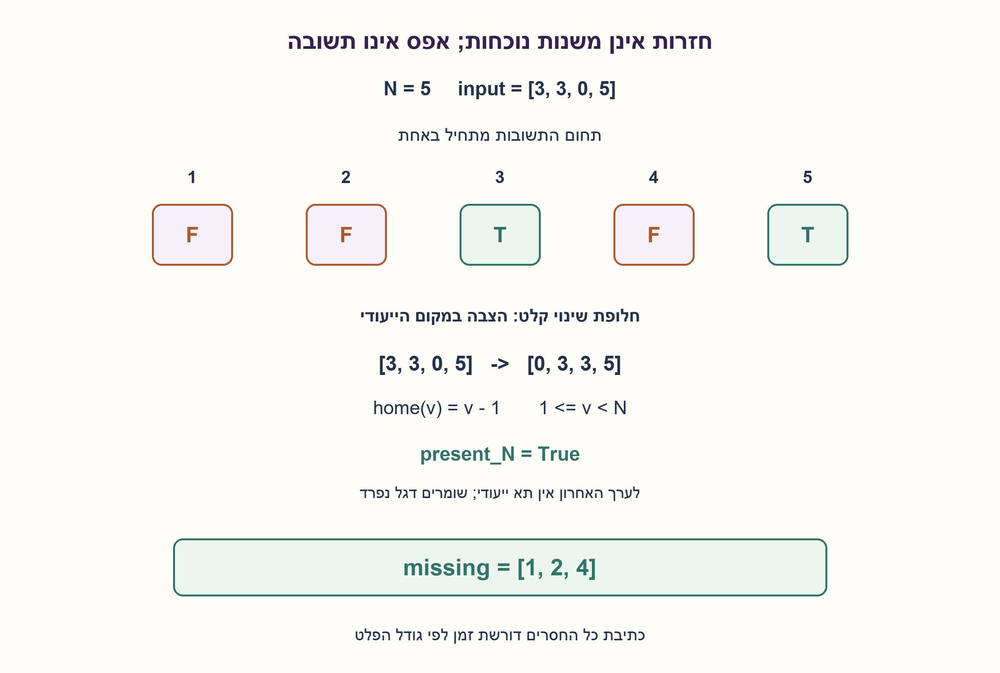
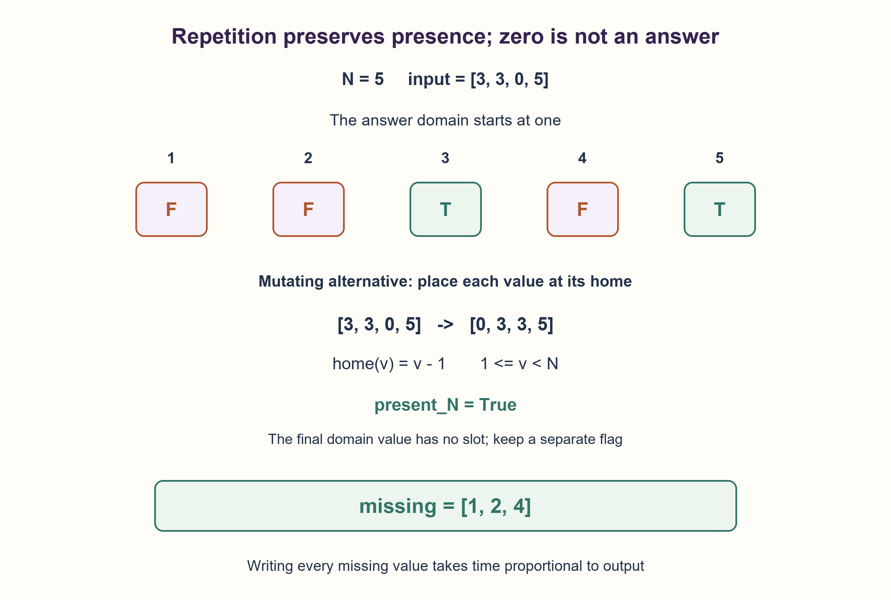

# PREP-041 — מציאת ערך אחד או שני ערכים שהוצאו ממערך

פתרון מוצע בסיוע AI; ביקורת מקצועית אנושית ממתינה.

## נוסח ערוך

### ד. חזרות, אפסים וכל הערכים החסרים
בסעיף החדש התחום המבוקש הוא 1..N, עם N≥1. בקלט N−1 תאים, אך כעת מותרות חזרות ואפסים; אפס הוא מציין מקום שאינו ערך בתחום. החזירו בסדר עולה את כל ערכי1..N שלא הופיעו. גם קלט שכולו אפסים אפשרי, ואז כולם חסרים. האם אפשר להבטיח גם זמן וגם מקום קטנים מ־O(N)?

הבהרות: תחום הקלט0..N מובטח ונבדק במימוש החדש; אין מספרים שליליים. הבדילו זיכרון עזר מזיכרון הפלט, ופלט מפורש מזרם. תחילה פתרון שאינו משנה קלט, המוכלל לאורך L כלשהו. אחר כך חלופה מפורשת שמותר לה לשנות את N−1 התאים. סעיפי א–ג והרמזים הקודמים נשארים ללא שינוי; שני החסרים בסעיף ב דורשים N−2 ערכים שונים.

### שלושה רמזים לסעיף החדש

1. מה משתנה בבדיקת נוכחות כאשר אותו ערך מופיע כמה פעמים, והאם צריך להחזיר אפס?
2. דגל נוכחות אינו משתנה אחרי החזרה הראשונה. במקרה של אפסים בלבד יש לכתוב N תוצאות, בלי קשר לאלגוריתם הפנימי.
3. ללא שינוי קלט סמנו דגל לכל ערך. אם מותר לשנות N−1 תאים, הציבו v בתחום1..N−1 במקוםv−1, הימנעו מהחלפת כפילויות ללא סוף, ושמרו דגל יחיד לנוכחותN.

### הצעה לפתרון

### נוכחות, לא סכום או מספר הופעות
בסעיף ד אין הבטחת חסר יחיד או זוג חסרים. סכום או XOR של הקלט אינם קובעים את קבוצת החסרים כאשר מופיעות חזרות. למשל N=5 והקלט [3,3,0,5] מכילים רק את3 ואת5, ולכן הפלט[1,2,4]. אפס הוא מציין מקום, לא איבר שיש להחזיר.

**בלי לשנות את הקלט:** נאתחל N+1 דגלי False. לכל ערך שאינו אפס נסמן seen[value]=True; חזרה נוספת פשוט משאירה אותו True. נסרוק1..N ונחזיר את מי שדגלו False. אחרי כל קריאה הדגלים מסמנים בדיוק את ערכי התחום שנצפו, ולכן התוצאה מלאה ומדויקת. לאורך קלט L העלות O(L+N), זיכרון דגלים O(N) תאים ועוד O(k) לפלט בן k ערכים. רשימת bool של Python אינה מפת ביטים דחוסה.

**אם מותר לשנות בדיוק N−1 תאים:** יש מקום ייעודי לכל v בין1 ל־N−1: אינדקסv−1. נסרוק; כשערך כזה אינו כבר במקומו, נחליף אותו עם התא הייעודי ונבדוק שוב את הערך שהגיע למקום הנוכחי. אם התא הייעודי כבר מכילv, זו כפילות ואין להחליף שוב. אפסים נדלגים; נוכחותN נשמרת בדגל יחיד, משום שאין תא באינדקסN−1. כל החלפה מוצלחת ממקמת ערך אחד לצמיתות, ולכן יש לכל היותר N−1 כאלה והלולאה לינארית. בסוף מקוםv−1 שאינו מכילv מעיד על חסרv; את N מוסיפים אם הדגל שלו שקר. החלפות משמרות את ריבוי הקלט אך משנות את הסדר. המימוש מאמת תחום לפני השינוי, כך שקלט פסול אינו נכתב חלקית.

בדוגמה [3,3,0,5], החלפת3 הראשון עם תא2 נותנת [0,3,3,5]. רק מקום2 מכיל את ערכו3, והדגל של5 אמת. חסרים1,2,4. עבור N=1 הקלט ריק והפלט[1]. עבור [0,0,0] ו־N=4 הפלט[1,2,3,4].

אי אפשר להבטיח זמן תת־לינארי במקרה הגרוע: הפלט המפורש לבדו עשוי להכיל N ערכים, ולכן כתיבתו Ω(N). בכלליות נדרשות גם קריאת הקלט והפקת הפלט, Ω(L+k) במקרה הגרוע. אם סופרים פלט כחלק מהזיכרון, גם הוא Ω(N) במקרה הזה. אם לא סופרים פלט ומתירים שינוי, החלופה אכן משתמשת ב־O(1) מילות עזר; לכן אסור להסיק שכל אלגוריתם זקוק למערך דגלים. אפשר גם להזרים פלט כדי לא לאחסנו, אבל זמן הכתיבה לא נעלם. זו הבחנה בין חסם פלט לבין בחירת ייצוג.

המודלים נבדקו מול חיפוש חברות עצמאי בכל הקלטים הקטנים המתאימים לאורךN−1, ב־300 דגימות ובמקרי אורך כללי, אפסים וכפילויות. הפתרון הקריא בלבד שומר קלט; בחלופת ההחלפות נבדק שימור הרב־קבוצה. זהו סעיף חדש, לא שינוי של הבטחות א–ג.

```python
"""Missing values in 1..N; repeated input values and zero sentinels allowed.

The read-only construction accepts arbitrary finite input length L. The
constant-auxiliary-workspace variant requires exactly N-1 mutable entries.
Output storage is counted separately; it may itself contain N integers.
"""


def missing_all_flags(values, n):
    if type(n) is not int or n < 0:
        raise ValueError("N must be a nonnegative integer")
    seen = [False] * (n + 1)
    for value in values:
        if type(value) is not int or not 0 <= value <= n:
            raise ValueError("entries must be integers in 0..N")
        if value != 0:
            seen[value] = True
    return [value for value in range(1, n + 1) if not seen[value]]


def missing_all_inplace(values, n):
    if type(n) is not int or n < 1 or len(values) != n - 1:
        raise ValueError("mutable variant requires N>=1 and exactly N-1 entries")
    if any(type(value) is not int or not 0 <= value <= n for value in values):
        raise ValueError("entries must be integers in 0..N")
    final_present = False
    index = 0
    while index < len(values):
        value = values[index]
        if value == n:
            final_present = True
            index += 1
        elif 1 <= value < n and values[value - 1] != value:
            values[index], values[value - 1] = values[value - 1], value
        else:
            index += 1
    missing = [value for value in range(1, n) if values[value - 1] != value]
    if not final_present:
        missing.append(n)
    return missing
```




## Edited prompt

### D. Repetitions, zero sentinels and every missing value
The new part asks for domain1..N, N≥1. Input has N−1 entries, now allowing repetitions and zeros. Zero is a sentinel outside the requested domain. Return in ascending order every value1..N absent from input. All-zero input is valid and makes all N values missing. Can both time and space be guaranteed below O(N)?

Clarify auxiliary versus output storage and materialized versus streamed output. Input values lie in0..N; new implementations validate this. First give a read-only solution generalized to arbitrary length L, then an explicitly permitted mutating alternative for exactly N−1 slots. Parts A–C and their old hints remain unchanged; distinct two-omission Part B has N−2 observations.

### Three hints for the new part

1. How does presence change when a value repeats, and should zero ever be returned?
2. A presence flag does not change after the first occurrence. All-zero input requires writing N answers regardless of internal algorithm.
3. Read-only: mark value-indexed flags. With N−1 mutable slots, place v in1..N−1 at v−1, avoid duplicate swap loops, and retain one presence flag for N.

### Proposed solution

### Presence, not sum or multiplicity
Part D promises neither one nor two omissions. With repetitions, a sum or XOR does not identify the missing set. For N=5,input[3,3,0,5] contains only3 and5; return[1,2,4]. Zero is a sentinel, never an answer.

**Read-only:** initialize N+1 False flags. Mark each nonzero value True; repeats leave it True. Scan1..N and return False indices. After every observation flags describe exactly the domain values seen, proving complete/correct output. For length L this takes O(L+N) time, O(N) flag entries and O(k) output for k missing values. Python bool lists are not packed bitmaps.

**With exactly N−1 mutable slots:** each v in1..N−1 has home v−1. Scan; swap such a value into its home if absent there, then inspect the displaced value at the current index. If the home already contains v, skip the duplicate rather than looping forever. Skip zeros. Track N in one flag because index N−1 does not exist. Each successful swap permanently places one value, so there are at most N−1 swaps and linear work. Finally a home not containing its value identifies an omission; append N if its flag is false. Swaps preserve multiplicity but change input order. The implementation validates the domain before mutation, avoiding partial modification on invalid input.

For[3,3,0,5], moving the first3 to index2 yields[0,3,3,5]. Only value3 has its home and the5 flag is true, giving[1,2,4]. For N=1 empty input yields[1]; for N=4,[0,0,0] yields[1,2,3,4].

Worst-case sublinear time is impossible: explicit output can contain N values, requiring Ω(N) writes. More generally reading input and producing answers requires Ω(L+k) in the worst case. Counting output as storage also gives Ω(N) here. Excluding output and allowing mutation, the placement alternative uses O(1) auxiliary words, so an N-entry flag array is not universally necessary. Streaming can avoid retained output storage, not output time. Separate the output lower bound from a representation choice.

Both models matched independent membership search on all selected small length-N−1 arrays, 300 seeded arrays and general-length/zero/duplicate cases. Read-only input preservation and the mutating variant’s multiset were checked. This is an added part, not a changed promise for A–C.

```python
"""Missing values in 1..N; repeated input values and zero sentinels allowed.

The read-only construction accepts arbitrary finite input length L. The
constant-auxiliary-workspace variant requires exactly N-1 mutable entries.
Output storage is counted separately; it may itself contain N integers.
"""


def missing_all_flags(values, n):
    if type(n) is not int or n < 0:
        raise ValueError("N must be a nonnegative integer")
    seen = [False] * (n + 1)
    for value in values:
        if type(value) is not int or not 0 <= value <= n:
            raise ValueError("entries must be integers in 0..N")
        if value != 0:
            seen[value] = True
    return [value for value in range(1, n + 1) if not seen[value]]


def missing_all_inplace(values, n):
    if type(n) is not int or n < 1 or len(values) != n - 1:
        raise ValueError("mutable variant requires N>=1 and exactly N-1 entries")
    if any(type(value) is not int or not 0 <= value <= n for value in values):
        raise ValueError("entries must be integers in 0..N")
    final_present = False
    index = 0
    while index < len(values):
        value = values[index]
        if value == n:
            final_present = True
            index += 1
        elif 1 <= value < n and values[value - 1] != value:
            values[index], values[value - 1] = values[value - 1], value
        else:
            index += 1
    missing = [value for value in range(1, n) if values[value - 1] != value]
    if not final_present:
        missing.append(n)
    return missing
```




## מקור וחומר משלים / Source and supporting material

[צילום מקור פרטי](../sources/2026-10-25-batch20-13.png)

חלק ראשון כבר קיים במאגר: מערך בגודל N-1 עם שלמים בתחום1 עדN, ללא חזרות; חסר מספר אחד בדיוק. פלט המספר החסר. חלק שני: אותו קלט אבל חסרים2 מספרים במקום אחד, ופלט שניהם. חלק שלישי: יש חזרות (יכול להיות מערך של אפסים); פלט כל המספרים החסרים (יכול להיות כולם). האם אפשר לפתור חלק שלישי בסיבוכיות זמן ומקום קטנות מO(N)? בכל החלקים למצוא פתרון יעיל בזמן ובמקום ולרשום פונקציה בפסאודו קוד.

```json
{
  "assumptions": {
    "he": [
      "סעיף ד: תחום התשובות1..N, אפס הוא מציין מקום, חזרות מותרות.",
      "סימון אינו משנה קלט ומאפשר אורךL כללי; הצבה דורשת רשות שינוי ואורךN−1.",
      "גודל פלטk נפרד מעזר; הוא עשוי להיותN."
    ],
    "en": [
      "D: answer domain1..N, zero sentinel, repeats allowed.",
      "Flags preserve input for general L; placement needs mutation permission and lengthN−1.",
      "Output size k is separate from workspace and may equal N."
    ]
  },
  "optimality": {
    "he": "דגלים O(L+N) זמן/O(N) עזר; הצבה באורךN−1 O(N) זמן/O(1) מילות עזר, ועודO(k) פלט. כל פלטN מפורש דורשΩ(N) זמן ושטח פלט.",
    "en": "Flags O(L+N) time/O(N) auxiliary entries; N−1 placement O(N) time/O(1) words plus O(k) output. An explicit N-item answer requires Ω(N) output time/storage."
  },
  "edge_cases": {
    "he": [
      "הכול אפסים, הרבה חזרות, חסרN, נוכחותN ו־N=1 עם ריקה.",
      "ערך כפול שכבר במקומו חייב לעצור החלפות; פסילה לפני כתיבה."
    ],
    "en": [
      "All zeros, many duplicates, missing/present N and N=1 empty.",
      "A duplicate already at its home must not swap forever; reject before mutation."
    ]
  },
  "common_mistakes": {
    "he": [
      "להחזיר אפס, להשתמש בביטול XOR למרות חזרות או להמשיך להבטיח חסר יחיד.",
      "להתעלם מזיכרון הפלט או לטעון לחסם זיכרון דגלים בכל מודל.",
      "לגשת לאינדקסN−1 במערך בןN−1 תאים."
    ],
    "en": [
      "Returning zero, XOR-cancelling repeats or retaining a one-omission promise.",
      "Ignoring output storage or claiming flag-space lower bounds in every model.",
      "Accessing index N−1 in an N−1-slot input."
    ]
  },
  "interview_answer": {
    "he": "אסמן נוכחות של1..N ואחזיר כל דגל חסר; אפסים וחזרות אינם מוסיפים ערך חדש. אם מותר לשנותN−1 תאים, אציב כלv<N בביתו ואשמור דגל לנוכחותN. זמן תת־לינארי אינו אפשרי כשצריך להוציאN חסרים.",
    "en": "Mark presence of1..N and emit missing flags; zeros/repeats add nothing. With N−1 mutable entries, place each v<N at its home and flag N. Sublinear time is impossible when N omissions must be emitted."
  },
  "source_ambiguities": {
    "he": "הצילום חוזר על סעיפי חסר אחד/שניים שכבר קיימים, ומוסיף חזרות ואף אפסים בניגוד לתחום המקורי. העריכה מפרשת אפסים כמצייני מקום, משאירה א–ג ומקצה ד לחסרים מרובים; אורךL כללי מוצג כהכללה מפורשת.",
    "en": "Source repeats the existing one/two-omission parts and introduces repeats/zeros contrary to the original domain. Zeros are explicitly sentinels, A–C remain, and D handles multiple omissions; general L is a labeled generalization."
  },
  "verification": {
    "he": "280,392 קלטי N−1 ממצים עבור N=1..7 ועוד 300 דגימות מול חברות עצמאית; נבדקו שימור קלט/רב־קבוצה ופסילה אטומית.",
    "en": "280,392 exhaustive length-N−1 inputs for N=1..7 plus 300 seeded arrays versus membership search; preservation/multiset and atomic rejection checked."
  },
  "solution_extensions": {
    "he": {
      "question": "מה אם אסור לשנות קלט ומותר מעט זיכרון, אך מותר זמן רב יותר?",
      "direction": "אפשר לבדוק כל מועמד מול כל הקלט בסריקות חוזרות ולהזרים חסרים; החיסכון בזיכרון בא על חשבוןO(NL) זמן.",
      "status": "רמזים והמשך מוכנים בחומר המשלים בלבד; התור הקודם נשמר."
    },
    "en": {
      "question": "What if input is read-only and little workspace is available, but more time is allowed?",
      "direction": "Search the entire input per candidate and stream omissions; O(NL) time trades for little workspace.",
      "status": "Supplemental hints/follow-up only; original queue retained."
    }
  }
}
```
