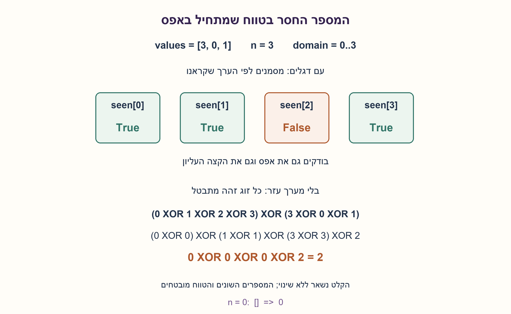
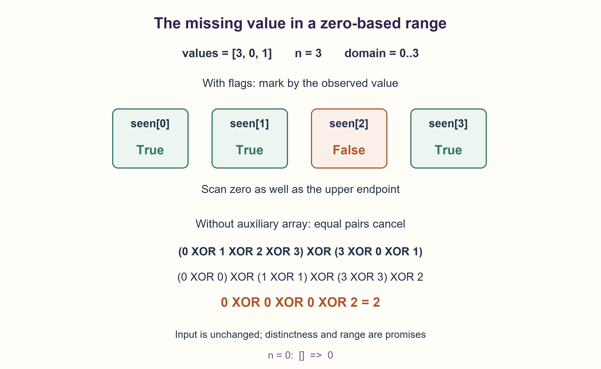

# PREP-041 — תוספת סעיף ג / Part C addendum

פתרון מוצע בסיוע AI; ביקורת מקצועית אנושית ממתינה. סעיפים א–ב והרמזים המקוריים לא הוחלפו.

[שאלה מקורית](prep-041-one-two-missing-values.md) · [צילום נוסף](../sources/2026-10-24-batch30-09.png)

ישנו רצף מספרים באורך n שאינו ממוין, המספרים ברצף יכולים להיות בין 0 ל-n וללא חזרה (סה״כ n+1 אופציות) בזמן ריצה O(n) כיצד ניתן לדעת איזה מן המספרים אינו מופיע ברצף?
ב) במידה והשתמשת במערך עזר, נסה לפתור שוב ללא מערך עזר

### ג. וריאציה: טווח שמתחיל באפס
נתון מערך לא ממוין באורך n, המכיל מספרים שלמים שונים זה מזה מתוך הטווח 0..n, כולל שני הקצוות. לכן חסר בדיוק מספר אחד. מצאו אותו בזמן O(n): תחילה כאשר מותר מערך עזר, ואחר כך בלי מערך עזר ובלי לשנות את הקלט.

בסעיף זה n הוא מספר הערכים שנותרו, בניגוד לסעיפים א–ב שבהם n היה הקצה העליון של הטווח שמתחיל באחת. אפשר לקרוא את הקלט שוב; התחום והייחודיות מובטחים, ואין דרישה לאמת אותם בזיכרון קבוע. עבור n=0 המערך ריק והתשובה היא 0. ההגבלה השנייה היא O(1) מילות עזר; אין פירושה מספר ביטים קבוע לכל n.

### שלושה רמזי ג — בחומר המשלים בלבד

1. מהם כל הערכים שהיו אמורים להופיע, ומה שונה בין הרשימה הזאת לבין הערכים שקראתם?
2. כאשר מותר זיכרון, אפשר להשתמש בערך שקראתם בתור אינדקס לדגל. נדרש מקום גם לערך n וגם לאפס.
3. בלי הדגלים, השתמשו בכך ש־x XOR x שווה לאפס: בטלו את ערכי הטווח המלא מול הקלט. הערך החסר יופיע פעם אחת בלבד.

### סעיף ג: אותו רעיון, אבל אפס הוא ערך חוקי
כעת יש n ערכים מתוך n+1 אפשרויות: 0,1,...,n. מאחר שאין חזרות, אפשרות אחת בדיוק לא הופיעה. אין משמעות למיקום הערך בתוך המערך הלא ממוין; מתייחסים לערכים שקראנו.

**עם מערך עזר.** ניצור n+1 דגלים שערכם False. לכל value שקראנו נסמן seen[value]=True. נסרוק את כל האינדקסים מ־0 עד n ונחזיר את האינדקס שנותר False. למשל עבור [3,0,1] יש ארבע אפשרויות: 0 ו־1 סומנו, 2 לא סומן ו־3 סומן, ולכן התשובה 2. הדגלים מסומנים לפי הערך ולא לפי מיקום התא בקלט.

הנימוק: אחרי כל ערך שקראנו, דגל הוא True בדיוק כאשר ערכו כבר נצפה. לכן בסוף דגל False מזהה בדיוק את החסר. זמן האתחול, הסימון והסריקה הוא O(n), והזיכרון O(n) תאי עזר. רשימת bool של Python אינה מערך ביטים דחוס.

**בלי מערך עזר.** XOR מבטל זוגות זהים: x XOR x=0 וגם x XOR 0=x. נחשב XOR של הטווח 0..n ושל כל ערכי הקלט. כל ערך שמופיע בקלט מופיע גם בטווח, ולכן מתבטל. רק המספר שלא הופיע בקלט נשאר.

במימוש מתחילים missing=n, ואז לכל זוג index,value מבצעים missing ^= index ^ value. האינדקסים הם בדיוק 0..n−1; יחד עם n שאיתחלנו הם משלימים את כל הטווח 0..n. אין כאן הנחה שהערכים ממוינים. אחרי הלולאה יש באוגר XOR של הטווח המלא ושל הקלט, ולכן הוא בדיוק החסר.

בדוגמה: (0 XOR 1 XOR 2 XOR 3) XOR (3 XOR 0 XOR 1)=2. בקלט הריק missing מתחיל ב־0 ואין איטרציות, ולכן מוחזר 0. חסר של 0 או של n מטופל באותו אופן. שני המימושים קוראים את הקלט בלבד.

**דיוק העלות והבטחות הקלט.** במספרים שנכנסים למילת מכונה, XOR עולה O(n) זמן ו־O(1) מילות עזר. האוגר והאינדקס דורשים O(log(n+1)) ביטים; אם פועלים על שלמים בעלי רוחב לא חסום, עלות פעולת ביטים תלויה ברוחב ולכן אין להסיק O(n) פעולות ביט בודדות. המספרים השונים והטווח הם הבטחה: כפילות או ערך מחוץ לטווח מבטלים את הוכחת הביטול. לא הוספנו מערך אימות חבוי.

גם n*(n+1)//2 פחות סכום הקלט הוא חלופה תקפה לחסר יחיד עם חשבון שלם מדויק. ברוחב קבוע יש לבדוק גלישה בסכום הביניים; XOR אינו יוצר את הסכום הזה. אין צורך בחלוקה של נקודה צפה.

**מה השתנה ומה לא.** סעיפים א–ב נשמרו; סעיף ג הוא וריאציה מאותו עיקרון, לא שאלה חדשה. 46,233 תמורות חוקיות ממצות עבור n=0..7 ועוד 400 מקרים מדגמיים עד n=2000 נבדקו מול חיפוש חברות עצמאי, בשני המימושים ותוך בדיקת אי־שינוי הקלט. בדיקה תוכנתית אינה אישור מקצועי אנושי. שלושת הרמזים הממוקדים של ג מוכנים בחומר המשלים; התור האינטראקטיבי הישן של א–ב נשמר ולא הוחלף.

```python
"""PREP-041 C: n distinct values in 0..n, exactly one missing; read-only input.

The input validity promise is not fully validated. Flags use O(n) storage; XOR
uses O(1) machine words, not a fixed bit count for arbitrary n.
"""


def missing_one_with_flags(values):
    present = [False] * (len(values) + 1)
    for value in values:
        present[value] = True
    for value, found in enumerate(present):
        if not found:
            return value
    raise ValueError("valid input must omit exactly one domain value")


def missing_one_xor(values):
    missing = len(values)
    for index, value in enumerate(values):
        missing ^= index ^ value
    return missing
```



### C. Variant: the range starts at zero
An unsorted array of length n contains distinct integers drawn from 0..n inclusive, so exactly one value is missing. Find it in O(n) time: first with an auxiliary array allowed, then without an auxiliary array and without modifying the input.

Here n denotes the number of remaining entries, unlike Parts A–B where n was the upper endpoint of a range starting at one. Further reads are allowed. Range and uniqueness are promises; constant-space full input validation is not required. For n=0 the input is empty and the answer is 0. The second constraint means O(1) auxiliary machine words, not a fixed number of bits for arbitrary n.

### Three C hints — supplemental material only

1. Which values should exist, and what differs between that complete range and the entries you read?
2. With extra storage, use each observed value as a flag index. Leave room for n as well as zero.
3. Without flags, exploit x XOR x = 0: cancel the complete range against the observed input. Only the missing value occurs once.

### Part C: the same idea, with zero as a valid value
There are n observations and n+1 candidates: 0,1,...,n. Since observations are distinct, exactly one candidate is absent. An unsorted entry's position says nothing about its value; reason about the values read.

**With an auxiliary array.** Create n+1 False flags. For each observed value set seen[value]=True. Scan every index from 0 through n and return the index still False. For [3,0,1], the four candidates have flags True,True,False,True, identifying 2. Mark by observed value, not by the input entry's position.

Correctness: after each observation a flag is True exactly when its value has appeared. Therefore the one final False flag identifies the omission. Initialization, marking and scanning take O(n) time and O(n) auxiliary entries. A Python bool list is not a packed bit array.

**Without an auxiliary array.** XOR cancels equal pairs: x XOR x=0 and x XOR 0=x. XOR the full range 0..n with every input value. Each observed value occurs twice and cancels. Only the absent value occurs once and remains.

The implementation starts missing=n, then updates missing ^= index ^ value for each enumerated entry. Indices cover exactly 0..n−1; combined with the initial n they contribute the full range 0..n. This does not assume sorted values. After the loop the accumulator equals the complete-range XOR combined with the input XOR, which is the missing value.

For the example, (0 XOR 1 XOR 2 XOR 3) XOR (3 XOR 0 XOR 1)=2. Empty input initializes missing to 0 and performs no iterations, yielding 0. Missing zero or n needs no special case. Both implementations only read the input.

**Cost and the input promise.** For values fitting a machine word, XOR takes O(n) time and O(1) auxiliary words. The accumulator and index need O(log(n+1)) bits. With unbounded integer width, bit operations depend on width, so linear word operations do not imply O(n) individual bit operations. Distinctness and range are promises: duplicates or out-of-range values invalidate cancellation's proof. No hidden validation array was added.

n*(n+1)//2 minus the observed sum is also valid for one omission with exact integer arithmetic. In fixed width its intermediate sum may overflow; XOR never forms that sum. Floating-point division is unnecessary.

**What changed.** Parts A–B are retained; C is another version of the principle, not a new question. Both actual implementations matched an independent membership-search oracle on all 46,233 valid permutations for n=0..7 plus 400 seeded cases up to n=2000, with input preservation checked. Software evidence is not human professional approval. C's three focused hints are prepared in supporting material; the old A–B interactive hint queue is preserved rather than replaced.

```python
"""PREP-041 C: n distinct values in 0..n, exactly one missing; read-only input.

The input validity promise is not fully validated. Flags use O(n) storage; XOR
uses O(1) machine words, not a fixed bit count for arbitrary n.
"""


def missing_one_with_flags(values):
    present = [False] * (len(values) + 1)
    for value in values:
        present[value] = True
    for value, found in enumerate(present):
        if not found:
            return value
    raise ValueError("valid input must omit exactly one domain value")


def missing_one_xor(values):
    missing = len(values)
    for index, value in enumerate(values):
        missing ^= index ^ value
    return missing
```



## חומר משלים / Supporting material

```json
{
  "prompt_variants": {
    "he": {
      "C": {
        "prompt": "### ג. וריאציה: טווח שמתחיל באפס\nנתון מערך לא ממוין באורך n, המכיל מספרים שלמים שונים זה מזה מתוך הטווח 0..n, כולל שני הקצוות. לכן חסר בדיוק מספר אחד. מצאו אותו בזמן O(n): תחילה כאשר מותר מערך עזר, ואחר כך בלי מערך עזר ובלי לשנות את הקלט.\n\nבסעיף זה n הוא מספר הערכים שנותרו, בניגוד לסעיפים א–ב שבהם n היה הקצה העליון של הטווח שמתחיל באחת. אפשר לקרוא את הקלט שוב; התחום והייחודיות מובטחים, ואין דרישה לאמת אותם בזיכרון קבוע. עבור n=0 המערך ריק והתשובה היא 0. ההגבלה השנייה היא O(1) מילות עזר; אין פירושה מספר ביטים קבוע לכל n.",
        "hints": [
          "מהם כל הערכים שהיו אמורים להופיע, ומה שונה בין הרשימה הזאת לבין הערכים שקראתם?",
          "כאשר מותר זיכרון, אפשר להשתמש בערך שקראתם בתור אינדקס לדגל. נדרש מקום גם לערך n וגם לאפס.",
          "בלי הדגלים, השתמשו בכך ש־x XOR x שווה לאפס: בטלו את ערכי הטווח המלא מול הקלט. הערך החסר יופיע פעם אחת בלבד."
        ],
        "integration_status": "מוכן בחומר המשלים; אינו מחליף את תור שלושת הרמזים המקורי של א–ב."
      }
    },
    "en": {
      "C": {
        "prompt": "### C. Variant: the range starts at zero\nAn unsorted array of length n contains distinct integers drawn from 0..n inclusive, so exactly one value is missing. Find it in O(n) time: first with an auxiliary array allowed, then without an auxiliary array and without modifying the input.\n\nHere n denotes the number of remaining entries, unlike Parts A–B where n was the upper endpoint of a range starting at one. Further reads are allowed. Range and uniqueness are promises; constant-space full input validation is not required. For n=0 the input is empty and the answer is 0. The second constraint means O(1) auxiliary machine words, not a fixed number of bits for arbitrary n.",
        "hints": [
          "Which values should exist, and what differs between that complete range and the entries you read?",
          "With extra storage, use each observed value as a flag index. Leave room for n as well as zero.",
          "Without flags, exploit x XOR x = 0: cancel the complete range against the observed input. Only the missing value occurs once."
        ],
        "integration_status": "Prepared in supplemental material; does not replace the original three-hint queue for A–B."
      }
    }
  },
  "source_ambiguities": {
    "he": "צילום 9 מבטיח במפורש טווח 0..n, אורך n, מספרים שונים ודרישת זמן לינארי; אחר כך הוא אוסר מערך עזר. העריכה מגדירה קריאה בלבד, n=0 והבטחת קלט במקום אימות מלא. זו תוספת לסעיף ג ואינה מחליפה את פירושי המקור של א–ב.",
    "en": "Image 9 explicitly promises range 0..n, length n, distinct entries and linear time, then forbids an auxiliary array. Read-only input, n=0 and a promise rather than full validation are added clarifications. This describes C and does not replace A–B source interpretations."
  }
}
```
