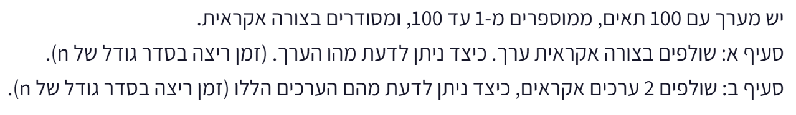

# PREP-041 — מציאת ערך אחד או שני ערכים שהוצאו ממערך

נקלטה ב־18 באוקטובר 2026. פתרון מוצע בסיוע AI, ממתין לסקירה מקצועית. קושי אינו מכויל. חברות לפי צילום המקור בלבד, ללא אימות עצמאי: לא מופיעות חברות בצילום.

## מקור ללא שינוי



יש מערך עם 100 תאים, ממוספרים מ-1 עד 100, ומסודרים בצורה אקראית.
סעיף א: שולפים בצורה אקראית ערך. כיצד ניתן לדעת מה הערך. (זמן ריצה בסדר גודל של n).
סעיף ב: שולפים 2 ערכים אקראיים, כיצד ניתן לדעת מהם הערכים הללו (זמן ריצה בסדר גודל של n).

## נוסח השאלה לאתר

נתון מערך המכיל את כל המספרים השלמים מ־1 עד 100, כל מספר בדיוק פעם אחת, בסדר אקראי.

הבהרת נוסח: בכל אחד מהסעיפים מתחילים מהמערך המלא. הערכים שמוציאים מוסתרים מאיתנו, ואפשר לקרוא את כל הערכים שנותרו במערך ובכל סדר.

א. מוציאים ערך אחד, כך שנותרים 99 ערכים. כתבו דרך למצוא את הערך שהוצא בזמן O(n).
ב. מוציאים שני ערכים שונים, כך שנותרים 98 ערכים. כתבו דרך למצוא את שניהם בזמן O(n).

כאן n=100; נתחו את הסיבוכיות גם עבור הטווח הכללי מ־1 עד n. אין דרישה לסדר פלט מסוים, ואין איסור על סריקה נוספת. ציינו במפורש מה הוספנו כהבהרה לנוסח המקור, ומה ניתן לומר אם הערכים שנשלפו גלויים או אם אין גישה למערך שנותר.

### שלושה רמזים

1. אין צורך לשחזר את הסדר האקראי. איזה מידע אפשר לחשב מראש על כל המספרים בטווח, ואז להשוות למה שנותר?
2. ערך חסר אחד אפשר למצוא מהפרש הסכומים. כשחסרים שניים, הסכום נותן רק את החיבור שלהם. איזו פעולה מבטלת ערך שמופיע פעמיים?
3. בצעו XOR על הטווח המלא ועל המערך שנותר. התוצאה היא XOR של שני החסרים. מצאו בתוצאה ביט שערכו 1, חלקו לפי הביט הזה את שתי קבוצות הקלט, ובצעו XOR נפרד בכל צד.

## הצעה לפתרון

### קודם מבהירים מה אפשר לראות

הנוסח המקורי אינו אומר במפורש שהערכים שנשלפו מוסתרים ושהמערך המקורי מכיל כל מספר פעם אחת. כאן נפתור את הפרשנות שהוגדרה במפורש בנוסח הערוך: בתחילה קיימת תמורה של המספרים מ־1 עד 100; ערך אחד או שני ערכים שונים הוצאו והוסתרו, ואפשר לקרוא את כל הערכים שנותרו. זהו מידע חיוני לפתרון, ולא מסקנה מהסדר האקראי. נסמן את גבול הטווח הכללי ב־n; בשאלה הנתונה n=100.

### סעיף א — משווים את מה שאמור להיות למה שנותר

אילו כל המספרים היו במערך, היינו יודעים את הסכום בלי לדעת את הסדר שלהם: n*(n+1)/2. סכימת כל הערכים שנותרו נותנת אותו סכום פחות הערך שהוצא. לכן החיסור מחזיר בדיוק את הערך החסר.

למשל, סכום המספרים מ־1 עד 100 הוא 5050. אם סכום 99 הערכים שנותרו הוא 5013, הערך שהוצא הוא 37.

```python
def missing_one(remaining, n=100):
    return n * (n + 1) // 2 - sum(remaining)
```

הפונקציה מניחה שהקלט תקין: כל הערכים הנותרים שונים, נמצאים בטווח, ורק ערך אחד חסר.

### סעיף ב — למה סכום בלבד אינו מספיק?

כעת הפרש הסכומים נותן את סכום שני החסרים, ולא את כל אחד מהם בנפרד. למשל, הסכום 119 מתאים גם ל־37 ו־82 וגם ל־36 ו־83. צריך מידע שמפריד בין שני הערכים.

פעולת XOR מתאימה לביטול כפילויות: לכל ערך מתקיים x XOR x = 0 וגם x XOR 0 = x. נפעיל XOR על כל המספרים בטווח, ואז על כל הערכים שנותרו במערך. כל ערך שנמצא במערך מופיע פעמיים ומתבטל. רק שני החסרים נשארים, ולכן התוצאה היא a XOR b.

אבל התוצאה הזו עדיין אינה שני המספרים עצמם. מכיוון שהחסרים שונים, יש לפחות ביט אחד שבו הם שונים; באותו מקום בתוצאת ה־XOR נמצא 1. הביט הימני ביותר שערכו 1 מבודד באמצעות combined & -combined.

מחלקים לפי הביט הזה את כל המספרים בטווח ואת כל הערכים שנותרו: קבוצה אחת לביט 1 וקבוצה שנייה לביט 0. בתוך כל קבוצה מבצעים XOR נפרד. כל ערך קיים שוב מתבטל עם העותק שלו באותה קבוצה, ושני החסרים נמצאים בקבוצות שונות. לכן בכל קבוצה נשאר בדיוק חסר אחד.

אם החסרים הם 37 ו־82, תוצאת ה־XOR היא 119 והביט המבדיל שבחרנו הוא ביט היחידות: 37 אי־זוגי ו־82 זוגי. אחרי הביטול בקבוצת האי־זוגיים נשאר 37, ובקבוצת הזוגיים נשאר 82. במקרים אחרים הביט המבדיל יכול להיות ביט אחר; אין להסתמך תמיד על זוגיות.

```python
def missing_two(remaining, n=100):
    combined = 0
    for value in range(1, n + 1):
        combined ^= value
    for value in remaining:
        combined ^= value

    distinguishing_bit = combined & -combined
    a = 0
    b = 0

    for value in range(1, n + 1):
        if value & distinguishing_bit:
            a ^= value
        else:
            b ^= value
    for value in remaining:
        if value & distinguishing_bit:
            a ^= value
        else:
            b ^= value

    return (a, b) if a < b else (b, a)
```

הקוד קורא את הערכים הנותרים פעמיים ואינו משנה את המערך. הוא מניח ששני חסרים שונים הוסרו מתמורה תקינה; הוא אינו בודק קלט שרירותי פגום.

### למה זה נכון ומה העלות?

בסעיף א, הפרש הסכומים מבטל כל ערך שנותר בדיוק פעם אחת. בסעיף ב, שלב ה־XOR הראשון משאיר רק a XOR b. הביט שנבחר מוכרח להיות שונה אצל שני החסרים, ולכן מפריד ביניהם. כל ערך קיים נשלח לאותה קבוצה בשתי הופעותיו ומתבטל, ובכל קבוצה נשאר חסר אחד.

לשני הסעיפים זמן O(n). מספר קבוע של סריקות עדיין נותן זמן ליניארי. נשמר מספר קבוע של משתנים: O(1) מילות מכונה במודל שבו מספרים בגודל הזה נכנסים למילה. בספירת ביטים זהו O(log n) זיכרון עזר; אין כאן טענה לזיכרון קבוע בביטים כשהטווח גדל ללא גבול. בפייתון המספרים מדויקים; בשפה בעלת טיפוסים ברוחב קבוע צריך למנוע גלישה בחישוב הסכום בסעיף א. עבור מערך שרירותי ולא ממוין צריך במקרה הגרוע לקרוא סדר גודל של n איברים, ולכן הזמן הליניארי מיטבי במודל הזה.

### מה קורה בקריאות אחרות של המקור?

אם הערכים שנשלפו גלויים לנו, פשוט קוראים אותם: עבור אחד או שניים זהו זמן O(1). אם הערכים מוסתרים ואי אפשר לבדוק את המערך שנותר, אין די מידע לזהות אותם בוודאות; כמה בחירות שונות מתיישבות עם אותו מידע. אם רק מספרי התאים ידועים ולא נאמר אילו ערכים היו בהם, אין הצדקה להשתמש בסכום של 1 עד 100. לכן תנאי ההתחלה והגישה לשאר המערך מופיעים במפורש בנוסח הערוך.


### הנחות והבהרות

- התחלה מתמורה של כל המספרים מ־1 עד n, כל מספר פעם אחת; n=100 במקרה הנתון.

- אחד או שני ערכים שונים הוצאו והוסתרו; נותרו n-1 או n-2 ערכים נגישים. כל סעיף עצמאי.

- אפשר לקרוא את המערך שנותר יותר מפעם אחת, ולא נדרש לשנות אותו.

- המקור אינו מנסח את מודל השליפה באופן חד־משמעי. הנחות ההוצאה וההסתרה נוספו בעריכה באישור הראל; חלופות הניסוח מוסברות בפתרון.

- הקוד מניח קלט העומד בהבטחה. בדיקת האורך בקובץ הקוד אינה בדיקה מלאה של ייחודיות או תחום.

### נכונות ויעילות

```json
{
  "criterion": "זמן חישוב כפונקציה של n עבור מערך שנותר נגיש ואינו ממוין, תחת ההבטחה שהקלט תקין.",
  "result": "O(n) זמן בשני הסעיפים; O(1) מילות עזר, שהן O(log n) ביטים במודל של מספרים לא חסומים.",
  "proof": "חיסור סכומים מזהה חסר אחד. XOR מבטל כל ערך קיים; ביט שבו החסרים שונים מפריד אותם לשתי קבוצות שבהן הביטול משאיר חסר יחיד. מספר הסריקות קבוע. במקרה הגרוע, תאים שלא נקראו יכולים להחליף איזה ערך חסר בלי לשנות את התאים שנצפו, ולכן נדרשות סדר גודל של n קריאות במודל זה.",
  "scope": "אין כאן טענה לזיכרון קבוע בביטים לכל n, או צורך בזמן ליניארי כאשר הערך שנשלף כבר גלוי. זמן פעולות על מספרים מעבר למילת מכונה תלוי ברוחב שלהם."
}
```

### בדיקות שבוצעו

24,023 בדיקות פייתון עברו מול אורקל בלתי תלוי של הפרש קבוצות: כל 100 החסרים היחידים וכל 4,950 זוגות החסרים עבור n=100, בכל אחד משלושה סדרי קלט; בנוסף כל סדר אפשרי של השארית לכל חסר או זוג חסרים עבור n מ־1 עד 7, וארבע בדיקות תנאי אורך. בדיקות אלה מאמתות את הקוד במסגרת ההנחות, ואינן סקירה מקצועית או בדיקת לחיצות באתר.

### מקרי קצה

- חסר 1 או n: נוסחת הסכום וה־XOR אינם תלויים בכך שהחסר פנימי.

- שני חסרים בעלי אותה זוגיות, למשל 2 ו־4: יש לבחור ביט מתוך תוצאת ה־XOR, ולא לקבע את ביט הזוגיות.

- n=1 בסעיף א: מערך ריק מחזיר 1. n=2 בסעיף ב: מערך ריק מחזיר את 1 ו־2.

- סדר אקראי, הפוך או ממוין: התוצאה זהה; סדר הפעולות אינו משנה סכום או XOR.

- זרם חד־פעמי שאי אפשר לסרוק שוב אינו הקלט המובטח של מימוש ה־XOR בשני מעברים.

### טעויות נפוצות

- הנחה שמספרי התאים מבטיחים גם את תוכנם: נדרשת הבטחה על הערכים, לא רק על הכתובות.

- שימוש רק בסכום למציאת שני חסרים: כמה זוגות שונים עשויים לתת אותו סכום.

- החזרת XOR של שני חסרים כאילו הוא זוג הערכים: נדרש שלב החלוקה לפי ביט מבדיל.

- חלוקה קבועה לזוגיים ואי־זוגיים: שני החסרים עלולים להיות באותה קבוצה.

- טענה שזיכרון העזר קבוע בביטים לכל n, או שבדיקת אורך בלבד מאמתת את הבטחת הקלט.

- ניסיון להסיק את הערכים כאשר גם הם מוסתרים וגם המערך שנותר אינו נגיש: אין מספיק מידע.

### תשובה קצרה לראיון

קודם אבהיר שהמערך היה תמורה של 1 עד n, שהערכים שהוצאו מוסתרים ושאפשר לסרוק את השארית. לחסר יחיד אחסיר את הסכום שנותר מהסכום n*(n+1)/2. לשני חסרים אבצע XOR של הטווח והשארית לקבלת a XOR b, אבחר ביט דלוק בו ואחזור על הביטול בנפרד בשתי הקבוצות לפי הביט. החסרים מופרדים, וכל ערך קיים מתבטל. הזמן O(n) וזיכרון העזר מספר קבוע של מילים. אם השליפה עצמה גלויה, אין צורך באלגוריתם הזה.

### הרחבות ושאלת המשך

```json
{
  "question": "מה משתנה אם השארית מגיעה כזרם שאי אפשר לקרוא שוב, ועדיין חסרים שני ערכים?",
  "direction": "אפשר לשמור במהלך מעבר אחד סכום וסכום ריבועים. הפרשי הסכומים נותנים s=a+b ו־q=a²+b². אז 2q-s²=(a-b)²; שורש ריבועי שלם מאפשר לחלץ את a ו־b. צריך חשבון שלם מדויק וטיפוס רחב מספיק, ואין להשתמש בשורש נקודה צפה ללא בקרה.",
  "status": "שאלת המשך מוכנה בארכיון; לא חוברה אוטומטית למנגנון ההמשך באתר."
}
```

## English question

An array initially contains every integer from 1 through 100 exactly once, in random order.

Editorial clarification: each part starts from the full array. The removed values are hidden, and all remaining entries can be inspected in any order.

A. One value is removed, leaving 99 entries. Find the removed value in O(n) time.
B. Two distinct values are removed, leaving 98 entries. Find both in O(n) time.

Here n=100; also analyze the general range 1 through n. The output may be in either order, and another scan is permitted. Distinguish the editorial assumptions from the original wording, and explain what changes if the drawn values are visible or if the remaining array cannot be inspected.

### Three progressive hints

1. You do not need to reconstruct the random order. What aggregate can you compute for the complete range and compare with the remaining entries?
2. A difference of sums finds one missing value. For two, it gives only their sum. Which operation cancels a value appearing twice?
3. XOR the complete range and the remaining entries. The result is the XOR of the two missing values. Choose a set bit in that result, partition both inputs by it, and XOR each group separately.

## Proposed solution

### First clarify what is observable

The original wording does not explicitly say that the drawn values are hidden or that every number occurs exactly once. We solve the interpretation stated in the edited prompt: the initial array is a permutation of 1 through 100; one or two distinct values are removed and hidden, and all remaining entries can be inspected. These are essential assumptions, not consequences of random ordering. Let n denote the general upper limit; here n=100.

### Part A — compare what should be present with what remains

If all values were present, their sum would be n*(n+1)/2 regardless of their order. The sum of the remaining values is that total minus the removed value. Subtracting therefore gives exactly the missing value.

For example, 1 through 100 sum to 5050. If the remaining 99 entries sum to 5013, the removed value is 37.

```python
def missing_one(remaining, n=100):
    return n * (n + 1) // 2 - sum(remaining)
```

This function assumes valid input: the remaining values are distinct, are in range, and exactly one value is absent.

### Part B — why is a sum alone insufficient?

The difference of sums now gives the sum of two missing values, not each value separately. For example, 119 could be 37+82 or 36+83. We need information that separates the two missing values.

XOR cancels duplicate values: x XOR x = 0 and x XOR 0 = x. XOR every value in the full range, then every remaining array entry. Every present value occurs twice and cancels. Only the two missing values survive, so the result is a XOR b.

This still does not identify both values. Because the missing values are distinct, at least one bit differs between them; that bit is 1 in their XOR. The expression combined & -combined isolates the rightmost set bit.

Partition both the full range and the remaining entries by that bit: one group has bit 1 and the other has bit 0. XOR the values independently within each group. Every present value cancels with its copy in the same group, while the two missing values lie in different groups. Exactly one missing value remains in each group.

If the missing values are 37 and 82, their XOR is 119, and the chosen distinguishing bit is the least significant bit: 37 is odd and 82 is even. Cancellation leaves 37 in the odd group and 82 in the even group. In other inputs, another bit may be required; a fixed odd/even split does not always work.

```python
def missing_two(remaining, n=100):
    combined = 0
    for value in range(1, n + 1):
        combined ^= value
    for value in remaining:
        combined ^= value

    distinguishing_bit = combined & -combined
    a = 0
    b = 0

    for value in range(1, n + 1):
        if value & distinguishing_bit:
            a ^= value
        else:
            b ^= value
    for value in remaining:
        if value & distinguishing_bit:
            a ^= value
        else:
            b ^= value

    return (a, b) if a < b else (b, a)
```

The code reads the remaining entries twice and does not modify the array. It assumes two distinct missing values from a valid permutation; it does not validate arbitrary malformed input.

### Correctness and cost

In Part A, subtracting the observed sum cancels every remaining value once. In Part B, the first XOR leaves a XOR b. The selected set bit must differ between the two missing values, so it separates them. Each present value is assigned to the same group on both appearances and cancels, leaving one missing value per group.

Both parts take O(n) time. A constant number of scans is still linear. A constant number of integer variables gives O(1) machine words when these values fit the word model. Counting bits gives O(log n) auxiliary storage; this is not constant bit space for an unbounded range. Python arithmetic is exact; fixed-width languages must avoid overflow in Part A's sum. For an arbitrary unsorted array, inspecting order n entries is necessary in the worst case, so linear time is optimal in this access model.

### Other readings of the original

If the drawn values are visible, simply read them: one or two values take O(1) time. If they are hidden and the remaining array cannot be inspected, there is insufficient information to identify them with certainty; different removed values fit the same observation. If only cell indices are known, without a guarantee on the original values, the sum of 1 through 100 is unjustified. The edited prompt therefore states the initial contents and observation model explicitly.


### Assumptions and clarifications

- The initial contents are a permutation of 1 through n, each value once; n=100 in the given instance.

- One or two distinct values are removed and hidden; n-1 or n-2 accessible entries remain. The parts are independent.

- The remaining array may be read more than once and need not be modified.

- The source does not specify an unambiguous draw model. Removal and concealment are user-authorized editorial assumptions; alternatives are explained in the solution.

- The code assumes the promised input contract. The file's length checks do not fully validate uniqueness or range.

### Correctness and efficiency

```json
{
  "criterion": "Time as a function of n for an accessible unsorted remaining array under the valid-input promise.",
  "result": "O(n) time in both parts; O(1) auxiliary words, corresponding to O(log n) bits for an unbounded range.",
  "proof": "Subtracting sums finds one missing value. XOR cancels every present value; a differing bit partitions the two missing values into groups in which cancellation leaves one value each. There are constantly many scans. In the worst case, unread entries can change which value is absent without changing the observed entries, requiring order n reads in this model.",
  "scope": "This does not claim constant bit space for all n or a linear-time requirement when drawn values are already visible. Arithmetic beyond one machine word depends on operand width."
}
```

### Verification performed

24,023 Python checks passed against an independent set-difference oracle: all 100 single omissions and all 4,950 missing pairs for n=100, in three input orders each; all remaining permutations for each one- or two-value omission with n from 1 through 7; and four size-guard checks. This verifies the code under its assumptions, not professional review or live website interaction.

### Edge cases

- Missing 1 or n: neither the sum formula nor XOR depends on an interior omission.

- Two missing values with the same parity, such as 2 and 4: select a bit from their XOR rather than always using parity.

- n=1 in Part A: an empty array yields 1. n=2 in Part B: an empty array yields 1 and 2.

- Random, reversed, or sorted order gives the same answer; sum and XOR do not depend on entry order.

- A one-use stream that cannot be read again is outside the two-pass XOR implementation's input contract.

### Common mistakes

- Treating numbered cells as a guarantee about their contents: the values, not just the addresses, need a contract.

- Using only a sum for two omissions: several different pairs may have the same sum.

- Returning the XOR of the missing values as though it identifies both: the distinguishing-bit partition is still required.

- Always splitting odd from even: both missing values may lie in the same group.

- Claiming constant auxiliary bits for every n, or that a length check fully verifies the input promise.

- Inferring hidden drawn values without access to the remaining array: the available information is insufficient.

### Interview answer

I first clarify that the array was a permutation of 1 through n, the removed values are hidden, and the remainder can be scanned. For one omission, subtract the remaining sum from n*(n+1)/2. For two, XOR the range and remainder to obtain a XOR b, choose one set bit, and repeat cancellation separately in the two bit groups. The missing values are separated and every present value cancels. Time is O(n), with constantly many auxiliary words. If the drawn values themselves are visible, this algorithm is unnecessary.

### Extensions and follow-up

```json
{
  "question": "What changes if the remaining entries arrive as a stream that cannot be read again, while two values are missing?",
  "direction": "In one pass, accumulate a sum and a sum of squares. Subtract from the complete-range totals to get s=a+b and q=a²+b². Then 2q-s²=(a-b)²; an exact integer square root recovers a and b. Exact arithmetic and sufficient integer width are required; do not use an unchecked floating-point square root.",
  "status": "Follow-up prepared in the archive; not automatically connected to the website's follow-up flow."
}
```

## קבצים ובדיקות

[prep_041_missing_values.py](../solutions/prep_041_missing_values.py) · [check_prep_041.py](../checks/check_prep_041.py) · [prep-041-verification.json](../checks/prep-041-verification.json)

שאלת ההמשך מוכנה בשתי השפות אך טרם חוברה לתור האינטראקטיבי. ההערכה המקצועית ורמת הקושי עדיין בביקורת; אין להעניק לשאלה זו ראיות שליטה או ניקוד תחרותי. שאלות חומרה אומתו במודל Python בלבד; אין בכך טענה לסימולציית HDL או לבדיקה פיזית.
