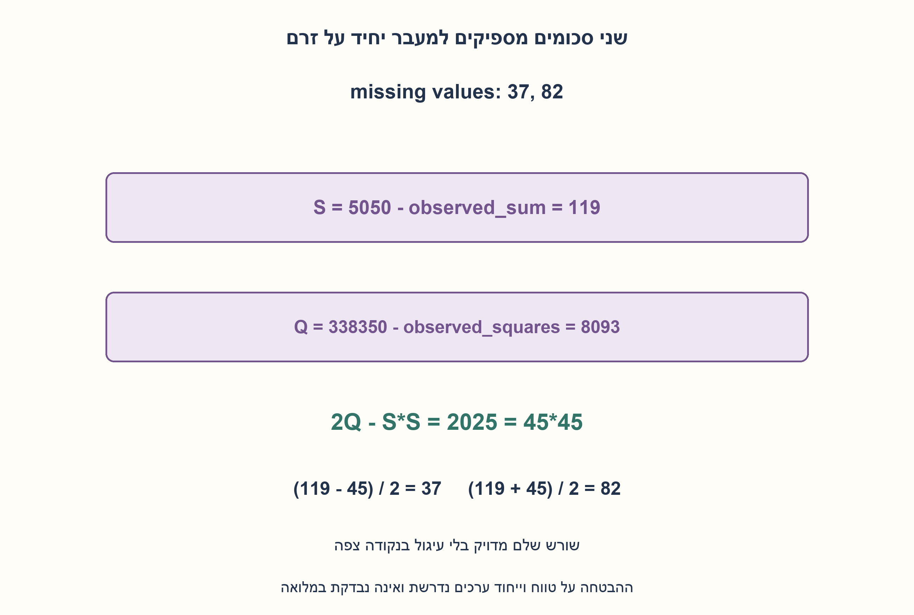
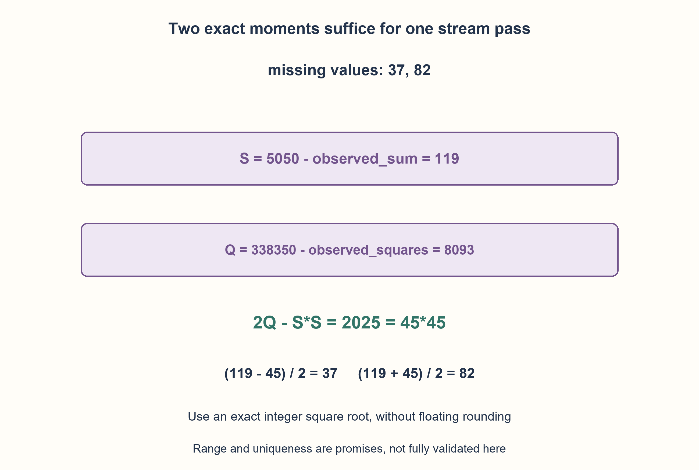

# PREP-041 — מציאת ערך אחד או שני ערכים שהוצאו ממערך

פתרון מוצע בסיוע AI; ביקורת מקצועית אנושית ממתינה.

## מקור פרטי / Private source

סעיף א: נתון מערך עם 99 איברים שמכיל את כל המספרים מאחד עד מאה מלבד איבר חסר, בעזרת מעבר יחיד ומשתנה עזר אחד על המערך עליך למצוא איזה איבר חסר. סעיף ב: נתון מערך בעל 98 איברים ששני איברים בין אחד למאה חסרים בו, בעזרת מעבר יחיד ושני משתני עזר כיצד תמצא את שני האיברים החסרים?

[צילום מקור פרטי](../sources/2026-10-30-batch70-07.png)

## נוסח ערוך

### הרחבה: מעבר יחיד ומשתנה צבירה אחד או שניים
א.99 ערכים שונים מתוך 1..100, חסר אחד: מצאו אותו במעבר אחד ובצובר מספרי אחד. ב.98 ערכים שונים מאותו תחום, חסרים שניים שונים: מצאו אותם במעבר אחד ובשני צוברים.

זהו חוזה חדש: הקלט יכול להיות זרם חד־פעמי שאסור לקרוא שוב. n ידוע מראש; אורך, תחום וייחוד הם הבטחה. המגבלה סופרת צוברים מספריים שמתעדכנים בזמן הזרימה, לא את n, פריט הקלט הנוכחי, בקרת הלולאה או משתני חישוב/פלט אחרי הסיום. נדרשת אריתמטיקה מדויקת עם רוחב מספיק, ושורש שלם מדויק. הכלילו ל־ 1..n ושמרו את גרסאות הקריאה החוזרת הקודמות.

### שלושה רמזים

1. ערך חסר אחד הוא הפרש בין סכום הטווח לבין מה שנקרא. איזה סיכום נוסף ייתן מידע עצמאי על שני חסרים?
2. צברו גם ריבועים. בסוף תקבלו S=a+b ו־Q=a²+b².
3. 2Q−S²=(a−b)². חשבו שורש שלם מדויק d, ואז a=(S−d)/2, b=(S+d)/2; הגדירו רוחב והימנעו מעיגול.

### הצעה לפתרון

### צוברים מה חסר במקום לשמור מה ראינו
לחסר יחיד נאתחל difference=n(n+1)/2 ונחסיר כל ערך פעם אחת. בסוף כל הנוכחים בוטלו ונשאר החסר. n=100 נותן 5050; סכום תצפיות 5013 משאיר 37.

לשני חסרים נאתחל שני הפרשים: S=n(n+1)/2 ו־Q=n(n+1)(2 n+1)/6. לכל ערך v נחסיר v מ־S ו־v² מ־Q. בסוף S=a+b, Q=a²+b², ולכן 2Q−S²=a²−2 ab+b²=(a−b)². מכיוון ששני החסרים שונים, ההפרש חיובי. שורש שלם d נותן את מרחקם והנוסחאות (S−d)/2,(S+d)/2 מחזירות אותם בסדר עולה.

עבור 37,82 נקבל S=119, Q=8093, והדיסקרימיננטה 2025=45². לכן התוצאות 37,82. אין צורך במעבר שני, והקוד מקבל גם iterable חד־פעמי. דגימת XOR דו־מעברית נשארת פתרון תקף לחוזה המקורי אך לא לזרם הזה.

הסכומים המדויקים חשובים: סכום הריבועים גדל כסדר n³, ולכן טיפוס שמכיל ערך קלט לא בהכרח מכיל את הצובר או מכפלות הנוסחה. ב־n=100 המספר 338350 קטן, אבל בהכללה צריך טיפוס רחב/בדיקות גלישה או שלמים ארוכים. isqrt מחזירה שורש שלם ללא קירוב; בדיקת ריבוע מושלם וזוגיות מגינה על חישוב המועמדים, אך אינה ולידציה מלאה של זרם שרירותי. ההבטחות על ייחוד וטווח עדיין נדרשות.

בזמן הזרימה מבוצעות Θ(n) פעולות ומוחזקים צובר אחד/שניים; חישוב הסיום הוא מספר קבוע של פעולות כולל שורש שלם במודל מילה שתומך בכך. עלות שורש ומכפלות בשלמים ארוכים תלויה ברוחב ואינה זמן פיזי קבוע. רוחב הצוברים הוא O(log n) ביטים, לא מספר ביטים קבוע. נבדקו 46233 סדרי חסר יחיד,23116 סדרי שני חסרים וכל 4950 זוגות חסרים מתוך 100, עם אובייקט שמכשיל ניסיון לקרוא את הקלט יותר מפעם אחת.

```python
"""Finite one-shot stream; promised distinct range values and omission count.

One/two STREAMING NUMERIC ACCUMULATORS. The current item, n, loop control and
post-stream arithmetic scratch/output are allowed. No full validity check or
input materialization is hidden in the accumulator budget.
"""
from math import isqrt


def missing_one_once(values, n=100):
    if type(n) is not int or n < 1:
        raise ValueError("n must be a positive integer")
    difference = n * (n + 1) // 2
    for value in values:
        difference -= value
    return difference


def missing_two_once(values, n=100):
    if type(n) is not int or n < 2:
        raise ValueError("two omissions require n at least two")
    sum_difference = n * (n + 1) // 2
    square_difference = n * (n + 1) * (2 * n + 1) // 6
    for value in values:
        sum_difference -= value
        square_difference -= value * value
    discriminant = 2 * square_difference - sum_difference * sum_difference
    if discriminant <= 0:
        raise ValueError("not two distinct omissions under the promise")
    root = isqrt(discriminant)
    if root * root != discriminant or (sum_difference - root) % 2:
        raise ValueError("nonintegral omission candidates")
    first, second = (sum_difference - root) // 2, (sum_difference + root) // 2
    if not 1 <= first < second <= n:
        raise ValueError("candidate values outside the promised domain")
    return first, second
```




### assumptions

[
  "תחום 1..n ללא חזרות, מספר חסרים ואורך הזרם מובטחים; n ידוע.",
  "מגבלת הצוברים אינה אוסרת פריט נוכחי או scratch אחרי הזרימה; אין שמירת קלט."
]

### optimality

מעבר קלט יחיד, צובר אחד/שניים ו־Θ(n) פעולות זרימה. עלות אריתמטיקה ושורש תלויה ברוחב; אין טענת ולידציה מלאה.

### edge_cases

[
  "n=1 וחסר יחיד, n=2 ושני חסרים, חסר 1 או n.",
  "חסרים סמוכים או רחוקים; טיפוסי גלישה ועיגול."
]

### common_mistakes

[
  "לקרוא שוב לזרם עבור פיצול XOR.",
  "להשתמש בשורש נקודה צפה או בטיפוס צר.",
  "לפרש שני צוברים כשתי סיביות או להציג בדיקת מועמדים כוולידציית ייחוד."
]

### interview_answer

אחשב הפרשי סכום וריבועים במעבר יחיד. בסוף S הוא סכום החסרים ו־ 2Q−S² ריבוע הפרשם; שורש שלם והחצי־סכום משחזרים את שניהם.

### source_ambiguities

הניסוח משתנה עזר פורש כצובר בזמן הקריאה; אם נאסרת אפילו בקרת לולאה או scratch צריך חוזה מכונה אחר. הגרסה הקודמת הרשתה עוד סריקה.

### verification

46233 סדרים לחסר אחד,23116 לשניים ו־ 4950 זוגות מתוך 100; מבקר צריכה אחת ושורש מדויק.

### solution_extensions

[
  {
    "question": "האם שני הצוברים מוכיחים שהקלט באמת ייחודי ובטווח?",
    "direction": "לא; אלה סיכומים תחת הבטחה. בדיקת כל תנאי הקלט היא משימה אחרת עם תקציב מתאים.",
    "principle": "פענוח תחת הבטחה שונה מאימות מלא."
  }
]

## Edited prompt

### Extension: one pass with one or two numeric accumulators
A.99 distinct observations from 1..100 omit one value: find it in one pass/one numeric accumulator. B.98 distinct observations omit two distinct values: one pass/two accumulators.

This new contract permits a one-shot stream that cannot be reread. n is known; length/range/uniqueness are promises. The budget counts numeric accumulators updated while streaming, not n, the current input item, loop control or post-stream arithmetic/output scratch. Use exact arithmetic with sufficient width and exact integer square root. Generalize to 1..n while preserving prior repeatable-input variants.

### Three hints

1. One omission is a difference of sums. What independent summary separates two omissions?
2. Accumulate squares as well, obtaining S=a+b and Q=a²+b².
3. 2Q−S²=(a−b)². Use exact integer root d, then a=(S−d)/2, b=(S+d)/2; define width rather than rounding.

### Proposed solution

### Accumulate what is missing instead of storing observations
For one omission initialize difference=n(n+1)/2 and subtract each observation once. Present values cancel, leaving the omission. For n 100,5050 minus observed 5013 gives 37.

For two omissions initialize S=n(n+1)/2 and Q=n(n+1)(2 n+1)/6. Each item v subtracts v from S and v² from Q. At the end S=a+b, Q=a²+b², so 2Q−S²=a²−2 ab+b²=(a−b)². Distinct omissions make it positive. Exact integer root d is their distance; (S−d)/2,(S+d)/2 give the ascending pair.

Missing 37,82 gives S119, Q8093 and discriminant 2025=45², recovering 37,82. No reread is required; code accepts a one-shot iterable. The previous two-pass XOR remains valid for its original repeatable-input contract, not this stream.

Exact width matters: the square sum grows on the order of n³, so an input-fitting type may not fit accumulators or formula products. At n 100 total 338350 is small, but generalization needs wider types/overflow checks or big integers. isqrt avoids floating rounding. Perfect-square/parity checks validate candidate arithmetic, not the entire arbitrary stream; uniqueness/range promises remain essential.

Streaming uses Θ(n) operations and one/two numeric accumulators. Postprocessing uses a fixed number of arithmetic operations, including integer root in a word model supporting it. Long-integer roots/multiplications have width-dependent cost, not constant physical time. Accumulators need O(log n) bits rather than a fixed bit count.46,233 single-omission orders,23,116 double-omission orders and all 4,950 missing pairs from 100 passed with an object rejecting any attempt to iterate input twice.

```python
"""Finite one-shot stream; promised distinct range values and omission count.

One/two STREAMING NUMERIC ACCUMULATORS. The current item, n, loop control and
post-stream arithmetic scratch/output are allowed. No full validity check or
input materialization is hidden in the accumulator budget.
"""
from math import isqrt


def missing_one_once(values, n=100):
    if type(n) is not int or n < 1:
        raise ValueError("n must be a positive integer")
    difference = n * (n + 1) // 2
    for value in values:
        difference -= value
    return difference


def missing_two_once(values, n=100):
    if type(n) is not int or n < 2:
        raise ValueError("two omissions require n at least two")
    sum_difference = n * (n + 1) // 2
    square_difference = n * (n + 1) * (2 * n + 1) // 6
    for value in values:
        sum_difference -= value
        square_difference -= value * value
    discriminant = 2 * square_difference - sum_difference * sum_difference
    if discriminant <= 0:
        raise ValueError("not two distinct omissions under the promise")
    root = isqrt(discriminant)
    if root * root != discriminant or (sum_difference - root) % 2:
        raise ValueError("nonintegral omission candidates")
    first, second = (sum_difference - root) // 2, (sum_difference + root) // 2
    if not 1 <= first < second <= n:
        raise ValueError("candidate values outside the promised domain")
    return first, second
```




### assumptions

[
  "Distinct 1..n observations with promised length/omissions; n known.",
  "Accumulator budget permits current item and post-stream scratch; no input retention."
]

### optimality

One input pass/one or two accumulators/Θ(n) streaming operations. Arithmetic/root costs depend on width; no full validation claim.

### edge_cases

[
  "n 1/one omission, n 2/two omissions, missing 1 or n.",
  "Adjacent/distant omissions, overflow and rounding."
]

### common_mistakes

[
  "Rereading a stream for XOR partitioning.",
  "Floating square root or narrow arithmetic.",
  "Confusing two accumulators with two bits or candidate checks with uniqueness validation."
]

### interview_answer

Accumulate sum/square differences once. S is the omissions' sum and 2Q−S² their squared distance; exact root and half-sum recover both.

### source_ambiguities

Auxiliary variable is interpreted as a streaming accumulator. Forbidding even loop control/scratch requires another machine model. The prior version permitted rereading.

### verification

46233 single orders,23116 double orders and 4950 hundred-range pairs; one-consumption guards and exact root.

### solution_extensions

[
  {
    "question": "Do two accumulators prove input uniqueness and range?",
    "direction": "No; they decode under a promise. Full input validation is a different task with an appropriate budget.",
    "principle": "Promise-based recovery differs from complete validation."
  }
]
