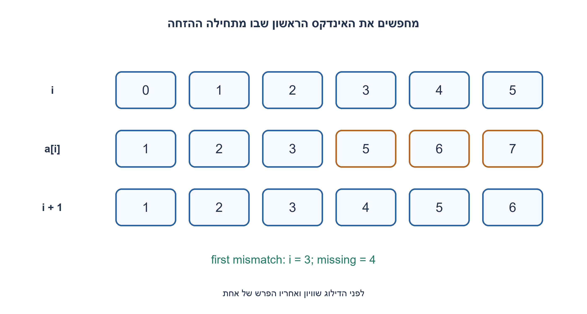
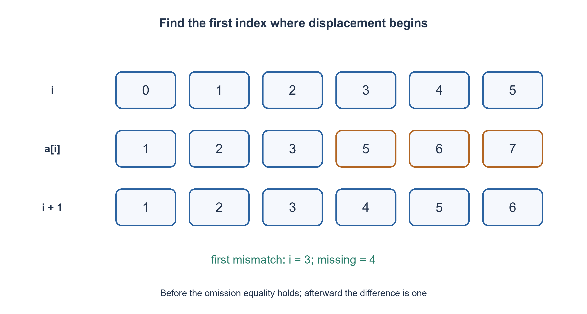

# PREP-041 — מציאת ערך אחד או שני ערכים שהוצאו ממערך

פתרון מוצע בסיוע AI; ביקורת מקצועית אנושית ממתינה. הקושי אינו מכויל.

## עברית

### הרחבה: רצף עולה עם דילוג יחיד
הדוגמה החדשה היא 1,2,3,5,6,7, ... והתוצאה בה 4. כדי להגדיר גם דילוג בקצוות, נניח במפורש מערך באורך n המכיל בסדר עולה את כל הערכים 1..n+1 למעט ערך אחד. אין כפילויות; הקלט מבטיח תקינות. מצאו את החסר בלי לשנות את המערך, ונסו לשפר את O(n) של הגרסה הלא־ממוינת. n=0 מותר.

המקור מציג דוגמה עולה אך אינו מגדיר את כל התחום; 1..n+1 והבטחת דילוג אחד הן השלמה עריכתית.

1. מה היה אמור להיות הערך באינדקס i אילו לא דילגו עד אליו?
2. לפני החסר מתקיים a[i]=i+1; אחריו a[i]=i+2. איפה משתנה התנאי?
3. חפשו בינארית את האינדקס הראשון שלא מקיים a[i]=i+1. התשובה היא האינדקס ועוד 1, כולל מקרה שכל האיברים תקינים והחסר הוא n+1.

### הדילוג הוא גבול בין שני אזורים
לפני המספר החסר אין הזחה, ואחריו כל איבר גדול באחד מהערך שהיה צפוי במקומו. לכן התנאי values[i]==i+1 הוא אמת ואז שקר, עם לכל היותר מעבר אחד. בחיפוש חצי־פתוח [low, high) נבדוק את middle: אם שווה, החסר אחריו ו־ low=middle+1; אחרת הגבול אינו אחריו ו־ high=middle. כשהגבולות נפגשים מחזירים low+1.

למשל [1,2,3,5,6,7] מחזיר 4; [2,3] מחזיר 1; [1,2] מחזיר 3; ריק מחזיר 1. האינווריאנט הוא שמיקום תחילת ההזחה נמצא בין low ל־ high כולל sentinel באינדקס n. הבטחת הסדר והיחידות מוכיחה מונוטוניות. בכל צעד התחום קטן בערך בחצי, ולכן O(log(n+1)) קריאות ו־ O(1) מילות עזר, בלי שינוי הקלט.

זה אינו אלגוריתם שמאמת קלט שרירותי בזמן לוגריתמי. אם צריך לבדוק שאין כפילות או פער נוסף, סריקה לינארית נפרדת נדרשת במקרה הכללי. אם אין התחלת תחום ידועה, אי אפשר להכריע מחסר לפני האיבר הראשון מול אחרי האחרון לפי הרשימה בלבד. הגרסאות הלא־ממוינות והסכום/XOR נשמרות ואינן נעשות לוגריתמיות בזכות דוגמה חדשה.

```python
"""n sorted distinct observations from 1..n+1; exactly one missing (promised)."""


def sorted_missing(values):
    low, high = 0, len(values)
    while low < high:
        middle = low + (high - low) // 2
        if values[middle] == middle + 1:
            low = middle + 1
        else:
            high = middle
    return low + 1
```




## English

### Extension: one gap in an increasing sequence
The new example is 1,2,3,5,6,7, ... with missing value four. To define endpoint omissions too, explicitly promise n sorted observations containing all values 1..n+1 except one. No duplicates; validity is promised. Find the omission without mutation and improve on the unordered variant's O(n). n=0 is allowed.

The source shows an ascending example but does not define the entire domain; 1..n+1 and exactly one omission are editorial clarifications.

1. What value belongs at index i before any omission?
2. Before the omission a[i]=i+1; afterward a[i]=i+2. Where does the predicate change?
3. Binary-search the first index not satisfying a[i]=i+1. Return that index plus one, including the all-matching case whose omission is n+1.

### The omission creates one boundary
Before the missing value there is no displacement; afterward every observed value exceeds its expected slot value by one. Thus values[i]==i+1 changes at most once from true to false. Search the half-open interval [low, high): equality at middle moves low to middle+1; inequality moves high to middle. Return low+1 when the boundaries meet.

[1,2,3,5,6,7] returns four, [2,3] returns one, [1,2] returns three and empty input returns one. The invariant keeps the first shifted index within the boundary interval, including sentinel index n. Sortedness and distinctness prove monotonicity. Each step halves the interval, giving O(log(n+1)) indexed reads and O(1) auxiliary words with no mutation.

This does not validate arbitrary malformed input in logarithmic time. Checking uniqueness or a second gap needs a separate linear scan in general. Without a known starting domain, an omission before the first or after the last observation may be unidentifiable. The previous unordered sum/XOR variants remain unchanged and do not become logarithmic merely because a new source shows sorted data.

```python
"""n sorted distinct observations from 1..n+1; exactly one missing (promised)."""


def sorted_missing(values):
    low, high = 0, len(values)
    while low < high:
        middle = low + (high - low) // 2
        if values[middle] == middle + 1:
            low = middle + 1
        else:
            high = middle
    return low + 1
```




## חומר משלים / Supporting material

```json
{
  "assumptions": {
    "he": "סדר עולה ו־ 1..n+1 ללא ערך יחיד; תקינות מובטחת.",
    "en": "Sorted distinct observations from 1..n+1 with one omission; validity promised."
  },
  "optimality": {
    "he": "O(log(n+1)) קריאות ו־ O(1) מילים; אימות מלא בנפרד O(n).",
    "en": "O(log(n+1)) reads and O(1) words; full validation separately O(n)."
  },
  "verification": {
    "he": "כל 20,301 אפשרויות ההשמטה ל־ n=0..200, מול החסר שנבחר, ללא שינוי קלט.",
    "en": "All 20,301 omissions for n=0..200 against the selected omitted value, with no mutation."
  },
  "edge_cases": {
    "he": "חסר ראשון, אחרון, מערך ריק; קלט פסול מחוץ להבטחה.",
    "en": "First/last omission, empty array; malformed input is outside promise."
  },
  "common_mistakes": {
    "he": "להחזיר אינדקס במקום ערך; לקרוא a[n]; להניח אותו פתרון בקלט לא ממוין.",
    "en": "Returning an index instead of value; reading a[n]; assuming sorted search works on arbitrary ordering."
  },
  "interview_answer": {
    "he": "אחפש את המקום הראשון שבו הערך כבר אינו i+1.",
    "en": "Find the first index whose value is no longer i+1."
  },
  "source_ambiguities": {
    "he": "התחום לא הוגדר במפורש בצילום; הבחירה נשמרת כהבהרה.",
    "en": "The domain is not explicit in the screenshot; the choice is recorded as a clarification."
  },
  "solution_extensions": {
    "he": [
      {
        "question": "מה אם שני מספרים חסרים?",
        "answer_direction": "ההזחה יכולה לעלות מ־ 0 ל־ 1 ול־ 2; צריך חוזה ותכנון נוסף, או הגרסה הקיימת לשני חסרים.",
        "principle": "חיפוש בינארי נשען על הבטחה מונוטונית."
      }
    ],
    "en": [
      {
        "question": "What if two values are missing?",
        "answer_direction": "Displacement can increase from zero to one to two; use a new contract/algorithm or the preserved two-omission variant.",
        "principle": "Binary search relies on a monotone promise."
      }
    ]
  }
}
```
