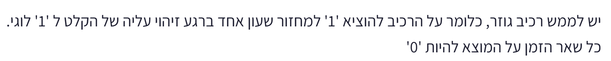
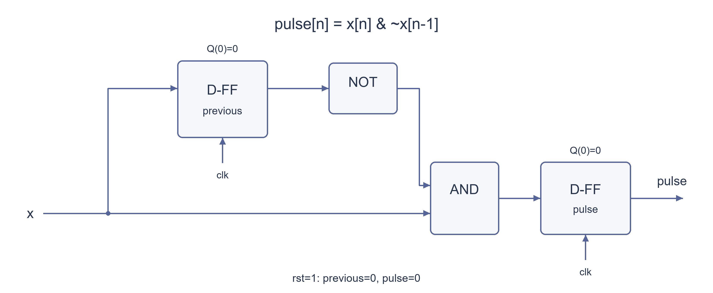

# PREP-042 — גלאי עלייה עם פולס של מחזור שעון אחד

נקלטה ב־18 באוקטובר 2026. פתרון מוצע בסיוע AI, ממתין לסקירה מקצועית. קושי אינו מכויל. חברות לפי צילום המקור בלבד, ללא אימות עצמאי: לא מופיעות חברות בצילום.

## מקור ללא שינוי



יש לממש רכיב גוזר, כלומר על הרכיב להוציא '1' למחזור שעון אחד ברגע זיהוי עליה של הקלט ל '1' לוגי.
כל שאר הזמן על המוצא להיות '0'

## נוסח השאלה לאתר

תכננו רכיב המפיק `1` במשך מחזור שעון אחד כאשר מזוהה עלייה בקלט מ־`0` ל־`1`. בשאר המחזורים הפלט יהיה `0`. קלט שנשאר גבוה אינו יוצר פולסים נוספים, וירידה מ־`1` ל־`0` אינה יוצרת פולס.

למימוש זה הניחו קלט בינארי `x` הסינכרוני לשעון ונדגם בחזית העולה. הפלט `pulse` רשום ומתעדכן לאחר חזית הדגימה. הדגימה הקודמת מתחילה ב־`0`, ולכן דגימה ראשונה גבוהה נחשבת עלייה.

הציגו מעגל, משוואות מצב ודוגמת תזמון. אפשר להציג איפוס סינכרוני פעיל בגבוה לקביעת מצב ההתחלה.

הבהרות העריכה: סינכרוניות הקלט, אופי הפלט הרשום, מצב ההתחלה ופרטי האיפוס לא הוגדרו בצילום. הם נכתבו כאן במפורש כדי להגדיר מימוש חד־משמעי. אין דרישה לזהות באופן מיידי כל מעבר אסינכרוני בין דגימות.

### שלושה רמזים

1. אם הקלט כרגע `1`, איך מבדילים בין עלייה חדשה לבין מצב שבו הוא גבוה כבר כמה מחזורים?
2. שמרו את דגימת הקלט הקודמת. איזה שילוב של הערך הקודם והנוכחי מתאר דווקא עלייה ולא ירידה?
3. רשמו בכל חזית את `x AND NOT(previous)` כפלט, ובמקביל שמרו את `x` לפעם הבאה. החישוב חייב להשתמש בערך הישן של `previous`.

## הצעה לפתרון

**הצעה לפתרון — זיהוי עלייה בין דגימות, עם פלט רשום**

הרעיון הוא להפריד בין שתי שאלות: האם הקלט עכשיו `1`, והאם הוא היה `0` בדגימה הקודמת. רק כאשר שתי התשובות נכונות, נרצה פולס. רמה גבוהה לבדה אינה אירוע חדש: אם הקלט נשאר `1` במשך חמישה מחזורים, צריכה להיווצר רק פעימה אחת.

**הבהרות לפני המימוש**

המקור אינו מגדיר יחס לשעון, אתחול או איפוס. במימוש כאן מניחים שהקלט `x` סינכרוני לשעון, עומד בדרישות זמני הכנה והחזקה, ונדגם בחזית העולה. הפלט `pulse` הוא פלט רשום: הוא מתעדכן לאחר חזית הדגימה ונשמר עד החזית הבאה. לאחר אתחול הדגימה הקודמת היא `0`, ולכן דגימה ראשונה שערכה `1` נחשבת עלייה. נציג איפוס סינכרוני פעיל בגבוה כדרך לקבוע מצב התחלה; זו הבהרת מימוש שהוספנו, ולא דרישה שהופיעה בתמונה.

**1. צריך לזכור את העבר**

אי אפשר להחליט לפי `x` הנוכחי בלבד. כאשר הוא `1`, יש הבדל בין מצב שבו זה עתה עלה מ־`0` לבין מצב שבו הוא כבר גבוה מזמן. לכן שומרים באוגר חד־ביטי בשם `previous` את הדגימה הקודמת של הקלט.

בכל חזית פעילה, לפני עדכון האוגרים, התנאי לעלייה הוא:

```text
rising = x AND NOT(previous)
```

התנאי אינו XOR: XOR מזהה גם ירידה, ואילו כאן ירידה אינה אמורה ליצור פולס.

**2. רושמים גם את תוצאת הזיהוי**

נשתמש בשני תאי זיכרון חד־ביטיים: האחד שומר את `previous`, והשני שומר את הפלט `pulse`. בכל חזית עולה ללא איפוס מחשבים את שני ערכי המצב הבאים מתוך הקלט והמצב הישן:

```text
pulse_next    = x AND NOT(previous)
previous_next = x
```

החיבורים הם: `x` מגיע לכניסת הנתונים של אוגר `previous` ולכניסה אחת של שער AND. היציאה ההפוכה של `previous`, או שער NOT על יציאתו, מגיעה לכניסה השנייה של AND. תוצאת AND מגיעה לכניסת הנתונים של אוגר `pulse`. שני האוגרים מקבלים את אותו שעון. אם ספריית התאים אינה מספקת יציאה הפוכה, משתמשים במהפך נפרד.

חשוב: שני האוגרים מתעדכנים יחד. חישוב `pulse_next` משתמש ב־`previous` הישן, ולא ב־`x` שזה עתה יישמר בו. הנה טבלת המעבר כאשר האיפוס אינו פעיל:

```text
previous  x  | pulse_next  previous_next
    0     0  |     0            0
    0     1  |     1            1
    1     0  |     0            0
    1     1  |     0            1
```

כאשר האיפוס פעיל בחזית, שני ערכי המצב הבאים הם `0`, בלי קשר ל־`x`.

**3. מימוש ב־SystemVerilog**

```systemverilog
module rising_edge_detector (
    input  logic clk,
    input  logic rst,
    input  logic x,
    output logic pulse
);
    logic previous;

    always_ff @(posedge clk) begin
        if (rst) begin
            previous <= 1'b0;
            pulse    <= 1'b0;
        end else begin
            pulse    <= x & ~previous;
            previous <= x;
        end
    end
endmodule
```

השמות `<=` בתוך בלוק שעוני הן השמות לא חוסמות. אגפי ימין מחושבים מהמצב שלפני העדכון; לכן שתי השורות מקיימות את המשוואות יחד. אין כאן צורך להפיק שעון חדש מתוך הקלט, ואין להשתמש ב־`posedge x` במקום בשעון המערכת. לצורך האתחול יש להפעיל `rst` בחזית שעון אחת לפחות.

**4. עוקבים אחרי דוגמה**

לאחר איפוס, `previous=0` ו־`pulse=0`. בכל עמודה להלן מופיעים הקלט שנדגם והפלט הרשום לאחר אותה חזית:

```text
sample:    1  2  3  4  5  6  7  8  9 10 11 12
x:         0  0  0  1  1  1  0  1  0  0  1  1
pulse:     0  0  0  1  0  0  0  1  0  0  1  0
```

בדגימה הרביעית, הקלט הוא `1` והדגימה הקודמת הייתה `0`, ולכן נרשם פולס. בדגימה החמישית הקלט עדיין `1`, אך גם `previous` כבר `1`, ולכן הפלט חוזר ל־`0`. בדגימה השביעית הקלט יורד ל־`0`, ולכן אין פולס. בדגימה השמינית יש עלייה חדשה ונוצר פולס חדש.

**5. למה זה עובד ולמה הפולס נמשך מחזור אחד?**

לפני כל חזית ללא איפוס, `previous` שווה לדגימת הקלט שנשמרה בחזית הקודמת, או ל־`0` שנקבע באיפוס. לכן המשוואה מחזירה `1` בדיוק עבור מעבר דגימות `0→1`. במקביל שומרים את הדגימה הנוכחית כדי לשמור על הטענה גם בחזית הבאה.

אם נוצר פולס, באותה חזית נשמר `previous=1`. בחזית הבאה הפולס יהיה `0` בכל מקרה: אם הקלט נשאר `1`, התנאי `NOT(previous)` הוא `0`; ואם הקלט ירד ל־`0`, הכניסה `x` היא `0`. הפלט הרשום נשאר גבוה בין שתי החזיתות, למשך מחזור שעון אחד במודל הסינכרוני האידאלי. איפוס בחזית הבאה מוריד אותו גם הוא. כל עלייה חדשה אחרי דגימת `0` יכולה לייצר פולס נוסף.

**6. עלות, תזמון והחלופה בעלת אוגר אחד**

המימוש המוצג משתמש בשני אוגרים חד־ביטיים, בתנאי AND ובהיפוך, לצד לוגיקת איפוס לפי התאים הזמינים. זמן העדכון קבוע בכל מחזור ומצב הזיכרון קבוע. אין כאן הוכחה למינימום שערים, שטח או השהיה. הפלט משקף עלייה בין דגימות לאחר חזית הדגימה שלה, בכפוף להשהיית השעון־למוצא; הוא אינו גלאי מיידי של כל שינוי פיזי בין חזיתות.

לעיתים מציעים אוגר יחיד וקשר צירופי `pulse = x & ~previous`. זו חלופה בעלת חוזה תזמון אחר: הפלט תלוי בקלט החי, וכאשר האוגר דוגם `1` גם `previous` נעשה `1` והפלט יורד. אין להציג אותה אוטומטית כפלט רשום שנותר גבוה במשך המחזור שאחרי דגימת העלייה. אם הקלט משתנה בזמן שרירותי, הפולס עלול להיות קצר ממחזור, להיחתך בחזית או להכיל הפרעות. אפשר לקבל התנהגות מתאימה תחת הנחות תזמון מוגדרות אחרות, אך צריך לכתוב אותן במפורש; אין להסיק מכאן ששני אוגרים הם מינימום בכל ניסוח של השאלה.

**אם הקלט אסינכרוני:** המעגל כפי שהוא מניח קלט סינכרוני. בדרך כלל מוסיפים סנכרון מתאים לפני הזיהוי, ומנתחים בנפרד את הסיכון למטא־יציבות ואת זמני הדגימה. שרשרת סנכרון מפחיתה את ההסתברות לכשל; היא אינה מבטלת מטא־יציבות לחלוטין ואינה מבטיחה לכידת פולס קצר שנופל בין דגימות. דרישה לתפיסת כל אירוע אסינכרוני עשויה לדרוש מתיחת פולס, החלפת ביט או פרוטוקול העברת אירועים אחר.

**תשובה קצרה לראיון:** אשמור את הדגימה הקודמת באוגר. בכל חזית אחשב פלט רשום שהוא הקלט הנוכחי AND היפוך הדגימה הקודמת, ובמקביל אשמור את הקלט לפעם הבאה. כך רק `0→1` נותן פולס; קלט שנשאר גבוה וירידה אינם מפעילים אותו. אבהיר שהקלט סינכרוני ושמצב ההתחלה הוא אפס.

אימות: מודל פייתון נבדק מול אורקל עצמאי שמחשב הפרש בין דגימות, לכל 16,382 הרצפים הבינאריים באורכים 0–12 עם שתי אפשרויות למצב קודם, ול־2,048 עקבות עם איפוס באמצע. נבדקו גם הדוגמה `0,1,1,0,1` וקלט גבוה במשך 100 מחזורים. קוד SystemVerilog צורף אך לא הורץ בסימולטור HDL ולא נמדד בתזמון פיזי. הפתרון מוצע בסיוע AI; סקירה מקצועית עצמאית עדיין ממתינה.

### הנחות והבהרות

- הקלט סינכרוני ועומד בזמני הכנה והחזקה; מזהים שינויים בין דגימות בחזיתות העולות, לא כל שינוי פיזי בין החזיתות.

- הפלט רשום ונשמר עד החזית הבאה. הדגימה הקודמת מאותחלת ל־0 ולכן דגימה ראשונה גבוהה יוצרת פולס.

- איפוס סינכרוני פעיל בגבוה מאפס את שני האוגרים בחזית; זהו פרט מימוש שהוספנו למקור.

- קלט גבוה רצוף יוצר פולס אחד בלבד. ירידה אינה יוצרת פולס. ערכי קלט לא ידועים ב־HDL אינם חלק מהמודל הבינארי שנבדק.

### נכונות ויעילות

```json
{
  "criterion": "מימוש סינכרוני ברור של פולס רשום למחזור אחד לאחר זיהוי עלייה בין דגימות.",
  "result": "הבנייה משתמשת בשני אוגרים חד־ביטיים, AND והיפוך, בנוסף למימוש האיפוס. כמות המצב והפעולות בכל חזית קבועה.",
  "proof": "האוגר previous שומר את הדגימה הקודמת; רק x=1 ו־previous=0 מפעילים pulse_next. אחרי הפעלה previous נעשה 1 ולכן בחזית הבאה הפולס יורד, בין שהקלט נשאר גבוה ובין שירד.",
  "scope": "אין טענה למינימום שערים, שטח, מספר אוגרים בכל מודל או השהיה פיזית. חלופת אוגר אחד עם AND צירופי היא בעלת חוזה תזמון אחר ואינה מוצגת כפלט רשום למחזור מלא אחרי הדגימה."
}
```

### בדיקות שבוצעו

```json
{
  "status": "בדיקות מודל פייתון עברו; סקירה מקצועית עצמאית ממתינה.",
  "method": "השוואה לאורקל עצמאי שמזהה עלייה לפי הפרש חיובי של 1 בין שתי דגימות.",
  "coverage": "16,382 רצפים בינאריים באורכים 0–12 עם שתי אפשרויות לדגימה הקודמת; 2,048 עקבות איפוס באמצע; דוגמה מפורשת וקלט גבוה במשך 100 מחזורים.",
  "script_path": "checks/check_prep_042.py",
  "scope": "הקוד ב־SystemVerilog צורף אך לא קומפל או הורץ בסימולטור HDL. לא נעשו סינתזה, בדיקת זמני הכנה/החזקה או מדידת מטא־יציבות ותזמון בחומרה."
}
```

### מקרי קצה

- מצב התחלה: previous=0, pulse=0. דגימה ראשונה של 1 מייצרת פולס לפי ההגדרה שנבחרה.

- רצף של אפסים אינו מייצר פולסים; רצף ארוך של אחדות מייצר פולס אחד בלבד בתחילתו.

- רצף 0,1,1,0,1 נותן פלט 0,1,0,0,1.

- איפוס בחזית כופה pulse=0 וגם previous=0. אם הקלט נשאר גבוה לאחר השחרור, הדגימה הראשונה ללא איפוס יוצרת פולס.

- פולס כניסה קצר שמופיע ונעלם בין דגימות עלול לא להיקלט; המימוש אינו מבטיח ללכוד אותו.

- כל מעבר מזוהה דורש סדר דגימות 0 ואז 1. לא מייצרים פולס לירידה בלבד.

### טעויות נפוצות

- שימוש ב־XOR, שמזהה גם עליות וגם ירידות.

- עדכון previous לפני חישוב הפלט באמצעות השמות חוסמות ב־HDL, כך שהתנאי משתמש בערך החדש ועלול להתאפס תמיד.

- הפקת שעון מתוך x או כתיבת posedge x בלי לפתור את היחס לשעון המערכת.

- טענה שקלט גבוה מתמשך צריך להשאיר את pulse גבוה או ליצור פולס בכל מחזור.

- השמטת מצב ההתחלה והנחה לא מוצהרת האם הדגימה הראשונה הגבוהה היא עלייה.

- הצגת AND עם קלט חי ואוגר אחד כאילו הוא בהכרח פולס רשום מלא למחזור שאחרי הדגימה.

- הנחה שסנכרון מבטל מטא־יציבות לחלוטין או מבטיח לכידת כל פולס אסינכרוני קצר.

### תשובה קצרה לראיון

אשמור את הדגימה הקודמת באוגר. בכל חזית עולה אחשב pulse_next=x AND NOT(previous), ובמקביל previous_next=x. אשתמש בשני אוגרים ובהשמות לא חוסמות לפלט רשום. רק דגימות 0 ואז 1 יוצרות פולס; בחזית הבאה הוא יורד גם אם הקלט נשאר גבוה. אבהיר שהקלט סינכרוני ושהמצב הקודם מאותחל לאפס.

### הרחבות ושאלת המשך

```json
{
  "question": "איך נזהה גם עלייה וגם ירידה? ומה משתנה אם הקלט אינו סינכרוני לשעון?",
  "answer_outline": "לשינוי בשני הכיוונים אפשר לרשום x XOR previous, באותו מודל דגימה ואתחול. לקלט אסינכרוני מוסיפים אסטרטגיית סנכרון והעברת אירועים מתאימה; יש לנתח הסתברות למטא־יציבות ואפשרות להחמצת פולסים קצרים, ולא להבטיח זיהוי מיידי של כל אירוע.",
  "integration_status": "שאלת המשך מוכנה בתוכן הארכיון; חיבור לתהליך ההמשך החי טרם בוצע."
}
```



## English question

Design a component that outputs `1` for one clock cycle when the input rises from `0` to `1`, and outputs `0` otherwise. A held-high input must not generate repeated pulses, and a `1` to `0` fall must not generate a pulse.

For this implementation, assume a binary input `x` synchronous to the clock and sampled on its rising edge. The output `pulse` is registered and updates after the sampling edge. The previous sample starts at `0`, so the first high sample counts as a rise.

Give the circuit, next-state equations and a timing example. A synchronous active-high reset may be used to establish the initial state.

Editorial clarification: the source does not define input synchrony, registered-output semantics, initialization or reset details. These are explicit assumptions for a well-defined implementation. Instant detection of every asynchronous transition between samples is not required.

### Three progressive hints

1. When the input is high, how do you distinguish a fresh rise from a level held high for several cycles?
2. Store the preceding input sample. Which combination of previous and current samples describes a rise rather than a fall?
3. At each edge register `x AND NOT(previous)` as the output, while saving `x` for next time. The expression must use the old value of `previous`.

## Proposed solution

**Proposed solution — sampled rising-edge detection with a registered output**

Separate two questions: is the input `1` now, and was its preceding sample `0`? A pulse is required only when both conditions hold. A high level is not itself a new event: five high samples should produce one pulse.

**Clarify the timing and initial state**

The source does not define clock relationship, initialization or reset. Here `x` is synchronous to the clock, meets setup/hold requirements, and is sampled on the rising clock edge. `pulse` is registered: it updates after the sampling edge and holds until the next edge. The previous sample starts at `0`, so a first high sample counts as a rise. A synchronous active-high reset is shown as one implementation of initialization; it is an editorial clarification, not an original source requirement.

**1. Remember the preceding sample**

The current input alone is insufficient. If it is high, we must distinguish a new rise from a level that was already high. A one-bit register named `previous` stores the preceding sampled input.

At an active edge, before updating the registers, the rising condition is:

```text
rising = x AND NOT(previous)
```

Do not substitute XOR: XOR also detects a falling transition, whereas a falling input must not generate a pulse here.

**2. Register the detection result too**

Use two one-bit registers: one for `previous` and one for output `pulse`. At each rising clock edge without reset, compute both next-state values from the current input and old state:

```text
pulse_next    = x AND NOT(previous)
previous_next = x
```

Connect `x` to the data input of the `previous` register and one AND input. Connect the inverted `previous` output to the other AND input, using an inverter if the cell has no complementary output. Drive the data input of the `pulse` register with the AND output. Both registers use the same clock.

The registers update together: `pulse_next` uses the old `previous`, not the value that is about to replace it. With reset inactive, the transition table is:

```text
previous  x  | pulse_next  previous_next
    0     0  |     0            0
    0     1  |     1            1
    1     0  |     0            0
    1     1  |     0            1
```

When reset is high at a clock edge, both next-state values are `0`, independent of `x`.

**3. SystemVerilog implementation**

```systemverilog
module rising_edge_detector (
    input  logic clk,
    input  logic rst,
    input  logic x,
    output logic pulse
);
    logic previous;

    always_ff @(posedge clk) begin
        if (rst) begin
            previous <= 1'b0;
            pulse    <= 1'b0;
        end else begin
            pulse    <= x & ~previous;
            previous <= x;
        end
    end
endmodule
```

Nonblocking assignments `<=` in the clocked block evaluate their right-hand sides from the pre-update state. Both equations therefore take effect together. Do not derive a new clock from the input or replace the system-clock event with `posedge x`. Assert `rst` across at least one active clock edge to establish the initial state.

**4. Walk through a trace**

After reset, `previous=0` and `pulse=0`. Each column shows the input sampled at an edge and the registered output after that edge:

```text
sample:    1  2  3  4  5  6  7  8  9 10 11 12
x:         0  0  0  1  1  1  0  1  0  0  1  1
pulse:     0  0  0  1  0  0  0  1  0  0  1  0
```

At sample four the input is high and the preceding sample was low, so a pulse is stored. At sample five the input remains high but `previous` is already high, so output returns low. Sample seven is a fall and produces no pulse. Sample eight is a fresh rise and produces a new pulse.

**5. Correctness and one-cycle duration**

Before each nonreset edge, `previous` holds the input sampled at the preceding edge, or the zero established by reset. Thus the detection expression is one exactly for a sampled `0→1` transition. Saving the current input in parallel preserves this invariant for the next edge.

If a pulse is stored, that same edge stores `previous=1`. At the next edge the pulse is zero either way: a high input makes `NOT(previous)` zero, and a low input makes `x` zero. The registered output stays high between these two edges, for one clock period in the ideal synchronous model. A reset at the next edge also lowers it. A subsequent rise after a low sample can generate another pulse.

**6. Cost, timing and the one-register alternative**

This construction uses two one-bit registers, an AND condition and inversion, plus reset logic appropriate to the available cells. Per-edge work and state storage are constant. This is not a gate-count, area or delay minimality proof. Output represents a rise between samples after the corresponding sampling edge, subject to clock-to-output delay. It does not instantly detect every physical transition between edges.

A common alternative uses one register and combinational `pulse = x & ~previous`. It has a different timing contract: output depends on the live input, and goes low when the register samples a high input and updates `previous` to high. It is not automatically a registered pulse held throughout the cycle after sampling the rise. With arbitrary input timing it can be shorter than a cycle, be truncated at an edge or glitch. It can suit other explicit timing assumptions, but those assumptions must be stated. Accordingly, two registers are not claimed to be the universal minimum for every interpretation of the source.

**For an asynchronous input:** this circuit assumes a synchronous input. Add an appropriate synchronization strategy before detection and separately analyze metastability risk and sampling. A synchronizer reduces failure probability; it does not eliminate metastability or guarantee capture of a short pulse between samples. Capturing every asynchronous event may require pulse stretching, a toggle scheme or another event-transfer protocol.

**Interview answer:** Store the preceding input sample. At each clock edge register current input AND NOT previous sample as the pulse, and save the current input for next time. Only sampled `0→1` creates a pulse; held-high and falling inputs do not. State the synchronous-input and zero-initialization assumptions.

Verification: a Python clock-edge model matched an independent sample-difference oracle for 16,382 binary streams of lengths 0–12 across both initial previous values and 2,048 midstream-reset traces. The `0,1,1,0,1` example and a 100-cycle held-high trace were also checked. The supplied SystemVerilog has not been HDL-simulated or physically timed. This is an AI-assisted proposal with independent expert review pending.

### Assumptions and clarifications

- Input is synchronous and meets setup/hold requirements; detection concerns samples at rising clock edges rather than every physical transition between edges.

- Output is registered and holds until the next edge. The previous sample initializes to zero, so a first high sample creates a pulse.

- Synchronous active-high reset clears both registers at an edge; this is an implementation clarification added to the source.

- A held-high input creates one pulse; a fall creates none. HDL unknown-valued inputs are outside the tested binary model.

### Correctness and efficiency

```json
{
  "criterion": "A clear synchronous construction producing a registered one-cycle pulse after a sampled rise.",
  "result": "Two one-bit registers, an AND condition and inversion, plus reset implementation. Per-edge operations and state size are constant.",
  "proof": "The previous register holds the preceding sample. Only x=1 with previous=0 asserts pulse_next. That edge stores previous=1, forcing pulse low at the next edge whether input stays high or falls.",
  "scope": "No universal minimum gate count, area, register count or physical-delay claim. The one-register combinational alternative has a different timing contract and is not presented as a registered full-cycle output after sampling."
}
```

### Verification performed

```json
{
  "status": "Python-model checks passed; independent expert review remains pending.",
  "method": "Comparison with an independent oracle identifying a rise from a sample difference of positive one.",
  "coverage": "16,382 binary streams of lengths 0–12 across both initial previous states; 2,048 midstream-reset traces; one explicit example and a 100-cycle held-high trace.",
  "script_path": "checks/check_prep_042.py",
  "scope": "SystemVerilog is supplied but has not been compiled or HDL-simulated. No synthesis, setup/hold verification, metastability measurement or physical timing checks."
}
```

### Edge cases

- Initial state previous=0 and pulse=0; a first high sample generates a pulse under the stated contract.

- All-zero input creates none; a long high run creates one pulse at its start.

- Samples 0,1,1,0,1 produce 0,1,0,0,1.

- Reset at an edge forces pulse=0 and previous=0. If input remains high after reset is released, its first nonreset sample generates a pulse.

- A short input pulse entirely between samples may be missed; capture is not guaranteed.

- A detected event requires low then high samples. A fall alone does not create a pulse.

### Common mistakes

- Using XOR, which detects falling as well as rising transitions.

- Updating previous first using blocking HDL assignments, then evaluating the condition from the new value, potentially forcing output always low.

- Using x as a generated clock or writing posedge x without defining the system-clock relationship.

- Keeping pulse high or repeating pulses throughout a held-high input.

- Leaving initialization and first-high behavior unspecified.

- Presenting live-input AND with one register as necessarily giving a registered full-cycle pulse after sampling.

- Claiming synchronization eliminates metastability or guarantees capture of every short asynchronous pulse.

### Interview answer

Store the preceding input sample. At each rising clock edge compute pulse_next=x AND NOT(previous), while saving previous_next=x. Use two registers and nonblocking assignments for a registered output. Only sampled 0 then 1 produces a pulse; it falls at the next edge even if input stays high. State the synchronous-input and zero-initialization assumptions.

### Extensions and follow-up

```json
{
  "question": "How would you detect both rising and falling changes? What changes if the input is asynchronous to the clock?",
  "answer_outline": "Register x XOR previous to detect either sampled transition, under the same sampling and initialization contract. An asynchronous input needs an appropriate synchronization and event-transfer strategy; analyze metastability probability and missed short pulses rather than promise immediate capture of every event.",
  "integration_status": "Follow-up prepared in archived content; not connected to the live follow-up workflow."
}
```


## קבצים ובדיקות

[prep_042_rising_edge.py](../solutions/prep_042_rising_edge.py) · [prep_042_rising_edge.sv](../solutions/prep_042_rising_edge.sv) · [check_prep_042.py](../checks/check_prep_042.py) · [prep-042-verification.json](../checks/prep-042-verification.json)

שאלת ההמשך מוכנה בשתי השפות אך טרם חוברה לתור האינטראקטיבי. ההערכה המקצועית ורמת הקושי עדיין בביקורת; אין להעניק לשאלה זו ראיות שליטה או ניקוד תחרותי. שאלות חומרה אומתו במודל Python בלבד; אין בכך טענה לסימולציית HDL או לבדיקה פיזית.
