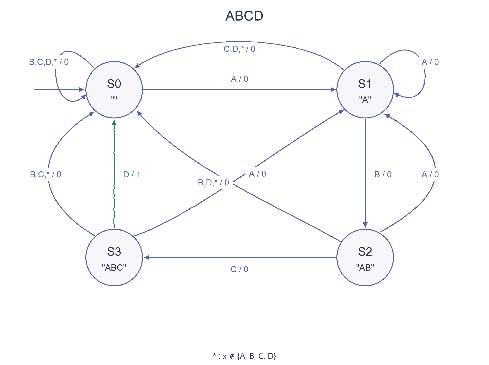

# PREP-043 — גלאי רצף ABCD למנעול כספת סדרתי

נקלטה ב־18 באוקטובר 2026. פתרון מוצע בסיוע AI, ממתין לסקירה מקצועית. קושי אינו מכויל. חברות לפי צילום המקור בלבד, ללא אימות עצמאי: Intel.

## מקור ללא שינוי


יש לבנות מכונת מצבים המהווה גלאי סדרה עבור מנעול כספת סדרתי. הסדרה הפותחת את הכספת היא ABCD, כאשר כל התווים שונים זה מזה.

## נוסח השאלה לאתר

בנו מכונת מצבים המזהה את הרצף הרציף ABCD בקלט טורי של תווים. ארבעת תווי הרצף שונים זה מזה.

הבהרת נוסח: בכל חזית שעון עולה נקלט תו אחד. ההתאמה היא לתווים הגדולים A, B, C, D; כל תו אחר נחשב אי־התאמה. מצב ההתחלה הוא מצב ללא התאמה חלקית.

א. תכננו גלאי המפיק פעימה באורך מחזור שעון אחד לאחר קליטת D המשלים את הרצף. הגדירו מצבים, טבלת מעברים מלאה, פלט ומימוש סינכרוני. יש לזהות גם רצף שמתחיל מחדש בעקבות תו A במהלך ניסיון חלקי.
ב. המקור אינו אומר אם הכספת צריכה להישאר פתוחה. הציגו גם חלופה שבה הפלט נשאר 1 אחרי הזיהוי עד איפוס.

ציינו את הנחות התזמון והאיפוס ואת ההבדל בין פעימת זיהוי לבין מצב פתיחה מתמיד. הבהרות וסעיפים אלה מוסיפים פירוט לנוסח המקורי, ואינם ציטוט של דרישות שלא נמסרו בו.

### שלושה רמזים

1. חשבו איזה חלק מסוף הקלט שכבר הגיע עדיין יכול להיות התחלה של ABCD. האם צריך לזכור את כל התווים, או רק את מידת ההתקדמות ברצף?
2. נסו מצבים עבור אין התאמה, A, AB ו־ABC. תכננו גם מה קורה כשמגיע A במקום התו הבא שציפיתם לו; בדקו את ABCABCD.
3. רק D במצב שמייצג ABC משלים זיהוי. תו A מעביר תמיד למצב של A; שאר אי־ההתאמות מאפסות את ההתקדמות. לאחר מכן החליטו אם פלט הזיהוי הוא פעימה או מעבר למצב OPEN שנשמר עד איפוס.

## הצעה לפתרון

### קודם מגדירים מה פירוש לפתוח

המקור מבקש לזהות את הרצף ABCD, אך אינו קובע אם הפלט הוא פעימת זיהוי או אם הכספת נשארת פתוחה. אלו שני מימושים תקפים לדרישות שונות. נבנה תחילה גלאי שמוציא 1 למחזור אחד לאחר קליטת D המסיים רצף תקין, ואז נציג חלופה מלאה שבה מצב הפתיחה נשמר עד איפוס.

נניח שבכל חזית שעון עולה נקלט תו אחד. ההשוואה היא לתווים הגדולים A, B, C, D; כל תו אחר נחשב קלט אחר. מצב ההתחלה הוא S0. בקוד החומרה הוגדר איפוס סינכרוני, שמבטל גם זיהוי באותה חזית. אלו הבהרות מימוש שהוספנו, ולא נתונים שנכתבו במקור.

### הרעיון — לזכור רק כמה מהרצף כבר זוהה

לא צריך לזכור את כל ההיסטוריה. צריך לזכור את הסיומת הארוכה ביותר שכבר נקלטה ושיכולה להיות תחילתו של הרצף המבוקש:

- S0: אין סיומת מתאימה.
- S1: הסיומת היא A.
- S2: הסיומת היא AB.
- S3: הסיומת היא ABC.

מ־S0 התו A מתחיל התאמה. אחריו B מקדם ל־S2, אחריו C ל־S3, ומ־S3 התו D משלים זיהוי.

### מה עושים כשמגיע תו שגוי?

לא תמיד נכון לחזור מיד ל־S0. אם התו החדש הוא A, הוא בעצמו התחלה של ניסיון חדש, ולכן מכל אחד מארבעת המצבים עוברים ל־S1. למשל, ברצף AABCD אין לפספס את ההתאמה שמתחילה ב־A השני. בדומה, ברצף ABCABCD התו A הרביעי מתחיל התאמה חדשה שמסתיימת בתו השביעי.

כל התווים בתבנית שונים, ולכן אחרי השלמת ABCD אין סיומת לא ריקה שהיא גם תחילת ABCD. אפשר לחזור ל־S0. כל אי־התאמה אחרת שאינה A גם מחזירה ל־S0.

### טבלת מעברים מלאה — גלאי פעימה

בכל תא כתובים המצב הבא והפלט של המעבר, בסדר מצב / פלט. בעמודת אחר נמצאים כל התווים שאינם A, B, C או D.

| מצב | A | B | C | D | אחר |
| --- | --- | --- | --- | --- | --- |
| S0 | S1 / 0 | S0 / 0 | S0 / 0 | S0 / 0 | S0 / 0 |
| S1 | S1 / 0 | S2 / 0 | S0 / 0 | S0 / 0 | S0 / 0 |
| S2 | S1 / 0 | S0 / 0 | S3 / 0 | S0 / 0 | S0 / 0 |
| S3 | S1 / 0 | S0 / 0 | S0 / 0 | S0 / 1 | S0 / 0 |

זהו תיאור Mealy מופשט: הפלט של המעבר תלוי במצב שלפני קליטת התו ובתו שנקלט. רק המעבר מ־S3 עם D מפיק 1.

### דוגמת תזמון

| מספר התו | 1 | 2 | 3 | 4 | 5 | 6 | 7 |
| --- | --- | --- | --- | --- | --- | --- | --- |
| קלט | A | B | C | A | B | C | D |
| מצב אחרי הקליטה | S1 | S2 | S3 | S1 | S2 | S3 | S0 |
| פעימת זיהוי אחרי החזית | 0 | 0 | 0 | 0 | 0 | 0 | 1 |

בקלט ABCDABCD מתקבלות פעימות אחרי התו הרביעי ואחרי השמיני. בקלט ABXCD אין זיהוי, כי התווים צריכים להיות רצופים.

### מודל פייתון של שתי החלופות

SequenceDetector מחזיר את פלט הזיהוי עבור התו שזה עתה נקלט. PersistentLock מחזיר מצב פתוח שנשאר 1 לאחר ההתאמה הראשונה, עד איפוס.

```python
def transition(state: int, symbol: str) -> tuple[int, int]:
    if state not in range(4) or not isinstance(symbol, str) or len(symbol) != 1:
        raise ValueError("Require prefix state 0..3 and one input character")
    detected = int(state == 3 and symbol == "D")
    if symbol == "A":
        following = 1
    elif state == 1 and symbol == "B":
        following = 2
    elif state == 2 and symbol == "C":
        following = 3
    else:
        following = 0
    return following, detected


class SequenceDetector:
    def __init__(self):
        self.state = 0

    def step(self, symbol: str, reset: bool = False) -> int:
        if reset:
            self.state = 0
            return 0
        self.state, pulse = transition(self.state, symbol)
        return pulse


class PersistentLock:
    def __init__(self):
        self.detector = SequenceDetector()
        self.opened = False

    def step(self, symbol: str, reset: bool = False) -> int:
        if reset:
            self.detector.step(symbol, reset=True)
            self.opened = False
        elif not self.opened:
            self.opened = bool(self.detector.step(symbol))
        return int(self.opened)
```

### מימוש סינכרוני בחומרה

מממשים את ארבעת מצבי ההתקדמות בשתי סיביות מצב. הלוגיקה הצירופית מחשבת את המצב הבא ואת תנאי הזיהוי לפי המצב הקיים והתו. בחזית השעון מעדכנים גם את המצב וגם אוגר נפרד של פעימת הזיהוי.

לכן הקוד הבא מכיל שני דלגלגים למצב ועוד דלגלג אחד לפלט: שלושה בסך הכול. אין לבלבל בין ארבעת מצבי ה־Mealy המופשטים לבין המימוש שפלטו נשמר באוגר. כאשר D נקלט אחרי ABC, הפלט הרשום עולה מיד לאחר אותה חזית ונשאר 1 עד החזית הבאה. איפוס באותה חזית מקבל עדיפות ומנקה את שניהם.

הקידוד בדוגמה הוא תו בן שמונה סיביות, עם ערכי ASCII של התווים הגדולים. זו בחירת מימוש; מכונת המצבים עצמה דורשת רק להבחין בין חמש קבוצות הקלט.

```systemverilog
module abcd_detector (
    input  logic       clk,
    input  logic       rst,
    input  logic [7:0] symbol,
    output logic       detected
);
    typedef enum logic [1:0] { S0, S1, S2, S3 } state_t;
    state_t state, next_state;
    logic next_detected;

    always_comb begin
        next_state = S0;
        next_detected = 1'b0;
        case (state)
            S0: if (symbol == 8'h41) next_state = S1;
            S1: begin
                if (symbol == 8'h41) next_state = S1;
                else if (symbol == 8'h42) next_state = S2;
            end
            S2: begin
                if (symbol == 8'h41) next_state = S1;
                else if (symbol == 8'h43) next_state = S3;
            end
            S3: begin
                if (symbol == 8'h41) next_state = S1;
                else if (symbol == 8'h44) next_detected = 1'b1;
            end
            default: begin
                next_state = S0;
                next_detected = 1'b0;
            end
        endcase
    end

    always_ff @(posedge clk) begin
        if (rst) begin
            state <= S0;
            detected <= 1'b0;
        end else begin
            state <= next_state;
            detected <= next_detected;
        end
    end
endmodule
```

### חלופה: הכספת נשארת פתוחה

אם הדרישה היא לשמור על פתיחה, מוסיפים מצב OPEN. המעבר מ־S3 עם D נכנס אליו. במצב OPEN הפלט הוא 1, וכל תו משאיר את המכונה באותו מצב. איפוס מחזיר ל־S0, שבו הפלט 0.

זהו תיאור Moore בעל חמישה מצבים לוגיים. הפלט נקבע לפי המצב אחרי החזית: הוא עולה כשנכנסים ל־OPEN ונשאר גבוה עד איפוס. הטבלה המלאה היא:

| מצב | A | B | C | D | אחר | פלט במצב |
| --- | --- | --- | --- | --- | --- | --- |
| S0 | S1 | S0 | S0 | S0 | S0 | 0 |
| S1 | S1 | S2 | S0 | S0 | S0 | 0 |
| S2 | S1 | S0 | S3 | S0 | S0 | 0 |
| S3 | S1 | S0 | S0 | OPEN | S0 | 0 |
| OPEN | OPEN | OPEN | OPEN | OPEN | OPEN | 1 |

קוד PersistentLock למעלה מממש את אותה התנהגות במודל צעדים. בקידוד בינרי רגיל ניתן לקודד את חמשת המצבים בשלוש סיביות מצב ולגזור מהן את פלט הפתיחה; זו חלופה שונה לפלט הפעימה הרשום, ואין צורך לספור כאילו שני המימושים זהים.

### למה הפתרון נכון?

האינווריאנט הוא שהמצב מציין את הסיומת הארוכה ביותר של התווים שנקלטו שהיא תחילית ממש של ABCD. התו המתאים הבא מאריך אותה; A מתחיל התאמה חדשה; וכל שאר התווים מוחקים את ההתאמה. כאשר מצב S3 מלווה ב־D, ארבעת התווים האחרונים הם בדיוק ABCD. כאשר ארבעת התווים האחרונים הם ABCD, שלושת הקודמים מביאים ל־S3 ולכן המעבר עם D מוכרח לזהות. כך לא מתקבל זיהוי חסר ולא זיהוי שווא. בחלופה המתמידה, OPEN נגיש רק דרך זיהוי כזה ואינו ננטש ללא איפוס.

### עלות והיקף האימות

לרצף הקבוע ארבעה מצבי התקדמות, וזיכרון ועבודה קבועים לכל תו. עיבוד זרם בן m תווים נמשך O(m). ארבעת מצבי ה־Mealy אכן נבדלים: לכל מצב יש המשך מתאים קצר יותר שיכול להשלים זיהוי, ואותו המשך לא משלים זיהוי ממצב פחות מתקדם. עם זאת, אין כאן טענה למספר שערים מינימלי או להשהיה פיזית מיטבית.

מודלי הפייתון נבדקו מול אורקל עצמאי שבוחן אם סיומת ההיסטוריה היא ABCD. נבדקו באופן ממצה 488,281 זרמים מעל A/B/C/D/X באורכים 0 עד 8, לרבות אינווריאנט התחילית וחלופות הפעימה והפתיחה המתמידה. נוספו שמונה עקבות מפורשות ובדיקות איפוס באמצע הזרם. זו בדיקת מודל תוכנה; קוד ה־SystemVerilog לא הורץ בסימולטור חומרה ולא נמדדו תזמונים במעגל פיזי.

### הנחות והבהרות

- הקלט הוא זרם של תווים, תו אחד בכל חזית שעון עולה, ולא ארבעה ביטים המייצגים את אותן אותיות.

- ההשוואה היא לרצף הרציף ABCD באותיות גדולות. כל תו אחר משתייך למחלקת אחר.

- מצב ההתחלה S0 ללא התאמה חלקית. reset בקוד החומרה סינכרוני ומקבל עדיפות על קליטת התו באותה חזית.

- המקור אינו מכריע בין פעימת זיהוי לבין כספת שנותרת פתוחה; שתי החלופות מוגדרות בנפרד ומקבלות פתרון.

- קלט בן שמונה סיביות בקידוד ASCII הוא בחירת מימוש בקוד, לא דרישה למכונת המצבים המופשטת.

### עמימות המקור

```json
{
  "opening": "לא הוגדר אם הכספת נשארת פתוחה. הפתרון כולל גלאי פעימה וגם מצב OPEN מתמיד.",
  "timing": "לא נמסרו שעון, מועד דגימה או איפוס. דגימת תו בכל חזית עולה ואיפוס סינכרוני מסומנים כהבהרות מימוש.",
  "symbols": "המקור מציין ארבעה תווים שונים. פתרון זה משתמש בתווים הסמליים A/B/C/D ומאפשר תווים אחרים כאי־התאמות."
}
```

### נכונות ויעילות

```json
{
  "criterion": "מספר מצבים במכונת Mealy מופשטת לזיהוי הרצף הקבוע, וזיכרון ועבודה לכל תו. אין מדד פיזי של שטח שערים או השהיה.",
  "result": "ארבעה מצבי התקדמות מופשטים. הקוד שפלטו רשום דורש שתי סיביות מצב ועוד דלגלג פעימה. לחלופה ששומרת פתיחה יש חמישה מצבים לוגיים. זמן O(1) לכל תו ו־O(m) לזרם בן m תווים.",
  "proof": "מצב ההתקדמות הוא הסיומת הארוכה ביותר שהיא תחילית ממש של ABCD. המצבים נבדלים על ידי המשכים D, CD, BCD או ABCD: המשך שמשלים זיהוי ממצב מתקדם יותר לא מספיק ממצב פחות מתקדם. בכך מוצדקים ארבעת מצבי ה־Mealy, אך לא נובע שדי בשני דלגלגים למימוש שפלטו נשמר אחרי החזית.",
  "scope": "ארבעה מצבי זיהוי מופשטים אינם אותה ספירה כמו מצב חומרה הכולל אוגר פלט. הקידוד הבינרי, ההשוואות והשהיות תלויים בטכנולוגיה ובמימוש; לא הוכחה אופטימליות של מספר שערים."
}
```

### בדיקות שבוצעו

אומתו 488,281 זרמים מעל A/B/C/D/X בכל האורכים מ־0 עד 8 מול אורקל עצמאי של סיומת ABCD. בכל צעד נבדקו פלט הפעימה, פתיחה מתמידה ואינווריאנט התחילית. נוספו שמונה עקבות מפורשות ואיפוס באמצע הזרם, לרבות איפוס במקום D שהיה משלים זיהוי. הבדיקות הן של מודל פייתון; קוד SystemVerilog לא הורץ בסימולטור חומרה ולא נבדק במעגל פיזי.

### מקרי קצה

- ABCD: זיהוי אחרי התו הרביעי. ABC: אין זיהוי מוקדם.

- AABCD: זיהוי אחרי התו החמישי. ABABCD: אחרי השישי. ABCABCD: אחרי השביעי.

- ABCDABCD: שתי פעימות, אחרי התווים הרביעי והשמיני; בחלופה המתמידה הפלט נשאר גבוה לאחר הראשון.

- ABXCD או ABDC: אין זיהוי; התבנית חייבת להופיע ברצף ובסדר הנכון.

- כל תו שאינו A/B/C/D מאפס את ההתקדמות; A במצב חלקי מתחיל התאמה חדשה.

- איפוס במצב ABC מבטל התאמה גם אם D נוכח באותה חזית. איפוס גם סוגר את חלופת OPEN.

- קלט ריק אינו מזהה רצף. אותיות קטנות אינן שקולות לגדולות בהנחת ההשוואה שנבחרה.

### טעויות נפוצות

- חזרה ל־S0 על כל אי־התאמה: מפספסת רצף חדש שמתחיל ב־A, כגון ABCABCD.

- הפקת פלט 1 מיד לאחר ABC: חסר התו D.

- הגדרה עמומה של פתיחת הכספת: פעימה של מחזור אחד ופתיחה עד איפוס הן התנהגויות שונות.

- הכרזה שארבעה מצבים מבטיחים שני דלגלגים לכל המימוש: הקוד מוסיף אוגר פלט פעימה.

- התעלמות מתווים שאינם בתבנית במקום לאפס התקדמות: כך ABXCD עלול להיחשב בטעות כהתאמה.

- הנחה שחזרה ל־S0 אחרי כל תבנית נכונה לכל גלאי: כאן היא נכונה בגלל התווים השונים; לתבנית כמו ABAB יש חפיפה.

- דיווח שסימולציית פייתון מאשרת סינתזה, גליצ'ים או עמידה בתזמון של קוד SystemVerilog: נדרש אימות חומרה נפרד.

### תשובה קצרה לראיון

אזכור את הסיומת הארוכה ביותר שמתאימה לתחילת ABCD: ארבעה מצבים עבור ריק, A, AB ו־ABC. התו הבא הצפוי מקדם מצב, כל A מתחיל מחדש ב־A, ושאר אי־ההתאמות מחזירות לריק. רק D אחרי ABC מפיק זיהוי. בגלל שכל התווים שונים אפשר לחזור לריק אחרי התאמה מלאה. אבהיר אם רוצים פעימה או פתיחה מתמידה; לפעימה רשומה אשתמש בשתי סיביות מצב ועוד אוגר פלט, ולפתיחה מתמידה אוסיף OPEN שנשמר עד איפוס.

### הרחבות ושאלת המשך

```json
{
  "question": "איך משתנה הגלאי אם התבנית היא ABAB, ומבקשים לזהות גם התאמות חופפות בקלט ABABAB?",
  "direction": "אחרי השלמת ABAB נשארת סיומת AB שהיא גם תחילת התבנית. לכן יש לחזור למצב AB ולא למצב הריק, כדי לזהות סיומות שמסתיימות בתו הרביעי ובתו השישי. גם במעברי אי־התאמה צריך לשמור את הסיומת הארוכה ביותר שהיא תחילית של התבנית החדשה.",
  "status": "שאלת המשך הוכנה בארכיון; לא נטען שנוספה אוטומטית למנגנון שאלות ההמשך באתר."
}
```



## English question

Design a finite-state machine that recognizes the contiguous sequence ABCD in a serial stream of symbols. All four pattern symbols are distinct.

Editorial clarification: sample one symbol on each rising clock edge. Matching is case-sensitive for uppercase A, B, C, D; every other symbol is a mismatch. The initial state has no partial match.

A. Design a detector producing a one-clock-cycle pulse after sampling the D that completes a match. Give states, a complete transition table, outputs, and a synchronous implementation. A fresh A during a partial attempt must still be allowed to begin another match.
B. The source does not specify whether the safe must remain open. Also give an alternative whose output stays 1 after detection until reset.

State the timing and reset assumptions and distinguish a detection pulse from persistent unlock. These clarifications and subparts expand the original wording; they are not quotations of requirements absent from the source.

### Three progressive hints

1. Which suffix of the input already consumed could still be the beginning of ABCD? Do you need the full history or only the progress through the target pattern?
2. Try states for no match, A, AB, and ABC. Work out what happens when A arrives instead of the expected next symbol; test ABCABCD.
3. Only D from the state representing ABC completes a match. A always leads to the A state, while other mismatches clear progress. Then choose between a detection pulse and an OPEN state held until reset.

## Proposed solution

### First define what opening means

The source asks to recognize ABCD but does not say whether the output is a detection pulse or whether the safe remains open. These are valid implementations of different requirements. We first build a detector that outputs 1 for one cycle after consuming the D that completes a match, then give a complete alternative that stays open until reset.

Assume one symbol is sampled on each rising clock edge. Matching is case-sensitive for uppercase A, B, C, D; every other symbol belongs to the Other class. The initial state is S0. The hardware example uses synchronous reset, which also suppresses a match on that edge. These are explicit implementation clarifications, not claims about the original wording.

### Remember only how much of the pattern has matched

The entire history is unnecessary. Remember the longest suffix already consumed that can still be the beginning of the target pattern:

- S0: no matching suffix.
- S1: the suffix is A.
- S2: the suffix is AB.
- S3: the suffix is ABC.

From S0, A begins a match. B then advances to S2, C advances to S3, and D in S3 completes detection.

### What happens on a mismatch?

Returning blindly to S0 is incorrect. If the new symbol is A, that symbol can itself begin another attempt, so every prefix state goes to S1 on A. For example, AABCD must recognize the match beginning at the second A. In ABCABCD, the fourth symbol A starts another attempt that completes at symbol seven.

Because all pattern symbols are distinct, after a full ABCD match no nonempty suffix is also a prefix of ABCD. Returning to S0 is correct. Every other mismatch that is not A also returns to S0.

### Complete transition table — pulse detector

Each cell contains next state / transition output. Other means any symbol outside A, B, C, D.

| State | A | B | C | D | Other |
| --- | --- | --- | --- | --- | --- |
| S0 | S1 / 0 | S0 / 0 | S0 / 0 | S0 / 0 | S0 / 0 |
| S1 | S1 / 0 | S2 / 0 | S0 / 0 | S0 / 0 | S0 / 0 |
| S2 | S1 / 0 | S0 / 0 | S3 / 0 | S0 / 0 | S0 / 0 |
| S3 | S1 / 0 | S0 / 0 | S0 / 0 | S0 / 1 | S0 / 0 |

This is an abstract Mealy description: the transition output depends on the state before consuming the symbol and on that symbol. Only D in S3 produces 1.

### Timing example

| Symbol position | 1 | 2 | 3 | 4 | 5 | 6 | 7 |
| --- | --- | --- | --- | --- | --- | --- | --- |
| Input | A | B | C | A | B | C | D |
| State after sampling | S1 | S2 | S3 | S1 | S2 | S3 | S0 |
| Pulse after the edge | 0 | 0 | 0 | 0 | 0 | 0 | 1 |

ABCDABCD produces pulses after symbols four and eight. ABXCD produces no pulse because the target symbols must be consecutive.

### Python event models for both alternatives

SequenceDetector returns the detection output for the symbol just consumed. PersistentLock returns a held-open flag that remains 1 after the first match until reset.

```python
def transition(state: int, symbol: str) -> tuple[int, int]:
    if state not in range(4) or not isinstance(symbol, str) or len(symbol) != 1:
        raise ValueError("Require prefix state 0..3 and one input character")
    detected = int(state == 3 and symbol == "D")
    if symbol == "A":
        following = 1
    elif state == 1 and symbol == "B":
        following = 2
    elif state == 2 and symbol == "C":
        following = 3
    else:
        following = 0
    return following, detected


class SequenceDetector:
    def __init__(self):
        self.state = 0

    def step(self, symbol: str, reset: bool = False) -> int:
        if reset:
            self.state = 0
            return 0
        self.state, pulse = transition(self.state, symbol)
        return pulse


class PersistentLock:
    def __init__(self):
        self.detector = SequenceDetector()
        self.opened = False

    def step(self, symbol: str, reset: bool = False) -> int:
        if reset:
            self.detector.step(symbol, reset=True)
            self.opened = False
        elif not self.opened:
            self.opened = bool(self.detector.step(symbol))
        return int(self.opened)
```

### Synchronous hardware implementation

Encode the four prefix states in two state bits. Combinational logic computes next state and the detection condition from the existing state and input. On a rising edge, update both state and a separate detection-pulse register.

The following code therefore uses two state flip-flops plus one output flip-flop: three in total. Do not confuse the four-state abstract Mealy detector with this registered-output realization. When D is sampled after ABC, the registered pulse rises immediately after that same edge and stays high until the next edge. Reset has priority on the edge and clears both state and pulse.

The example encodes the input as an eight-bit symbol using uppercase ASCII values. This is an implementation choice; the state machine only requires distinguishing five input classes.

```systemverilog
module abcd_detector (
    input  logic       clk,
    input  logic       rst,
    input  logic [7:0] symbol,
    output logic       detected
);
    typedef enum logic [1:0] { S0, S1, S2, S3 } state_t;
    state_t state, next_state;
    logic next_detected;

    always_comb begin
        next_state = S0;
        next_detected = 1'b0;
        case (state)
            S0: if (symbol == 8'h41) next_state = S1;
            S1: begin
                if (symbol == 8'h41) next_state = S1;
                else if (symbol == 8'h42) next_state = S2;
            end
            S2: begin
                if (symbol == 8'h41) next_state = S1;
                else if (symbol == 8'h43) next_state = S3;
            end
            S3: begin
                if (symbol == 8'h41) next_state = S1;
                else if (symbol == 8'h44) next_detected = 1'b1;
            end
            default: begin
                next_state = S0;
                next_detected = 1'b0;
            end
        endcase
    end

    always_ff @(posedge clk) begin
        if (rst) begin
            state <= S0;
            detected <= 1'b0;
        end else begin
            state <= next_state;
            detected <= next_detected;
        end
    end
endmodule
```

### Alternative: keep the safe open

If the requirement is a persistent unlock, add an OPEN state. D in S3 enters it. OPEN has output 1, and every symbol leaves the machine in OPEN. Reset returns to S0, whose output is 0.

This is a five-logical-state Moore description. The output is determined by the state after the edge: it rises when OPEN is entered and remains high until reset. The complete table is:

| State | A | B | C | D | Other | Output in state |
| --- | --- | --- | --- | --- | --- | --- |
| S0 | S1 | S0 | S0 | S0 | S0 | 0 |
| S1 | S1 | S2 | S0 | S0 | S0 | 0 |
| S2 | S1 | S0 | S3 | S0 | S0 | 0 |
| S3 | S1 | S0 | S0 | OPEN | S0 | 0 |
| OPEN | OPEN | OPEN | OPEN | OPEN | OPEN | 1 |

PersistentLock above implements the same behavior in the event model. A conventional binary encoding can represent the five states in three state bits and decode the unlock output from them. This is an alternative to the registered pulse circuit; the two implementations should not be counted as though they were identical.

### Why it works

The invariant is that the state represents the longest suffix of consumed input that is a proper prefix of ABCD. The next expected symbol extends that suffix; A begins a fresh attempt; all remaining mismatches discard it. If state S3 receives D, the last four symbols are exactly ABCD. Conversely, when the last four symbols are ABCD, the preceding three bring the detector to S3, so consuming D must detect the match. Thus there are neither missed matches nor false positives. In the persistent variant, OPEN is reachable only through such a detection and cannot be left without reset.

### Cost and verification scope

The fixed pattern needs four prefix states and constant storage and work per symbol. A stream of m symbols takes O(m) time. The four abstract Mealy states are distinguishable: each has a completion suffix that can detect sooner, and that suffix does not complete the pattern from a less advanced state. This does not claim a minimum gate count or optimal physical delay.

The Python models were compared with an independent suffix oracle testing whether the consumed history ends in ABCD. All 488,281 streams over A/B/C/D/X of lengths 0 through 8 were exhaustively checked, including the prefix invariant, pulse behavior, and persistent unlock. Eight explicit traces and midstream reset checks were added. This verifies software event models; the SystemVerilog was not run in an HDL simulator and no physical circuit timing was measured.

### Assumptions and clarifications

- The input is a symbol stream with one symbol sampled per rising clock edge, not four binary input bits standing for the letters.

- Match contiguous uppercase ABCD. Every other symbol belongs to the Other class.

- Start in S0 with no partial match. Hardware reset is synchronous and takes priority over sampling on the same edge.

- The source does not choose between a detection pulse and a safe remaining open; both alternatives are separately specified and solved.

- An eight-bit ASCII input is a code-level implementation choice, not a requirement of the abstract state machine.

### Source ambiguities

```json
{
  "opening": "The source does not specify whether unlock is held. The solution includes both a pulse detector and a persistent OPEN state.",
  "timing": "Clocking, sampling instant, and reset are unspecified. One symbol per rising edge and synchronous reset are labeled implementation clarifications.",
  "symbols": "The source states four distinct symbols. This solution uses A/B/C/D symbolically and treats other symbols as mismatches."
}
```

### Correctness and efficiency

```json
{
  "criterion": "State count for an abstract Mealy detector of the fixed pattern, plus storage and work per symbol. No physical gate-area or delay metric is optimized.",
  "result": "Four abstract prefix states. The registered-output code uses two state bits and one pulse flip-flop. Persistent unlock has five logical states. O(1) work per symbol and O(m) time for m symbols.",
  "proof": "Progress is the longest suffix that is a proper prefix of ABCD. States are distinguishable by continuations D, CD, BCD, or ABCD: a suffix completing a match from a more advanced state is insufficient from a less advanced state. This justifies four abstract Mealy states, but does not imply that two flip-flops suffice for an output held after the edge.",
  "scope": "Four abstract recognition states are not the same count as hardware state including an output register. Binary encoding, comparisons, and delays depend on technology and implementation; no minimum gate count is proved."
}
```

### Verification performed

All 488,281 streams over A/B/C/D/X of lengths 0 through 8 were checked against an independent ABCD suffix oracle. Each step checks pulse output, persistent unlock, and the prefix invariant. Eight explicit traces and midstream resets were added, including reset on a D that would otherwise complete a match. These are Python model checks; SystemVerilog was not HDL-simulated or tested on physical hardware.

### Edge cases

- ABCD detects after symbol four. ABC must not detect early.

- AABCD detects after symbol five; ABABCD after six; ABCABCD after seven.

- ABCDABCD yields pulses after symbols four and eight; persistent unlock remains high after the first match.

- ABXCD and ABDC do not detect: the pattern must be contiguous and ordered.

- Any symbol outside A/B/C/D clears partial progress; A during a partial match starts a fresh attempt.

- Reset in the ABC state suppresses a match even if D is present on that edge. Reset also closes the OPEN variant.

- An empty input does not detect. Lowercase letters do not match uppercase under the stated comparison.

### Common mistakes

- Returning to S0 on every mismatch misses a fresh A starting another match, such as ABCABCD.

- Raising output after ABC detects before the required D.

- Leaving unlock semantics implicit: a one-cycle pulse and opening until reset are different behaviors.

- Claiming four states means two flip-flops for the entire realization: the code adds a pulse output register.

- Ignoring non-pattern symbols instead of clearing progress can incorrectly accept ABXCD.

- Assuming every pattern should return to S0 after a full match: distinct symbols justify that here; ABAB has overlap.

- Claiming Python simulation confirms synthesis, glitch behavior, or SystemVerilog timing: separate hardware verification is required.

### Interview answer

I remember the longest suffix matching the start of ABCD: four states for empty, A, AB, and ABC. The expected next symbol advances; any A restarts at A; other mismatches clear progress. Only D after ABC detects. Because all symbols are distinct, a full match falls back to empty. I clarify whether output is a pulse or persistent unlock. A registered pulse uses two state bits plus an output register; persistent unlock adds OPEN held until reset.

### Extensions and follow-up

```json
{
  "question": "How does the detector change for ABAB when overlapping matches must be recognized in ABABAB?",
  "direction": "After a complete ABAB, suffix AB is also a prefix of the pattern. Fall back to the AB state rather than empty so matches ending at symbols four and six are both detected. Mismatch transitions must likewise retain the longest suffix that is a prefix of the new pattern.",
  "status": "Follow-up prepared in the archive; not claimed to be automatically connected to the website's follow-up flow."
}
```


## קבצים ובדיקות

[prep_043_serial_lock.py](../solutions/prep_043_serial_lock.py) · [prep_043_serial_lock.sv](../solutions/prep_043_serial_lock.sv) · [check_prep_043.py](../checks/check_prep_043.py) · [prep-043-verification.json](../checks/prep-043-verification.json)

שאלת ההמשך מוכנה בשתי השפות אך טרם חוברה לתור האינטראקטיבי. ההערכה המקצועית ורמת הקושי עדיין בביקורת; אין להעניק לשאלה זו ראיות שליטה או ניקוד תחרותי. שאלות חומרה אומתו במודל Python בלבד; אין בכך טענה לסימולציית HDL או לבדיקה פיזית.


## מקור נוסף — 30.10.2026, צילום 3

[צילום פרטי](../sources/2026-10-30-batch20-03.png)

נוספה הרחבה דו־לשונית, בלי למחוק את התוכן והרמזים הקודמים.
