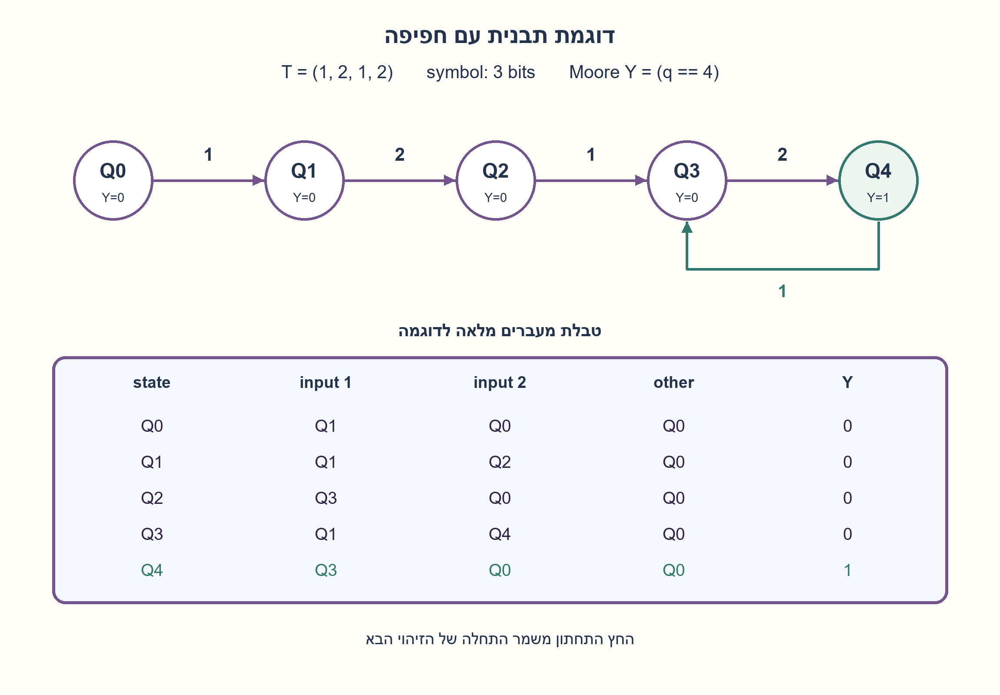
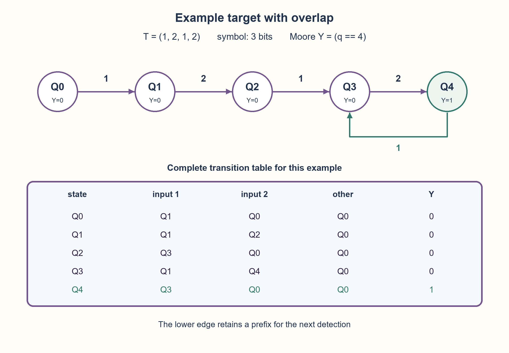

# PREP-043 — הרחבה מתאריך 30.10.2026

פתרון מוצע בסיוע AI; ביקורת אנושית ממתינה. הקושי לא כויל.

[צילום מקור פרטי](../sources/2026-10-30-batch20-03.png)

נתונה מחרוזת בעלת 4 איברים, כל איבר מיוצג על ידי 3 סיביות. נתונים 3 סיביות המשתנים בזמן ומייצגים איבר. יש לבנות מערכת שהמוצא שלה נותן 1 כאשר יש זיהוי של המחרוזת עבור הסיביות המשתנות.

## עברית

### וריאציה: ארבעה סמלים בני שלוש סיביות
נתונה תבנית של ארבעה איברים, שכל אחד מקודד בשלוש סיביות. בכל חזית נקלט קוד בן שלוש סיביות. בנו מערכת שמוציאה 1 אחרי השלמת כל הופעה רציפה של התבנית. המקור אינו נותן את ערכי התבנית או מבטיח שכל האיברים שונים. לכן נסמן תבנית קבועה בזמן הפעולה T=(T0,T1,T2,T3), כאשר כל Ti בתחום 0..7 וחזרות מותרות. הדגימה היא של סמל שלם בכל חזית, לא זרם של ביט בודד. נבחר מוצא Moore אחרי קליטת הסמל, נזהה גם הופעות חופפות, ואיפוס סינכרוני ימחק התאמה חלקית. הציגו גם כיצד הכלל מצטמצם כאשר ארבעת הסמלים שונים, כמו בגרסה המקורית.

1. איזו סיומת מהסמלים שכבר הגיעו עדיין יכולה להיות תחילת התבנית?
2. חזרות בתבנית עשויות לאפשר התאמה חדשה עוד לפני שהישנה הסתיימה. בדקו את התבנית 1,2,1,2 על הזרם 1,2,1,2,1,2.
3. שמרו מצב 0..4 לפי אורך הקידומת הארוכה ביותר שהיא גם סיומת ההיסטוריה. במעבר הוסיפו סמל וחפשו סיומת מתאימה; מוצא 1 רק במצב 4.

### שלוש סיביות הן סמל אחד
ארבעה סמלים אינם בהכרח ארבעה ביטים. נשווה בכל מחזור את קוד הקלט השלם לקודי התבנית, ונזכור כמה מתחילתה עדיין מתאימים לסוף ההיסטוריה. הערכים T0..T3 הם פרמטרים, כי לא נמסרו ערכים מסוימים. אפשר לממש משווה לכל קוד קבוע וטבלת מעבר צירופית, או ROM קטן המוגדר מהתבנית. עדכון תבנית בזמן ריצה דורש פרוטוקול נוסף ואינו נדרש כאן.

מצב q הוא אורך הקידומת הארוכה ביותר של T שהיא סיומת מה שנקלט, בתחום 0..4. במצב 4 המוצא 1. לקלט סמל a יוצרים מועמד T[:q] ואחריו a, ובוחרים את האורך הגדול ביותר j בתחום 0..4 שעבורו T[:j] היא סיומת המועמד. מעבירים ל־j. זהו אלגוריתם לבניית טבלת מעברים, ולא דרישה לשמור מחרוזת הולכת וגדלה בחומרה. בתבנית קבועה יש חמישה מצבי Moore ומקסימום 40 שורות עבור שמונה קודים; שלושה דלגלגים מספיקים לקידוד בינארי, ללא טענה שכל תבנית מחייבת שטח מזערי זה.

למה אפשר לבנות מעבר רק מהקידומת ששמרנו? אם קידומת חדשה מסתיימת בסמל a, החלק שלפני a חייב להיות סיומת מתאימה של ההיסטוריה הקודמת. כל סיומת קצרה כזאת כלולה כסיומת של הקידומת הארוכה ביותר שנשמרה. לכן לא איבדנו מועמד תקף, והבחירה באורך המרבי משמרת את האינווריאנט. הגעה ל־4 שקולה לכך שארבעת הסמלים האחרונים הם T.

בדוגמה ערוכה T=(1,2,1,2), הזרם 1,2,1,2,1,2 נותן 000101. אחרי זיהוי, הסיומת 1,2 עדיין יכולה לשמש לתחילת הזיהוי הבא. בתבנית (1,1,1,1), שישה סמלי 1 נותנים 000111; אין חובה לפער נמוך בין זיהויים סמוכים. במקרה המקורי של ABCD עם סמלים שונים, אי־התאמה שהיא A חוזרת לקידומת A, וכל אי־התאמה אחרת מוחקת התקדמות. אסור להחיל את הכלל הפשוט הזה על תבנית עם חזרות.

כל 4,096 התבניות האפשריות נבדקו בכל 40 שורות הטבלה, ועוד 16,368 צירופי תבנית/זרם בינאריים הושוו לאורקל של ההיסטוריה המלאה. איפוס נבדק בכל צירוף. אלו בדיקות מודל Python, ללא קומפילציית HDL או אימות תזמון פיזי.

| state | input 1 | input 2 | other codes | Y |
| --- | --- | --- | --- | --- |
| Q0 | Q1 | Q0 | Q0 | 0 |
| Q1 | Q1 | Q2 | Q0 | 0 |
| Q2 | Q3 | Q0 | Q0 | 0 |
| Q3 | Q1 | Q4 | Q0 | 0 |
| Q4 | Q3 | Q0 | Q0 | 1 |


```python
"""Four-symbol prefix machine; all eight 3-bit codes, repeated targets allowed."""


class FourSymbolDetector:
    def __init__(self, target):
        if len(target) != 4 or any(type(x) is not int or not 0 <= x < 8 for x in target):
            raise ValueError("four 3-bit target symbols required")
        self.target = tuple(target)
        self.state = 0
        self.table = {}
        for state in range(5):
            for symbol in range(8):
                candidate = self.target[:state] + (symbol,)
                self.table[state, symbol] = max(
                    length for length in range(5)
                    if length <= len(candidate)
                    and (length == 0 or candidate[-length:] == self.target[:length])
                )

    def step(self, symbol, reset=False):
        if type(symbol) is not int or not 0 <= symbol < 8:
            raise ValueError("3-bit input symbol required")
        self.state = 0 if reset else self.table[self.state, symbol]
        return int(self.state == 4)
```




## English

### Variant: four3-bit symbols
A target contains four items, each encoded in three bits. One3-bit code is accepted at each edge. Produce one after every completed contiguous target occurrence. The source gives no target values and does not promise distinct items. Parameterize a target fixed during operation as T=(T0,T1,T2,T3), each Ti in0..7 with repetition allowed. Sample one whole symbol per edge, not one serial bit. Choose a Moore output after accepting the symbol, allow overlapping occurrences, and let synchronous reset discard partial progress. Also show how the rule simplifies for four distinct items as in the original version.

1. Which suffix of received symbols can still be the beginning of the target?
2. Repeated target items can preserve progress after a mismatch or a match. Test target1,2,1,2 against stream1,2,1,2,1,2.
3. Use states0..4 for the longest target prefix that is a history suffix. Append the next symbol and keep the longest matching suffix; output one only in state4.

### Three bits form one symbol
Four items are not necessarily four bits. Compare the whole input code with target codes at each edge and retain how much of the target beginning still matches the history suffix. T0..T3 are parameters because concrete values were not supplied. Constant comparators plus combinational transition logic, or a small target-specific ROM, can implement the table. Changing the target during operation needs another protocol and is not required here.

State q is the length0..4 of the longest target prefix that is a suffix of received history. Output one in state4. For next symbol a, form candidate T[:q] followed by a and choose the largest j in0..4 such that T[:j] is its suffix. Transition to j. This is a table-construction algorithm, not a requirement for unbounded hardware history. A fixed target has five Moore prefix states and at most40 rows for eight codes; three binary state bits suffice, without a claim of minimum area for every target.

Why is the retained prefix sufficient? If a new target prefix ends in a, its portion before a must have been a matching suffix of previous history. Any shorter such suffix is itself a suffix of the longest retained prefix. Thus no valid candidate is lost and the maximum-length choice preserves the invariant. State4 holds exactly when the last four symbols equal T.

For the explicit illustration T=(1,2,1,2), stream1,2,1,2,1,2 gives000101. After detection, suffix1,2 can begin the next match. Target(1,1,1,1) with six ones gives000111: adjacent detections need no low gap. For original distinctABCD, mismatching A retains prefixA and every other mismatch discards progress. That simpler rule must not be copied to repeated-symbol targets.

All4,096 possible targets were checked at all40 table rows, plus16,368 binary-target/stream pairs against a full-history oracle, with reset in each pair. These are Python model checks, without HDL compilation or physical timing validation.

| state | input 1 | input 2 | other codes | Y |
| --- | --- | --- | --- | --- |
| Q0 | Q1 | Q0 | Q0 | 0 |
| Q1 | Q1 | Q2 | Q0 | 0 |
| Q2 | Q3 | Q0 | Q0 | 0 |
| Q3 | Q1 | Q4 | Q0 | 0 |
| Q4 | Q3 | Q0 | Q0 | 1 |


```python
"""Four-symbol prefix machine; all eight 3-bit codes, repeated targets allowed."""


class FourSymbolDetector:
    def __init__(self, target):
        if len(target) != 4 or any(type(x) is not int or not 0 <= x < 8 for x in target):
            raise ValueError("four 3-bit target symbols required")
        self.target = tuple(target)
        self.state = 0
        self.table = {}
        for state in range(5):
            for symbol in range(8):
                candidate = self.target[:state] + (symbol,)
                self.table[state, symbol] = max(
                    length for length in range(5)
                    if length <= len(candidate)
                    and (length == 0 or candidate[-length:] == self.target[:length])
                )

    def step(self, symbol, reset=False):
        if type(symbol) is not int or not 0 <= symbol < 8:
            raise ValueError("3-bit input symbol required")
        self.state = 0 if reset else self.table[self.state, symbol]
        return int(self.state == 4)
```




```json
{
  "assumptions": {
    "he": [
      "תבנית של ארבעה קודים קבועה בזמן ריצה; קוד בתחום 0..7 נקלט בשלמותו בכל חזית.",
      "חזרות וחפיפה מותרות; איפוס סינכרוני מחזיר ל־0 וגובר על קליטה; מוצא Moore מתעדכן אחרי חזית."
    ],
    "en": [
      "Four-code target fixed during operation; one whole0..7 code per edge.",
      "Repetition and overlap allowed; synchronous reset returns to0 and overrides acceptance; Moore output observed after the edge."
    ]
  },
  "optimality": {
    "he": "חמישה מצבי קידומת, שלושה ביטי מצב בקידוד בינארי, טבלה עד 40 שורות עבור תבנית קבועה. זהו חסם בנייה, ללא טענת מינימום שערים או השהיה.",
    "en": "Five prefix states, three binary state bits, at most40 table rows for a fixed target. A construction bound, without minimum gate or delay claims."
  },
  "verification": {
    "he": "163,840 שורות מעבר עבור כל 4,096 התבניות; 16,368 צירופי תבנית/זרם, 131,104 סמלים ו־16,368 איפוסים. Python מול אורקל סיומת מלא.",
    "en": "163,840 transition rows over all4,096targets;16,368target/stream pairs,131,104symbols and16,368resets. Python versus full-history suffix oracle."
  },
  "edge_cases": {
    "he": [
      "ארבעה סמלים זהים מאפשרים זיהוי בכל מחזור אחרי המילוי.",
      "קלט קצר מארבעה סמלים לא מזהה.",
      "קוד שגוי או איפוס באמצע אינו משלים הופעה."
    ],
    "en": [
      "Four identical target symbols allow detection every cycle after fill.",
      "Fewer than four symbols cannot detect.",
      "Mismatch or midstream reset does not complete an occurrence."
    ]
  },
  "common_mistakes": {
    "he": [
      "הנחה שסמלי התבנית שונים בלי שנאמר כך.",
      "בדיקת שלושת הביטים כרצף של שלוש דגימות במקום סמל אחד.",
      "איפוס אוטומטי אחרי זיהוי שמאבד חפיפה."
    ],
    "en": [
      "Assuming distinct target symbols without a promise.",
      "Treating three code bits as three separate accepted samples.",
      "Unconditionally clearing after detection and losing overlap."
    ]
  },
  "interview_answer": {
    "he": "אשמור את אורך קידומת התבנית שהיא הסיומת הארוכה ביותר בהיסטוריה, 0 עד 4. כל קוד קלט מעדכן לפי טבלת fallback שנבנתה מהתבנית; מצב 4 מזהה. כך מטפלים גם בחזרות ובחפיפה, והגרסה עם ABCD שונים היא מקרה פרטי.",
    "en": "Retain the longest target-prefix length that is a history suffix,0..4. Each input code uses a target-derived fallback table; state4 detects. This handles repetition and overlap; distinctABCD is a special case."
  },
  "source_ambiguities": {
    "he": [
      "לא נמסרו קודי התבנית, שונות הסמלים, חפיפה, שעון או איפוס; הפרמטרים והחוזה הם השלמות עריכה גלויות."
    ],
    "en": [
      "Target codes, distinctness, overlap, clock and reset were omitted; parameters and timing are explicit editorial choices."
    ]
  },
  "solution_extensions": {
    "he": [
      {
        "question": "מה נדרש לתבנית שמשתנה בזמן ריצה?",
        "answer_direction": "ללכוד תבנית חדשה באופן אטומי, לבנות או לבחור טבלת מעבר מתאימה ולאפס התקדמות, או להשתמש בשיפטר קבוע של ארבעה סמלים ומשווה.",
        "principle": "תצורה משתנה דורשת חוזה עדכון."
      }
    ],
    "en": [
      {
        "question": "What if the target changes at runtime?",
        "answer_direction": "Atomically capture a new target, rebuild/select its transition table and clear progress, or compare a fixed four-symbol shift register.",
        "principle": "Dynamic configuration needs an update contract."
      }
    ]
  }
}
```
