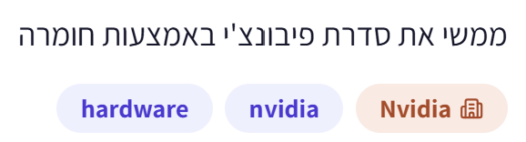
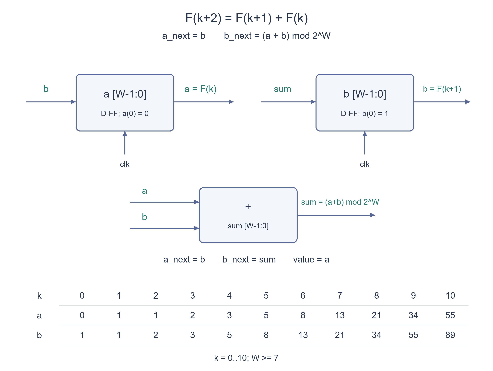

# PREP-044 — מימוש סדרת פיבונצ׳י באמצעות חומרה

נקלטה ב־19 באוקטובר 2026. פתרון מוצע בסיוע AI, בביקורת מקצועית ותרגומית ממתינה. קושי אינו מכויל. חברות מדווחות לפי הצילום בלבד, ללא אימות עצמאי: NVIDIA.

## מקור ללא שינוי



ממשי את סדרת פיבונצ׳י באמצעות חומרה

## נוסח השאלה לאתר

ממשו באמצעות חומרה רכיב שמפיק את סדרת פיבונצ׳י: `F_0=0`, `F_1=1`, וכל איבר נוסף הוא סכום שני קודמיו. הציגו את מבנה המעגל, ערכי האתחול, העדכון בכל חזית שעון ודוגמת ריצה.

לצורך מימוש מוגדר, נניח שעון סינכרוני, שני אוגרים ללא סימן ברוחב `W` ביטים (`W>=1`) ואיפוס סינכרוני שמתחיל את הפלט ב־0. בכל חזית עולה ללא איפוס יתקבל האיבר הבא. יש להסביר את התנהגות המימוש כאשר התוצאה אינה נכנסת ברוחב האוגרים.

הבהרת עריכה: המקור מבקש רק לממש פיבונצ׳י בחומרה ואינו מגדיר אינדוקס, רוחב, תזמון או איפוס. אלו הנחות מפורשות לפתרון, וניתן להציע ממשק תקף אחר אם מגדירים אותו בעקביות.

### שלושה רמזים

1. כדי לחשב את האיבר הבא, איזה חלק מהסדרה הקודמת באמת צריך לזכור?
2. שמרו שני איברים סמוכים בשני אוגרים. מה צריך להיות תוכנו של כל אוגר במחזור הבא?
3. אתחלו את האוגרים ל־0 ול־1. בכל חזית עדכנו במקביל a_next=b ו־b_next=a+b מתוך הערכים הישנים; הפלט הוא a. הגדירו גם רוחב וגלישה.

## הצעה לפתרון

**פתרון מוצע — שני אוגרים ומחבר**

**מה צריך לזכור?** בסדרת פיבונצ׳י כל איבר הוא סכום שני קודמיו. לכן אין צורך לשמור את כל הסדרה: מספיק לזכור שני איברים סמוכים. נבחר `F_0=0, F_1=1`, כך שהפלט מתחיל `0,1,1,2,3,5,...`. המקור אינו מגדיר אינדוקס, רוחב, שעון או איפוס; אלו הבהרות למימוש שלנו, ולא נתונים מקוריים.

**1. נשמור שני איברים סמוכים.** האוגר `a` מחזיק את האיבר שמוצג כעת, והאוגר `b` מחזיק את הבא אחריו. מיד לאחר איפוס: `a=0, b=1`, והפלט הוא `a`. שני האוגרים ברוחב `W` ביטים ללא סימן, עם `W>=1`.

**2. נתקדם צעד אחד בכל חזית שעון עולה.** האיבר הבא להצגה הוא `b`, והאיבר שאחריו הוא הסכום של `a` ו־`b`. לכן:

```text
a_next = b
b_next = (a + b) mod 2^W
value  = a
```

שני האוגרים מתעדכנים **במקביל מתוך הערכים הישנים**. למשל, מ־`a=2,b=3` עוברים ל־`a=3,b=5`. אם היינו משנים קודם את `a` ואחר כך מחשבים `a+b` מהערך החדש, היינו מקבלים בטעות `b=6`.

**3. החומרה.** נחבר את יציאת `b` לכניסת הנתונים של `a`. יציאות שני האוגרים נכנסות למחבר ברוחב `W`, ו־`W` הביטים הנמוכים של הסכום מחוברים לכניסת `b`. שני האוגרים מקבלים אותו שעון. הפלט הוא יציאת `a`. בשרטוט, חוטים בעלי אותו שם (`a`, `b`, `sum`) מחוברים זה לזה; השמות מאפשרים להציג את המעגל בלי הצטלבויות מבלבלות.

**4. דוגמת ריצה ללא גלישה.** השורה הראשונה היא מצב האתחול, לפני החזית הראשונה ללא איפוס:

```text
k       a=value    b
0          0      1
1          1      1
2          1      2
3          2      3
4          3      5
5          5      8
6          8     13
7         13     21
8         21     34
9         34     55
10        55     89
```

**5. מימוש SystemVerilog.** איפוס סינכרוני פעיל בגבוה קובע את מצב ההתחלה בחזית שעון. יש להחזיק אותו פעיל לפחות בחזית אחת; לא מניחים שאתחול אובייקט במודל פייתון מאתחל מעגל פיזי.

```systemverilog
// W >= 1. Synchronous reset; output after k nonreset edges is F_k mod 2**W.
module hardware_fibonacci #(
    parameter int unsigned W = 16
) (
    input  logic         clk,
    input  logic         rst,
    output logic [W-1:0] value
);
    logic [W-1:0] a, b;

    assign value = a;

    always_ff @(posedge clk) begin
        if (rst) begin
            a <= '0;
            b <= 1;
        end else begin
            a <= b;
            b <= a + b;
        end
    end
endmodule
```

ההשמות הלא חוסמות `<=` מחשבות את שני אגפי ימין מהמצב הישן ורק אז מעדכנות יחד. הפלט בחזית מספר `k` לאחר העדכון הוא `F_k mod 2^W`, כאשר סופרים רק חזיתות מאז האיפוס שאינן מאפסות.

**6. למה זה נכון?** באתחול הזוג הוא `(F_0,F_1)`. אם לפני עדכון הוא `(F_k,F_(k+1))`, לאחריו הוא `(F_(k+1),F_k+F_(k+1))`, כלומר `(F_(k+1),F_(k+2))`. אותו נימוק תקף מודולו `2^W`, ולכן האינווריאנט נשמר בכל מחזור.

**7. רוחב סופי וגלישה.** אין חומרה בעלת מספר ביטים סופי שמפיקה לעד את כל המספרים המדויקים, כי הסדרה גדלה ללא גבול. במימוש הזה הסכום נקטע ל־`W` ביטים, ולכן הפלט הוא פיבונצ׳י מודולו `2^W`. למשל, עבור `W=4` יוצג `0,1,1,2,3,5,8,13,5,2,...`: הערך 21 מיוצג כ־5. אם צריך רק מספר ידוע של איברים מדויקים, בוחרים רוחב שמספיק לערך הגדול ביותר שיש לאחסן, כולל האוגר `b`, או מוסיפים מדיניות גלישה מפורשת. גלישת `b` עשויה להתרחש חזית אחת לפני הופעת האיבר הגולש ב־`a`.

**עלות ותזמון.** הבנייה משתמשת בשני אוגרים בני `W` ביטים ובמחבר אחד ברוחב `W`, בתוספת לוגיקת האיפוס. מתקבל איבר חדש בכל מחזור ללא איפוס. זהו תיאור מימוש, לא הוכחה למינימום שטח או השהיה. תקופת השעון צריכה לאפשר את מסלול האוגר–מחבר–אוגר, כולל זמני הכנה, שעון וניתוב; השהיית המחבר תלויה בארכיטקטורה ובטכנולוגיה.

**תשובה קצרה לראיון:** אשמור שני איברים סמוכים באוגרים מאותחלים ל־0 ול־1. בכל חזית אעביר את השני לראשון ואת סכומם לשני, במקביל, ואוציא את הראשון. אגדיר את רוחב האוגרים ואת התנהגות הגלישה, כי בחומרה סופית אי אפשר לייצר לעד סדרה מדויקת ללא הגבלה.

**אימות:** מודל פייתון נבדק מול אורקל עצמאי שמחשב פיבונצ׳י מדויק בשיטת הכפלה מהירה: 10,260 מצבים ברוחבים 1–17, 32, 64 ו־128, ועוד כל 8,192 עקבות האיפוס באורך 10 ברוחבים 1–8. שש אפשרויות רוחב לא תקינות נדחו. קוד SystemVerilog צורף, אך לא קומפל או הורץ בסימולטור HDL ולא עבר סינתזה או בדיקת תזמון פיזית. זהו פתרון מוצע בסיוע AI, שממתין לסקירה מקצועית עצמאית.


### הנחות והבהרות

- הגדרת הסדרה היא F_0=0,F_1=1. הפלט הוא האוגר a, כולל הערך 0 לפני החזית הראשונה ללא איפוס.

- שני אוגרים ללא סימן ברוחב W>=1, שעון משותף ואיפוס סינכרוני פעיל בגבוה. ההנחות נוספו למקור הקצר.

- חיבור ברוחב סופי נקטע מודולו 2^W; אין הבטחה לסדרה מדויקת בלתי מוגבלת.

- יש להפעיל איפוס בחזית ולהתאים את תקופת השעון למסלול הנתונים. אין דרישה לאפשור או לממשק לחיצת יד.

### נכונות ויעילות

```json
{
  "criterion": "מימוש סינכרוני מפורש שמפיק איבר חדש בכל מחזור.",
  "result": "שני אוגרים בני W ביטים ומחבר W ביטים, בנוסף ללוגיקת האיפוס.",
  "proof": "אם המצב הוא (F_k,F_(k+1)), עדכון מקביל ל־(b,a+b) נותן (F_(k+1),F_(k+2)); הדבר נכון גם מודולו 2^W.",
  "scope": "לא הוכח מינימום שטח או השהיה. חומרה ברוחב סופי אינה מייצגת את כל הסדרה המדויקת לעד; תזמון המחבר תלוי במימוש."
}
```

### בדיקות שבוצעו

```json
{
  "status": "בדיקות מודל פייתון עברו; סקירה מקצועית עצמאית ממתינה.",
  "method": "השוואה לאורקל הכפלה מהירה שמחשב פיבונצ׳י במספרים שלמים מדויקים ולאחר מכן מצמצם מודולו.",
  "coverage": "10,260 מצבי דגימה ב־20 רוחבים, 8,192 עקבות איפוס באורך 10 ושש בדיקות קלט רוחב לא תקין.",
  "script_path": "checks/check_prep_044.py",
  "scope": "SystemVerilog צורף אך לא קומפל או הורץ בסימולטור HDL; לא בוצעו סינתזה או תזמון פיזי."
}
```

### מקרי קצה

- W=1 תקין ומפיק פיבונצ׳י מודולו 2.

- איפוס באמצע מחזיר מיד לאחר החזית את הזוג ל־0,1 והפלט ל־0.

- ללא חזיתות שעון המצב אינו מתקדם; אי אפשר להניח מצב אתחול פיזי בלי לאתחל אותו.

- עבור W=4, הערך 21 יופיע כ־5. האוגר b עשוי לגלוש לפני שהאיבר הגולש מופיע בפלט a.

- אם נדרש מספר מוגבל של איברים מדויקים, רוחב האוגרים צריך לכסות גם את האיבר הבא המאוחסן ב־b.

### טעויות נפוצות

- עדכון a לפני חישוב הסכום באמצעות ערכו החדש, במקום עדכון מקביל מהמצב הישן.

- אתחול שני האוגרים ל־0, שינעל את הסדרה על אפס.

- הצגת פלט שמתחיל ב־1 בלי להגדיר מוסכמת אינדוקס שונה.

- טענה שרוחב סופי מספיק לכל איברי הסדרה המדויקת.

- השמטת איפוס או הנחה שהמצב ידוע פיזית מעצמו.

- טענה להשהיית חיבור קבועה שאינה תלויה ברוחב ובארכיטקטורת המחבר.

### תשובה קצרה לראיון

אשמור שני איברים סמוכים באוגרים מאותחלים ל־0 ול־1. בכל חזית אעביר את השני לראשון ואת סכומם לשני במקביל, ואציג את הראשון. אציין רוחב ואת התנהגות הגלישה: המימוש ברוחב W מפיק את הסדרה מודולו 2^W.

### הרחבות ושאלת המשך

```json
{
  "question": "איך נוסיף אות אפשור, ומה צריך להשתנות אם אסור לגלוש?",
  "answer_outline": "כשאין אפשור שני האוגרים נשארים ללא שינוי; איפוס מקבל קדימות. עבור מספר מוגבל של איברים בוחרים רוחב מספיק או מחשבים סכום W+1 ביטים ומדווחים/עוצרים בגלישה. בחירה ברוויה משנה את הסדרה; לא ניתן לייצר לעד ערכים מדויקים ברוחב סופי.",
  "integration_status": "שאלת המשך מוכנה בתוכן; אינה מחוברת לתהליך ההמשך החי."
}
```



## English question

Implement a hardware component that generates Fibonacci numbers: `F_0=0`, `F_1=1`, and each later term equals the sum of its two predecessors. Show the datapath, initial values, per-edge update and a trace.

For a defined implementation, assume a common synchronous clock, two unsigned `W`-bit registers (`W>=1`) and synchronous reset starting output at zero. Each nonreset rising edge produces the next term. Explain behavior when a result no longer fits the register width.

Editorial clarification: the source asks only for hardware Fibonacci and does not specify indexing, width, timing or reset. These are explicit solution assumptions; another valid interface is acceptable if defined consistently.

### Three hints

1. Which part of the previous sequence must actually be remembered to calculate the next term?
2. Store two consecutive terms in two registers. What should each register contain next cycle?
3. Initialize to zero and one. On each edge update a_next=b and b_next=a+b in parallel from old values; expose a. Also define width and overflow.

## Proposed solution

**Proposed solution — two registers and an adder**

**What must be remembered?** Each Fibonacci number is the sum of the preceding two. We need not store the entire sequence: two consecutive terms suffice. Choose `F_0=0, F_1=1`, producing `0,1,1,2,3,5,...`. The source leaves indexing, width, clock and reset unspecified; these are explicit implementation clarifications, not original data.

**1. Store two adjacent terms.** Register `a` holds the term currently displayed, and `b` holds the following term. Immediately after reset, `a=0,b=1`, with output `value=a`. Both registers are unsigned and `W` bits wide, where `W>=1`.

**2. Advance on each rising clock edge.** The next displayed term is `b`; the term after it is the sum of old `a` and old `b`:

```text
a_next = b
b_next = (a + b) mod 2^W
value  = a
```

Both registers update **simultaneously from their old values**. For example, `(a,b)=(2,3)` becomes `(3,5)`. Updating `a` first and then using the new value in the sum would incorrectly make `b=6`.

**3. Hardware connections.** Connect output `b` to the data input of `a`. Feed both register outputs into a `W`-bit adder, and connect its low `W` result bits to the data input of `b`. Both registers share the clock. Expose `a` as output. In the schematic, matching net names (`a`, `b`, `sum`) denote connected wires; named nets avoid ambiguous wire crossings.

**4. Trace before overflow.** Row zero is initialization, before the first nonreset edge:

```text
k       a=value    b
0          0      1
1          1      1
2          1      2
3          2      3
4          3      5
5          5      8
6          8     13
7         13     21
8         21     34
9         34     55
10        55     89
```

**5. SystemVerilog implementation.** A synchronous active-high reset establishes the initial state at a clock edge. Assert it across at least one active edge; Python object initialization does not initialize physical registers.

```systemverilog
// W >= 1. Synchronous reset; output after k nonreset edges is F_k mod 2**W.
module hardware_fibonacci #(
    parameter int unsigned W = 16
) (
    input  logic         clk,
    input  logic         rst,
    output logic [W-1:0] value
);
    logic [W-1:0] a, b;

    assign value = a;

    always_ff @(posedge clk) begin
        if (rst) begin
            a <= '0;
            b <= 1;
        end else begin
            a <= b;
            b <= a + b;
        end
    end
endmodule
```

Nonblocking assignments `<=` evaluate both right-hand sides from the old state before updating together. After nonreset edge `k` since initialization, output is `F_k mod 2^W`.

**6. Correctness.** Initialization gives `(F_0,F_1)`. If the stored pair is `(F_k,F_(k+1))`, the next pair is `(F_(k+1),F_k+F_(k+1))=(F_(k+1),F_(k+2))`. The same identity holds modulo `2^W`, preserving the invariant at every edge.

**7. Finite width and overflow.** No fixed finite number of bits can represent all exact Fibonacci terms forever: their values grow without bound. This implementation truncates the sum to `W` bits, giving Fibonacci modulo `2^W`. For `W=4`, for example, output is `0,1,1,2,3,5,8,13,5,2,...`, because 21 is represented as 5. For a bounded number of exact terms, choose a width covering the largest stored value, including register `b`, or specify an overflow policy. Register `b` can overflow one edge before the overflowing term reaches output `a`.

**Cost and timing.** This construction uses two `W`-bit registers and one `W`-bit adder, plus reset logic, and produces one new term per nonreset cycle. This is not an area or delay minimality proof. The clock period must accommodate the register–adder–register path, including setup, clock and routing effects; adder delay depends on architecture and technology.

**Interview answer:** Store two adjacent terms in registers initialized to zero and one. At every rising edge copy the second term into the first register and their old-value sum into the second, in parallel, and expose the first. Define register width and overflow because finite hardware cannot generate an unbounded exact sequence forever.

**Verification:** A Python clock-edge model matched an independent exact fast-doubling Fibonacci oracle at 10,260 states across widths 1–17, 32, 64 and 128, plus all 8,192 length-ten reset traces at widths 1–8. Six invalid widths were rejected. SystemVerilog is supplied but has not been compiled, HDL-simulated, synthesized or physically timed. This is an AI-assisted proposal with independent expert review pending.


### Assumptions

- Sequence convention is F_0=0,F_1=1. Output is register a, including zero before the first nonreset edge.

- Two unsigned W-bit registers, W>=1, common clock and synchronous active-high reset; these clarify the terse source.

- Finite-width addition wraps modulo 2^W; an unbounded exact sequence is not promised.

- Reset must be asserted at an edge, and clock period must accommodate the datapath. No enable or handshake is required.

### Correctness and efficiency

```json
{
  "criterion": "An explicit synchronous implementation producing one term per cycle.",
  "result": "Two W-bit registers and one W-bit adder, plus reset logic.",
  "proof": "State (F_k,F_(k+1)) updates in parallel to (b,a+b)=(F_(k+1),F_(k+2)); this also holds modulo 2^W.",
  "scope": "No area or delay minimum is proved. Finite-width hardware cannot represent the entire exact sequence forever, and adder timing depends on implementation."
}
```

### Verification

```json
{
  "status": "Python-model checks passed; independent expert review pending.",
  "method": "Comparison to independent exact fast-doubling Fibonacci followed by modular reduction.",
  "coverage": "10,260 sampled states across 20 widths, 8,192 length-ten reset traces and six invalid-width cases.",
  "script_path": "checks/check_prep_044.py",
  "scope": "SystemVerilog supplied but not compiled or HDL-simulated; no synthesis or physical timing."
}
```

### Edge cases

- W=1 is valid and produces Fibonacci modulo two.

- A midstream reset returns the pair to zero and one, with output zero, after the edge.

- Without clock edges state does not advance; physical initialization must be established.

- For W=4, 21 appears as 5. Register b can overflow before the overflowing term reaches a.

- A bounded exact sequence needs sufficient width for the next term stored in b as well as the output.

### Common mistakes

- Updating a before evaluating the sum from its new value rather than updating in parallel from old state.

- Initializing both registers to zero, trapping the sequence at zero.

- Starting output at one without defining a different indexing convention.

- Claiming finite width represents all exact terms forever.

- Omitting reset or assuming physical state initializes itself.

- Claiming adder delay is independent of width and architecture.

### Interview answer

Store adjacent terms in registers initialized to zero and one. At each edge simultaneously copy the second to the first and their old-value sum to the second; expose the first. State width and overflow: a W-bit implementation produces the sequence modulo 2^W.

### Extensions and follow-up

```json
{
  "question": "How would you add an enable, and what changes if overflow is forbidden?",
  "answer_outline": "Hold both registers when enable is low, with reset taking priority. For a bounded exact sequence choose sufficient width, or compute a W+1-bit sum and flag/stop on overflow. Saturation changes the sequence; finite width cannot provide exact unbounded terms forever.",
  "integration_status": "Follow-up prepared in content; not connected to the live follow-up workflow."
}
```


## קוד ובדיקות

[prep_044_hardware_fibonacci.py](../solutions/prep_044_hardware_fibonacci.py) · [prep_044_hardware_fibonacci.sv](../solutions/prep_044_hardware_fibonacci.sv) · [check_prep_044.py](../checks/check_prep_044.py) · [prep-044-verification.json](../checks/prep-044-verification.json)

צילום המקור פנימי ואינו מדיה ללומדים. שאלת ההמשך הוכנה אך לא חוברה לתור החי. אין אישור מקצועי, כיול קושי או זכאות לראיות שליטה ולניקוד תחרותי. בדיקות Python אינן קומפילציית HDL, בדיקת חומרה או לחיצות בחשבון חי.
