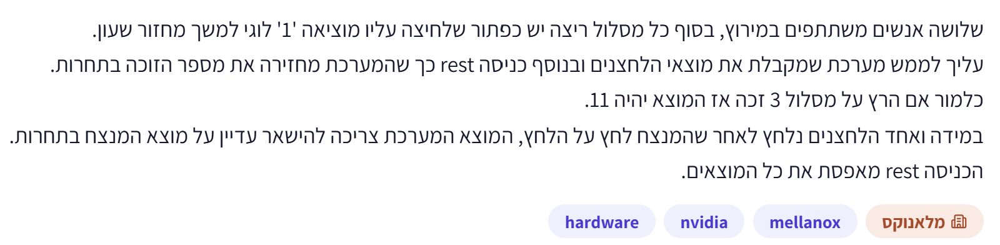
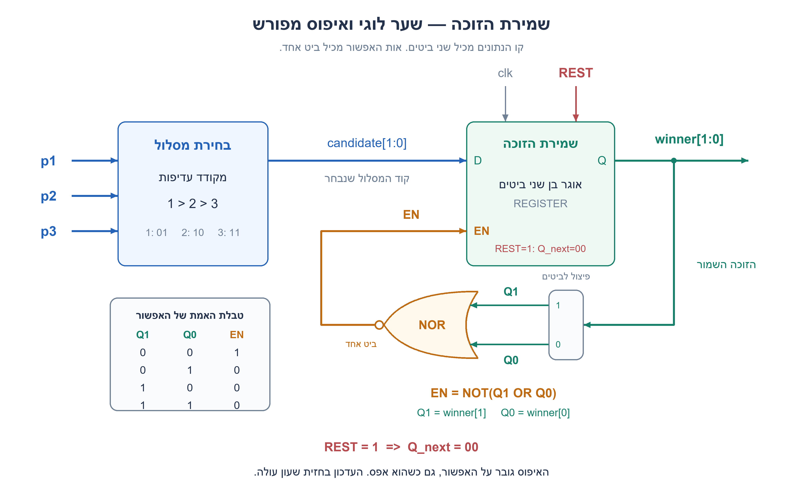
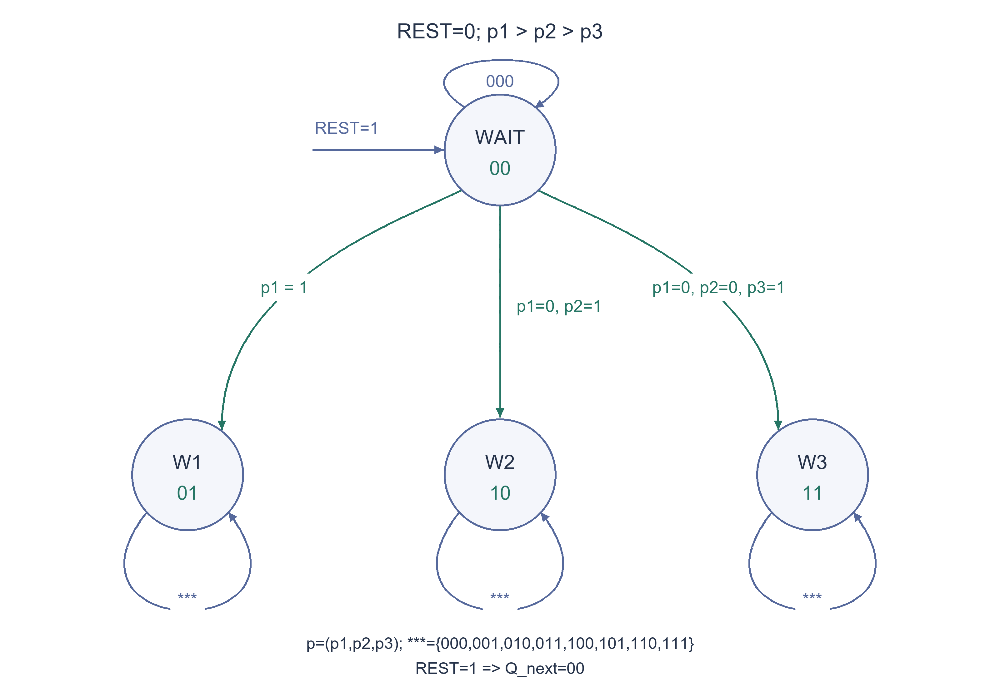
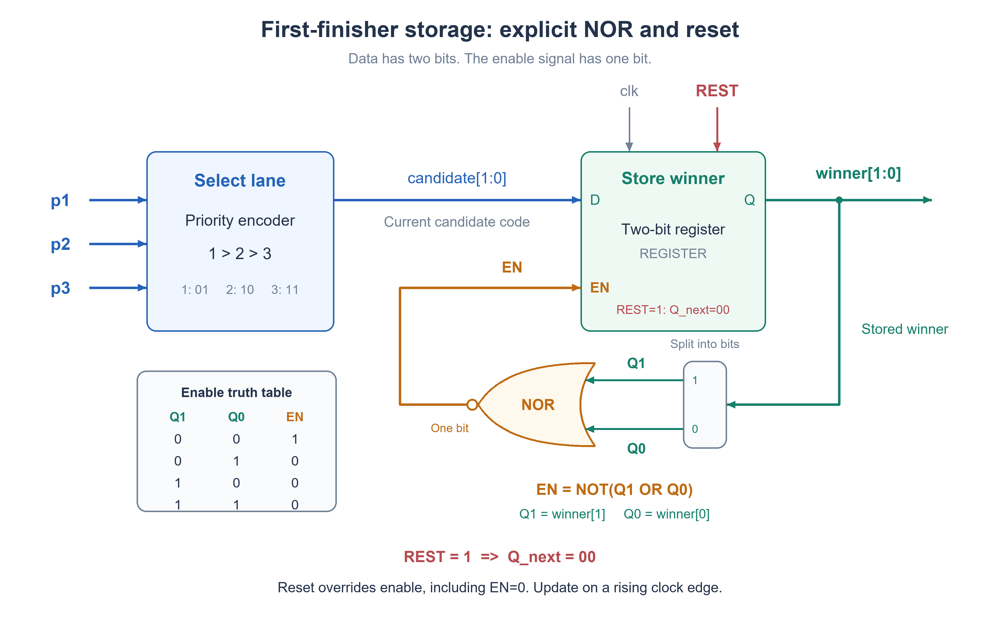

# PREP-045 — שמירת הזוכה הראשון במירוץ של שלושה מסלולים

נקלטה ב־19 באוקטובר 2026. פתרון מוצע בסיוע AI, בביקורת מקצועית ותרגומית ממתינה. קושי אינו מכויל. חברות מדווחות לפי הצילום בלבד, ללא אימות עצמאי: NVIDIA, Mellanox.

## מקור ללא שינוי



שלושה אנשים משתתפים במירוץ, בסוף כל מסלול ריצה יש כפתור שלחיצה עליו מוציאה '1' לוגי למשך מחזור שעון.
עליך לממש מערכת שמקבלת את מוצאי הלחצנים ובנוסף כניסה rest כך שהמערכת מחזירה את מספר הזוכה בתחרות.
כלומר אם הרץ על מסלול 3 זכה אז המוצא יהיה 11.
במידה ואחד הלחצנים נלחץ לאחר שהמנצח לחץ על הלחצן, מוצא המערכת צריכה להישאר עדיין על מוצא המנצח בתחרות.
הכניסה rest מאפסת את כל המוצאים.

## נוסח השאלה לאתר

שלושה רצים משתתפים במירוץ, אחד בכל מסלול. לחצן הסיום במסלול i מספק אות pi ששווה 1 למשך מחזור שעון אחד. ממשו מערכת שמציגה את מספר המסלול של הזוכה ושומרת אותו גם לאחר שהפולס מסתיים וגם אם רצים אחרים לוחצים אחר כך.

קידוד הפלט: 00 — עדיין אין זוכה, 01 — מסלול 1, 10 — מסלול 2, 11 — מסלול 3. כניסת איפוס rst מחזירה את הפלט ל־00 ומאפשרת להתחיל מירוץ חדש.

הנחות המימוש המפורשות: הפולסים כבר סינכרוניים ויציבים לדגימה בחזית עולה; האיפוס סינכרוני, פעיל בגבוה ובעל עדיפות על לחיצות. אם כמה מסלולים נדגמים פעילים באותה חזית, נבחר במסלול בעל המספר הנמוך ביותר. אין דרישה להסיק סדר הגעה בתוך מחזור.

הציגו טבלת אמת לבחירת מועמד, מעגל ומכונת מצבים, והסבירו כיצד מונעים מלחיצה מאוחרת להחליף זוכה. המקור אינו מגדיר שבירת תיקו או תזמון איפוס; אלה הבהרות העריכה שלנו. במקור כניסת האיפוס נכתבת rest.

### שלושה רמזים

1. הפולס של הזוכה נעלם אחרי מחזור, אבל התוצאה צריכה להישאר. איזה מידע צריך לשמור, וכמה תוצאות שונות יש?
2. הפרידו בין מקודד שמציע מספר מסלול לפי הפולסים הנוכחיים לבין זיכרון שמחליט האם לקבל את ההצעה. מה מסמן שעדיין אין זוכה?
3. השתמשו באוגר בן שני ביטים: איפוס כופה 00; אם האוגר עדיין 00, טענו את קוד המועמד; אחרת החזיקו את ערכו. הגדירו במפורש סדר עדיפות ללחיצות באותה דגימה.

## הצעה לפתרון

**פתרון מוצע — מקודד עדיפות ואוגר ששומר את הזוכה הראשון**

### קודם מבהירים מה נחשב ראשון

המקור מתאר פולס באורך מחזור שעון מכל לחצן, אבל אינו מגדיר מה עושים אם כמה פולסים נדגמים באותה חזית. נבחר ונצהיר: מסלול 1 קודם ל־2, ומסלול 2 קודם ל־3 במקרה כזה בלבד. זו מדיניות שבירת תיקו שהוספנו, ולא נתון מהמקור. אם כמה אנשים מגיעים בין אותן שתי חזיתות, המערכת אינה יודעת מתוך שלושת הביטים מי הגיע קודם בזמן רציף.

נניח שהכניסות `p1,p2,p3` כבר סינכרוניות לשעון ועומדות בזמני הכנה והחזקה. נדגום אותן בחזית עולה. נסמן `REST` כאיפוס פעיל בגבוה וסינכרוני, עם עדיפות על כל לחיצה. במקור נכתב `rest`; פירשנו זאת ככניסת איפוס. סימון `rst` בנוסח השאלה וסימון `REST` בשרטוט ובקוד מציינים אותה כניסה. נשתמש בקידוד `00` כשאין זוכה, `01` למסלול 1, `10` למסלול 2 ו־`11` למסלול 3.

### 1. למה צריך זיכרון?

מקודד צירופי בלבד אינו מספיק. אם מסלול 3 זכה והפולס שלו כבר נגמר, עדיין צריך להציג `11`. גם לחיצה מאוחרת במסלול 1 אינה רשאית להחליף אותו. לכן שומרים את הקוד באוגר `winner` בן שני ביטים, ולא מפיקים פלט רק מהלחצנים הנוכחיים.

### 2. מפרידים בין בחירת מועמד לבין שמירת תוצאה

המקודד בוחר את המועמד מתוך הפולסים הנוכחיים, לפי סדר העדיפות שהוגדר:

```text
if p1:      candidate = 01
else if p2: candidate = 10
else if p3: candidate = 11
else:       candidate = 00
```

טבלת האמת המלאה של המקודד:

| p1 | p2 | p3 | קוד המועמד |
| --- | --- | --- | --- |
| 0 | 0 | 0 | 00 |
| 0 | 0 | 1 | 11 |
| 0 | 1 | 0 | 10 |
| 0 | 1 | 1 | 10 |
| 1 | 0 | 0 | 01 |
| 1 | 0 | 1 | 01 |
| 1 | 1 | 0 | 01 |
| 1 | 1 | 1 | 01 |

הטבלה אינה אומרת שמסלול 1 תמיד מנצח. היא משמשת רק כל עוד **עדיין אין זוכה**. אם מסלול 3 נרשם קודם, אפילו צירוף `111` מאוחר יותר לא ישנה את התוצאה.

אפשר גם לכתוב את שני ביטי קוד המועמד כך:

```text
candidate[1] = NOT(p1) AND (p2 OR p3)
candidate[0] = p1 OR (NOT(p2) AND p3)
```

### 3. שער NOR מפיק ביט אפשור אחד

נסמן את שני ביטי הזוכה השמור `Q1=winner[1]` ו־`Q0=winner[0]`. שער NOR עם שתי כניסות מחבר אותם ב־OR ואז הופך את התוצאה:

```text
EN = NOT(Q1 OR Q0)
```

זו בדיקת אפס של הקוד כולו. השער אינו מעביר את `winner` כפי שהוא ואינו הופך כל ביט בנפרד. הקלט מכיל שני ביטים, והמוצא `EN` מכיל ביט יחיד. העיגול הקטן ביציאת סמל השער מציין את ההיפוך.

| Q1 | Q0 | EN | משמעות |
| --- | --- | --- | --- |
| 0 | 0 | 1 | עדיין אין זוכה; מותר לקלוט מועמד |
| 0 | 1 | 0 | מסלול 1 כבר זכה; שומרים אותו |
| 1 | 0 | 0 | מסלול 2 כבר זכה; שומרים אותו |
| 1 | 1 | 0 | מסלול 3 כבר זכה; שומרים אותו |

### 4. קריאת המעגל והעדיפות של האיפוס

המקודד הכחול בוחר מסלול מהפולסים הנוכחיים ומחבר את קוד המועמד בן שני הביטים לכניסת הנתונים `D` של האוגר. הפלט הירוק `Q` הוא הזוכה השמור. ענף ממנו מתפצל לשני החוטים `Q1,Q0` ונכנס לשער NOR. פיצול זה הוא חיווט בלבד, ללא זיכרון או חישוב נוסף. מוצא השער הכתום מחובר לכניסת האפשור `EN` של האוגר.

כאשר `EN=1`, בחזית השעון הבאה האוגר טוען את הקוד שבכניסת `D`. כאשר `EN=0`, הוא מחזיק את ערכו הקודם. האוגר עם האפשור מממש את אותה בחירה בין טעינת מועמד לבין החזקה באמצעות משוב; אין צורך בביט נעילה נוסף.

כניסת האיפוס האדומה `REST` מחוברת ישירות לאיפוס הסינכרוני של האוגר. היא גוברת על `EN`, ולכן גם לאחר זכייה, כאשר `EN=0`, אפשר לאפס. סדר הפעולות בכל חזית עולה הוא:

```text
if REST:
    winner_next = 00
else if EN:
    winner_next = candidate
else:
    winner_next = winner
```

| REST | EN | פעולה בחזית שעון עולה |
| --- | --- | --- |
| 1 | לא משנה | איפוס הזוכה השמור ל־00 |
| 0 | 1 | טעינת קוד המועמד |
| 0 | 0 | החזקת הזוכה הקיים |

למשל, אחרי זכייה של מסלול 3 נשמר `11`, ולכן שער NOR מוציא אפס והאוגר נעול. אם מפעילים `REST`, בחזית הבאה מתקבל `00` גם שהאפשור היה אפס. בעקבות האיפוס שער NOR מוציא אחד. כל עוד האיפוס פעיל, כל חזית ממשיכה לאפס; אחרי שחרורו אפשר לקלוט מועמד במירוץ חדש. האיפוס אינו מיידי בין חזיתות במימוש הסינכרוני הזה.

מכונת מור השקולה נשארת בעלת ארבעה מצבים: `WAIT/00`, `W1/01`, `W2/10`, `W3/11`. בכל מצב זכייה שומרים את הקוד עבור כל קלט כאשר האיפוס אינו פעיל. איפוס מחזיר כל מצב ל־`WAIT`.

| מצב נוכחי | תנאי בחזית, כשאין איפוס | מצב הבא | פלט לאחר החזית |
| --- | --- | --- | --- |
| WAIT | אין לחיצה | WAIT | 00 |
| WAIT | p1=1 | W1 | 01 |
| WAIT | p1=0 וגם p2=1 | W2 | 10 |
| WAIT | p1=0 וגם p2=0 וגם p3=1 | W3 | 11 |
| W1 | כל צירוף לחיצות | W1 | 01 |
| W2 | כל צירוף לחיצות | W2 | 10 |
| W3 | כל צירוף לחיצות | W3 | 11 |
| כל מצב | REST=1 בחזית | WAIT | 00 |

### 5. דוגמת ריצה

כל שורה מתארת דגימה בחזית שעון ואת הפלט שנשמר אחריה:

| חזית | REST | p1,p2,p3 | הפלט לפני החזית | הפלט אחרי החזית | הסבר |
| --- | --- | --- | --- | --- | --- |
| 1 | 1 | 000 | לא משנה | 00 | הכנת המערכת למירוץ |
| 2 | 0 | 000 | 00 | 00 | עדיין אין מסיים |
| 3 | 0 | 001 | 00 | 11 | מסלול 3 זוכה |
| 4 | 0 | 100 | 11 | 11 | לחיצה מאוחרת אינה מחליפה זוכה |
| 5 | 0 | 010 | 11 | 11 | גם מסלול 2 אינו משנה את הפלט |
| 6 | 1 | 111 | 11 | 00 | האיפוס גובר גם על שלוש לחיצות |
| 7 | 0 | 011 | 00 | 10 | מירוץ חדש: באותה דגימה מסלול 2 קודם ל־3 |

### 6. קוד חומרה ומודל לבדיקות

ב־SystemVerilog האוגר מתעדכן רק ב־`posedge clk`; השמה לא חוסמת שומרת על התנהגות סינכרונית. היעדר השמה בענף הנעול של בלוק `always_ff` אומר להחזיק את הערך — הוא אינו יוצר latch צירופי. המקודד מקבל ערך בכל מסלול ולכן אינו יוצר latch.

```systemverilog
// Finish pulses must already meet this clock domain's setup/hold requirements.
// Simultaneous sampled pulses use explicit editorial priority: lane 1 > 2 > 3.
module first_finisher (
    input  logic       clk,
    input  logic       REST,
    input  logic       p1,
    input  logic       p2,
    input  logic       p3,
    output logic [1:0] winner
);
    logic [1:0] candidate;
    logic       en;

    // One-bit NOR result, not a bitwise inversion of the two-bit winner.
    assign en = ~(winner[1] | winner[0]);

    always_comb begin
        if      (p1) candidate = 2'b01;
        else if (p2) candidate = 2'b10;
        else if (p3) candidate = 2'b11;
        else         candidate = 2'b00;
    end

    always_ff @(posedge clk) begin
        if (REST)
            winner <= 2'b00;
        else if (en)
            winner <= candidate;
        // Reset overrides enable, including when en=0 after a win.
        // Otherwise hold winner; later pulses cannot replace it.
    end
endmodule
```

יש להחזיק את `REST` פעיל לפחות בחזית אחת כדי לאתחל את החומרה. מודל פייתון הבא מייצג חזיתות שעון ולא לחצנים פיזיים; המתודה מחזירה את הפלט אחרי החזית:

```python
"""Clock-edge model of a first-finisher register with lane-1-first tie priority.

Input pulses are already synchronous and stable at each clock edge. This model
does not debounce physical switches or recover subcycle event ordering.
"""


def next_winner(winner: int, p1: int, p2: int, p3: int, reset: bool = False) -> int:
    """Return 0 for no winner, or the latched lane number 1, 2, or 3."""
    if winner not in (0, 1, 2, 3) or any(p not in (0, 1) for p in (p1, p2, p3)):
        raise ValueError("Require winner 0..3 and binary finish pulses")
    if reset:
        return 0
    if winner != 0:
        return winner
    if p1:
        return 1
    if p2:
        return 2
    if p3:
        return 3
    return 0


class FirstFinisher:
    """Output changes only on a modeled rising clock edge."""

    def __init__(self):
        self.winner = 0

    def step(self, p1: int, p2: int, p3: int, reset: bool = False) -> int:
        self.winner = next_winner(self.winner, p1, p2, p3, reset)
        return self.winner
```

### 7. למה המימוש נכון ומה עלותו?

אחרי איפוס הפלט אפס. כל עוד לא נדגם פולס, המקודד נותן אפס ולכן המצב נשאר אפס. בחזית הראשונה שבה יש פולס נשמר המסלול היחיד, או המסלול בעל העדיפות מתוך הצירוף שנדגם. מכאן ואילך הפלט שונה מאפס, וכל חזית ללא איפוס מחזיקה אותו. איפוס מחזיר לאפס ללא תלות בלחצנים. זה מוכיח בחירה, שימור ויכולת להתחיל מירוץ חדש.

ארבעה מצבים בעלי ארבעה פלטים שונים מחייבים לפחות ארבע אפשרויות זיכרון. בקידוד בינארי רגיל נדרשים לפחות שני ביטים, והבנייה משתמשת בדיוק בשניים. זו טענת מינימום לביטי המצב במודל הסינכרוני הנתון; אין כאן הוכחת מינימום שערים, שטח או השהיה פיזית. הלוגיקה היא מקודד קטן, בדיקת אפס ובחירת החזקה; מספר הפעולות בכל חזית קבוע.

### 8. מה אינו מוגדר באמצעות המעגל הזה?

אם רוצים להכריז תיקו, צריך להוסיף קוד/דגל מתאים ולבדוק ריבוי לחיצות באותה דגימה; לא נשאר קוד פנוי בשני ביטי הפלט הנוכחיים. אפשר גם להבטיח מראש שלא יהיו לחיצות בו־זמניות, ואז אין חשיבות לסדר העדיפות. אין להסיק שבירת תיקו מתוך החיווט בלי להצהיר עליה.

לחצנים אמיתיים עשויים להיות אסינכרוניים ולקפוץ מכנית. לפני הכניסות שניתנו בשאלה דרושה לפי הצורך שרשרת סנכרון, הסרת רטט והפקת פולס, עם ניתוח דרישות לכידת אירועים. סנכרון אינו מבטיח למנוע כל מטא־יציבות, ללכוד כל פולס קצר או לשמר את סדרם של שני אירועים קרובים. הדרישה כאן היא הזוכה הראשון **לפי הדגימות והמדיניות המוצהרת**.

אימות: נבדקו כל 64 שילובי המצב, שלוש הכניסות והאיפוס; כל 299,593 רצפי הפולסים באורכים 0–6 ללא איפוס; וכל 69,905 רצפי הפולסים והאיפוס באורכים 0–4. אורקל עצמאי סורק את ההיסטוריה מאז האיפוס האחרון ובוחר את חזית ההגעה הראשונה ואת מספר המסלול הקטן בה. נבדקו גם משוואות המקודד ושימור זוכה במשך 100 מחזורים. אלה בדיקות מודל פייתון, לא סימולציית HDL, סינתזה או מדידת חומרה. הפתרון מוצע בסיוע AI וסקירה מקצועית עצמאית עדיין ממתינה.


### הנחות והבהרות

- הקלטים הם פולסים בינאריים שכבר סונכרנו ועומדים בזמני הכנה והחזקה; המערכת אינה מטפלת כאן ברטט של לחצנים פיזיים.

- דוגמים בחזית עולה; הפלט הוא האוגר לאחר החזית. איפוס סינכרוני פעיל בגבוה גובר על כל לחיצה ומחזיר ל־00.

- בהגעה שנדגמת באותה חזית בוחרים מסלול 1 לפני 2 לפני 3; זו מדיניות שהוספנו ולא נתון במקור.

- 00 מסמן שאין זוכה; 01,10,11 הם מסלולים 1,2,3. rest במקור, rst בנוסח ו־REST בשרטוט מציינים אותה כניסת איפוס.

- אין אפשרות להסיק משלושת הפולסים את סדרם הכרונולוגי של אירועים שונים בין אותן שתי חזיתות.

### נכונות ויעילות

```json
{
  "criterion": "מספר ביטי הזיכרון במודל סינכרוני עם ארבע תוצאות יציבות.",
  "result": "שני ביטי מצב מספיקים ונדרשים; מקודד, בדיקת אפס ובחירת החזקה משלימים את הבנייה.",
  "proof": "אין זוכה ושלושת הזוכים דורשים ארבעה מצבים נבדלים בפלט. ביט אחד מייצג רק שני מצבים; שני ביטים מייצגים ארבעה. קוד הזוכה עצמו שומר את המצב.",
  "scope": "אין טענה למינימום שערים, שטח או השהיה. הדרישה היא הגעה ראשונה לפי דגימות ולא הכרעה אנלוגית בין אירועים קרובים."
}
```

### בדיקות שבוצעו

```json
{
  "status": "בדיקות מודל פייתון עברו; סקירה מקצועית עצמאית ממתינה.",
  "method": "אורקל עצמאי סורק את היסטוריית הדגימות מאז האיפוס האחרון ובוחר את זוג החזית והמסלול המינימלי. נבדקו גם משוואות בוליאניות ואינווריאנטים.",
  "coverage": "64 מעברי מצב/קלט/איפוס; 299,593 רצפי פולסים באורכים 0–6; 69,905 רצפי פולסים ואיפוס באורכים 0–4; החזקת זוכה 100 מחזורים. ארבע שורות האמת של אפשור NOR ועדיפות איפוס גם כשהאפשור אפס.",
  "script_path": "checks/check_prep_045.py",
  "scope": "אין סימולציית HDL, סינתזה, בדיקת CDC או מדידת חומרה; קוד SystemVerilog צורף כמימוש מוצע."
}
```

### מקרי קצה

- בלי לחיצות אחרי איפוס נשארים ב־00.

- כל לחצן לבדו מתקבל בקוד המתאים, לרבות מסלול 3 שמקבל 11.

- לחיצה מאוחרת במסלול בעל עדיפות גבוהה אינה מחליפה זוכה שכבר נשמר.

- כל שמונת צירופי הלחצנים מוגדרים; לחיצות באותה חזית נפתרות בעדיפות 1 ואז 2 ואז 3.

- איפוס בחזית עם לחיצות מאפס במקום לבחור זוכה. אם פולס נשאר פעיל בחזית הבאה ללא איפוס, הוא יכול להיבחר אז.

- איפוס אחרי זכייה מאפשר למירוץ הבא לבחור זוכה אחר; בלי חזית איפוס אין הבטחת מצב התחלה בחומרה.

- גם כשהזוכה השמור שונה מאפס ו־EN=0, REST=1 מאפס בחזית; לאחר האיפוס EN חוזר ל־1.

### טעויות נפוצות

- מקודד צירופי בלבד: מאבד את התוצאה בסיום הפולס ומאפשר ללחיצות מאוחרות לשנות אותה.

- עדכון הקוד בכל לחיצה במקום רק במצב שעדיין אין זוכה.

- שימוש ב־OR של קודי מסלולים בלי להגדיר תיקו: למשל מסלולים 1 ו־2 עלולים להיראות בטעות כמסלול 3.

- סימון 00 כמסלול 1 ואז שימוש באפס כדי לזהות שאין זוכה.

- השמטת עדיפות האיפוס או טענה שסדר if משחזר את זמן ההגעה האמיתי בתוך מחזור.

- הנחה שלחצן פיזי מסונכרן, נקי מרטט או בטוח ממטא־יציבות בלי טיפול מתאים.

- בלבול בין NOR על שני ביטי הזוכה לבין העברת הקוד או היפוך כל ביט בנפרד; חסימת האיפוס כשהאפשור אפס.

### תשובה קצרה לראיון

מקודד עדיפות מפיק קוד מועמד בן שני ביטים. אשמור אותו באוגר שהאפשור שלו הוא NOR של שני ביטי הזוכה: EN=NOT(Q1 OR Q0). רק כשהזוכה 00 האוגר טוען מועמד בחזית; אחרי זכייה האפשור אפס והאוגר מחזיק. איפוס סינכרוני REST גובר גם על EN=0 ומחזיר ל־00. נגדיר תיקו באותה דגימה במפורש; כאן מסלול 1 קודם ל־2 ול־3. אין הכרעה בסדר הגעה בתוך מחזור.

### הרחבות ושאלת המשך

```json
{
  "question": "איך תשנו את המערכת כדי להציג תיקו כשיותר מרץ אחד מסיים באותה דגימה?",
  "answer_outline": "מזהים לפחות שתי כניסות פעילות בעזרת (p1 AND p2) OR (p1 AND p3) OR (p2 AND p3), ורושמים דגל תיקו רק בחזית ההגעה הראשונה. ארבעת קודי שני הביטים כבר משמשים לשלושה זוכים ולהמתנה, ולכן נדרש דגל נוסף או ממשק רחב יותר. עדיין לא יודעים מי הגיע ראשון בתוך מחזור.",
  "integration_status": "שאלת המשך מוכנה בארכיון; טרם חוברה לתהליך שאלות ההמשך החי."
}
```





## English question

Three runners race in three lanes. Lane i has a finish button that produces a one-clock-cycle pulse pi. Design a system that outputs the winning lane and retains it after its pulse ends and when other runners press later.

Encode no winner as 00, lane 1 as 01, lane 2 as 10 and lane 3 as 11. Reset input rst clears the result to 00 and permits a new race.

Explicit implementation assumptions: pulses are already synchronous and stable at the rising sampling edge; reset is synchronous, active high and takes priority over finish inputs. If several lanes are sampled active at the same edge, choose the smallest lane number. Reconstructing arrival order within a clock cycle is not required.

Provide the candidate truth table, circuit and state machine, and explain why later arrivals cannot replace a winner. Tie policy and reset timing are editorial clarifications absent from the source, which spells the reset input rest.

### Three hints

1. The winner pulse disappears after a cycle, but its result must remain. What information must be stored, and how many possible results exist?
2. Separate an encoder proposing a lane from memory deciding whether to accept it. What code can indicate that no winner has been accepted?
3. Use a two-bit register: reset forces 00; while it is 00, load the candidate code; otherwise hold its old value. Explicitly define priority for pulses sampled at the same edge.

## Proposed solution

**Proposed solution — a priority encoder and a register that keeps the first winner**

### First define what first means

The source provides one-clock finish-button pulses, but does not specify simultaneous sampled arrivals. Explicitly choose lane 1 over lane 2 over lane 3 only when pulses are sampled at the same edge. This tie policy is an editorial clarification, not a source requirement. If several people arrive between the same two clock edges, these three sampled bits do not reveal their continuous-time ordering.

Assume p1, p2 and p3 are already synchronous and meet setup/hold requirements. Sample them on rising clock edges. Use synchronous active-high REST with priority over every finish input. The source spells the reset input rest; the diagram and code use REST. The name rst in the question refers to that same reset input. Encode no winner as 00, lane 1 as 01, lane 2 as 10 and lane 3 as 11.

### 1. Why memory is necessary

A combinational encoder alone loses the result when a finish pulse ends. If lane 3 wins, output must keep 11 after its pulse disappears and after lane 1 presses later. Store the winner code in a two-bit register rather than derive output only from current button levels.

### 2. Separate choosing a candidate from storing the result

The encoder considers the current pulses, with the declared tie priority:

```text
if p1:      candidate = 01
else if p2: candidate = 10
else if p3: candidate = 11
else:       candidate = 00
```

The complete encoder truth table is:

| p1 | p2 | p3 | Candidate code |
| --- | --- | --- | --- |
| 0 | 0 | 0 | 00 |
| 0 | 0 | 1 | 11 |
| 0 | 1 | 0 | 10 |
| 0 | 1 | 1 | 10 |
| 1 | 0 | 0 | 01 |
| 1 | 0 | 1 | 01 |
| 1 | 1 | 0 | 01 |
| 1 | 1 | 1 | 01 |

This does not make lane 1 the winner regardless of history. The table is used to update the result only while there is no winner. Once lane 3 has been stored, even a later 111 combination cannot change it.

Equivalent candidate-bit equations are:

```text
candidate[1] = NOT(p1) AND (p2 OR p3)
candidate[0] = p1 OR (NOT(p2) AND p3)
```

### 3. A NOR gate produces a one-bit enable

Name the two stored winner bits `Q1=winner[1]` and `Q0=winner[0]`. A two-input NOR first ORs these bits and then inverts the result:

```text
EN = NOT(Q1 OR Q0)
```

This tests whether the entire stored code is zero. It neither passes `winner` through nor inverts each bit separately. Its input comprises two bits; its output `EN` is a single bit. The small output bubble on the gate symbol denotes inversion.

| Q1 | Q0 | EN | Meaning |
| --- | --- | --- | --- |
| 0 | 0 | 1 | No winner yet; the register may accept a candidate |
| 0 | 1 | 0 | Lane 1 already won; keep it |
| 1 | 0 | 0 | Lane 2 already won; keep it |
| 1 | 1 | 0 | Lane 3 already won; keep it |

### 4. Read the circuit and give reset priority

The blue encoder chooses a lane from the current pulses and sends its two-bit candidate code to register input `D`. Green output `Q` is the stored winner. A branch splits into wires `Q1,Q0` feeding the NOR gate. This split is wiring only, with no extra memory or computation. The orange gate output drives register enable `EN`.

When `EN=1`, the next rising edge loads the code at `D`. When `EN=0`, the register holds its previous value. A register with enable implements the same load-or-feedback-hold selection; no separate lock bit is needed.

Red input `REST` directly drives the register's synchronous reset. Reset overrides `EN`, so it still clears a winner when `EN=0`. Every rising edge follows this order:

```text
if REST:
    winner_next = 00
else if EN:
    winner_next = candidate
else:
    winner_next = winner
```

| REST | EN | Rising-edge action |
| --- | --- | --- |
| 1 | Either value | Clear the stored winner to 00 |
| 0 | 1 | Load the candidate code |
| 0 | 0 | Hold the existing winner |

For example, after lane 3 wins the stored code is `11`; NOR outputs zero and the register holds. Asserting `REST` clears it to `00` at the next edge even though enable was zero. NOR then outputs one. Each edge while reset remains asserted clears again; after reset is released a new race can accept a candidate. This synchronous reset does not change the register immediately between edges.

The equivalent Moore machine still has four states: `WAIT/00`, `W1/01`, `W2/10`, `W3/11`. Winning states hold for every input combination unless reset is asserted. Reset takes every state to `WAIT`.

| Current state | Edge condition without reset | Next state | Output after edge |
| --- | --- | --- | --- |
| WAIT | No pulse | WAIT | 00 |
| WAIT | p1=1 | W1 | 01 |
| WAIT | p1=0 and p2=1 | W2 | 10 |
| WAIT | p1=0 and p2=0 and p3=1 | W3 | 11 |
| W1 | Any pulse combination | W1 | 01 |
| W2 | Any pulse combination | W2 | 10 |
| W3 | Any pulse combination | W3 | 11 |
| Any | REST=1 at edge | WAIT | 00 |

### 5. Clock-by-clock example

Each row shows inputs sampled at an edge and the registered result after that edge:

| Edge | REST | p1,p2,p3 | Before edge | After edge | Meaning |
| --- | --- | --- | --- | --- | --- |
| 1 | 1 | 000 | Any | 00 | Initialize the race |
| 2 | 0 | 000 | 00 | 00 | No finisher yet |
| 3 | 0 | 001 | 00 | 11 | Lane 3 wins |
| 4 | 0 | 100 | 11 | 11 | Later lane 1 cannot replace it |
| 5 | 0 | 010 | 11 | 11 | Lane 2 cannot replace it either |
| 6 | 1 | 111 | 11 | 00 | Reset overrides all three pulses |
| 7 | 0 | 011 | 00 | 10 | New race: lane 2 wins this sampled tie with lane 3 |

### 6. Hardware source and test model

In SystemVerilog the register changes only at posedge clk, using nonblocking assignment. No assignment in the locked branch of always_ff means retain the register value; it does not infer a combinational latch. The encoder assigns a value on every path, so it also does not infer a latch.

```systemverilog
// Finish pulses must already meet this clock domain's setup/hold requirements.
// Simultaneous sampled pulses use explicit editorial priority: lane 1 > 2 > 3.
module first_finisher (
    input  logic       clk,
    input  logic       REST,
    input  logic       p1,
    input  logic       p2,
    input  logic       p3,
    output logic [1:0] winner
);
    logic [1:0] candidate;
    logic       en;

    // One-bit NOR result, not a bitwise inversion of the two-bit winner.
    assign en = ~(winner[1] | winner[0]);

    always_comb begin
        if      (p1) candidate = 2'b01;
        else if (p2) candidate = 2'b10;
        else if (p3) candidate = 2'b11;
        else         candidate = 2'b00;
    end

    always_ff @(posedge clk) begin
        if (REST)
            winner <= 2'b00;
        else if (en)
            winner <= candidate;
        // Reset overrides enable, including when en=0 after a win.
        // Otherwise hold winner; later pulses cannot replace it.
    end
endmodule
```

Assert REST across at least one rising edge to establish the hardware initial state. The following Python model represents clock edges, not physical switches, and step returns the output after that edge:

```python
"""Clock-edge model of a first-finisher register with lane-1-first tie priority.

Input pulses are already synchronous and stable at each clock edge. This model
does not debounce physical switches or recover subcycle event ordering.
"""


def next_winner(winner: int, p1: int, p2: int, p3: int, reset: bool = False) -> int:
    """Return 0 for no winner, or the latched lane number 1, 2, or 3."""
    if winner not in (0, 1, 2, 3) or any(p not in (0, 1) for p in (p1, p2, p3)):
        raise ValueError("Require winner 0..3 and binary finish pulses")
    if reset:
        return 0
    if winner != 0:
        return winner
    if p1:
        return 1
    if p2:
        return 2
    if p3:
        return 3
    return 0


class FirstFinisher:
    """Output changes only on a modeled rising clock edge."""

    def __init__(self):
        self.winner = 0

    def step(self, p1: int, p2: int, p3: int, reset: bool = False) -> int:
        self.winner = next_winner(self.winner, p1, p2, p3, reset)
        return self.winner
```

### 7. Correctness and cost

Reset establishes zero. Before any sampled arrival, the encoder gives zero and the state stays zero. At the first edge with an arrival, it stores the sole finishing lane or the highest-priority lane among that edge's pulses. The result is then nonzero; every later edge without reset holds it. Reset returns it to zero independently of finish inputs. This proves first-sampled selection, retention and restart behavior.

Four states with distinct outputs need at least four distinguishable memory configurations. Conventional binary encoding therefore needs at least two state bits, achieved here. This is a state-bit minimum for this synchronous contract, not a minimum gate count, area or physical delay proof. A small encoder, zero test and hold selection provide constant work per edge.

### 8. Scope and alternative tie policies

Reporting a tie would need an additional output code or flag and a multiple-input test; the present two-bit output has no unused code. Alternatively, guarantee at most one finish pulse per edge, in which case priority is irrelevant. Do not leave tie behavior as an unstated wiring accident.

Real pushbuttons can be asynchronous and bounce. As appropriate, place synchronization, debouncing and pulse generation before the inputs specified by this question, and analyze event-capture requirements. Synchronization does not guarantee elimination of metastability, capture of every short pulse or preservation of close-event ordering. This design selects the first winner according to the sampled inputs and declared policy.

Verification covered all 64 state/input/reset combinations, all 299,593 no-reset pulse streams of lengths 0 through 6 and all 69,905 pulse-and-reset streams of lengths 0 through 4. An independent oracle scans history since the most recent reset and selects the earliest arrival edge and then its smallest lane number. Encoder equations and a 100-cycle locked hold were also checked. These are Python model checks, not HDL simulation, synthesis or physical measurements. This is an AI-assisted proposed solution with independent expert review pending.


### Assumptions

- Inputs are binary pulses already synchronized and meeting setup/hold requirements; physical button debouncing is outside this circuit.

- Sample at rising edges; output is the stored value after the edge. Synchronous active-high reset overrides every finish pulse and establishes 00.

- Same-edge ties use lane 1 before 2 before 3; this is an added policy, not a source fact.

- 00 means no winner; 01,10,11 identify lanes 1,2,3. Source rest, question rst and diagram REST name the same reset input.

- The three sampled pulses cannot reveal the continuous-time order of arrivals between the same two edges.

### Correctness and efficiency

```json
{
  "criterion": "State-bit count in the synchronous model with four stable results.",
  "result": "Two state bits are sufficient and necessary; an encoder, zero test and hold selection complete the construction.",
  "proof": "No winner and three winners have distinct outputs and require four distinguishable states. One bit represents only two states; two bits represent four. The winner code stores the state itself.",
  "scope": "No gate-count, area or physical-delay minimum is claimed. The contract selects the first sampled arrival rather than resolving analog ordering of close events."
}
```

### Verification

```json
{
  "status": "Python-model checks passed; independent expert review remains pending.",
  "method": "Independent oracle scans sampled history since the latest reset and selects the smallest arrival-edge/lane pair. Boolean equations and invariants were also checked.",
  "coverage": "64 state/input/reset transitions; 299,593 pulse streams of lengths 0–6; 69,905 pulse/reset streams of lengths 0–4; a 100-cycle locked hold. Four NOR-enable truth rows and reset overriding disabled loading.",
  "script_path": "checks/check_prep_045.py",
  "scope": "No HDL simulation, synthesis, CDC verification or physical measurements; SystemVerilog is supplied as a proposed implementation."
}
```

### Edge cases

- After reset, no pulses keep output 00.

- Each individual lane yields its code, including lane 3 producing 11.

- A later higher-priority pulse cannot replace an already stored winner.

- All eight pulse combinations are defined; same-edge ties resolve as 1 then 2 then 3.

- Reset at an edge with pulses clears instead of selecting. A pulse still active at a later nonreset edge can then be selected.

- Reset after a win allows another race to choose a different lane; hardware initialization requires a reset edge.

- Even with a nonzero stored winner and EN=0, REST=1 clears at an edge; enable becomes one after reset.

### Common mistakes

- Using only a combinational encoder, losing output when the pulse ends and allowing later changes.

- Updating on every press instead of only while no winner has been stored.

- OR-ing lane codes without a tie policy: lanes 1 and 2 can incorrectly look like lane 3.

- Encoding lane 1 as 00 while also using zero to mean no winner.

- Omitting reset priority or claiming if-order reconstructs physical arrival time within a cycle.

- Assuming a physical switch is synchronized, debounced or metastability-free without suitable conditioning.

- Confusing the one-bit NOR of the two winner bits with pass-through or bitwise inversion; blocking reset when enable is zero.

### Interview answer

A priority encoder produces a two-bit candidate. Store it in a register enabled by the NOR of the stored winner bits: EN=NOT(Q1 OR Q0). A zero winner permits loading at an edge; a winner disables loading and holds. Synchronous REST overrides even EN=0 and clears to 00. Define same-edge ties explicitly; here lane 1 precedes 2 and 3. Subcycle ordering is not resolved.

### Extensions and follow-up

```json
{
  "question": "How would the system report a tie when more than one runner finishes at the same sampled edge?",
  "answer_outline": "Detect at least two active inputs with (p1 AND p2) OR (p1 AND p3) OR (p2 AND p3), and capture a tie flag only at the first arrival edge. All four two-bit codes already mean waiting or a winner, so use another flag or widen the interface. Subcycle ordering remains unknown.",
  "integration_status": "Follow-up prepared in the archive; not yet connected to the live follow-up workflow."
}
```




## קוד ובדיקות

[prep_045_first_finisher.py](../solutions/prep_045_first_finisher.py) · [prep_045_first_finisher.sv](../solutions/prep_045_first_finisher.sv) · [check_prep_045.py](../checks/check_prep_045.py) · [prep-045-verification.json](../checks/prep-045-verification.json)

צילום המקור פנימי ואינו מדיה ללומדים. שאלת ההמשך הוכנה אך לא חוברה לתור החי. אין אישור מקצועי, כיול קושי או זכאות לראיות שליטה ולניקוד תחרותי. בדיקות Python אינן קומפילציית HDL, בדיקת חומרה או לחיצות בחשבון חי.
