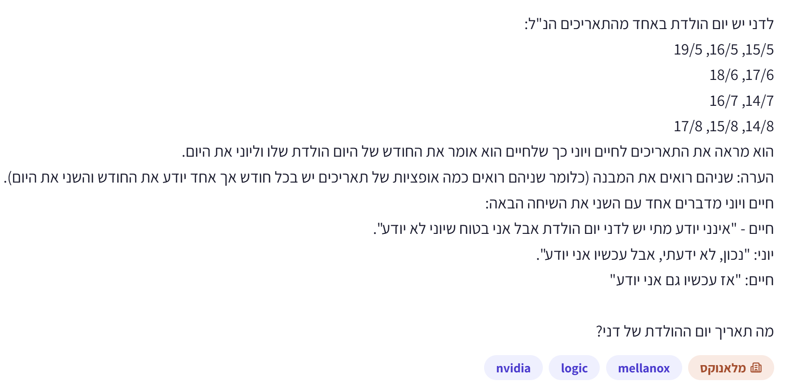
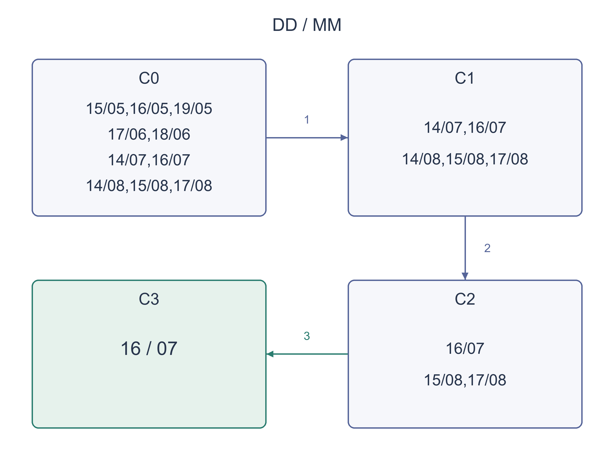

# PREP-046 — יום ההולדת של דני — הסקה מתוך מה שאחרים יודעים

נקלטה ב־19 באוקטובר 2026. פתרון מוצע בסיוע AI, בביקורת מקצועית ותרגומית ממתינה. קושי אינו מכויל. חברות מדווחות לפי הצילום בלבד, ללא אימות עצמאי: NVIDIA, Mellanox.

## מקור ללא שינוי



לדני יש יום הולדת באחד מהתאריכים הנ״ל:
15/5, 16/5, 19/5
17/6, 18/6
14/7, 16/7
14/8, 15/8, 17/8
הוא מראה את התאריכים לחיים ויוני כך שלחיים הוא אומר את החודש של היום הולדת שלו וליוני את היום.
הערה: שניהם רואים את המבנה (כלומר שניהם רואים כמה אופציות של תאריכים יש בכל חודש אך אחד יודע את החודש והשני את היום).
חיים ויוני מדברים אחד עם השני את השיחה הבאה:
חיים — "אינני יודע מתי יש לדני יום הולדת אבל אני בטוח שיוני לא יודע".
יוני: "נכון, לא ידעתי, אבל עכשיו אני יודע".
חיים: "אז עכשיו גם אני יודע".
מה תאריך יום ההולדת של דני?

## נוסח השאלה לאתר

יום ההולדת של דני הוא אחד מעשרת התאריכים הבאים. הפורמט הוא יום/חודש:

| חודש | הימים האפשריים |
| --- | --- |
| מאי | 15, 16, 19 |
| יוני | 17, 18 |
| יולי | 14, 16 |
| אוגוסט | 14, 15, 17 |

שניהם מכירים את הרשימה המלאה: דני אומר לחיים בפרטיות רק את החודש, וליוני בפרטיות רק את מספר היום בחודש. לאחר מכן הם אומרים בפומבי:

חיים: ״אני לא יודע מתי יום ההולדת, אבל אני בטוח שגם יוני לא יודע.״
יוני: ״נכון, בהתחלה לא ידעתי, אבל עכשיו אני יודע.״
חיים: ״אז עכשיו גם אני יודע.״

מה תאריך יום ההולדת? הסבירו מה כל משפט מאפשר לפסול, ומדוע הידיעה של חיים על מה שיוני יודע מתייחסת לכל האפשרויות בחודש שלו.

הבהרת הנחות: כולם דוברים אמת ומסיקים נכון; הרשימה, חלוקת המידע וההצהרות הפומביות ידועות לכולם, וכך גם העובדה שכולם יודעים זאת. המועמדים מתעדכנים לפי סדר המשפטים. אלו הנחות המודל הלוגי, ולא מידע נוסף על התאריך.

### שלושה רמזים

1. חיים אינו רואה את היום. כדי להיות בטוח שיוני אינו יודע, ההצהרה שלו צריכה להיות נכונה לכל יום אפשרי בחודש שחיים קיבל.
2. אילו מספרי יום מופיעים ברשימה רק פעם אחת? אם החודש של חיים מכיל יום כזה, האם הוא יכול להיות בטוח שיוני אינו יודע?
3. אחרי סינון החודשים, יוני יכול לדעת רק אם מספר היום שלו מופיע בתאריך אחד ברשימה המצומצמת. אחר כך חיים צריך חודש שנשאר בו תאריך אחד בלבד.

## הצעה לפתרון

### מתרגמים את המשפטים למידע

חיים יודע חודש, ולכן בתחילה מבחינתו כל תאריך באותו חודש אפשרי. יוני יודע יום בחודש, ולכן מבחינתו כל תאריך בעל אותו מספר יום אפשרי. המטרה היא לצמצם את רשימת המועמדים באמצעות המשפטים, בלי לנחש תאריך ולבדוק אם הוא נשמע סביר.

### המשפט הראשון — חיים בטוח שיוני לא יודע

ברשימה המקורית, 19 מופיע רק ב־19/05 ו־18 מופיע רק ב־18/06. אילו יוני היה מקבל 19 או 18, הוא היה יודע מיד את התאריך.

לכן החודש שחיים קיבל אינו יכול להיות מאי: אילו קיבל מאי, היה צריך להביא בחשבון גם את 19/05, ולא היה יכול להיות בטוח שיוני אינו יודע. מאותה סיבה החודש אינו יוני, המכיל את 18/06.

שימו לב: פוסלים את כל מאי ואת כל יוני. לא מספיק להוציא רק את שני התאריכים החריגים, משום שחיים יודע חודש ולא יום. חלק המשפט ״אני לא יודע״ אינו מוסיף כאן סינון, כי בכל חודש מקורי יש יותר מתאריך אחד.

נותרו חמישה מועמדים: 14/07, 16/07, 14/08, 15/08, 17/08.

### המשפט השני — יוני יודע עכשיו

יוני שמע את חיים, ולכן גם הוא יודע שנשארו רק חמש האפשרויות האלה. אילו היום שלו היה 14, עדיין היו מבחינתו שתי אפשרויות: 14/07 ו־14/08. הוא לא היה יכול לומר שהוא יודע.

לעומת זאת, 16 מופיע עכשיו רק ב־16/07, 15 רק ב־15/08, ו־17 רק ב־17/08. לכן אחרי דבריו של יוני נותרו: 16/07, 15/08, 17/08. התנאי שגם בתחילה לא ידע מתקיים בשלוש האפשרויות: כל אחד ממספרי היום האלה הופיע ביותר מתאריך אחד ברשימה המקורית.

### המשפט השלישי — גם חיים יודע עכשיו

אם חיים קיבל אוגוסט, הוא עדיין מתלבט בין 15/08 ל־17/08, ולכן אינו יודע. אם קיבל יולי, נשארה לו רק אפשרות אחת: 16/07.

לכן יום ההולדת הוא **16 ביולי**.

| אחרי איזה מידע? | המועמדים שנותרו |
| --- | --- |
| הרשימה המקורית | עשרת התאריכים שניתנו |
| חיים בטוח שיוני אינו יודע | 14/07, 16/07, 14/08, 15/08, 17/08 |
| יוני יודע עכשיו | 16/07, 15/08, 17/08 |
| חיים יודע עכשיו | 16/07 |

### למה התשובה ודאית?

כל סינון מבטא בדיוק משפט שנאמר. בשלב הראשון פוסלים חודש אם יש בו אפשרות שבה יוני כבר היה יודע. בשלב השני שומרים רק יום שמזהה תאריך יחיד אחרי הסינון הראשון, אבל לא לפניו. בשלב השלישי שומרים רק חודש שמזהה תאריך יחיד אחרי הסינון השני. נשאר תאריך אחד, והוא מתאים לכל שלושת המשפטים.

בשרטוט, C0 היא הרשימה המקורית, C1 אחרי המשפט הראשון, C2 אחרי השני ו־C3 אחרי השלישי. כל התאריכים בשרטוט כתובים יום/חודש. קובץ הפייתון המצורף מממש את הסינונים; המצב שם נשמר כזוג חודש,יום כדי שהקיבוץ יהיה מפורש. הפתרון הלוגי אינו דורש כתיבת קוד.

### תחולת הפתרון

הטענה נשענת על הרשימה המדויקת ועל ידיעה משותפת של העובדות וההיגיון. שינוי מועמד, שקר או הבנה שונה של המידע הפרטי יכולים לשנות את המסקנה. זו הסקה בתוך מודל מפורש, לא הוכחה שאנשים אמיתיים בהכרח פועלים כך.

### הנחות והבהרות

- התאריכים הם בדיוק עשרת המועמדים שבתמונה, בפורמט יום/חודש.

- חיים יודע רק חודש ויוני רק מספר יום. שניהם יודעים את כל רשימת המועמדים ואת חלוקת המידע.

- כל המשפטים אמיתיים, ההסקה נכונה וסדר ההצהרות פומבי. הנחות אלה הן ידיעה משותפת במודל.

- אין מידע נוסף על השנה או על התאריך, ואין ניחוש הסתברותי.

### נכונות ויעילות

```json
{
  "criterion": "האם שלוש ההצהרות מבודדות תאריך יחיד ברשימה הנתונה.",
  "result": "מספר המועמדים מצטמצם מ־10 ל־5, ל־3 ול־1; התאריך היחיד הוא 16/07.",
  "proof": "סינון לפי מחלקות ידע: חודשים שכל ימיהם אינם יחידאיים בתחילה; לאחר מכן ימים יחידאיים ברשימה המצומצמת; לבסוף חודשים יחידאיים במועמדים שנותרו.",
  "scope": "אין טענה למינימום שאלות, מינימום משפטים לכל רשימה או אופטימליות בזמן תוכנה. הקוד הישיר המצורף מבצע O(k²) עבודה במקרה הגרוע עבור k מועמדים, ומשתמש ב־O(k) זיכרון."
}
```

### בדיקות שבוצעו

עברו 1,969 בדיקות של מודל Python מול אורקל עצמאי של עולמות אפשריים: כל 1,024 תתי־הקבוצות של הרשימה, 200 ערבובים, 24 שינויי שמות חודשים, 720 שינויי שמות ימים ודחיית מועמד כפול. נבדקו במפורש קבוצות הביניים וגדליהן 10,5,3,1. שינוי שמות הוא בדיקת סימטריה לוגית בלבד; אינו רשימת תאריכים חדשה לפרסום. לא בוצעה ביקורת אנושית מקצועית או בדיקת לחיצות באתר חי.

### מקרי קצה

- חיים אינו פוסל רק את 18/06 ואת 19/05: עליו לפסול כל חודש שמכיל יום שבו יוני עשוי לדעת.

- יוני עם יום 14 עדיין לא יודע אחרי המשפט הראשון, משום ש־14 מופיע ביולי ובאוגוסט.

- אוגוסט עדיין מכיל שני תאריכים אחרי המשפט השני ולכן אינו מתאים להצהרה האחרונה.

- שינוי הרשימה או סדר המשפטים יכול להשאיר אפס מועמדים או כמה מועמדים; הקוד מחזיר את הקבוצות ולא מכריח תשובה יחידה.

- שמות חיים ויוני אינם חשובים; מי יודע חודש ומי יודע יום חשובים.

### טעויות נפוצות

- לפרש ׳אני בטוח שיוני לא יודע׳ כאמירה רק על התאריך האמיתי, שחיים כלל אינו יודע.

- להסיר רק ימים ייחודיים בלי להסיר את החודשים שמכילים אותם.

- להסיק שיוני יודע את החודש לאחר המשפט הראשון, גם אם היום שלו עדיין מופיע בשני חודשים.

- לתת לחיים את היום וליוני את החודש בטעות.

- להכריז על תאריך לפי זיכרון של חידה דומה בלי לבדוק את הרשימה הנתונה.

### תשובה קצרה לראיון

הימים 18 ו־19 מופיעים כל אחד פעם אחת. חיים בטוח שיוני אינו יודע, ולכן החודש אינו מאי או יוני, שמכילים ימים כאלה. נשארים יולי ואוגוסט. כעת 14 מופיע פעמיים ולכן יוני, שאומר שהוא יודע, אינו עם 14. נותרו 16/07,15/08,17/08. חיים יכול לדעת רק עם יולי, כי באוגוסט נשארו שניים. לכן התאריך הוא 16 ביולי.

### הרחבות ושאלת המשך

```json
{
  "question": "מה משתנה אם חיים אומר רק ׳אני לא יודע׳, בלי לומר שהוא בטוח שיוני אינו יודע?",
  "direction": "בתחילה בכל חודש יש כמה תאריכים, ולכן המשפט הזה לבדו אינו מסיר שום חודש. אין להשתמש בסינון מאי ויוני של הפתרון המקורי; יש לחשב מחדש את כל ההצהרות ולבדוק אם בכלל נשאר פתרון.",
  "status": "שאלת המשך מוכנה בתוכן; טרם חוברה לתהליך ההמשך החי."
}
```



## English question

Dani's birthday is one of the following ten dates, written day/month:

| Month | Possible days |
| --- | --- |
| May | 15, 16, 19 |
| June | 17, 18 |
| July | 14, 16 |
| August | 14, 15, 17 |

Both people know the entire candidate list. Dani privately tells Chaim only the month and Yoni only the day of the month. They then make these public statements:

Chaim: "I do not know the birthday, but I am certain Yoni does not know either."
Yoni: "Correct, I did not know initially, but now I know."
Chaim: "Then now I also know."

What is the birthday? Explain each elimination, including why Chaim's certainty about Yoni concerns every possible day in Chaim's month.

Model clarification: everyone is truthful and reasons correctly. The candidate list, allocation of private information, and public statements are common knowledge. Update the candidates in statement order. These are assumptions of the logical model, not additional information about the date.

### Three hints

1. Chaim cannot see the day. To be certain that Yoni does not know, his claim must hold for every possible day in the month Chaim was told.
2. Which day numbers occur only once initially? If Chaim's month includes one of them, can he be certain that Yoni does not know?
3. After eliminating months, Yoni can know only if his day occurs in one remaining date. Chaim's last statement then requires a month with only one remaining date.

## Proposed solution

### Turn the statements into information

Chaim knows the month, so initially every listed date in that month is possible for him. Yoni knows the day, so initially every listed date with that day number is possible for him. Eliminate candidates using the statements rather than guessing a date that seems plausible.

### First statement — Chaim is certain Yoni does not know

Initially, day 19 occurs only on 19/05, and day 18 only on 18/06. If Yoni had either day, he would know the exact date immediately.

Chaim therefore cannot have May: he would have to consider 19/05, in which case Yoni would know, contradicting Chaim's certainty. The same reasoning excludes June because it includes 18/06.

Eliminate all of May and June, not just the two exceptional dates. Chaim knows a month, not a day. His own statement that he does not know adds no further restriction here because every original month contains multiple candidates.

Five dates remain: 14/07, 16/07, 14/08, 15/08, 17/08.

### Second statement — Yoni now knows

Yoni heard Chaim, so he also knows that only these five dates remain. If his day were 14, both 14/07 and 14/08 would still be possible, so he could not claim to know.

In contrast, day 16 now occurs only on 16/07, day 15 only on 15/08, and day 17 only on 17/08. Thus the surviving dates are 16/07, 15/08, 17/08. Each also satisfies Yoni's initial ignorance: its day originally occurred more than once.

### Third statement — Chaim now knows too

With August, Chaim would still be unable to distinguish 15/08 from 17/08. With July, only 16/07 remains. Therefore the birthday is **16 July**.

| Information available | Remaining candidates |
| --- | --- |
| Initial list | All ten supplied dates |
| Chaim is certain Yoni does not know | 14/07, 16/07, 14/08, 15/08, 17/08 |
| Yoni now knows | 16/07, 15/08, 17/08 |
| Chaim now knows | 16/07 |

### Why is the conclusion certain?

Each elimination is exactly a stated knowledge condition. First reject any month containing a world in which Yoni would already know. Next retain a day identifying one date after the first announcement but not initially. Finally retain a month identifying one date after the second announcement. Exactly one date survives and satisfies every statement.

In the diagram C0 is the initial candidate set, C1 follows the first statement, C2 the second, and C3 the third. Every displayed date is day/month. The attached Python file implements these updates, internally storing dates as month,day pairs to make the grouping explicit. Coding is not required for the logical interview solution.

### Scope

The conclusion depends on this exact list and the common-knowledge/truthfulness assumptions. Changing a candidate, allowing a lie, or changing private information can alter the answer. This proves a conclusion inside the stated model, not that real people necessarily reason that way.

### Assumptions

- The candidates are exactly the ten supplied dates, using day/month notation.

- Chaim knows only the month and Yoni only the day; both know the complete list and information assignment.

- Statements are truthful, reasoning is correct, and the public sequence and reasoning assumptions are common knowledge.

- No additional year/date information or probabilistic guess is used.

### Correctness and efficiency

```json
{
  "criterion": "Whether the three announcements identify one date in the supplied list.",
  "result": "Candidate counts shrink from 10 to 5 to 3 to 1; the sole date is 16/07.",
  "proof": "Filter knowledge classes: months whose possible days are all initially nonunique, then days unique after that restriction, then months unique among the survivors.",
  "scope": "No minimum-question, universal minimum-statement, or software-time optimality claim. The attached direct implementation performs O(k²) worst-case work and uses O(k) storage for k candidates."
}
```

### Verification

1,969 Python model checks passed against an independent possible-world oracle: all 1,024 candidate subsets, 200 input shuffles, 24 month relabellings, 720 day relabellings and duplicate rejection. Exact intermediate sets and sizes 10,5,3,1 were asserted. Relabelling checks logical symmetry only; these are not new published date lists. No professional human approval or authenticated live-site clicking is implied.

### Edge cases

- Chaim must reject entire months containing an initially unique day, not just 18/06 and 19/05 themselves.

- Day 14 still leaves Yoni uncertain after the first statement because it occurs in both July and August.

- August retains two candidates after the second statement and cannot satisfy the last one.

- Changing the candidate list or statement order may leave no date or several; the code returns sets rather than forcing a unique answer.

- The names do not matter; which person knows month versus day does.

### Common mistakes

- Evaluating Chaim's certainty only at the actual date, which he does not yet know.

- Removing only unique dates instead of every month containing one.

- Assuming Yoni can identify a month while his day still occurs in two months.

- Accidentally giving Chaim the day and Yoni the month.

- Recalling an answer from a similar puzzle without checking this candidate list.

### Interview answer

Days 18 and 19 are initially unique. Chaim's certainty that Yoni does not know excludes May and June, which contain those days. Only July and August remain. Day 14 is still duplicated, so Yoni's new knowledge excludes it. The survivors are 16/07,15/08,17/08. Chaim can now know only with July because August still has two candidates. Therefore the date is 16 July.

### Extensions and follow-up

```json
{
  "question": "What changes if Chaim only says that he does not know, without claiming certainty about Yoni's ignorance?",
  "direction": "Initially every month has multiple candidates, so that statement alone excludes no month. Do not reuse the May/June elimination; recompute subsequent announcements and check whether any date remains.",
  "status": "Follow-up prepared in content; not connected to the live follow-up workflow."
}
```


## קוד ובדיקות

[prep_046_birthday_knowledge.py](../solutions/prep_046_birthday_knowledge.py) · [check_prep_046.py](../checks/check_prep_046.py) · [prep-046-verification.json](../checks/prep-046-verification.json)

צילום המקור פנימי ואינו מדיה ללומדים. שאלת ההמשך הוכנה אך לא חוברה לתור החי. אין אישור מקצועי, כיול קושי או זכאות לראיות שליטה ולניקוד תחרותי. בדיקות Python אינן קומפילציית HDL, בדיקת חומרה או לחיצות בחשבון חי.
