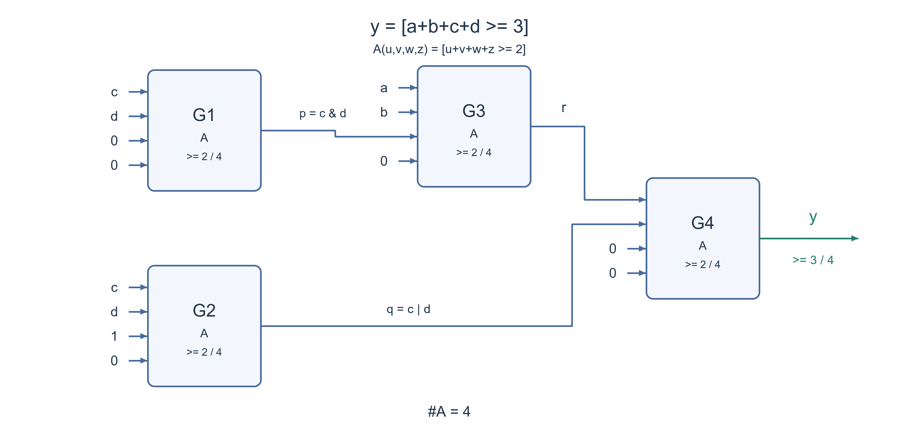

# PREP-047 — מימוש סף של שלוש מתוך ארבע באמצעות קופסאות סף

נקלטה ב־19 באוקטובר 2026. פתרון מוצע בסיוע AI, בביקורת מקצועית ותרגומית ממתינה. קושי אינו מכויל. חברות מדווחות לפי הצילום בלבד, ללא אימות עצמאי: NVIDIA, Apple.

## מקור ללא שינוי


נתון רכיב A עם 4 כניסות ויציאה 1. הרכיב מחזיר 1 אם 2 או יותר מהכניסות דולקות.
עליך לממש רכיב עם 4 כניסות המחזיר 1 אם שלוש או יותר מהכניסות דולקות באמצעות רכיב A ובמספר מינימלי.

## נוסח השאלה לאתר

נתונה קופסה `A` עם ארבע כניסות בינאריות ומוצא יחיד. היא מוציאה `1` אם לפחות שתיים מהכניסות הן `1`, ואחרת `0`.

ממשו רכיב בעל ארבע כניסות `a,b,c,d` שמוציא `1` אם לפחות שלוש מהן הן `1`. השתמשו במספר מינימלי של קופסאות `A`, הציגו חיבורים, טבלת אמת והסבר לנכונות ולמינימליות.

לצורך גרסה חד־משמעית זו מותר להשתמש בקבועים `0,1`, בחוטים, בפיצול אות לכמה כניסות ובחיבור חוזר של אותו אות. אין שערי NOT או שערים אחרים בחינם, ואין משוב או זיכרון. סופרים רק קופסאות `A`.

הבהרת עריכה: המקור לא הגדיר אילו קבועים ושערים נוספים מותרים. ההיתרים האלה נוספו במפורש; יש להסביר בנפרד מה משתנה אם היפוכים חופשיים מותרים.

### שלושה רמזים

1. חלקו את ארבע הכניסות לשני זוגות. אם בזוג הראשון יש אפס, אחת או שתי אחדות, כמה אחדות צריך מהזוג השני?
2. אפשר לחבר קבועים לקופסה: מה מפיקים A(c,d,0,0) ו־A(c,d,1,0)? אלה שני סוגים שונים של מידע על הזוג.
3. הפיקו p שאומר ששניהם c,d דולקים ו־q שאומר שלפחות אחד דולק. בדקו A(a,b,p,0), ואז חסמו בעזרת q את המקרה a=b=1,c=d=0.

## הצעה לפתרון

**הצעה לפתרון — ארבע קופסאות, תחת מודל רכיבים מפורש**

לפני שסופרים רכיבים צריך להבהיר מה מותר. נניח שמותר להשתמש רק בעותקים של `A`, בקבועים `0,1`, בחוטים ובפיצול אות לכמה כניסות. מותר גם לחבר אותו אות לכמה פינים. אין שערי NOT או שערים אחרים בחינם, ואין משוב. הקבועים והחוטים אינם נספרים; המטרה היא למזער את מספר קופסאות `A`. המקור לא הגדיר את ההיתרים האלה, ולכן המינימום להלן מותנה בהם.

**1. מפרקים את הבעיה לשני זוגות**

נסמן את ארבע הכניסות `a,b,c,d`. נסתכל על הזוג `c,d`:

- אם שניהם `0`, אי אפשר להגיע לשלוש אחדות בסך הכול, גם אם `a=b=1`.
- אם יש בהם `1` יחיד, צריך ששניהם `a,b` יהיו `1`.
- אם שניהם `1`, מספיק שאחד מבין `a,b` יהיה `1`.

לכן כדאי להפיק שני דגלים מהזוג: `p` שאומר ששניהם דולקים, ו־`q` שאומר שלפחות אחד דולק. אלה משמעויות של אותות שנפיק עם קופסאות `A`, ולא שערים נוספים שמותר להוסיף.

**2. שתי הקופסאות הראשונות מפיקות את הדגלים**

```text
p = A(c,d,0,0) = c AND d
q = A(c,d,1,0) = c OR d
```

בקופסה הראשונה שני הקבועים הם אפס, ולכן רק `c=d=1` מספקים את שתי האחדות הדרושות. בשנייה הקבוע `1` מספק אחת משתי האחדות, ולכן מספיק ש־`c` או `d` יהיה `1`.

**3. קופסה שלישית בודקת את a,b בעזרת הדגל p**

```text
r = A(a,b,p,0)
```

אם `p=0`, הקופסה דורשת `a=b=1`. אם `p=1`, די באחד מביניהם. זה מתאים לשני המקרים שבהם יש בזוג `c,d` אחת או שתי אחדות.

אבל יש מלכודת: אם `c=d=0` וגם `a=b=1`, נקבל `r=1` למרות שיש בסך הכול שתי אחדות. לכן עדיין אסור להוציא את `r` ישירות.

**4. הקופסה הרביעית חוסמת את המקרה הבעייתי**

```text
y = A(r,q,0,0) = r AND q
```

הדגל `q` מחייב שלפחות אחד מבין `c,d` יהיה `1`. כך המקרה `1100` נחסם. אם יש בדיוק אחד בזוג, `p=0` וצריך `a=b=1`; אם יש שניים בזוג, `p=1` וצריך לפחות אחד ב־`a,b`. אלה בדיוק כל המקרים שבהם הסכום הכולל לפחות שלוש.

רשימת החיבורים המלאה:

| קופסה | פין 1 | פין 2 | פין 3 | פין 4 | מוצא |
| --- | --- | --- | --- | --- | --- |
| G1 | c | d | 0 | 0 | p |
| G2 | c | d | 1 | 0 | q |
| G3 | a | b | p | 0 | r |
| G4 | r | q | 0 | 0 | y |

בשרטוט כל קופסה היא רכיב `A` אחד, וכל ארבעת פיני הכניסה שלה מחוברים. התוויות `c,d` החוזרות מייצגות את אותם קלטים. הכיתובים `p=c&d` ו־`q=c|d` מתארים את האותות שנוצרים בתוך הקופסאות; לא הוספנו שערי AND או OR חיצוניים. אין שעון, אוגרים או מצב.

**5. טבלת אמת מלאה**

```text
a b c d | p q r | y
--------+-------+--
0 0 0 0 | 0 0 0 | 0
0 0 0 1 | 0 1 0 | 0
0 0 1 0 | 0 1 0 | 0
0 0 1 1 | 1 1 0 | 0
0 1 0 0 | 0 0 0 | 0
0 1 0 1 | 0 1 0 | 0
0 1 1 0 | 0 1 0 | 0
0 1 1 1 | 1 1 1 | 1
1 0 0 0 | 0 0 0 | 0
1 0 0 1 | 0 1 0 | 0
1 0 1 0 | 0 1 0 | 0
1 0 1 1 | 1 1 1 | 1
1 1 0 0 | 0 0 1 | 0
1 1 0 1 | 0 1 1 | 1
1 1 1 0 | 0 1 1 | 1
1 1 1 1 | 1 1 1 | 1
```

רק ארבע השורות שיש בהן בדיוק שלוש אחדות, והשורה `1111`, מחזירות `1`. בפרט `1100` נותן `r=1` אבל `q=0`, ולכן `y=0` כפי שנדרש.

**6. מדוע ארבע הוא גם מינימום במודל הזה?**

הבנייה מוכיחה שארבע מספיקות. כדי להוכיח שאין מימוש בשלוש או פחות, צורפה בדיקת סינתזה ממצה של כל המעגלים הצירופיים המותרים, ולא רק ניסיון של כמה חיבורים ידניים.

מייצגים כל אות בטבלת האמת המלאה שלו, כלומר בחתימה של 16 ביטים. מתחילים בששת האותות `a,b,c,d,0,1`. בכל שלב מחברים ארבע כניסות של קופסה לאותות שכבר קיימים, כולל חזרות. הקופסה סימטרית, ולכן אין צורך לבדוק שוב סדרי פינים שונים של אותה רביעייה. שומרים את כל אותות הביניים, וכך החיפוש מאפשר פיצול ושיתוף בין קופסאות, ולא רק עצי ביטויים.

החיפוש בדק 126 רביעיות לקופסה הראשונה; 6,930 אפשרויות לקופסה השנייה על פני 33 קבוצות אותות ביניים; ו־312,840 אפשרויות לקופסה השלישית על פני 948 קבוצות. בסך הכול נבדקו 319,896 רביעיות פינים, ואף אחת לא הפיקה את הפונקציה המבוקשת. גם ששת האותות הישירים ללא קופסה אינם הפתרון.

למה הצמצום הזה של החיפוש שלם? כל מעגל ללא משוב ניתן לסדר כך שכל קופסה משתמשת רק בקלטים ובמוצאי קופסאות קודמות. קופסה שמפיקה פונקציה שכבר קיימת אפשר להחליף בחוט, ולכן אין צורך לכלול אותה במימוש מינימלי. שתי היסטוריות שיוצרות בדיוק את אותה קבוצת פונקציות מאפשרות בדיוק אותם חיבורים בהמשך. השוויון נבדק על כל 16 הקלטים. לכן אין כאן השמטה של מעגל קטן אפשרי.

מכאן, יחד עם הבנייה התקינה: **המינימום הוא ארבע קופסאות A תחת ההיתרים שהוגדרו**. המסלול הארוך בבנייה עובר בשלוש קופסאות; זו ספירת רמות לוגיות, לא מדידת השהיה פיזית.

**7. מדוע חשוב לברר אם היפוכים מותרים?**

אם מותר להפוך בחינם את ארבע הכניסות ואת המוצא, אפשר להשתמש בקופסת `A` אחת בלבד:

```text
y = NOT A(NOT a, NOT b, NOT c, NOT d)
```

אם בקלט המקורי יש `k` אחדות, בקלטים המהופכים יש `4-k`. לכן הקופסה המהופכת נותנת `1` בדיוק כש־`4-k<2`, כלומר `k>=3`. זוהי חלופה עם קופסת `A` אחת ועם חמישה היפוכים; היא אינה מותרת במודל הראשי ללא NOT, ואין להציג אותה כאותו מחיר כולל כשמהפכים עולים רכיבים. אם קבוע `1` אינו מותר, הבנייה המוצגת אינה עומדת בהגבלה ונדרשת בדיקה חדשה; איננו טוענים כאן מינימום למודל הזה.

**8. מודל פייתון וקוד חומרה**

```python
def A(a, b, c, d):
    return int(a + b + c + d >= 2)


def three_of_four(a, b, c, d):
    p = A(c, d, 0, 0)
    q = A(c, d, 1, 0)
    r = A(a, b, p, 0)
    return A(r, q, 0, 0)
```

הפונקציה `A` היא מודל ההתנהגות של הרכיב הנתון. ארבע הקריאות בפונקציה השנייה הן ארבע הקופסאות. אין כאן דרישה לממש את החיבור המספרי כשער חיצוני ברשת.

```systemverilog
// Behavioral definition of the supplied A primitive, not a physical-cell claim.
module threshold_a (
    input  logic a, b, c, d,
    output logic y
);
    assign y = (a & b) | (a & c) | (a & d)
             | (b & c) | (b & d) | (c & d);
endmodule

// Four A instances. Only direct wires and free binary constants are added.
module threshold_three_of_four (
    input  logic a, b, c, d,
    output logic y
);
    logic p, q, r;
    threshold_a g1 (.a(c), .b(d), .c(1'b0), .d(1'b0), .y(p));
    threshold_a g2 (.a(c), .b(d), .c(1'b1), .d(1'b0), .y(q));
    threshold_a g3 (.a(a), .b(b), .c(p), .d(1'b0), .y(r));
    threshold_a g4 (.a(r), .b(q), .c(1'b0), .d(1'b0), .y(y));
endmodule
```

מודול `threshold_a` מתאר את התנהגות הקופסה לצורך הצגת RTL. מודול המערכת מכיל ארבעה מופעים שלה. גוף המודל אינו קביעה לגבי מספר הטרנזיסטורים או השערים הפיזיים בתוך הקופסה הנתונה.

**תשובה קצרה לראיון:** אברר קודם שמותר להשתמש בקבועים אבל לא במהפכים חופשיים. אפיק מ־`c,d` דגל ששניהם `1` ודגל שלפחות אחד `1`. אבחן את `a,b` יחד עם הדגל הראשון באמצעות קופסה שלישית, ואחייב גם את הדגל השני בקופסה רביעית. כך מתקבלים בדיוק שלושה אחדים או ארבעה. ארבע הוא מינימום במודל הזה לפי חיפוש ממצה; אם היפוכים חופשיים מותרים, אפשר קופסה אחת באמצעות היפוך כל הכניסות והמוצא.

אימות: נבדקו כל 16 קלטי הרכיב, כל 16 קלטי הבנייה כולל אותות הביניים, כל 16 קלטי חלופת ההיפוך וארבעה מקרי קלט לא תקין במודל פייתון. החיפוש הממצה של מעגלי עד שלוש קופסאות עבר. השרטוט נבדק חזותית מול רשימת הפינים. קוד SystemVerilog צורף אך לא הורץ בסימולטור HDL; לא בוצעו סינתזה, בדיקת הפרעות מעבר או מדידת תזמון פיזי. זהו פתרון מוצע בסיוע AI, הממתין לסקירה מקצועית עצמאית.


### הנחות והבהרות

- קלטים בינאריים ומעגל צירופי ללא משוב; כמה עותקים של A מותרים.

- קבועים 0,1, חוטים, פיצול אות וחיבור חוזר לפינים מותרים ללא ספירת עלות; אין NOT או שערים אחרים בחינם.

- קריטריון המינימום הוא מספר קופסאות A במודל הזה. ההיתרים אינם מפורשים במקור והתווספו כהבהרת עריכה.

- כל משמעות AND/OR על חוט מתארת את התוצאה של קופסה, ולא רכיב חיצוני נוסף.

### נכונות ויעילות

```json
{
  "criterion": "מספר קופסאות A, כאשר קבועי 0,1 וחוטים חופשיים והיפוכים ושערים אחרים אסורים.",
  "result": "ארבע קופסאות הן מינימום. בבנייה המוצגת המסלול הארוך עובר בשלוש קופסאות.",
  "proof": "בדיקת 16 שורות האמת מאשרת את הבנייה. חיפוש שלם של מעגלי 0–3 קופסאות בדק שישה חוטים ישירים ו־319,896 רביעיות פינים על קבוצות האותות הנגישות, ולא מצא את פונקציית הסף המבוקשת. שיתוף אותות וחזרות בפינים נכללו.",
  "scope": "מינימום מותנה במודל. עם היפוכים חופשיים מספיק A אחד והיפוך ארבע הכניסות והמוצא. אין טענה למינימום במודל ללא קבוע 1, לשטח טרנזיסטורים או להשהיה פיזית."
}
```

### בדיקות שבוצעו

```json
{
  "status": "בדיקות לוגיקה ומינימליות עברו; סקירה מקצועית עצמאית ממתינה.",
  "method": "טבלת אמת עצמאית המבוססת על ספירת אחדות, בדיקת אותות הביניים וחיפוש סינתזה ממצה של חתימות אמת בנות 16 ביטים.",
  "coverage": "16 שורות לרכיב, 16 לבנייה, 16 לחלופת ההיפוך ו־4 קלטים לא תקינים; 126+6,930+312,840 רביעיות פינים, על 1,33,948 קבוצות אותות בהתאמה.",
  "script_path": "checks/check_prep_047.py",
  "scope": "קוד SystemVerilog צורף אך לא הורץ בסימולטור HDL. לא בוצעו סינתזה, מדידת תזמון פיזי או בדיקת הפרעות מעבר."
}
```

### מקרי קצה

- 0000 וכל קלט עם אחת או שתי אחדות חייבים להחזיר 0.

- 1100 הוא מבחן חשוב: r=1 אבל q=0, ולכן y=0.

- 0011 כולל שתיים בלבד, ולכן p=q=1 אבל a=b=0 ו־r=0.

- 0111,1011,1101,1110 וגם 1111 מחזירים 1.

- החלפת ההיתר לגבי קבועים או היפוכים משנה את בעיית המינימום; אי אפשר להעביר את ההוכחה למודל אחר אוטומטית.

### טעויות נפוצות

- הנחה שקופסה אחת עם a,b,c,d משנה מעצמה את הסף משתיים לשלוש.

- הוצאת r ישירות ושכחת קלט 1100 שנותן חיובי שגוי.

- הוספת שערי AND/OR או NOT חופשיים בזמן שטוענים למספר מינימלי של רכיבים לפי מודל אחר.

- מימוש נכון בארבע קופסאות אינו לבדו הוכחת מינימום; צריך גם לשלול מספר קטן יותר.

- בדיקת עצי ביטויים בלבד והחמצת אפשרות לשיתוף מוצא בין קופסאות בחיפוש המינימום.

- טענה לא מותנית שארבע הוא המינימום למרות שהמקור אינו מפרט קבועים ומהפכים.

### תשובה קצרה לראיון

אברר שמותר קבועי 0,1 אבל לא מהפכים חופשיים. אפיק p=A(c,d,0,0) ו־q=A(c,d,1,0), ואז r=A(a,b,p,0) ולבסוף y=A(r,q,0,0). אם בזוג c,d יש אחת, צריך ששניהם a,b יהיו אחד; אם יש שתיים, מספיק אחד; אם אין, q חוסם. ארבע קופסאות הן מינימום במודל הזה לפי חיפוש ממצה. עם היפוכים חופשיים יש פתרון עם קופסת A אחת.

### הרחבות ושאלת המשך

```json
{
  "question": "מה משתנה אם מותר להשתמש במהפכים בחינם, וסופרים רק קופסאות A?",
  "answer_outline": "יוצרים NOT A(NOT a,NOT b,NOT c,NOT d). מספר האחדות המהופכות הוא 4-k, ולכן המוצא 1 בדיוק כש־k>=3. זו קופסת A אחת וחמישה היפוכים; עם מחיר שונה למהפכים צריך להגדיר ולנתח מחדש את פונקציית העלות.",
  "integration_status": "שאלת המשך מוכנה בתוכן הארכיון; אינה מחוברת לתהליך ההמשך החי."
}
```

### עמימות בנוסח המקורי

- המקור דורש מינימום רכיבי A אך אינו קובע במפורש אילו קבועים, היפוכים או רכיבים אחרים מותרים.

- בחרנו מודל עיקרי של A וקבועי 0,1 ללא NOT, וכתבנו במפורש את ההבדל מול מודל היפוכים חופשיים.



## English question

A primitive `A` has four binary inputs and one output. It returns `1` iff at least two inputs are `1`, and otherwise returns `0`.

Implement a four-input component on `a,b,c,d` that returns `1` iff at least three inputs are `1`. Minimize the number of `A` boxes; provide pin connections, a truth table, correctness and minimality reasoning.

For this explicit version, free constants `0,1`, direct wires, fanout and repeated signals on pins are allowed. No free NOT or other gates, feedback or storage are allowed. Count only `A` instances.

Editorial clarification: the source did not define allowed constants or extra gates. These permissions are stated explicitly; separately discuss how free inversion changes the answer.

### Three hints

1. Split the four inputs into two pairs. If one pair contains zero, one or two ones, how many are required from the other pair?
2. Tie constants to the primitive. What do A(c,d,0,0) and A(c,d,1,0) produce? They encode different information about the pair.
3. Let p mean both c,d are high and q mean either is high. Test A(a,b,p,0), then use q to block a=b=1,c=d=0.

## Proposed solution

**Proposed solution — four boxes under an explicit component model**

Clarify the allowed resources before counting components. Assume only copies of `A`, free constants `0,1`, direct wires and fanout; repeated signals on multiple pins are allowed. No free NOT or other gates, feedback or storage are allowed. Minimize the number of `A` boxes, not constants or wires. The source did not specify these permissions, so the minimum below is conditional on them.

**1. Group the inputs into pairs**

Call the four inputs `a,b,c,d` and inspect pair `c,d`:

- If both are zero, a total of three ones is impossible even when `a=b=1`.
- If exactly one is high, both `a,b` must be high.
- If both are high, at least one of `a,b` must be high.

Generate two flags: `p` says both pair inputs are high, and `q` says at least one is high. These are wire meanings produced by `A` boxes, not permission to add external AND/OR gates.

**2. Generate those flags with two boxes**

```text
p = A(c,d,0,0) = c AND d
q = A(c,d,1,0) = c OR d
```

Two fixed zeros in the first box require both variable inputs to meet the threshold. The fixed one in the second box supplies one of the two needed ones, so either variable input suffices.

**3. Test a,b with flag p**

```text
r = A(a,b,p,0)
```

When `p=0`, this requires `a=b=1`. When `p=1`, either `a` or `b` suffices. This matches the cases with one or two ones in `c,d`.

There is still a trap: `a=b=1,c=d=0` makes `r=1` although the original total is only two. Do not output `r` directly.

**4. Block that trap with the fourth box**

```text
y = A(r,q,0,0) = r AND q
```

Flag `q` requires at least one high input in `c,d`, blocking `1100`. With exactly one high in that pair, `p=0` requires both `a,b`; with both high, `p=1` requires at least one of `a,b`. These are precisely the cases with at least three original ones.

Complete pin list:

| Box | Pin 1 | Pin 2 | Pin 3 | Pin 4 | Output |
| --- | --- | --- | --- | --- | --- |
| G1 | c | d | 0 | 0 | p |
| G2 | c | d | 1 | 0 | q |
| G3 | a | b | p | 0 | r |
| G4 | r | q | 0 | 0 | y |

Each drawn box is one `A` primitive and all four input pins are connected. Repeated `c,d` labels denote the same primary inputs. Labels `p=c&d` and `q=c|d` describe the wires produced by the boxes; there are no extra external AND or OR gates. No clock or state is involved.

**5. Complete truth table**

```text
a b c d | p q r | y
--------+-------+--
0 0 0 0 | 0 0 0 | 0
0 0 0 1 | 0 1 0 | 0
0 0 1 0 | 0 1 0 | 0
0 0 1 1 | 1 1 0 | 0
0 1 0 0 | 0 0 0 | 0
0 1 0 1 | 0 1 0 | 0
0 1 1 0 | 0 1 0 | 0
0 1 1 1 | 1 1 1 | 1
1 0 0 0 | 0 0 0 | 0
1 0 0 1 | 0 1 0 | 0
1 0 1 0 | 0 1 0 | 0
1 0 1 1 | 1 1 1 | 1
1 1 0 0 | 0 0 1 | 0
1 1 0 1 | 0 1 1 | 1
1 1 1 0 | 0 1 1 | 1
1 1 1 1 | 1 1 1 | 1
```

Exactly the four weight-three rows and `1111` produce one. In particular `1100` gives `r=1` but `q=0`, hence the required `y=0`.

**6. Why is four minimal in this model?**

The construction proves an upper bound of four. An accompanying exact synthesis check excludes every permitted acyclic circuit of at most three `A` gates, rather than merely trying a few hand-drawn candidates.

Represent a signal by its complete 16-bit truth signature. Start from `a,b,c,d,0,1`. At each stage choose four pins from every available signal, with repetition. The primitive is symmetric, so pin permutations with identical multisets need not be repeated. Retain all earlier outputs to allow arbitrary sharing and fanout, not just expression trees.

The search tested 126 pin multisets for the first gate; 6,930 for the second across 33 intermediate signal sets; and 312,840 for the third across 948 signal sets. None of these 319,896 final-gate choices produced the target. None of the six direct zero-gate sources is the target either.

This reduction is complete: topologically order any acyclic candidate so every gate uses primary inputs and earlier outputs. A gate whose complete truth function is already available can be replaced by that wire, so no minimum candidate needs it. Histories that produce the same available function set permit exactly the same future connections. Equality is evaluated on all 16 rows. Thus no smaller allowed circuit is lost by these reductions.

Together with the correct construction, this proves **a minimum of four A boxes under the stated grammar**. The longest path in this construction passes through three boxes; this counts logical stages, not measured physical delay.

**7. Why ask about inversion?**

If inversion of all four inputs and the output is free, a single `A` box suffices:

```text
y = NOT A(NOT a, NOT b, NOT c, NOT d)
```

For an original input with `k` ones, the inverted inputs have `4-k`. The inverted box output is one exactly when `4-k<2`, or `k>=3`. This alternative uses one `A` plus five inversions. It is forbidden in the main no-NOT grammar and is not the same total component cost if inverters are charged. If constant one is forbidden, the presented construction does not satisfy that restriction and requires a new analysis; no minimum is asserted for that model.

**8. Python model and hardware code**

```python
def A(a, b, c, d):
    return int(a + b + c + d >= 2)


def three_of_four(a, b, c, d):
    p = A(c, d, 0, 0)
    q = A(c, d, 1, 0)
    r = A(a, b, p, 0)
    return A(r, q, 0, 0)
```

Function `A` models the supplied primitive; the second function calls it exactly four times. Numeric addition in the behavioral primitive model is not an added external gate in the A-only netlist.

```systemverilog
// Behavioral definition of the supplied A primitive, not a physical-cell claim.
module threshold_a (
    input  logic a, b, c, d,
    output logic y
);
    assign y = (a & b) | (a & c) | (a & d)
             | (b & c) | (b & d) | (c & d);
endmodule

// Four A instances. Only direct wires and free binary constants are added.
module threshold_three_of_four (
    input  logic a, b, c, d,
    output logic y
);
    logic p, q, r;
    threshold_a g1 (.a(c), .b(d), .c(1'b0), .d(1'b0), .y(p));
    threshold_a g2 (.a(c), .b(d), .c(1'b1), .d(1'b0), .y(q));
    threshold_a g3 (.a(a), .b(b), .c(p), .d(1'b0), .y(r));
    threshold_a g4 (.a(r), .b(q), .c(1'b0), .d(1'b0), .y(y));
endmodule
```

Module `threshold_a` describes the primitive's behavior for RTL presentation. The system module instantiates it four times. The primitive model's body does not assert a physical transistor or internal gate count for the supplied box.

**Interview answer:** First clarify that constants are allowed and free inversion is not. Derive from `c,d` a both-high flag and an any-high flag. Use a third box to test `a,b` together with the both-high flag, then a fourth to require the any-high flag too. This accepts exactly three or four ones. An exact search establishes four as the minimum under that grammar; free input and output inversions would instead allow one box.

Verification covered all 16 primitive input rows, all 16 construction rows with intermediate signals, all 16 inversion-alternative rows, four invalid Python inputs, and exhaustive synthesis exclusion through three gates. The schematic was visually checked against its pin list. The supplied SystemVerilog has not been HDL-simulated; no synthesis, glitch-freedom or physical timing claim is made. This is an AI-assisted proposal pending independent expert review.


### Assumptions

- Binary inputs and an acyclic combinational circuit; multiple A instances are permitted.

- Free constants 0,1, wires, fanout and repeated pins; no free NOT or other gates.

- Minimize A-instance count under this grammar. Permissions were not specified in the source and are editorial clarifications.

- AND/OR wire labels describe primitive outputs, not additional external gates.

### Correctness and efficiency

```json
{
  "criterion": "A-instance count with free 0/1 constants and wires, but no inversion or other gates.",
  "result": "Four A instances are minimal. The shown network has a longest path of three A stages.",
  "proof": "All 16 rows verify the construction. Complete 0–3-gate synthesis checked six direct sources and 319,896 pin multisets over reachable signal sets without finding the target. Arbitrary sharing and repeated pins were included.",
  "scope": "Conditional on the grammar. Free inversions allow one A plus inversions of all inputs and output. No minimum is asserted without constant one, nor for transistor area or physical delay."
}
```

### Verification

```json
{
  "status": "Boolean and minimality checks passed; independent expert review pending.",
  "method": "Independent population-count truth oracle, intermediate-wire checks and exhaustive synthesis using complete 16-bit truth signatures.",
  "coverage": "16 primitive rows, 16 construction rows, 16 inversion-alternative rows and 4 invalid inputs; 126+6,930+312,840 pin multisets across 1,33,948 available-signal sets respectively.",
  "script_path": "checks/check_prep_047.py",
  "scope": "SystemVerilog is supplied but not HDL-simulated. No synthesis, physical timing measurement or glitch-freedom check."
}
```

### Edge cases

- 0000 and every input of weight one or two must output zero.

- 1100 is a key trap: r=1 but q=0, so y=0.

- 0011 has only two ones: p=q=1 but a=b=0 gives r=0.

- 0111,1011,1101,1110 and 1111 output one.

- Changing permissions for constants or inversion changes the minimization problem; the proof does not automatically transfer.

### Common mistakes

- Assuming one A driven by a,b,c,d changes its own threshold from two to three.

- Outputting r directly and missing the false-positive row 1100.

- Adding free AND/OR or NOT gates while claiming a minimum under a different component model.

- A correct four-box construction alone is an upper bound, not a minimality proof.

- Searching only expression trees and overlooking shared earlier outputs.

- Claiming an unconditional four-box minimum despite unspecified constants and inversion in the source.

### Interview answer

Clarify that constants 0,1 are free but inversion is not. Form p=A(c,d,0,0), q=A(c,d,1,0), r=A(a,b,p,0), then y=A(r,q,0,0). One high in c,d requires both a,b; two highs require either; zero is blocked by q. Four is minimal in that grammar by exhaustive search. Free inversion instead permits one A.

### Extensions and follow-up

```json
{
  "question": "What changes if inversion is free and only A boxes are counted?",
  "answer_outline": "Use NOT A(NOT a,NOT b,NOT c,NOT d). Inverted inputs have 4-k ones, making inverted output one exactly for k>=3. This uses one A and five inversions; charging inverters requires a new cost analysis.",
  "integration_status": "Follow-up prepared in archived content; not connected to the live follow-up workflow."
}
```

### Source ambiguities

- The source asks for minimum A count without explicitly specifying constants, inversion or other gates.

- The primary model uses A and constants 0,1 without NOT; the free-inversion model is explicitly distinguished.


## קוד ובדיקות

[prep_047_threshold_three_of_four.py](../solutions/prep_047_threshold_three_of_four.py) · [prep_047_threshold_three_of_four.sv](../solutions/prep_047_threshold_three_of_four.sv) · [check_prep_047.py](../checks/check_prep_047.py) · [prep-047-verification.json](../checks/prep-047-verification.json)

צילום המקור פנימי ואינו מדיה ללומדים. שאלת ההמשך הוכנה אך לא חוברה לתור החי. אין אישור מקצועי, כיול קושי או זכאות לראיות שליטה ולניקוד תחרותי. בדיקות Python אינן קומפילציית HDL, בדיקת חומרה או לחיצות בחשבון חי.


## מקור נוסף — 30.10.2026, מקבץ110

[צילום מקור פרטי 3](../sources/2026-10-30-batch110-03.png)

נתון רכיב A עם 4 כניסות ויציאה 1. הרכיב מחזיר 1 אם שתיים או יותר מהכניסות דולקות. עליך לממש רכיב עם 4 כניסות המחזיר 1 אם שלוש או יותר מהכניסות דולקות, רק באמצעות רכיבי A ובמספר מינימלי.

שיוכי מקור מדווחים: Apple.

מקור נוסף בלבד; הגרסה, הנוסח, הרמזים והפתרון נשמרו.
