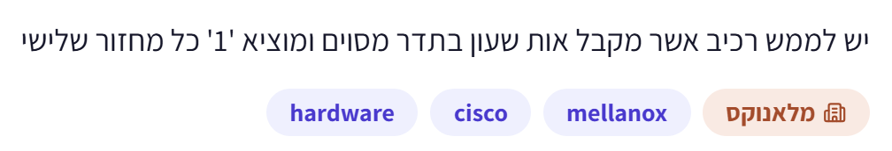
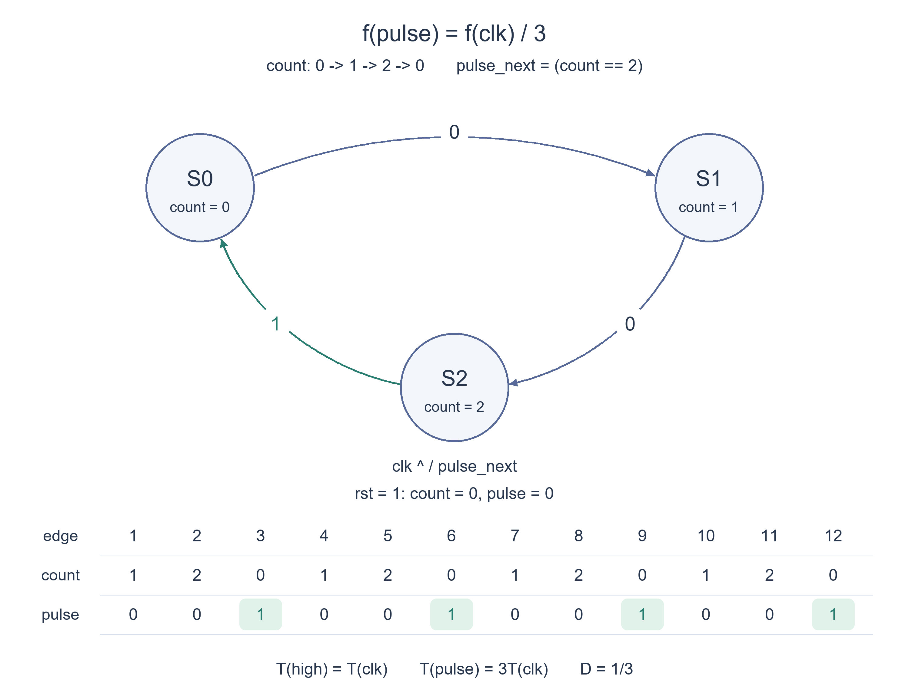

# PREP-048 — פולס של מחזור שעון אחד בכל מחזור שלישי

נקלטה ב־19 באוקטובר 2026. פתרון מוצע בסיוע AI, בביקורת מקצועית ותרגומית ממתינה. קושי אינו מכויל. חברות מדווחות לפי הצילום בלבד, ללא אימות עצמאי: Cisco, Mellanox.

## מקור ללא שינוי



יש לממש רכיב אשר מקבל אות שעון בתדר מסוים ומוציא '1' כל מחזור שלישי

## נוסח השאלה לאתר

ממשו רכיב שמקבל שעון ומוציא 1 בכל מחזור שלישי. הציגו מכונת מצבים או מונה, טבלת מעברים, תרשים תזמון ומימוש חומרה.

כדי להגדיר במדויק את התזמון, נבחר פלט רשום שאורכו מחזור שעון מלא: לאחר איפוס הפלט הוא 0, והוא עולה לאחר החזית העולה השלישית, השישית, התשיעית וכן הלאה. בשאר המחזורים הוא 0. איפוס סינכרוני פעיל בגבוה מאפס את המונה ואת הפלט ומתחיל מחדש את הספירה.

הבהרת עריכה: המקור אינו מגדיר רוחב פולס, מופע התחלתי או סוג איפוס. אלו הנחות המימוש שלנו. אין דרישה ליחס גבוה של 50%; יש להבחין בין פולס חוזר בכל שלושה מחזורים לבין מחלק שעון בעל יחס גבוה של חצי.

### שלושה רמזים

1. איזה מידע צריך לשמור כדי לדעת אם החזית הנוכחית היא הראשונה, השנייה או השלישית בקבוצה?
2. בנו מונה עם שלושת הערכים 0,1,2, החוזר ל־0 במקום להמשיך ל־3.
3. התחילו ב־count=0 ו־pulse=0. כאשר המונה הישן הוא 2, רשמו pulse=1 ו־count=0; אחרת רשמו pulse=0 והגדילו את המונה. בדקו את שלוש החזיתות הראשונות.

## הצעה לפתרון

**פתרון מוצע — מונה מודולו 3 ופולס רשום**

**קודם מגדירים מה פירוש כל מחזור שלישי.** המקור אינו קובע מופע התחלתי, רוחב פולס או איפוס. כאן נבחר שהפלט יהיה 0 באיפוס, ואז יהיה 1 במשך מחזור מלא אחרי החזיתות העולות 3,6,9 וכן הלאה מאז השחרור מאיפוס. אחרי החזיתות 1 ו־2 הוא נשאר 0. זהו פולס חוזר עם יחס גבוה של שליש, ולא גל בעל יחס גבוה של חצי.

**1. צריך לזכור כמה מחזורים עברו בקבוצה הנוכחית.** מספיקים שלושה ערכי ספירה: `0,1,2`. נשתמש במונה בן שתי סיביות. המונה מאותחל ל־0, ובכל חזית עולה ללא איפוס:

```text
0 -> 1 -> 2 -> 0 -> 1 -> 2 -> ...
```

**2. החזית השלישית היא החזרה מ־2 ל־0.** לכן אם ערך המונה הישן הוא 2, נרשום בפלט 1 ונחזיר את המונה ל־0. בשני המצבים האחרים נרשום 0 ונגדיל את המונה. את הפלט שומרים באוגר כדי שיישאר יציב לאורך המחזור:

```text
count_next = 0,       if count == 2
count_next = count+1, otherwise
pulse_next = (count == 2)
```

**3. טבלת מעברים.** כל שורה מתארת חזית אחת ללא איפוס. הפולס בטבלה הוא הפלט הרשום **אחרי** החזית, ומחושב מהמונה **לפניה**:

```text
old count   next count   pulse after edge
   0            1               0
   1            2               0
   2            0               1
```

כאשר האיפוס פעיל בחזית, המונה והפלט נעשים 0 ללא תלות במצב הקודם. בשרטוט המצבים, המספר על כל חץ הוא `pulse_next`; כל מעבר מתרחש בחזית עולה אחת. הוא מתאר את שלושת מצבי המונה ואת פלט המעבר, ולא טוען שהפלט הרשום הוא פונקציה של המונה הנוכחי בלבד: `count=0` מיד באיפוס מלווה ב־`pulse=0`, ואחרי החזית השלישית מלווה ב־`pulse=1`.

**4. דוגמת תזמון.** כל עמודה היא המצב והפלט לאחר החזית המתאימה:

```text
edge:    1  2  3  4  5  6  7  8  9 10 11 12
count:   1  2  0  1  2  0  1  2  0  1  2  0
pulse:   0  0  1  0  0  1  0  0  1  0  0  1
```

לאחר חזית 3 הפלט עולה, ולאחר חזית 4 הוא יורד. הוא שוב עולה אחרי חזית 6. לכן רוחב כל פולס הוא `T_clk`, והמרחק בין תחילות פולסים הוא `3*T_clk`.

**5. מימוש SystemVerilog.**

```systemverilog
// Pulse high after input edges 3, 6, 9, ... since the last reset edge.
module every_third_clock (
    input  logic clk,
    input  logic rst,
    output logic pulse
);
    logic [1:0] count;

    always_ff @(posedge clk) begin
        if (rst) begin
            count <= 2'd0;
            pulse <= 1'b0;
        end else if (count == 2'd2) begin
            count <= 2'd0;
            pulse <= 1'b1;
        end else begin
            count <= count + 2'd1;
            pulse <= 1'b0;
        end
    end
endmodule
```

ההשמות הלא חוסמות מבטיחות ששני העדכונים משתמשים בספירה הישנה. אין לשכוח את `pulse <= 0` בענף הרגיל: אחרת הפלט עלול להישאר גבוה לאחר הפולס הראשון. יש להפעיל את האיפוס הסינכרוני לפחות לאורך חזית עולה אחת. מצב הקידוד `11` אינו נגיש מהאיפוס התקין; הקוד אינו מבטיח התאוששות מפגיעה במצב או פעולה עם ערכי X ב־HDL.

**6. למה זה נכון?** אחרי `k` חזיתות ללא איפוס מאז האיפוס האחרון, המונה הוא `k mod 3`. לפני חזית שמספרה מתחלק ב־3 המונה הוא 2, ולכן הפלט הרשום נעשה 1 בדיוק בחזיתות אלו. בחזית הבאה המונה הישן הוא 0, ולכן הפלט חוזר ל־0. איפוס מחדש מתחיל קבוצה חדשה של שלוש חזיתות.

**7. תדר, יחס גבוה ועלות.** תדר החזרה הוא `f_clk/3`, ויחס הזמן הגבוה הוא `1/3`. הבנייה משתמשת בשני ביטים למונה וביט נוסף לפלט הרשום, עם לוגיקת מעבר/פענוח ואיפוס. אין כאן הוכחה למספר הרכיבים המזערי; אפשר לבחור קידודים ומימושים אחרים. לצריכת פעולה כל מחזור שלישי עדיף לרוב להשתמש בפולס כאות אפשור תחת השעון המקורי, ולא להפוך אותו לשעון חדש בלי תכנון שעונים מתאים.

**חשוב להבדיל:** פלט צירופי `count==2` עם אתחול המונה ל־0 יהיה גבוה אחרי החזיתות 2,5,8, ולכן אינו בעל אותו מופע כמו הפלט הרשום שבחרנו. אפשר לשנות את הקידוד או את האתחול כדי לקבל מופע אחר, אבל צריך לציין זאת. דרישה למחלק ב־3 עם יחס גבוה 50% היא בעיה אחרת; הפתרון כאן אינו מבטיח זאת.

**תשובה קצרה לראיון:** אשתמש במונה מודולו 3 שמתחיל ב־0. בכל חזית שבה ערכו הישן הוא 2 אאפס את המונה וארשום 1 בפלט; בשאר החזיתות אגדיל אותו וארשום 0. כך מתקבל פולס למחזור מלא אחרי כל חזית שלישית, בתדר חזרה של שליש מהשעון ויחס גבוה של שליש.

**אימות:** מודל פייתון הושווה לאורקל עצמאי שסופר חזיתות מאז האיפוס האחרון: כל 65,535 עקבות האיפוס באורכים 0–15, הכוללים 917,506 חזיתות, ועוד 3,000 מחזורים רציפים עם 1,000 פולסים. נבדקו מופע, איפוס באמצע והיעדר שני מחזורים גבוהים רצופים. קוד SystemVerilog צורף, אך לא קומפל או הורץ בסימולטור HDL ולא עבר סינתזה או תזמון פיזי. הפתרון מוצע בסיוע AI וממתין לסקירה מקצועית עצמאית.


### הנחות והבהרות

- הפלט רשום וגבוה למחזור קלט מלא אחרי חזיתות 3,6,9 מאז האיפוס; אחרי שתי החזיתות הראשונות הוא נמוך.

- איפוס סינכרוני פעיל בגבוה קובע count=0,pulse=0; זמן הפולס והמופע הם הבהרות שנוספו למקור.

- הדרישה היא פולס ביחס גבוה 1/3, לא מחלק ב־3 עם יחס גבוה 50%.

- מונה בן שני ביטים מופעל רק מהמצבים התקינים 0,1,2 לאחר איפוס; אין הבטחת התאוששות מערכי X או פגיעה במצב.

### נכונות ויעילות

```json
{
  "criterion": "פולס רשום חד־מחזורי בכל חזית שלישית במופע המוגדר.",
  "result": "מונה מודולו 3 בשני ביטים ואוגר פלט נוסף, עם לוגיקת מעבר ואיפוס; תדר החזרה f_clk/3 ויחס גבוה 1/3.",
  "proof": "אחרי k חזיתות המונה הוא k mod 3. המונה הישן הוא 2 בדיוק לפני כל חזית שלישית, ולכן pulse_next נדלק אז בלבד ויורד בחזית הבאה.",
  "scope": "אין הוכחת מינימום שטח או מספר אוגרים. פענוח צירופי count==2 עם אתחול 0 נותן מופע אחר. מחלק ב־3 עם יחס 50% הוא שאלה שונה."
}
```

### בדיקות שבוצעו

```json
{
  "status": "בדיקות מודל פייתון עברו; סקירה מקצועית עצמאית ממתינה.",
  "method": "השוואה לאורקל עצמאי המחזיק את מספר החזיתות מאז האיפוס ומחשב מתי הוא כפולה חיובית של 3.",
  "coverage": "65,535 עקבות איפוס באורכים 0–15, 917,506 חזיתות ועוד 3,000 מחזורים רציפים עם 1,000 פולסים.",
  "script_path": "checks/check_prep_048.py",
  "scope": "SystemVerilog צורף אך לא קומפל או הורץ בסימולטור HDL; לא בוצעו סינתזה או בדיקת תזמון פיזית."
}
```

### מקרי קצה

- האיפוס מחזיק את הפלט נמוך גם אם המונה היה 2 לפני החזית.

- לאחר שחרור מאיפוס נדרשות שלוש חזיתות ללא איפוס לפני הפולס הראשון.

- איפוס באמצע הספירה מתחיל את שלישיית החזיתות מחדש.

- הפלט אינו נשאר גבוה ואינו נדלק בשני מחזורים רצופים.

- קידוד המונה 11 אינו נגיש מהאתחול; התאוששות ממצב לא חוקי היא הרחבה נפרדת.

- תדר החזרה אינו מגדיר לבדו יחס גבוה: כאן רוחב הפולס הוא T_clk ולא 1.5*T_clk.

### טעויות נפוצות

- מונה בינארי רגיל בן שני ביטים שמגיע גם ל־3 ומייצר מחזור של ארבעה במקום שלושה.

- השוואה לערך החדש של המונה בלי לבדוק את המופע ביחס לחזית השלישית.

- השמטת השמה ל־0 בפלט בשאר המחזורים, כך שהוא נשאר גבוה.

- הצגת count==2 כפלט צירופי כאילו הוא זהה לפולס הרשום אחרי החזית השלישית.

- בלבול בין יחס גבוה של שליש לבין 50%.

- שימוש בפולס כשעון חדש בלי להתייחס לתכנון שעונים; לאות אפשור אין צורך בשעון חדש.

### תשובה קצרה לראיון

אשמור מונה מודולו 3 שמתחיל באפס. בכל חזית שבה ערכו הישן 2 אחזיר אותו לאפס וארשום פולס 1; אחרת אגדיל אותו וארשום 0. הפלט רשום למחזור מלא אחרי חזיתות 3,6,9, בתדר חזרה של שליש מהשעון ויחס גבוה של שליש.

### הרחבות ושאלת המשך

```json
{
  "question": "איך נכליל לפולס בכל מחזור N, ואיך נתאושש מקידוד מונה לא חוקי?",
  "answer_outline": "ל־N>=2 נשתמש במונה 0 עד N-1 ברוחב ceil(log2 N), ונרשום פולס כשהמונה הישן הוא N-1. לאתחול ולמופע נשמור את אותו חוזה. התאוששות יכולה לזהות ערך לא חוקי ולהחזיר לאפס עם פלט 0; צריך להגדיר מה קורה למופע לאחר תקלה. N=1 הוא מקרה נפרד שבו הפלט גבוה בכל מחזור ללא איפוס.",
  "integration_status": "שאלת המשך מוכנה בתוכן; אינה מחוברת לתהליך ההמשך החי."
}
```



## English question

Implement a component receiving a clock and outputting one every third cycle. Provide a state machine or counter, transition table, timing trace and hardware implementation.

For precise timing, choose a registered pulse lasting one complete clock period: output is zero at reset and rises after the third, sixth, ninth and subsequent third rising edges. It is zero during other cycles. Synchronous active-high reset clears count and output, restarting the phase.

Editorial clarification: the source does not specify pulse width, initial phase or reset type. These are implementation assumptions. Fifty-percent duty cycle is not required; distinguish a pulse every three cycles from a half-duty divided clock.

### Three hints

1. What information must be stored to tell whether the current edge is first, second or third in its group?
2. Build a counter using values zero, one and two, returning to zero instead of advancing to three.
3. Start count and pulse at zero. If old count is two, register pulse=1 and count=0; otherwise register pulse=0 and increment count. Trace the first three edges.

## Proposed solution

**Proposed solution — modulo-three counter and a registered pulse**

**First define every third cycle.** The source leaves initial phase, pulse width and reset unspecified. Here output is zero at reset, then high for one complete clock period after rising edges 3,6,9 and so on since reset release. It remains zero after edges one and two. This is a periodic pulse with one-third duty cycle, not a half-duty square wave.

**1. Remember progress within a three-cycle group.** Three count values, `0,1,2`, suffice. Use a two-bit counter initialized to zero. At each nonreset rising edge it follows:

```text
0 -> 1 -> 2 -> 0 -> 1 -> 2 -> ...
```

**2. The third edge is the transition from two back to zero.** If old count is two, register output one and return count to zero. Otherwise register output zero and increment count. Registering the output keeps it stable across the cycle:

```text
count_next = 0,       if count == 2
count_next = count+1, otherwise
pulse_next = (count == 2)
```

**3. Transition table.** Each row describes a nonreset edge. The pulse is the registered output **after** the edge and is computed from the count **before** it:

```text
old count   next count   pulse after edge
   0            1               0
   1            2               0
   2            0               1
```

Reset at an edge sets count and output to zero, regardless of old state. In the state diagram each arrow label is `pulse_next`; one rising edge triggers each transition. It shows three counter states with transition output, not a claim that the registered output is solely a function of present count: `count=0` accompanies `pulse=0` immediately at reset, but `pulse=1` after edge three.

**4. Timing example.** Each column shows count and registered output after its edge:

```text
edge:    1  2  3  4  5  6  7  8  9 10 11 12
count:   1  2  0  1  2  0  1  2  0  1  2  0
pulse:   0  0  1  0  0  1  0  0  1  0  0  1
```

Output rises after edge three and falls after edge four, then rises again after edge six. Each pulse is `T_clk` wide; pulse starts are `3*T_clk` apart.

**5. SystemVerilog implementation.**

```systemverilog
// Pulse high after input edges 3, 6, 9, ... since the last reset edge.
module every_third_clock (
    input  logic clk,
    input  logic rst,
    output logic pulse
);
    logic [1:0] count;

    always_ff @(posedge clk) begin
        if (rst) begin
            count <= 2'd0;
            pulse <= 1'b0;
        end else if (count == 2'd2) begin
            count <= 2'd0;
            pulse <= 1'b1;
        end else begin
            count <= count + 2'd1;
            pulse <= 1'b0;
        end
    end
endmodule
```

Nonblocking assignments make both updates depend on old count. Do not omit `pulse <= 0` in the ordinary branch, or output can stay high after its first pulse. Assert synchronous reset across at least one rising edge. Encoding `11` is unreachable after proper reset; this code does not promise recovery from state corruption or operation with HDL X values.

**6. Correctness.** After `k` nonreset edges since the latest reset, count equals `k mod 3`. Before every edge numbered a positive multiple of three, old count is two, so registered output becomes one exactly at those edges. At the following edge old count is zero, forcing output back low. A new reset restarts the three-edge grouping.

**7. Frequency, duty cycle and cost.** Repetition frequency is `f_clk/3` and high-time duty cycle is `1/3`. This construction uses two counter bits and one registered-output bit, with transition/decode and reset logic. It is not a minimum-component proof; other encodings and architectures are possible. When enabling work every third cycle, it is usually preferable to use this pulse as a clock enable under the original clock rather than create a new clock without appropriate clock design.

**Distinguish timing contracts:** combinational `count==2` with count initialized to zero is high after edges 2,5,8, so its phase differs from the chosen registered output. Encoding or initialization can be changed for a different phase, but must be stated. Divide-by-three with 50% duty cycle is a different requirement and is not supplied by this solution.

**Interview answer:** Use a modulo-three counter starting at zero. At an edge with old count two, reset the counter and register output one; at other edges increment it and register zero. This produces a full-period pulse after every third edge, with one-third repetition frequency and one-third duty cycle.

**Verification:** A Python model matched an independent elapsed-edge-since-reset oracle for all 65,535 reset traces of lengths zero through fifteen, covering 917,506 sampled edges, plus 3,000 continuous cycles with 1,000 pulses. Checks cover phase, midstream reset and absence of adjacent high cycles. SystemVerilog is supplied but has not been compiled, HDL-simulated, synthesized or physically timed. This is an AI-assisted proposal with independent expert review pending.


### Assumptions

- Registered output is high for one complete input period after edges 3,6,9 since reset, and low after the first two edges.

- Synchronous active-high reset sets count=0,pulse=0; pulse width and phase clarify the terse source.

- Requirement is a one-third-duty pulse, not a fifty-percent-duty divide-by-three clock.

- A two-bit counter operates in legal states zero, one and two after reset; no X-state or corruption-recovery promise is made.

### Correctness and efficiency

```json
{
  "criterion": "A registered one-cycle pulse on each third edge at the specified phase.",
  "result": "Two-bit modulo-three counter and a separate output register, with transition/reset logic; repetition f_clk/3 and duty 1/3.",
  "proof": "After k edges count is k mod 3. Old count equals two precisely before each third edge, so pulse_next asserts only then and falls at the next edge.",
  "scope": "No minimum-area or minimum-register proof. Combinational count==2 with zero initialization has a different phase. Fifty-percent-duty divide-by-three is a different problem."
}
```

### Verification

```json
{
  "status": "Python-model checks passed; independent expert review pending.",
  "method": "Comparison to an independent oracle tracking edges since reset and checking positive multiples of three.",
  "coverage": "65,535 reset traces of lengths zero through fifteen, 917,506 sampled edges, plus 3,000 continuous cycles with 1,000 pulses.",
  "script_path": "checks/check_prep_048.py",
  "scope": "SystemVerilog supplied but not compiled or HDL-simulated; no synthesis or physical timing."
}
```

### Edge cases

- Reset forces output low even when old count is two.

- Three nonreset edges are needed after reset release before the first pulse.

- Midstream reset restarts the three-edge group.

- Output never stays high or asserts during adjacent cycles.

- Counter encoding 11 is unreachable from initialization; illegal-state recovery is a separate extension.

- Repetition frequency alone does not specify duty: pulse width here is T_clk rather than 1.5*T_clk.

### Common mistakes

- Using an ordinary two-bit binary counter including three, giving period four instead of three.

- Comparing the updated count without checking phase relative to edge three.

- Omitting output-zero assignment on other cycles, leaving output high.

- Presenting combinational count==2 as identical to the registered pulse after edge three.

- Confusing one-third duty with fifty percent.

- Using the pulse as a new clock without clock-design analysis; a clock enable needs no new clock.

### Interview answer

Use a modulo-three counter starting at zero. At an edge with old count two, return it to zero and register pulse one; otherwise increment and register zero. Output is a full-period pulse after edges 3,6,9, with one-third repetition frequency and one-third duty.

### Extensions and follow-up

```json
{
  "question": "How would you generalize to every Nth cycle and recover from illegal counter encodings?",
  "answer_outline": "For N>=2, count zero through N-1 using ceil(log2 N) bits and register a pulse when old count is N-1, preserving reset and phase semantics. Recovery can detect an illegal value and return to zero with pulse low; define phase after the fault. N=1 is separate, with output high every nonreset cycle.",
  "integration_status": "Follow-up prepared in content; not connected to the live follow-up workflow."
}
```


## קוד ובדיקות

[prep_048_every_third_clock.py](../solutions/prep_048_every_third_clock.py) · [prep_048_every_third_clock.sv](../solutions/prep_048_every_third_clock.sv) · [check_prep_048.py](../checks/check_prep_048.py) · [prep-048-verification.json](../checks/prep-048-verification.json)

צילום המקור פנימי ואינו מדיה ללומדים. שאלת ההמשך הוכנה אך לא חוברה לתור החי. אין אישור מקצועי, כיול קושי או זכאות לראיות שליטה ולניקוד תחרותי. בדיקות Python אינן קומפילציית HDL, בדיקת חומרה או לחיצות בחשבון חי.
