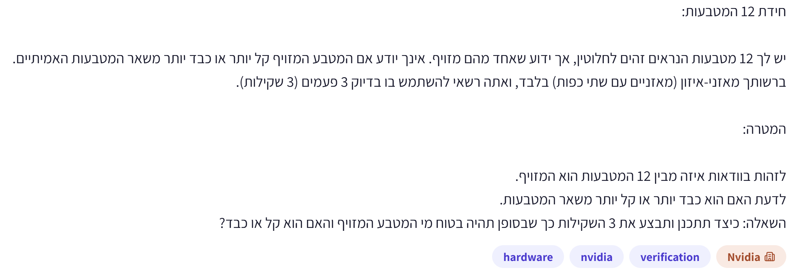
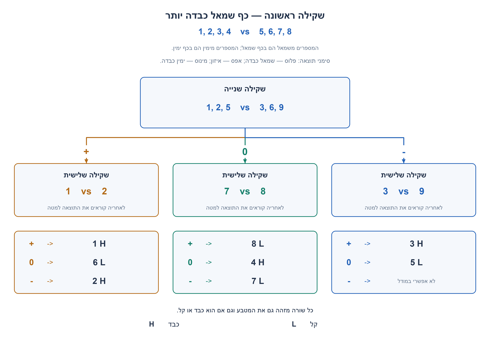
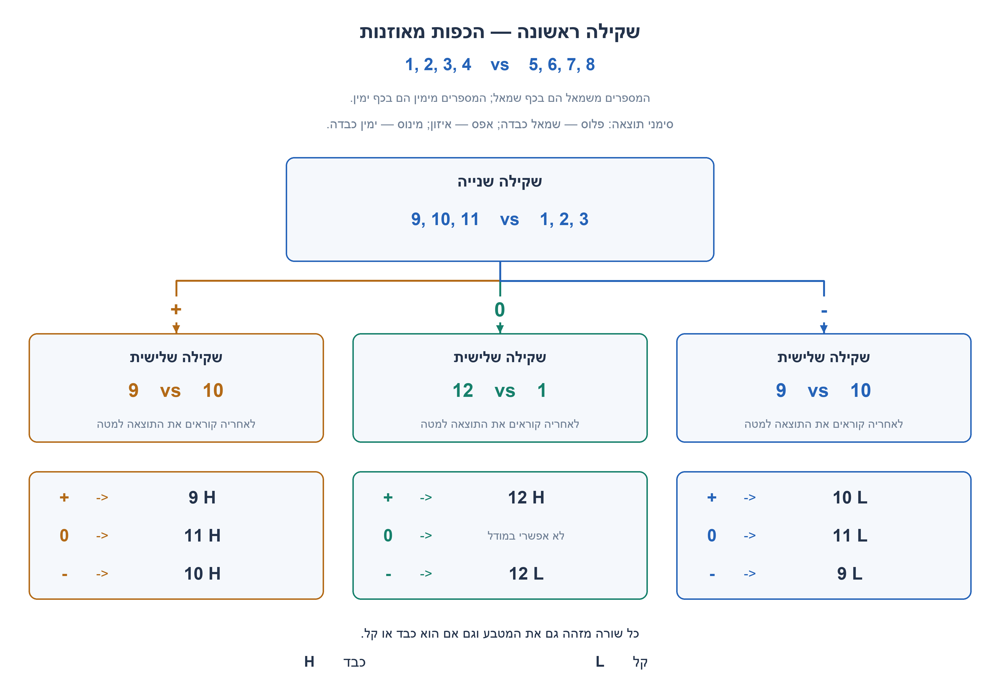
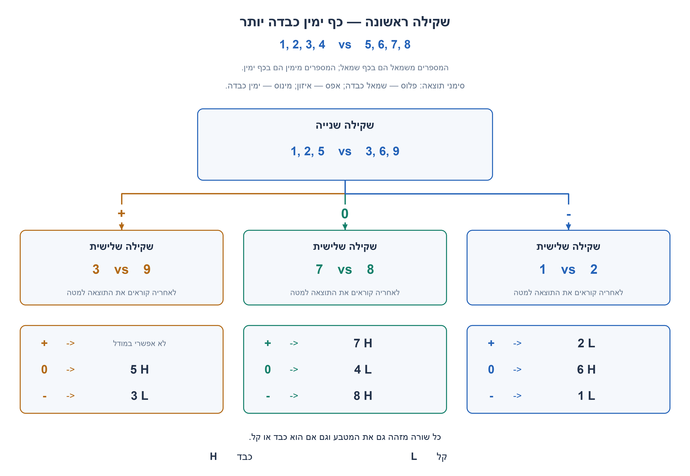
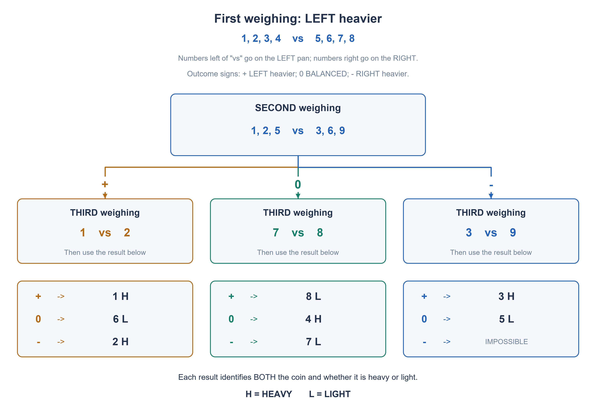
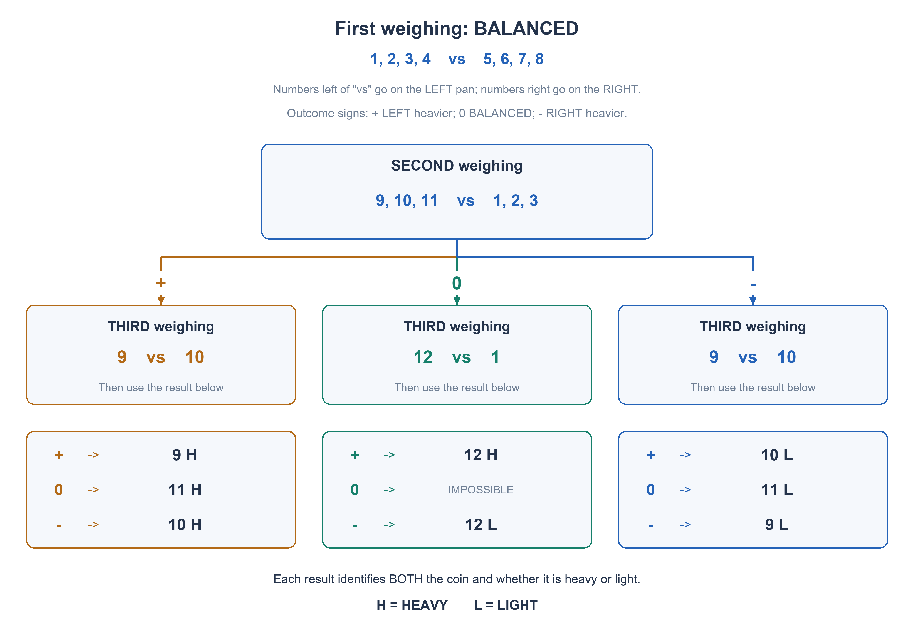
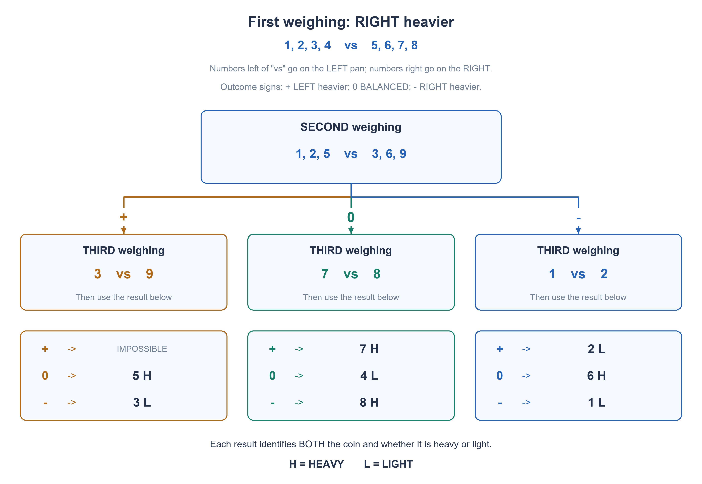

# PREP-049 — 12 מטבעות — זיהוי המזויף וכיוון הסטייה בשלוש שקילות

נקלטה ב־20 באוקטובר 2026. פתרון מוצע בסיוע AI. ביקורת מקצועית, בדיקת תרגום אנושית ובדיקת זכויות שימוש ממתינות. קושי אינו מכויל. דיווח NVIDIA מהצילום בלבד, ללא אימות עצמאי.

## מקור ללא שינוי



חידת 12 המטבעות:

יש לך 12 מטבעות הנראים זהים לחלוטין, אך ידוע שאחד מהם מזויף. אינך יודע אם המטבע המזויף קל יותר או כבד יותר משאר המטבעות האמיתיים.
ברשותך מאזני-איזון (מאוזניים עם שתי כפות) בלבד, ואתה רשאי להשתמש בו בדיוק 3 פעמים (3 שקילות).

המטרה:
לזהות בוודאות איזה מבין 12 המטבעות הוא המזויף.
לדעת האם הוא כבד יותר או קל יותר משאר המטבעות.
השאלה: כיצד תתכנן ותבצע את 3 השקילות כך שבסופן תהיה בטוח מי המטבע המזויף והאם הוא קל או כבד?

## נוסח השאלה לאתר

יש 12 מטבעות זהים במראם. בדיוק אחד שונה במשקלו, אך אינכם יודעים אם הוא קל או כבד יותר. 11 המטבעות האמיתיים שווים במשקלם.

ברשותכם רק מאזני איזון בעלי שתי כפות, ללא משקולות נוספות וללא מטבע שידוע מראש שהוא אמיתי. השתמשו בדיוק בשלוש שקילות כדי לזהות בוודאות גם את המטבע המזויף וגם אם הוא קל או כבד.

תארו מה מניחים בכל כף בכל שקילה וכיצד פועלים עבור כל אחת משלוש התוצאות: כף שמאל כבדה יותר, איזון, או כף ימין כבדה יותר. מותר לבחור את השקילה הבאה לפי תוצאות הקודמות. הסבירו מדוע התוכנית מכסה את כל האפשרויות ומדוע שתי שקילות אינן מספיקות.

הבהרת מודל: המאזניים מדויקים, המשקלים קבועים, והפרש המשקל של המזויף אינו אפס. אין ידיעה מוקדמת על גודל ההפרש. אפשר לסמן את המטבעות במספרים 1 עד 12; המספרים אינם מגלים את משקלם. התכנון אדפטיבי ומבצע שלוש שקילות בכל מסלול.

### שלושה רמזים

1. ספרו אפשרויות של מטבע וכיוון סטייה, ולא רק מטבעות. לכל שקילה יש שלוש תוצאות. כיצד תוצאת איזון יכולה לתת לכם מטבעות שידוע שהם אמיתיים?
2. התחילו בארבעה מטבעות מול ארבעה אחרים. איזון משאיר את ארבעת המטבעות שבחוץ חשודים; חוסר איזון משאיר חשדות לכבד בצד הכבד ולקל בצד הקל. בכל מקרה יש כעת מטבעות אמיתיים להשוואה.
3. אחרי חוסר איזון אין לחלק את שמונת החשודים כאילו כולם כבדים. ערבבו מטבעות משתי הכפות עם מטבע אמיתי בשקילה השנייה, כך שכל תוצאה תשאיר לכל היותר שלוש אפשרויות של מטבע וכיוון.

## הצעה לפתרון

**פתרון מוצע — בונים עץ החלטה שמזהה מטבע וגם כיוון.**

מספרו את המטבעות 1 עד 12. בכל התיאורים, קבוצת המספרים הראשונה נמצאת בכף שמאל והשנייה בכף ימין. ״שמאל כבדה״ פירושו שכף שמאל יורדת; ״ימין כבדה״ פירושו שכף ימין יורדת. איזון משמעו משקל כולל שווה.

### למה צריך שלוש שקילות?

יש 24 אפשרויות: כל אחד מ־12 המטבעות יכול להיות כבד או קל. לשתי שקילות יש לכל היותר 9 רצפי תוצאות, ולכן אינן יכולות להבחין בין כל 24 האפשרויות. לשלוש יש לכל היותר 27 רצפים. המספר 27 לבדו אינו מוכיח שיש פתרון מעשי; התכנון המפורש שלהלן מוכיח ששלוש מספיקות, ולכן שלוש הן המינימום במקרה הגרוע.

### שקילה ראשונה — ארבעה מול ארבעה

```text
LEFT: 1, 2, 3, 4
RIGHT: 5, 6, 7, 8
OUT: 9, 10, 11, 12
```

בכל מצב יש עכשיו מטבעות אמיתיים: אם יש איזון, כל שמונת הנשקלים אמיתיים; אם אין איזון, כל ארבעת המטבעות שנשארו בחוץ אמיתיים. לא הנחנו מראש מטבע אמיתי נוסף.

### א. השקילה הראשונה מאוזנת

המזויף הוא אחד מ־9,10,11,12. בשקילה השנייה שוקלים:

```text
LEFT: 9, 10, 11
RIGHT: 1, 2, 3
```

אם שמאל כבדה, המזויף הוא אחד מ־9,10,11 והוא כבד. אם ימין כבדה, הוא אחד מאותם שלושה והוא קל. אם יש איזון, המזויף הוא 12, אבל עדיין צריך לברר אם הוא קל או כבד.

| תוצאת שקילה 2 | שקילה 3: שמאל מול ימין | אם בשקילה 3 שמאל כבדה | אם שקילה 3 מאוזנת | אם בשקילה 3 ימין כבדה |
| --- | --- | --- | --- | --- |
| שמאל כבדה | 9 vs 10 | מטבע 9 כבד | מטבע 11 כבד | מטבע 10 כבד |
| איזון | 12 vs 1 | מטבע 12 כבד | לא אפשרי לפי ההנחות | מטבע 12 קל |
| ימין כבדה | 9 vs 10 | מטבע 10 קל | מטבע 11 קל | מטבע 9 קל |

למשל, כאשר 9,10,11 קלים, שקילת 9 מול 10 שמתאזנת מזהה את 11 כקל. אם 9 מול 10 נוטה שמאלה, דווקא 10 הוא הקל: הצד עם המטבע הקל עולה.

### ב. בשקילה הראשונה כף שמאל כבדה

החשודים הם 1,2,3,4 ככבדים או 5,6,7,8 כקלים. מטבעות 9 עד 12 אמיתיים. בשקילה השנייה שוקלים:

```text
LEFT: 1, 2, 5
RIGHT: 3, 6, 9
```

למה לערבב צדדים? כל חשד גורם לתוצאה לפי שני דברים יחד: האם המטבע כבד או קל ובאיזו כף הוא נמצא. מטבע כבד בשמאל או קל בימין גורם לשמאל להיות כבדה. מטבע שלא נשקל אינו מפר את האיזון.

- אם שמאל כבדה: נשארו 1 כבד, 2 כבד או 6 קל.
- אם יש איזון: נשארו 4 כבד, 7 קל או 8 קל.
- אם ימין כבדה: נשארו 3 כבד או 5 קל.

| תוצאת שקילה 2 | שקילה 3: שמאל מול ימין | אם בשקילה 3 שמאל כבדה | אם שקילה 3 מאוזנת | אם בשקילה 3 ימין כבדה |
| --- | --- | --- | --- | --- |
| שמאל כבדה | 1 vs 2 | מטבע 1 כבד | מטבע 6 קל | מטבע 2 כבד |
| איזון | 7 vs 8 | מטבע 8 קל | מטבע 4 כבד | מטבע 7 קל |
| ימין כבדה | 3 vs 9 | מטבע 3 כבד | מטבע 5 קל | לא אפשרי לפי ההנחות |

דוגמה מלאה: מטבע 6 קל. השקילה הראשונה נוטה שמאלה כי 6 נמצא בכף ימין. גם השנייה נוטה שמאלה כי שוב 6 בכף ימין. בשקילה השלישית 1 מול 2 יש איזון. התוצאה היא 6 קל, ולא ״לא ידוע״.

### ג. בשקילה הראשונה כף ימין כבדה

כעת החשודים הם 1,2,3,4 כקלים או 5,6,7,8 ככבדים. שוב 9 עד 12 אמיתיים. השתמשו באותה שקילה שנייה: 1,2,5 בשמאל מול 3,6,9 בימין. חשוב להשתמש בטבלה של המקרה הזה; לא להעתיק את אבחנות הכבד והקל מהמקרה הקודם.

- אם שמאל כבדה: נשארו 3 קל או 5 כבד.
- אם יש איזון: נשארו 4 קל, 7 כבד או 8 כבד.
- אם ימין כבדה: נשארו 1 קל, 2 קל או 6 כבד.

| תוצאת שקילה 2 | שקילה 3: שמאל מול ימין | אם בשקילה 3 שמאל כבדה | אם שקילה 3 מאוזנת | אם בשקילה 3 ימין כבדה |
| --- | --- | --- | --- | --- |
| שמאל כבדה | 3 vs 9 | לא אפשרי לפי ההנחות | מטבע 5 כבד | מטבע 3 קל |
| איזון | 7 vs 8 | מטבע 7 כבד | מטבע 4 קל | מטבע 8 כבד |
| ימין כבדה | 1 vs 2 | מטבע 2 קל | מטבע 6 כבד | מטבע 1 קל |

### למה כל התוכנית עובדת?

השקילה הראשונה מחלקת את 24 ההשערות לשלוש קבוצות של שמונה. בכל ענף השקילה השנייה משאירה קבוצות בגודל 3,3,2 בסדר המתאים. ההשוואה השלישית שבטבלאות מבחינה בין כל ההשערות בקבוצה שלה. כך לכל אחת מ־24 האפשרויות יש רצף תוצאות ייחודי ואבחנה אחת של מטבע וכיוון, וכל מסלול משתמש בשלוש שקילות בדיוק.

שלושה מתוך 27 הרצפים אינם אפשריים במודל, למשל שלוש שקילות מאוזנות לאורך התוכנית. במקרה כזה אין להמציא אבחנה: יש לבדוק את מספרי המטבעות, קריאת המאזניים וההנחה שיש מזויף יחיד. הטבלאות והקוד מסמנים במפורש תוצאה בלתי אפשרית.

שלושת התרשימים המצורפים תואמים לשלוש תוצאות השקילה הראשונה. בתרשימים פלוס פירושו שמאל כבדה, אפס הוא איזון, ומינוס הוא ימין כבדה; H מסמן כבד ו־L קל. הסימן אינו משקל מספרי. קובץ הפייתון מקבל רק תוצאות מאזניים דרך פונקציה ומבצע בדיוק שלוש קריאות; אין צורך בקוד כדי לפתור את החידה. פתרונות שקילה אחרים תקפים מתקבלים אם הם מכסים את כל 24 האפשרויות באותם אילוצים.







### assumptions

```json
[
  "בדיוק מטבע אחד מתוך 12 שונה במשקלו; כל 11 האחרים שווים.",
  "כיוון וגודל הסטייה אינם ידועים; המשקלים קבועים והמאזניים מדויקים.",
  "אין משקולות או מטבע חיצוני שידוע מראש כאמיתי. כל השוואה משתמשת במספר מטבעות שווה בכל כף.",
  "מותר לבחור שקילה לפי תוצאות קודמות. התוכנית משתמשת בשלוש שקילות בדיוק, כולל בירור קל או כבד."
]
```

### optimality

```json
{
  "criterion": "מינימום שקילות במקרה הגרוע לזיהוי המטבע והכיוון בוודאות.",
  "result": "שלוש שקילות מספיקות ונחוצות; התוכנית משתמשת בשלוש בכל 24 המצבים.",
  "proof": "יש 24 השערות. שתי שקילות מבחינות לכל היותר בין 9 רצפים, ולכן אינן מספיקות. עץ ההחלטה המפורש מפריד את כל 24 המצבים בשלוש שקילות.",
  "scope": "זהו מינימום במודל מאזניים מדויק ויחידת עלות של שקילה. ספירת 27 רצפים אינה לבדה הוכחת קיום; אין טענה למינימום מספר ההנחות על הכפות או לכלליות לכל מספר מטבעות."
}
```

### verification

עברו 72 הדמיות משקל מדויקות: כל 24 מצבי המטבע והכיוון, כל אחד בשלושה גדלי סטייה חיוביים או שליליים באמצעות שברים מדויקים. בכל מקרה בוצעו שלוש שקילות וזוהו המטבע והכיוון. אורקל עצמאי סינן עולמות אפשריים בכל 27 רצפי התוצאות: 24 עלים יחידאיים ושלושה בלתי אפשריים שנדחו. נבדקו מספר מטבעות שווה בכפות, היעדר שימוש כפול במטבע והסתמכות על מטבע אמיתי רק לאחר שהוכח כאמיתי. זו בדיקת Python, לא ניסוי במאזניים פיזיים או אישור מומחה.

### edge_cases

```json
[
  "מטבע 12 אינו נשקל בשתי השקילות הראשונות בענף המאוזן; השלישית משווה אותו למטבע 1 האמיתי וקובעת כיוון.",
  "איזון בשקילה השלישית יכול לזהות חשוד שלא נמצא בכפות, למשל 6 קל אחרי שתי תוצאות שמאל כבדה.",
  "מטבע קל בימין גורם לשמאל להיות כבדה, ולא להפך.",
  "שלוש תוצאות מאוזנות לאורך התוכנית סותרות את ההנחה שיש בדיוק מזויף אחד.",
  "מטבע ששימש כייחוס הוכח אמיתי מתוצאת השקילה הראשונה, לא מהנחה נוספת."
]
```

### common_mistakes

```json
[
  "לספור 12 אפשרויות בלבד ולהתעלם מכבד או קל.",
  "להכריז שהמזויף נמצא רק בכף הכבדה; ייתכן מטבע קל בכף האחרת.",
  "לחלק 6 מול 6 ולהשאיר 12 השערות בכל תוצאת חוסר איזון, יותר מתשע ששתי השקילות הבאות יכולות להפריד.",
  "להסתפק בזיהוי 12 אחרי שתי שקילות מאוזנות בלי לברר כיוון.",
  "להשתמש במטבע אמיתי שלא הוכח כאמיתי או להשמיט ענף של השקילה הראשונה.",
  "להסיק ששלוש שקילות מספיקות רק מכך ש־27 גדול מ־24, בלי להציג תכנון תקף."
]
```

### interview_answer

יש 24 אפשרויות ולכן שתי שקילות אינן מספיקות. אתחיל ב־1,2,3,4 מול 5,6,7,8. באיזון החשודים הם 9 עד 12, ואשקול 9,10,11 מול שלושה אמיתיים. בחוסר איזון החשודים הם כבדים בצד הכבד וקלים בצד הקל; אשקול 1,2,5 מול 3,6,9. כל תוצאת שקילה שנייה משאירה לכל היותר שלוש השערות, וההשוואה השלישית שבטבלה מבדילה ביניהן. העץ מכסה את כל 24 המצבים ומזהה גם את הכיוון.

### solution_extensions

```json
{
  "question": "האם ספירת 26 אפשרויות מוכיחה שגם 13 מטבעות ניתנים לפתרון בשלוש שקילות, בלי מטבע אמיתי נוסף?",
  "direction": "לא. עבור שקילה ראשונה של k מול k, חוסר איזון משאיר 2k השערות ולכן נחוץ k לכל היותר 4. איזון משאיר 2(13-2k) השערות ולכן נחוץ k לפחות 5. הדרישות סותרות זו את זו. זה מדגים שחסם המידע לבדו אינו מבטיח תוכנית פיזית. הניתוח מתייחס להשוואות עם מספר מטבעות שווה בכל כף וללא מטבע אמיתי חיצוני.",
  "status": "שאלת המשך מוכנה בתוכן; אינה מחוברת לתור ההמשך החי."
}
```

## English question

Twelve coins look identical. Exactly one has a different weight, but you do not know whether it is lighter or heavier. The eleven genuine coins all have the same weight.

You have only a two-pan balance, with no extra weights and no coin initially known to be genuine. Use exactly three weighings to determine both the counterfeit coin and whether it is lighter or heavier.

State what goes on each pan and what to do for all three outcomes: left pan heavier, balanced, or right pan heavier. Later weighings may depend on earlier results. Explain why every possibility is covered and why two weighings cannot suffice.

Model clarification: the balance is exact, weights stay fixed, and the counterfeit weight difference is nonzero but otherwise unknown. You may label coins 1 through 12; labels give no weight information. The strategy is adaptive and performs three weighings on every path.

### Three hints

1. Count coin-and-direction possibilities, not just coins. Each weighing has three outcomes. How can a balanced result establish genuine reference coins?
2. Begin with four coins against four others. Balance leaves the four unweighed coins suspect; imbalance leaves heavy possibilities on the heavy side and light possibilities on the light side. Either way, genuine reference coins are now available.
3. After an imbalance, do not split eight suspects as though all were heavy. Mix coins from both pans with a genuine reference in weighing two so every result leaves at most three coin-and-direction hypotheses.

## Proposed solution

**Proposed solution — build a decision tree for coin AND direction.**

Label the coins 1 through 12. In every comparison, the first group goes on the LEFT pan and the second on the RIGHT. LEFT heavier means the left pan goes down; RIGHT heavier means the right pan goes down. Balance means equal total weights.

### Why three weighings?

There are 24 possibilities: each of twelve coins could be heavy or light. Two weighings have at most nine outcome sequences, so cannot distinguish all 24. Three have at most 27. Counting 27 outcomes alone does not prove a feasible plan; the construction below proves that three suffice, establishing a worst-case minimum of three.

### First weighing: four against four

```text
LEFT: 1, 2, 3, 4
RIGHT: 5, 6, 7, 8
OUT: 9, 10, 11, 12
```

Genuine references now exist in every case: on balance, all eight weighed coins are genuine; on imbalance, all four unweighed coins are genuine. No extra reference coin was assumed initially.

### A. The first weighing balances

The counterfeit is one of 9,10,11,12. For weighing two use:

```text
LEFT: 9, 10, 11
RIGHT: 1, 2, 3
```

LEFT heavier means one of 9,10,11 is heavy. RIGHT heavier means one of them is light. Balance identifies coin 12, but its direction still needs the third comparison.

| Weighing 2 result | Weighing 3: LEFT vs RIGHT | Third: LEFT heavier | Third: BALANCED | Third: RIGHT heavier |
| --- | --- | --- | --- | --- |
| LEFT heavier | 9 vs 10 | Coin 9 heavy | Coin 11 heavy | Coin 10 heavy |
| BALANCED | 12 vs 1 | Coin 12 heavy | Impossible under the assumptions | Coin 12 light |
| RIGHT heavier | 9 vs 10 | Coin 10 light | Coin 11 light | Coin 9 light |

For example, among three light suspects, balancing 9 against 10 identifies 11 as light. If 9 against 10 is LEFT heavier, coin 10 is the light one: a pan containing the light coin goes up.

### B. The first weighing is LEFT heavier

The candidates are heavy 1,2,3,4 or light 5,6,7,8. Coins 9 through 12 are genuine. Use this second weighing:

```text
LEFT: 1, 2, 5
RIGHT: 3, 6, 9
```

Why mix the sides? Each hypothesis predicts an outcome from both the coin's direction and its current pan. A heavy coin on the left or a light coin on the right makes the LEFT heavier. An unweighed counterfeit leaves the two pans balanced.

- LEFT heavier leaves heavy 1, heavy 2 or light 6.
- BALANCE leaves heavy 4, light 7 or light 8.
- RIGHT heavier leaves heavy 3 or light 5.

| Weighing 2 result | Weighing 3: LEFT vs RIGHT | Third: LEFT heavier | Third: BALANCED | Third: RIGHT heavier |
| --- | --- | --- | --- | --- |
| LEFT heavier | 1 vs 2 | Coin 1 heavy | Coin 6 light | Coin 2 heavy |
| BALANCED | 7 vs 8 | Coin 8 light | Coin 4 heavy | Coin 7 light |
| RIGHT heavier | 3 vs 9 | Coin 3 heavy | Coin 5 light | Impossible under the assumptions |

Complete example: coin 6 is light. The first weighing is LEFT heavier because 6 is on the right. The second is also LEFT heavier because 6 is again on the right. The third compares genuine coins 1 and 2 and balances. The diagnosis is light 6, not an inconclusive result.

### C. The first weighing is RIGHT heavier

The candidates are light 1,2,3,4 or heavy 5,6,7,8. Again 9 through 12 are genuine. Use the same second weighing: 1,2,5 on the left against 3,6,9 on the right. Use THIS branch's diagnoses, rather than copying heavy/light conclusions from the previous branch.

- LEFT heavier leaves light 3 or heavy 5.
- BALANCE leaves light 4, heavy 7 or heavy 8.
- RIGHT heavier leaves light 1, light 2 or heavy 6.

| Weighing 2 result | Weighing 3: LEFT vs RIGHT | Third: LEFT heavier | Third: BALANCED | Third: RIGHT heavier |
| --- | --- | --- | --- | --- |
| LEFT heavier | 3 vs 9 | Impossible under the assumptions | Coin 5 heavy | Coin 3 light |
| BALANCED | 7 vs 8 | Coin 7 heavy | Coin 4 light | Coin 8 heavy |
| RIGHT heavier | 1 vs 2 | Coin 2 light | Coin 6 heavy | Coin 1 light |

### Why does the whole plan work?

The first weighing partitions the 24 hypotheses into three groups of eight. Within each group, weighing two produces groups of sizes 3,3,2 in the appropriate order. The third comparisons distinguish every hypothesis in their groups. Thus every one of the 24 possibilities has a unique observation sequence and a unique coin-and-direction diagnosis. Every path uses exactly three weighings.

Three of the 27 possible observation sequences are impossible under the model, such as all three weighings balancing along this plan. Do not invent a diagnosis for those sequences: recheck coin labels, balance readings and the single-counterfeit assumption. Both the tables and code explicitly flag impossible observations.

The three attached diagrams correspond to the three possible FIRST results. In each diagram + means LEFT heavier, 0 means balance and - means RIGHT heavier; H means heavy and L means light. These signs are outcome labels, not numeric weights. The Python implementation obtains only balance outcomes through a callback and makes exactly three calls. Coding is not required to solve the puzzle. Other weighing strategies are valid if they cover all 24 possibilities under the same constraints.







### assumptions

```json
[
  "Exactly one of twelve coins has a different weight; the other eleven have equal weight.",
  "Direction and magnitude are unknown; weights are fixed and the balance is exact.",
  "No external weights or initially known genuine coin are available. Each comparison uses equal numbers of coins per pan.",
  "Weighings may depend on earlier results. The plan uses exactly three, determining light versus heavy as well as identity."
]
```

### optimality

```json
{
  "criterion": "Minimum worst-case weighings to determine both identity and direction with certainty.",
  "result": "Three weighings are necessary and sufficient; the plan uses three in all 24 states.",
  "proof": "There are 24 hypotheses. Two weighings distinguish at most nine outcome sequences, so cannot suffice. The explicit tree distinguishes all 24 within three weighings.",
  "scope": "The minimum concerns an exact balance with one weighing as the cost unit. Counting 27 sequences alone is not a construction proof. No claim minimizes coin placements or generalizes to arbitrary coin counts."
}
```

### verification

72 exact-weight simulations passed: all 24 coin-and-direction states, each at three positive or negative deviation magnitudes using exact rational arithmetic. Every case used three weighings and identified both coin and direction. An independent possible-world oracle filtered all 27 outcome sequences: 24 singleton leaves and three rejected impossible sequences. Checks cover equal pan counts, no coin appearing twice, and genuine references only after their status is established. This is Python verification, not a physical balance experiment or expert approval.

### edge_cases

```json
[
  "Coin 12 remains unweighed in the first two comparisons of the balanced branch; weighing three against genuine coin 1 determines its direction.",
  "A balanced third result can identify an unweighed suspect, such as light 6 after two LEFT-heavier results.",
  "A light coin on the right makes the LEFT heavier.",
  "Three balanced results along this plan contradict exactly one counterfeit.",
  "Every reference coin is established genuine by the first result, not assumed from outside information."
]
```

### common_mistakes

```json
[
  "Counting twelve possibilities while ignoring heavy versus light.",
  "Assuming the counterfeit must be on the heavier pan; it may be light on the other.",
  "Starting six against six: either imbalance leaves twelve hypotheses, exceeding the remaining two-weighing capacity of nine.",
  "Identifying coin 12 after two balances without determining its direction.",
  "Using an unproved genuine reference or omitting a first-result branch.",
  "Claiming sufficiency just because 27 exceeds 24 without a feasible weighing plan."
]
```

### interview_answer

There are 24 possibilities, so two weighings cannot suffice. Start 1,2,3,4 against 5,6,7,8. On balance the suspects are 9 through 12; weigh 9,10,11 against three genuine coins. On imbalance the candidates are heavy coins on the heavy side or light coins on the light side; weigh 1,2,5 against 3,6,9. Every second outcome leaves at most three hypotheses, distinguished by the third comparisons in the table. The tree covers all 24 states and determines direction too.

### solution_extensions

```json
{
  "question": "Does counting 26 states prove that thirteen coins can also be solved in three weighings without an extra genuine coin?",
  "direction": "No. If the first weighing uses k coins per pan, imbalance leaves 2k hypotheses, requiring k at most four. Balance leaves 2(13-2k) hypotheses, requiring k at least five. These constraints conflict. The information bound alone does not guarantee a feasible physical plan. This argument concerns equal-count pan comparisons without an external genuine coin.",
  "status": "Follow-up prepared in content; not connected to the live follow-up queue."
}
```

## קוד ובדיקות

[Python](../solutions/prep_049_twelve_coins.py) · [בדיקה ממצה](../checks/check_prep_049.py) · [תוצאות](../checks/prep-049-verification.json) · [מקור יצירת התרשימים](../solutions/draw_prep_049.py)

צילום המקור נשמר פנימית ואינו מוצג ללומדים. תרשימים וקוד נחשפים לאחר חשיפת הפתרון. שאלת ההמשך מוכנה אך אינה מחוברת לתור החי. השאלה אינה כשירה לראיות שליטה או לניקוד תחרותי כל עוד הביקורת ממתינה. לא נכתבו רשומות פעילות של הראל בעקבות השיחה.
